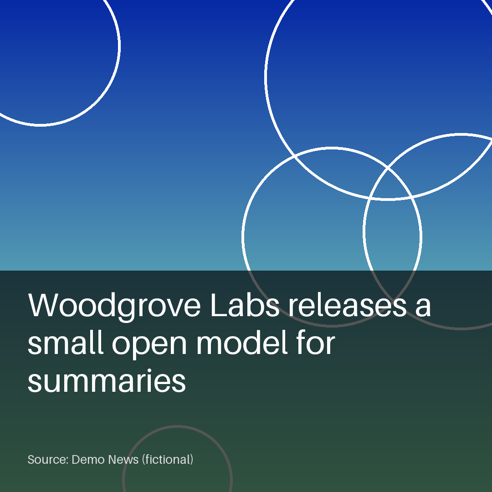
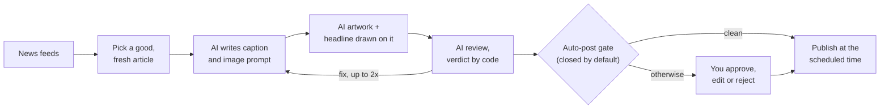
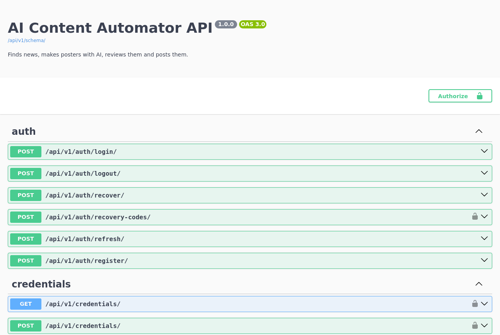

# AI Content Automator

[](https://github.com/Shri0777/AI-Content-Automater/actions/workflows/ci.yml)


**A backend that runs a social media account on a schedule.** It finds
real news on the topics you pick, writes a caption and a poster with the AI
models *you* choose, has an AI reviewer check it (with the final verdict
decided by code), corrects it, and publishes through Buffer, X, LinkedIn or
Facebook at the times you set: automatically, or after your approval.



*A poster made by the demo (fictional article, generated artwork, headline
drawn by the app so it is always spelled right).*



## What it does

- **Bring your own AI:** Claude, or any OpenAI-compatible service (OpenAI,
  OpenRouter, Groq, Gemini, Ollama ...) for text; OpenAI-compatible, NVIDIA
  FLUX or fal for images. Keys are encrypted and never shown again.
- **Real news, no news API key:** sites' own RSS/Atom feeds and Hacker News,
  read politely (daily request caps, "only if changed", robots.txt honoured,
  including sites that opt out of AI readers).
- **Schedules in your timezone**, safe across daylight-saving changes, that
  survive crashes and restarts, and never post stale news after downtime.
- **Never posts twice:** if a platform takes a post but never answers, it is
  marked "unconfirmed" and you are asked, instead of risking a duplicate.
- **Free-tier limits, in-app notifications, invite-only sign-up** and
  password recovery codes (no email needed).

## Engineering highlights (measured 2026-11-17)

| | |
|---|---|
| Tests | **475** in about 30 s, against a real PostgreSQL and HTTP stub servers that speak each provider's documented format |
| Coverage | **92%** branch coverage of app code, **96%** on the critical modules; CI fails below 90% |
| Concurrency | real-thread tests: three dispatchers racing, two workers publishing at once (found and fixed two race bugs) |
| Load (local Docker) | **400** posts due at once, all ready in **56 s**, 0 failures (fake providers: measures the scheduler, not AI speed) |
| Security | SSRF and DNS-rebinding protection, OAuth state + PKCE, encrypted secrets, a test that tries every API address as another user, prompt-injection defences |
| Readability | a beginner-readable code standard enforced in CI on **239** files |

The story of rebuilding this from a version that "passed" its tests but did
not work is in [docs/CASE-STUDY.md](docs/CASE-STUDY.md). Diagrams are in
[docs/ARCHITECTURE.md](docs/ARCHITECTURE.md).

## Try the demo (no API keys needed)

You need Docker and Python 3.

```bash
docker compose up -d --build --wait
docker compose exec web python manage.py create_invite_codes 1
python3 scripts/demo_walkthrough.py --invite-code <the code printed above>
```

The script registers a user, saves demo keys, links a demo account, creates
a plan, makes a post (in the background worker), saves its poster to
`demo-poster.png`, approves it and checks it was published. CI runs these
same three commands on every push.

**Demo content is canned, not real AI output.** In demo mode, fake
providers (see [demo/](demo/README.md)) stand in for the AI models, the news
sources and the social network. Every article is fictional and links to
example.com, and every post is marked `demo_mode: true` in the API.



Prefer clicking? Open http://localhost:8000/api/v1/docs/ for the
interactive API. A full run of the walkthrough is in
[docs/demo-walkthrough.txt](docs/demo-walkthrough.txt).

## Honest limitations

- **Not yet run against the live platforms.** Every AI, news and social
  adapter follows that provider's documentation and is tested against stub
  servers; only Buffer's refusal of a wrong key has been seen live. Real
  accounts need developer apps (see "Linking real social accounts").
- **No frontend yet**: the API (and Swagger UI) is the interface for now.
- **Not deployed**: it runs locally with Docker Compose.
- Instagram is not linked yet (it needs a public JPEG address).

## What's next

1. Run every adapter once with real keys and accounts, and record the result.
2. The frontend (theme analysed in [design/frontend-theme.md](design/frontend-theme.md)).
3. Deployment, with the production settings that already refuse unsafe values.

## Quickstart (development)

You need [uv](https://docs.astral.sh/uv/) and Docker.

```bash
uv sync                                 # install the exact package versions
docker compose up -d db redis           # Postgres on 5433, Redis on 6380
uv run python manage.py migrate         # create the database tables
uv run python manage.py create_invite_codes 1
uv run python manage.py runserver
```

Then open http://localhost:8000/api/v1/docs/ to explore the API.

**Prefer pip?** `requirements.txt` lists the same exact versions (production
packages only), generated from `uv.lock`:

```bash
python -m venv .venv && source .venv/bin/activate
pip install -r requirements.txt
```

After changing dependencies with `uv add` or `uv remove`, regenerate it:

```bash
uv export --frozen --no-dev --no-hashes --no-emit-project --format requirements-txt -o requirements.txt
```

To run everything in Docker instead (web server, worker and scheduler):

```bash
docker compose up --build
```

## Linking real social accounts

Demo mode needs nothing. To link real accounts, set these environment
variables (`GET /api/v1/social/platforms/` shows which platforms are ready):

| Variable | Needed for |
|---|---|
| `PUBLIC_API_URL` | The address the internet uses to reach this API (default `http://localhost:8000`). Platforms send users back here, and Buffer downloads posters from here, so Buffer needs a public address. |
| `FRONTEND_URL` | Where users land after linking (default `http://localhost:5173`). |
| `X_CLIENT_ID`, `X_CLIENT_SECRET` | X: an app from the X developer console with OAuth 2.0 turned on. |
| `LINKEDIN_CLIENT_ID`, `LINKEDIN_CLIENT_SECRET` | LinkedIn: an app with the "Share on LinkedIn" and "Sign In with LinkedIn using OpenID Connect" products. |
| `FACEBOOK_APP_ID`, `FACEBOOK_APP_SECRET` | Facebook Pages: a Meta app with Facebook Login. Some permissions need Meta's app review. |
| `LINKEDIN_API_VERSION` | Optional; LinkedIn's API version, `YYYYMM` (default `202610`). |

Register each app's redirect address as
`<PUBLIC_API_URL>/api/v1/social/link/<x|linkedin|facebook>/callback/`.
Buffer needs no app: each user pastes their own API key from Buffer's
Settings > API page. The adapters are tested against stub servers that
answer in each platform's documented format; they have not yet been run
against the live platforms.

## Checks

```bash
uv run pytest                           # tests
uv run ruff check . && uv run ruff format --check .
uv run python scripts/check_readability.py   # beginner-readable code rules
docker compose run --rm worker python scripts/smoke_check.py
docker compose exec web python manage.py load_test --pipelines 100   # local load test (demo mode)
```

## Where to start reading

1. [docs/CODE-TOUR.md](docs/CODE-TOUR.md): a guided path through the code.
2. [plan.md](plan.md): what is being built, in which order.
3. [design/](design/): system design, decision records, test strategy and the
   [code standard](design/code-standard.md) that keeps every file readable by
   a beginner.

The previous version (V3) is preserved under the git tag `legacy-v3`.
