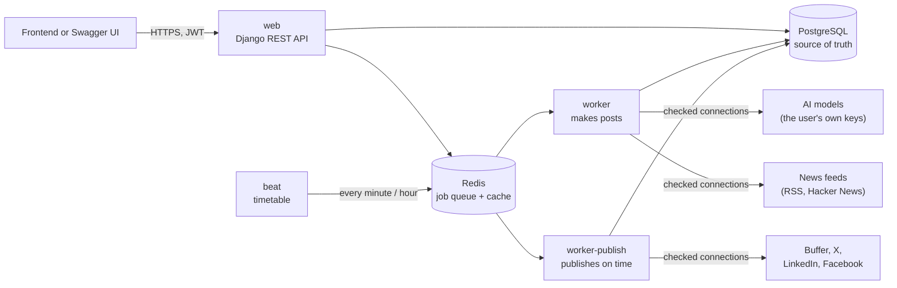
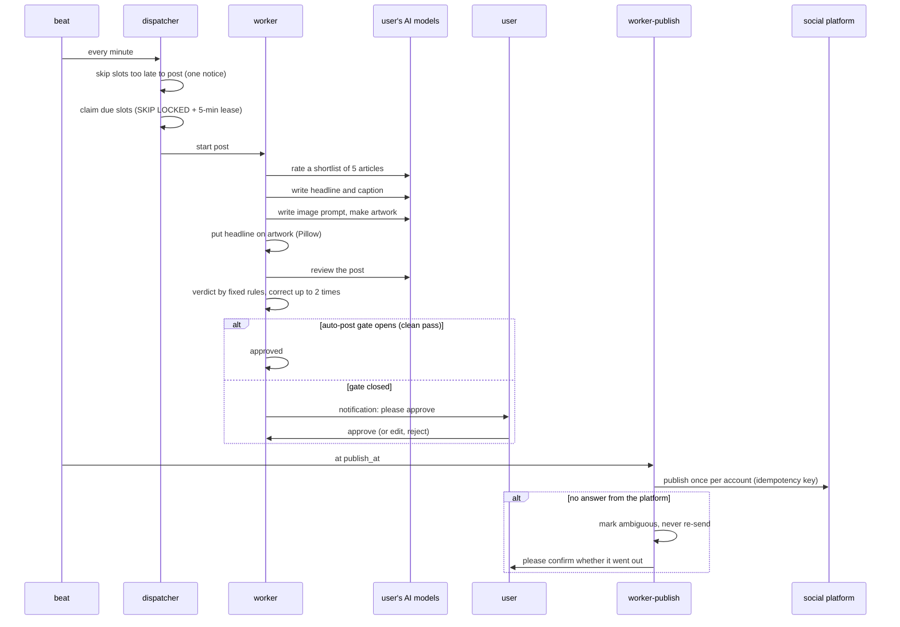
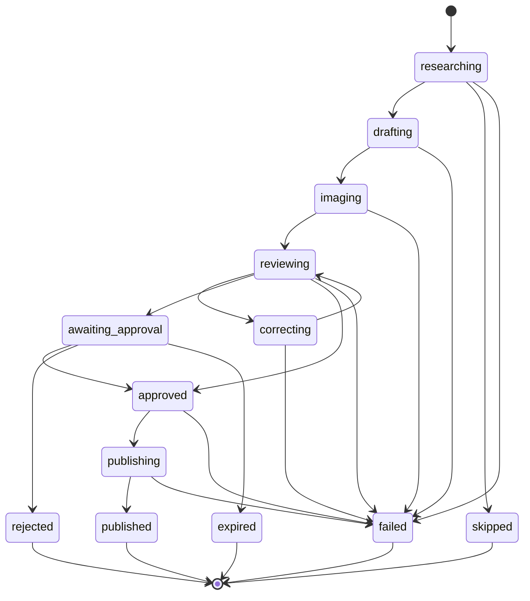
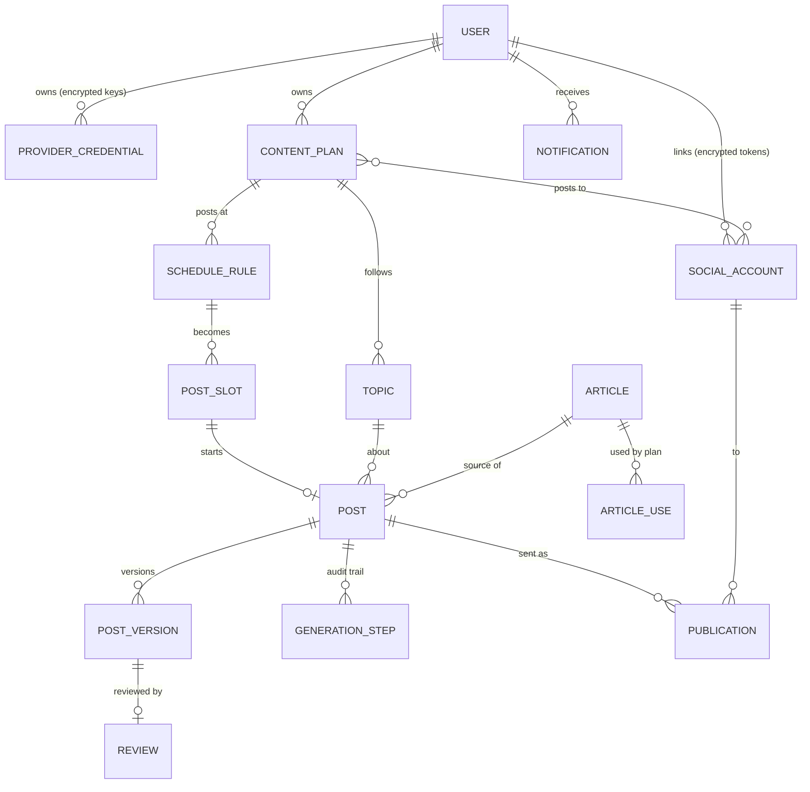

# Architecture

Four diagrams of how the backend fits together. They are written in
Mermaid, so GitHub draws them from plain text, and the post lifecycle is
generated from the code's own transition table (`studio/statuses.py`);
`tests/test_architecture_doc.py` fails if the two ever disagree.

For the reasoning behind each choice, see
[design/system-design.md](../design/system-design.md) and the decision
records in [design/decisions.md](../design/decisions.md).

## 1. The system

- **PostgreSQL holds every state** (slots, posts, publications), so a
  restart loses nothing: Celery only runs the work (ADR-002).
- **Two worker queues:** a burst of posts being made never delays a post
  that is due to go out.
- **Every outside connection** goes through `core/safe_network.py`, which
  refuses private addresses at the moment of connecting (SSRF and DNS
  rebinding protection).

## 2. One scheduled post, end to end

## 3. A post's life

Generated from `ALLOWED_TRANSITIONS` in `studio/statuses.py`.

- `skipped`: no article was good enough; nothing is posted rather than filler.
- `reviewing → approved` happens only when the auto-post gate opens.
- `expired`: a scheduled post nobody approved in time (plans set to "expire").

## 4. The main tables

- `POST_SLOT` is unique per plan and time, and a post belongs to at most one
  slot, so a slot can never produce two posts.
- `PUBLICATION.idempotency_key` is unique per post, version and account, so
  the same post is never sent twice to the same account.
- `ARTICLE` is shared by every user who follows the same topic.
