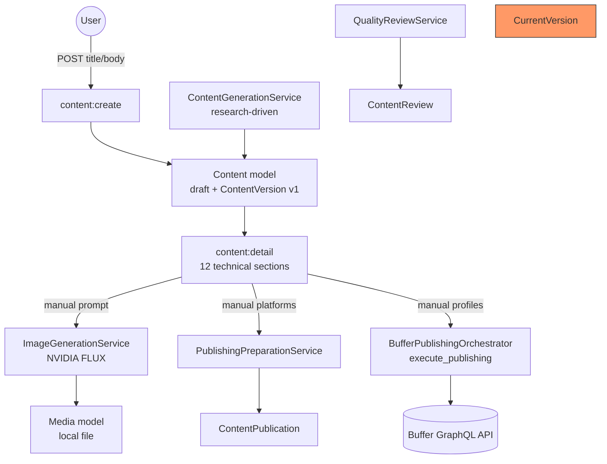
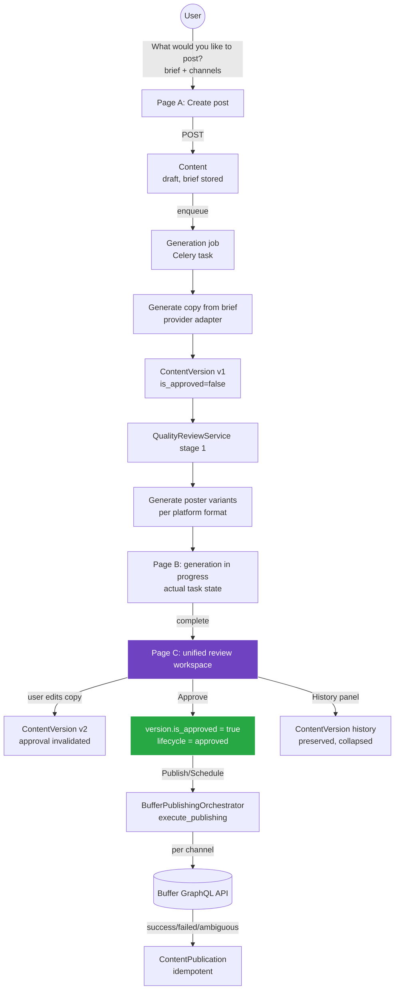
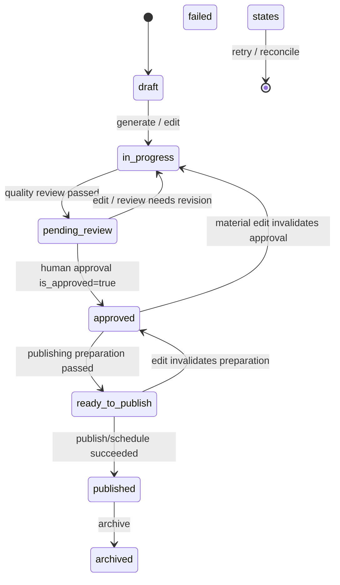
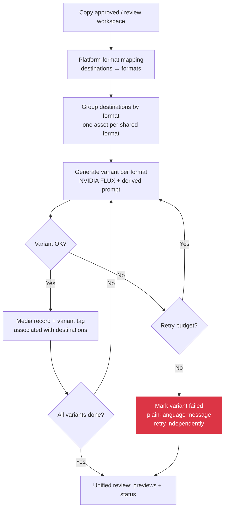

# Post-Creation UX Redesign Plan — AI Content Automater

**Repository:** `/home/shri/Development/AI-AUTOMATER`  
**Branch:** `main` (uncommitted change: `Dockerfile` only — preserved, not touched by this plan)  
**Status:** Plan mode only. No implementation performed.  
**Artifact:** `docs/development/POST-CREATION-UX-REDESIGN-PLAN.md` (this file)

---

## 1. Executive Summary

The AI Content Automater is a Django 5.1 application (Python 3.12, PostgreSQL, Celery + Redis) that currently operates like an internal content-management / AI-configuration system. Its primary content detail page exposes internal concepts — immutable `Current Version (v1)` sections, AI revision counters (`2/2 used`), publishing-preparation gates, lifecycle state machines, and a manually-filled image-generation form — and forces the user to write copy, compose image prompts, choose dimensions, and wire together separate panels.

This plan redesigns the experience around a **brief-first workflow**:

> Short user brief → AI-generated post copy → platform-appropriate poster variants → unified preview and editing → approval → scheduling or publishing through the user's connected Buffer channels.

The redesign is a **full workflow redesign, not a visual restyle**. It reuses the existing, verified service layer (provider adapters, quality review, Buffer GraphQL service, publishing orchestrator, media service) and the existing data model wherever possible, introducing only minimal additive schema changes. All mandatory approval gates, immutable version history, audit logging, and idempotency safeguards are preserved.

**Verification baseline established during planning (read-only):**
- `venv/bin/python manage.py check` → no issues.
- `venv/bin/python manage.py makemigrations --check --dry-run` → no changes detected (migrations consistent with models).
- `venv/bin/python manage.py test --keepdb --verbosity 1` → **381 tests, all passing** (OK).
- Default shell Python lacks Django; the `venv` (Python 3.12) virtualenv has Django, Celery, psycopg2 and is the environment that runs checks/tests. `.venv` (Python 3.14) has Django but is missing Celery, so it cannot run the full suite. No dependencies were installed during planning.

---

## 2. Verified Current-State Architecture

### 2.1 Technology stack (verified from settings and requirements)

| Layer | Implementation | Source |
|-------|---------------|--------|
| Web framework | Django 5.1.15 | `requirements.txt`, `content_automater/settings/base.py` |
| Python | 3.12 (approved); default shell is 3.14 | README.md, `.venv`/`venv` |
| Database | PostgreSQL (django.db.backends.postgresql) | `settings/base.py` DATABASES |
| Background jobs | Celery 5.6 + Redis, django-celery-beat | `requirements.txt`, `settings/base.py` CELERY_* |
| Media storage | Django `FileField` local storage (`MEDIA_ROOT`/`MEDIA_URL`); optional Cloudflare R2 via `storages`/`boto3` when `MEDIA_STORAGE=r2` | `settings/base.py` |
| AI text providers | OpenAI, NVIDIA NIM, Anthropic adapters (provider-neutral `GenerationRequest`/`GenerationResult`) | `ai_providers/services/*_adapter.py` |
| AI image provider | NVIDIA FLUX (`black-forest-labs/flux-3-image-klein`) via NVIDIA API | `ai_providers/services/nvidia_flux_adapter.py` |
| Buffer integration | Official Buffer GraphQL API (`https://api.buffer.com`), single `BUFFER_ACCESS_TOKEN` | `content/services/buffer_service.py` |
| Direct platform providers | LinkedIn, Facebook, Twitter/X (separate from Buffer) | `content/services/publishing/*_provider.py` |
| Templates | Django templates + HTMX, shared `frontend` app shell | `content/templates/content/`, `frontend/templates/frontend/` |

### 2.2 Core data model (verified from `content/models.py`)

| Model | Key fields | Purpose |
|-------|-----------|---------|
| `Content` | `owner` (User FK), `title`, `topic`, `description`, `lifecycle_state` (draft/in_progress/pending_review/approved/ready_to_publish/published/archived), `current_version` (ContentVersion FK, SET_NULL), `created_at`, `updated_at`, `deleted_at` | Main content entity + state machine |
| `ContentVersion` | `content` FK, `version_number`, `content_text`, `created_by`, `created_at`, `change_summary`, `is_approved` (default False) | Immutable version history; `unique_together (content, version_number)` |
| `ContentReview` | `content_version` FK, `stage` (1/2), `status` (passed/needs_revision/failed), `score`, `findings`, `unsupported_claims`, `summary`, `reviewed_by_provider` | Mandatory two-stage AI quality review |
| `PublishingPreparation` | `content` FK, `content_version` FK, `target_platforms` (JSON), `status` (prepared/invalidated/failed), `prepared_payload` (JSON), `validation_results` (JSON), `invalidation_reason` | Final validation gate before publishing |
| `ContentPublication` | `content` FK, `content_version` FK, `user` FK, `profile_id` (Buffer channel ID), `profile_service`, `profile_name`, `status` (pending/publishing/scheduled/published/failed/ambiguous/cancelled), `mode` (immediate/scheduled), `scheduled_at`, `published_at`, `idempotency_key` (unique), `external_post_id`, `payload_text`, `error_message`, `error_type`, `retry_count` | Durable Buffer publishing/scheduling records with idempotency |
| `Media` | `owner` (User FK), `content` (Content FK, SET_NULL), `file` (FileField), `file_name`, `file_size`, `mime_type`, `width`, `height`, `approval_status` (not_required/pending/approved/rejected), `reviewed_by`, `reviewed_at` | Uploaded/generated media; one record per file |
| `Campaign`, `CampaignExecution`, `Notification`, `PublicationMetrics`, `WorkflowAuditLog` | (see models.py) | Recurring campaigns, executions, notifications, metrics, audit trail |

### 2.3 Current service layer (verified)

| Service | File | Key methods |
|---------|------|-------------|
| Content generation | `content/services/generation_service.py` | `ContentGenerationService.generate_draft_for_request(creation_request_id, user, custom_instructions)` — research-driven, requires `ContentCreationRequest` + selected `Research` sources, creates `Content` + `ContentVersion`, runs `QualityReviewService` stage 1 |
| Quality review | `content/services/review_service.py` | `QualityReviewService.review_version(content_version, stage, user, adapter, credential, ...)` — AI or deterministic fallback; transitions `in_progress` → `pending_review` when passed |
| Image generation | `content/services/image_generation_service.py` | `ImageGenerationService.generate_image_for_content(content_id, user, prompt, **generation_params)` — requires a manually-written prompt; resolves image provider; stores PIL image as a `Media` record |
| Buffer service | `content/services/buffer_service.py` | `BufferPublishingService()` — `get_connection_status()`, `get_profiles()`, `create_update(profile_ids, text, now, due_at, image_urls)`; validates public HTTPS image URLs (`_is_public_https_url`, `_is_reachable_image_url` HEAD check) |
| Publishing orchestrator | `content/services/publishing_orchestrator.py` | `BufferPublishingOrchestrator.execute_publishing(content_id, user, profile_ids, mode, scheduled_at, client_idempotency_key, custom_text, image_urls)` — gates: `is_approved`, lifecycle state, passing review, destination authorization, idempotency, partial success, ambiguous outcome handling |
| Publishing preparation | `content/services/publishing_service.py` | `PublishingPreparationService.prepare_content(content_id, user, target_platforms)` — gates: approval, lifecycle, review, citation alignment, platform char limits (twitter 280, linkedin 3000, generic 5000); formats payloads |
| Workflow orchestrator | `content/services/workflow_orchestrator.py` | `execute_state_transition`, `approve_content_version`, `handle_material_edit` (invalidates approvals/preparations on material edit), `prepare_content_for_publishing`, `get_workflow_summary` |
| Media service | `content/services/media_service.py` | `MediaService.upload_media(user, uploaded_file, content)` — MIME whitelist (jpeg/png/gif/webp/mp4/quicktime), 10 MB limit, PIL dimension extraction |
| AI provider adapters | `ai_providers/services/base_adapter.py` + `*_adapter.py` | Normalized `GenerationRequest`/`GenerationResult`; `CredentialValidationService.get_active_provider_for_user(user, capability)` |

### 2.4 Current views (verified from `content/views/__init__.py`, `content/views/image_generation_views.py`, `frontend/views.py`)

Content URLs (`content/urls.py`, `app_name='content'`): `list`, `create`, `detail`, `edit`, `delete`, `versions`, `transition`, `trigger_review`, `apply_correction`, `approve_version`, `prepare_publishing`, `publish`, `reconcile_publication`, `generate_image`, plus campaign/notification/media/analytics routes.

Frontend URLs (`frontend/urls.py`, `app_name='frontend'`): `dashboard` (`/`), `publishing` (`/publishing/`), `help` (`/help/`).

Ownership enforcement: `@user_owns_content` decorator (`content/authorization.py`) returns 403 if `content.owner != request.user`.

### 2.5 Current detail page (`content/templates/content/detail.html`) — the problem page

Renders, in sequence:
1. Status dashboard (lifecycle badge, version counts, timestamps, owner).
2. "End-to-End Workflow Pipeline" stepper (research, generation, review, approval, preparation).
3. Lifecycle transition controls (Start Progress / Submit for Review / Approve / Publish / Archive / Return to Draft).
4. Content metadata (topic, created).
5. **`Current Version (v{{ current_version.version_number }})`** section — approval bar, change summary, content text, Approve button.
6. Research Evidence & Grounding (cited sources).
7. AI Quality Review (review cards, rubric, findings, unsupported claims, Run Review button).
8. **Bounded AI Correction** (Revisions Used: N / 2, Apply Automated AI Revision form).
9. **AI Image Generation** — manual prompt textarea + Size (1024x1024 / 1792x1024 / 1024x1792) + Quality + Style dropdowns + Generate Image button; Associated Media grid below.
10. Publishing Preparation & Multi-Platform Payloads (target platforms checkboxes, Validate & Prepare button, platform payload cards).
11. **Buffer Social Publishing & Scheduling** — Buffer connected badge, profile checkboxes (all pre-checked), immediate/scheduled mode, "Send to Buffer" button, publication history table with reconcile actions.
12. Workflow Audit Trail.
13. Form actions: Edit / View Version History / Delete / Back to List.

### 2.6 Current create page (`content/templates/content/create.html`)

Manual draft creation: title, topic, internal notes, content body, version note. Does NOT generate AI content or publish. Separate `ContentForm` + `ContentVersionForm`.

### 2.7 Buffer channel discovery — verified findings

- `BufferPublishingService.get_profiles()` queries Buffer GraphQL `GetOrganizations` (account → organizations) then `GetChannels(input: {organizationId})` per organization.
- Returns list of dicts: `id`, `service`, `formatted_username` (displayName/name/id), `service_username`, `avatar`, `disabled` (`isQueuePaused`).
- **No local storage of Buffer channels.** Profiles are retrieved on demand per request via the single `BUFFER_ACCESS_TOKEN`. There is no `BufferChannel`/`SocialAccount` model and no per-user token storage.
- `is_configured()` rejects empty tokens and angle-bracket/placeholder tokens (`<your_buffer_access_token>`).
- Expired/invalid credentials → 401 or `UNAUTHENTICATED` GraphQL error → `connected: False`, `status: 'unauthorized'`.
- Empty organizations → `[]`. API errors / non-200 → `RuntimeError` ("destination authorization cannot be verified"), caught in views and orchestrator.
- **Reconnection:** Not supported as a distinct flow; reconfiguration means setting a new `BUFFER_ACCESS_TOKEN` in the environment. There is no OAuth2 connect/disconnect UI for Buffer (LinkedIn/Facebook/Twitter have OAuth2 flows, but Buffer uses a static access token).
- **Channel identifiers:** Retrieved on demand, not stored locally. `ContentPublication.profile_id` stores the Buffer channel ID at publish time for the publication record.
- **Cross-user ownership:** Because there is a single account-level Buffer token, every authenticated user sees the same channels. There is no per-user channel ownership. Protection against a user targeting another user's channels is therefore not applicable at the channel level (one shared account); protection exists at the content/publication level (`Content.owner = user`, `ContentPublication.user = user`, and the orchestrator validates selected `profile_ids` against `get_profiles()` and rejects any not in the authorized set).
- **Unsupported channel types:** `service` is echoed from Buffer (`'unknown'` fallback); no capability filtering in the app.

### 2.8 Image generation — verified capabilities and limits

- Provider: NVIDIA FLUX adapter, default model `black-forest-labs/flux-3-image-klein`, endpoint `https://integrate.api.nvidia.com/v1`.
- Supported `size` values (from adapter `generate_image` body): `1024x1024`, `1792x1024`, `1024x1792`. Default `1024x1024`. `quality` (`standard`/`hd`) and `style` (`vivid`/`natural`) passed through optionally.
- Returns a PIL `Image`; stored as `Media` record via `media.file.save(...)` (Django default local storage; R2 if configured).
- **Text rendering:** FLUX is an image-generation model; the codebase makes no claim and provides no mechanism for reliable exact text rendering. The plan treats exact poster text as NOT reliably renderable by the model and proposes a deterministic compositing layer only if essential (Pillow is already a dependency).
- **Current image generation requires a manually written prompt** (verified: `image_generation_views.generate_image_for_content` requires `prompt`; template label "Image Generation Prompt *").

### 2.9 Public storage for media URLs (verified)

- R2 support is optional and gated on `MEDIA_STORAGE=r2` plus `R2_ACCOUNT_ID`, `R2_ACCESS_KEY_ID`, `R2_SECRET_ACCESS_KEY`, `R2_BUCKET_NAME`, `R2_PUBLIC_DOMAIN` (all in `.env.example` commented out).
- When R2 is not configured, `Media.file.url` is a local `/media/...` URL, which `BufferPublishingService.create_update` will **reject** (`_is_public_https_url` requires `https` scheme and a globally routable host; `_is_reachable_image_url` does an anonymous HEAD request and requires `image/` content type).
- Therefore, image publishing to Buffer currently requires R2 (public HTTPS). Without R2, image publishing must be blocked with a plain-language message — this is already enforced by the service layer, not silently allowed.

### 2.10 Test baseline (verified)

- 381 tests across `content/tests/` (`test_models.py`, `test_views.py`, `test_phase4.py`, `test_phase5.py`, `test_phase6.py`, `test_automated_post_orchestration.py`, `test_media_storage.py`, `test_new_features.py`, `test_image_generation_views.py`, `test_social_providers.py`) plus `ai_providers/tests.py` and `research/tests.py`/`test_views.py`.
- All external HTTP requests mocked. Deterministic. `OK`.

---

## 3. Current User Journey and Its Problems

**Current journey (detail-page-centric):**
1. User goes to Content Studio (`content:list`), clicks "+ Create content", fills title/topic/notes/body manually → creates a `Content` in `draft` with `ContentVersion v1`.
2. User opens the detail page, which presents ~12 technical sections (version, research, review, correction, image generation with manual prompt + dimensions, publishing preparation, Buffer publishing, audit trail).
3. User must write a full image-generation prompt and pick size/quality/style themselves.
4. User must discover which Buffer profiles are connected (all pre-checked checkboxes) and manually select them.
5. User must manually run quality review, apply corrections (max 2), approve the version, run publishing preparation, then publish — each a separate action with internal state names (`is_approved`, `ready_to_publish`, `pending_review`, `can_prepare`, `ai_revisions_count`).
6. After any edit, a new version is created and previous approvals are invalidated — but the UI shows `Current Version (v1)` as a primary section, exposing version internals.

**Problems:**
- No "What would you like to post?" brief field; creation starts from a blank editor.
- User must compose an image-generation prompt and choose raw dimensions — precisely what the vision says they should not do.
- No automatic derivation of poster variants per platform; square image used generically (no verified platform-format mapping).
- The separate visible `Current Version (v1)` section dominates the detail page and exposes implementation details (version numbers, revision counters, `is_approved`).
- Approval/publishing gates are scattered across independent forms and buttons; blocked actions show technical field names.
- Local media URLs would be passed to Buffer and rejected (or silently fail) unless R2 is configured; no clear blocker message in the primary flow.
- Channel selection is not persisted with a draft; profiles are re-fetched on each detail-page load.
- No unified workspace combining brief, editable copy, destinations, poster previews, format labels, status, and publish controls.

---

## 4. Proposed User Journey

1. **Create post (Page A):** User enters "What would you like to post?" (short brief). Optionally adds a reference image / business context. Selects target Buffer channels (discovered from their connected Buffer account). Clicks Generate.
2. **Generation in progress (Page B):** System derives post copy and an image prompt from the brief, generates text, runs quality review, generates poster variant(s) for the selected destination formats. User sees real task state (queued / text generated / posters generated / failed), not simulated progress.
3. **Unified review (Page C):** One workspace showing the brief, editable generated copy, selected destinations with platform/format labels, poster previews grouped by variant, generation status, approval controls, and schedule/publish controls (or a plain-language blocker). Optional collapsed History panel for prior versions.
4. **Approval & publishing:** User approves, then schedules or publishes to selected Buffer channels. Partial failures are shown per destination; retries are safe and idempotent; duplicate posts are prevented by idempotency keys.
5. **Dashboard (Page D):** Content list with thumbnail, selected channels, plain-language status, next action, scheduling/publishing details, filters, empty states.

---

## 5. Detailed Page-by-Page UX Specification

### Page A — Create post

**Layout hierarchy (desktop):**
- Header: page title "Create post".
- Prominent single field: "What would you like to post?" (textarea, autofocus).
- Helper text: examples ("Announce our new AI automation service for small businesses."), maximum length notice.
- Optional section (collapsible by default): "Add context" — reference image upload, brand assets, additional business context. Not mandatory.
- Destination selector: "Where should this post go?" — channel cards fetched from Buffer (service + handle + avatar), multi-select, at least one required if publishing is intended.
- Main CTA: "Generate post" (primary button), disabled while brief is empty or invalid.
- Secondary: "Cancel" → dashboard.

**Validation:**
- Brief required; whitespace-only treated as empty.
- Maximum brief length: 1,000 characters (proposed; configurable). Error in plain language if exceeded.
- Optional reference image: validated by `MediaService.upload_media` (MIME whitelist, 10 MB max). Invalid file → inline error, does not block brief submission.

**Empty-input behavior:** Re-render Page A with the brief retained, field-focused, and an inline error ("Please describe what you'd like to post."). No partial generation.

**Submission behavior:** POST creates a `Content` in `draft` state, stores the brief, enqueues a generation job, redirects to Page B for that content. POST-redirect-GET prevents resubmission on refresh.

**Duplicate-submission prevention:** Idempotency key derived from `(user, brief_hash)` stored on the `Content`/`ContentVersion` or a short-lived creation record; rapid repeated submits return the existing in-progress content rather than starting a second job. (Exact storage to be confirmed in Phase 2; session-based dedupe is an acceptable fallback.)

**How the brief is persisted:** Proposed additive `brief` TextField on `Content` (nullable). The existing `description` field is "internal notes" and should not be repurposed, to preserve the distinction between user-provided brief and internal notes.

**How a generation job is initiated:** The create view enqueues a Celery task (or runs inline in development) that: resolves the text provider → generates copy → creates `ContentVersion v1` → runs `QualityReviewService` stage 1 → enqueues poster variant generation for selected formats. The user is redirected to Page B immediately; Page B reads task state.

**Recovery if generation fails:** Page B shows a plain-language error ("We couldn't generate the post. Try again.") with a "Retry generation" button that re-enqueues from the stored brief. The draft remains in `draft`/`in_progress` and is editable.

**Returning to an in-progress or completed draft:** From Page D (dashboard) the user clicks a content row → Page C (unified review). From Page B, browser refresh re-reads task state; navigation away does not lose the draft (it is persisted).

**Mobile layout:** Single-column; brief field full-width; channel selector as tappable cards; optional context section collapsible; CTA full-width at bottom (sticky on very small screens).

---

### Page B — Generation in progress

**States (reflecting actual task state, never simulated):**
- `queued`: "We're preparing your post…" (job accepted, not yet started).
- `generating_text`: "Writing your post copy…"
- `reviewing`: "Running quality review…"
- `generating_posters`: "Creating poster variants for your selected channels…" (per-variant: e.g., "Instagram square", "LinkedIn landscape").
- `complete`: all succeeded → auto-advance to Page C (or a "Review your post" CTA).
- `partial`: some posters failed → show succeeded previews, offer "Retry failed posters" for only the failed variants (do not regenerate successes).
- `failed`: text generation failed → "Retry generation" / "Edit brief and retry".

**No fake progress bars:** Progress reflects actual Celery task state / database record state (e.g., `ContentVersion` exists, `Media` records exist, `ContentReview` exists). Polling via short-interval GET or HTMX-triggered status checks is acceptable; no invented percentages.

**Navigation away and return:** Draft persisted in DB; user can leave and return via Page D. Page B re-hydrates from the content record.

**Persistence and refresh behavior:** Refreshing Page B re-queries task state and re-renders; no duplicate generation because the job is tied to the content record and idempotency keys.

**Cancellation:** Not required in MVP. If a safe Celery revocation is added later, it must be explicit and must not leave partial approved state. Marked as out of scope for Phase 1 (proposed, not implemented now).

---

### Page C — Unified review workspace

**Structure (one coherent page, no `Current Version (v1)` primary section):**
1. Brief summary card: the original brief ("You asked to: …"), plus optional context/reference thumbnail.
2. Editable generated copy: headline/hook, body, call to action, hashtags — editable textareas. Each edit creates a new immutable `ContentVersion` and invalidates prior approval (existing `handle_material_edit` behavior preserved).
3. Selected destinations: channel cards with service + handle, each labeled with its platform/format (e.g., "Instagram • Square 1:1").
4. Poster preview layout: variants grouped by format; each preview shows the generated image, format label, dimensions, and generation status (generated / failed / retrying).
5. Variant grouping: one asset when multiple destinations share a format; distinct variants when aspect ratios differ.
6. Image replacement/regeneration: "Replace poster" per variant; "Regenerate all" only after user action; a single failed variant retryable independently.
7. Approval actions: "Approve post" (primary, only when quality review passes and copy non-empty). On approval: `version.is_approved = True`, lifecycle → `approved`.
8. Validation blockers: plain-language messages (e.g., "Review the generated text before publishing.", "Add at least one destination channel.", "Approve the poster before publishing."). No raw field names (`is_approved`, `lifecycle_state`) or Python exceptions.
9. Schedule/publish controls (when eligible): "Publish now" or "Schedule for later" (datetime picker), per-destination or all-selected; results shown per destination.
10. Optional history: collapsed "History" panel listing prior versions with timestamps and change summaries (versions model preserved, not deleted).
11. Error / partial-failure states: per-destination publish status, retry buttons, reconcile for ambiguous outcomes (existing `reconcile_publication`).

**Desktop vs mobile:** Desktop: copy editor left, previews/destinations right (two-column). Mobile: stacked sections; copy editor full-width; previews as horizontally-scrollable or stacked cards.

---

### Page D — Content dashboard / list

**Row content:** thumbnail (first poster), title, brief excerpt, selected channels (service badges or count), plain-language status (Draft / Generating / Ready for review / Approved / Scheduled / Published / Failed), next action (Continue editing / Approve / Publish / View), scheduled-at if scheduled, publish results summary.
**Filters:** search, lifecycle state, has media. Empty state: "Create your first post" → Page A.
**Desktop vs mobile:** Desktop table; mobile cards.

---

## 6. Architecture Diagrams

### 6.1 Current architecture (verified)



### 6.2 Proposed brief-to-publishing flow (proposed)



### 6.3 Approval state transitions (preserved gates)



### 6.4 Image variant generation and retry flow (proposed)



Diagrams labeled "current" reflect verified implementation; "proposed" diagrams describe intended future behavior to be implemented.

---

## 7. File-by-File Impact Analysis

### Files likely to change (implementation)

| File | Role | Proposed change |
|------|------|-----------------|
| `content/models.py` | Data model | Add nullable `brief` TextField to `Content`; add nullable `target_channels` JSONField to `Content` (persist channel selection for a draft); optionally add nullable `platforms`/`format` fields to `Media` to tag variant purpose. All additive, null-safe. |
| `content/urls.py` | URL routing | Add route for brief-first create (reuse `content:create` or new `content:create_brief`); keep all existing routes for regression. |
| `content/views/__init__.py` | Views | Refactor `content_create` into brief-first flow; add generation-status view (Page B); unify `content_detail` into workspace (Page C) or add new workspace view; remove/hide `Current Version (v1)` primary section from detail template. |
| `content/views/image_generation_views.py` | Image views | Add automatic poster-variant generation view (derive prompt, call `ImageGenerationService` per format); keep existing manual `generate_image_for_content` for regression/advanced use. |
| `content/templates/content/create.html` | Template | Replace with brief-first form (Page A). |
| `content/templates/content/detail.html` | Template | Consolidate into unified workspace (Page C); remove visible `Current Version (v1)` section; move version history to collapsed History panel; reorganize approval/publish controls with plain-language blockers. |
| `content/templates/content/list.html` | Template | Dashboard row enhancements (thumbnail, channels, plain-language status, next action) — Page D. |
| `content/services/generation_service.py` | Service | Add brief-based text generation path (reuses `CredentialValidationService` + provider adapter + `QualityReviewService`); do not duplicate `ContentGenerationService.generate_draft_for_request` (research-driven). |
| `content/services/image_generation_service.py` | Service | Add variant-generation helper (per-format prompt, size from mapping, store `Media` with format tag); reuse existing `generate_image_for_content`. |
| `content/services/buffer_service.py` | Service | No change needed (channel discovery `get_profiles()` already verified); possibly add a helper to validate/return profiles for a draft. |
| `content/services/publishing_orchestrator.py` | Service | No change needed (gates + idempotency already verified); reuse `execute_publishing`. |
| `content/services/media_service.py` | Service | No change needed (upload/validation already verified). |
| `content/authorization.py` | Auth | No change (`user_owns_content` already enforces content ownership). |
| `frontend/urls.py`, `frontend/views.py` | Frontend | Possibly add Page B (generation status) route under `frontend` or `content` namespace. |

### Files to create (only when justified)

- Possibly a new template `content/templates/content/create_brief.html` (Page A) if `create.html` is not replaced outright.
- Possibly a new template `content/templates/content/generation_status.html` (Page B).
- Possibly a new service module for brief-generation orchestration (to avoid bloating `generation_service.py`).

### Models and schema impact

Proposed minimal additive changes (all nullable, default-safe, no data loss):

1. `Content.brief` — `TextField(null=True, blank=True)` — stores the user brief.
2. `Content.target_channels` — `JSONField(default=list, blank=True)` — stores selected Buffer profile IDs for a draft.
3. `Media.platforms` — `JSONField(default=list, blank=True)` — tags which destination platform(s) a variant is intended for (supports variant reuse + retry).

Migration strategy: standard `makemigrations` generates additive `AddField` migrations; `default=list` for JSONField is safe; existing rows get NULL/empty defaults. Rollback: `migrate content <previous>` removes columns (data in new columns lost, but no existing data depends on them). No table drops, no record deletions.

---

## 8. Buffer Channel-Discovery Findings

**Confirmed (Verified):**
- `BufferPublishingService.get_profiles()` (`content/services/buffer_service.py:234`) returns connected channels from the Buffer GraphQL API.
- Returned metadata: `id`, `service`, `formatted_username`, `service_username`, `avatar`, `disabled` (`isQueuePaused`). No follower counts, no media-format requirements, no per-channel capabilities.
- Authentication: single `BUFFER_ACCESS_TOKEN` (settings). `is_configured()` rejects placeholders/empty.
- Errors handled: 401/UNAUTHENTICATED → unauthorized; 429 → rate_limited; non-200 → error; exceptions → `RuntimeError`.
- Empty channel list → `[]` (no crash).
- No local channel model; profiles fetched on demand per request.
- `ContentPublication.profile_id` persists the channel ID at publish time.

**Assumptions requiring implementation/API verification (Unverified):**
- The exact set of `service` values returned by Buffer for this account (twitter, linkedin, facebook, instagram, pinterest, tiktok, etc.) — not confirmed without live credentials.
- Whether Buffer returns per-channel media format/dimension requirements — not part of the verified response shape; plan does not depend on it.
- Whether a per-user OAuth flow for Buffer is desired — current design uses a single account token (verified behavior).
- Channel selection persistence for a draft — no existing field; proposed `Content.target_channels` (schema change).

---

## 9. Platform-Specific Image-Format Strategy

### 9.1 Verified constraints

- NVIDIA FLUX supported sizes: `1024x1024` (1:1 square), `1792x1024` (~16:9 landscape), `1024x1792` (~9:16 portrait) — verified in `nvidia_flux_adapter.py:282`.
- Buffer `create_update` requires public HTTPS image URLs; local `/media/` URLs are rejected unless R2 public domain is configured (verified in `buffer_service.py:573-598`).
- App text platform limits: twitter 280, linkedin 3000, generic 5000 (`publishing_service.py:27-31`) — text-only, not image.

### 9.2 Proposed platform-format mapping (Proposed — requires verification against Buffer/API docs)

| Destination | Placement | Aspect | FLUX size | Notes |
|-------------|-----------|--------|-----------|-------|
| Instagram feed | square | 1:1 | 1024x1024 | Default |
| Instagram stories/reels | portrait | 9:16 | 1024x1792 | Needs verification |
| Facebook feed | square/landscape | 1:1 or 16:9 | 1024x1024 | |
| LinkedIn | landscape | 16:9 | 1792x1024 | |
| X / Twitter | landscape/square | 16:9 or 1:1 | 1792x1024 | |
| Pinterest | portrait | 2:3 | 1024x1792 | closest available |

**Mapping rules (Proposed):**
- One asset when several destinations safely share a format (e.g., Facebook feed + LinkedIn both landscape → one 1792x1024 variant).
- Distinct variants when aspect ratios materially differ (square vs portrait vs landscape).
- Preserve aspect ratio; no stretching; crop-aware composition with safe margins (if a compositing layer is added).
- Validate dimensions and media type; associate each variant with intended destination(s) via `Media.platforms`.
- Single failed variant retryable without regenerating successes.
- Record generation state and failure details safely (existing `Media` + new fields; or a generation-state log).
- Do not generate variants for unselected channels.
- If placement cannot be determined reliably, default to square 1024x1024 with a plain-language note ("Poster formatted for square feed placements"), clearly labeled as a default, not an exact guarantee.

**Source of truth:** A mapping constant in a new or existing module (e.g., `content/services/image_generation_service.py` or a new `content/services/platform_formats.py`), with unit tests covering each mapping. Not hardcoded in templates.

---

## 10. Image-Generation and Storage Design

- Derive the image prompt automatically from: brief + generated copy + selected platform placements + brand/reference context. No manual prompt in the standard flow (advanced/manual prompt retained as an optional "Regenerate with custom prompt" action).
- One Celery task per format variant (or one task generating all variants sequentially) to allow independent retry.
- Store each variant as a `Media` record linked to the `Content`; tag intended platform(s).
- Public URL requirement: if R2 is not configured, `Media.file.url` is local and Buffer publishing will be blocked with a plain-language message ("Poster cannot be published because public image storage is not configured."). Do not silently publish without the poster.
- Text on posters: FLUX is not verified to render exact text reliably. Do not promise exact copy in the image. If exact poster text is essential, evaluate a deterministic Pillow compositing layer (Pillow is already a dependency) that places copy on top of the generated visual — this is a future enhancement, not Phase 1, pending dependency/need evaluation.
- Generation state: use `Media` creation + optional new fields to record success/failure; a single failed variant does not block others.

---

## 11. Content/Versioning Strategy

- The brief is the user input; generated copy is AI output. Preserve distinction: `Content.brief` (user-provided) vs `ContentVersion.content_text` (AI-generated, then user-edited).
- `ContentVersion` remains immutable; every edit creates `create_next_version` (existing behavior) and invalidates approval/preparations (existing `handle_material_edit` / `PublishingPreparationService.invalidate_preparations_for_content`).
- `is_approved` on the version; human approval recorded via `WorkflowOrchestratorService.approve_content_version` (existing).
- History: versions remain available; the `Current Version (v1)` visible section is removed from the primary page; a collapsed History panel exposes prior versions (no model deletion).
- The separate visible version section removal does NOT delete `ContentVersion`, `ContentReview`, `PublishingPreparation`, `ContentPublication`, `WorkflowAuditLog`, or `Media` records.

---

## 12. Approval and Publishing State Transitions

**Mandatory gates preserved (verified from `publishing_orchestrator.py`, `publishing_service.py`, `workflow_orchestrator.py`):**
1. Human approval: `current_version.is_approved` must be True.
2. AI quality review: a `ContentReview` with `status='passed'` must exist for the version.
3. Lifecycle state: must be `approved` or `ready_to_publish`.
4. Channel authorization: selected `profile_ids` validated against `buffer_service.get_profiles()`; unauthorized IDs rejected.
5. Media URL accessibility: image URLs passed to Buffer must be public HTTPS and reachable (HEAD returns `image/`); local URLs blocked unless R2.
6. Publishing preparation: `PublishingPreparation` status `prepared` for the version (campaign path).
7. State invalidation after edits: material edit → new version, `is_approved=False`, preparations invalidated, lifecycle → `in_progress`.

**On content change after approval:** Approval record becomes invalid (`is_approved=False`), `PublishingPreparation` records invalidated (`status='invalidated'`), lifecycle reverts to `in_progress`. Reapproval required before publishing. Enforced by existing `handle_material_edit` and `execute_state_transition`.

**Plain-language blockers (Proposed):**
- "Review the generated text before publishing." (review required)
- "Approve the post before publishing." (approval required)
- "Add at least one destination channel." (missing destination)
- "Buffer isn't connected. Connect your Buffer account to publish." (unconfigured)
- "The poster couldn't be published because public image storage isn't configured." (media URL)
- "One or more channels failed to publish. You can retry them individually." (partial failure)

---

## 13. Data Model and Migration Assessment

**No schema change strictly required to run the existing workflow.** The redesign can reuse `Content`, `ContentVersion`, `ContentReview`, `PublishingPreparation`, `Media`, `ContentPublication`.

**Proposed minimal additive schema changes (justified):**

| Change | Why | Field | Default | Effect on existing records | Index/constraint | Rollback |
|--------|-----|-------|---------|---------------------------|------------------|----------|
| Store user brief | Requirement A | `Content.brief` TextField null/blank | None | NULL for existing rows | none | drop column |
| Persist channel selection for draft | Requirement B | `Content.target_channels` JSONField default=list | `[]` | `[]` for existing | none | drop column |
| Tag variant destination platforms | Requirement D/E | `Media.platforms` JSONField default=list | `[]` | `[]` for existing | none | drop column |

All migrations are additive `AddField`; compatible with PostgreSQL; `makemigrations --check --dry-run` must pass after changes; no `Reset`/`DropTable`/`DeleteModel`; historical versions preserved.

---

## 14. Security and Reliability Assessment

- **Authentication/authorization:** `@login_required` + `@user_owns_content` on all content views; Buffer channel selection validated against `get_profiles()`; `ContentPublication.user` recorded. Cross-user channel access: single shared Buffer token → all users see same channels; protection is at content/publication level (verified).
- **Buffer token handling:** `BUFFER_ACCESS_TOKEN` from env/settings; masked in UI (`mask_token` shows first 4 + last 4); never logged raw (`buffer_service.py:98-104`).
- **CSRF:** `CsrfViewMiddleware` enabled; all state-changing views are POST with `` (verified in templates).
- **Form validation:** Django forms + server-side validation in services; brief max length, non-empty; image MIME + 10 MB limit (`media_service.py`).
- **Uploaded file validation:** MIME whitelist + PIL dimension extraction; file saved via Django storage.
- **External URL validation:** Buffer `_is_public_https_url` rejects localhost/private/non-HTTPS; `_is_reachable_image_url` requires anonymous HEAD 200 with `image/` content type.
- **Prompt injection:** AI prompts incorporate user brief; system prompts instruct grounding and no invented claims (existing `generation_service.py` system prompt). User-provided brief is treated as untrusted input to the model, not executed.
- **Secret leakage:** Errors return generic messages (`buffer_service.py:542-550` "Do not expose exception text"); tokens masked.
- **Celery duplicate-task behavior:** Idempotency via `ContentPublication.idempotency_key` (unique) and pre-dispatch existence check (verified in `publishing_orchestrator.py:260-270`).
- **Partial publishing failures:** `execute_publishing` tracks per-channel results, supports partial success, marks ambiguous outcomes without blind retry (verified).
- **Storage failure:** `ImageGenerationService` catches storage errors and returns `storage_error`; media upload failures return validation errors.
- **Race conditions on edit during generation:** `select_for_update` in `execute_publishing`, `prepare_content`, `approve_content_version`, `execute_state_transition` (verified).
- **Approval invalidation:** `handle_material_edit` + `invalidate_preparations_for_content` (verified).

---

## 15. Test Strategy

### Test environment (verified)
- `venv` (Python 3.12) has Django, Celery, psycopg2. `manage.py check`, `makemigrations --check`, and the full 381-test suite pass. `.venv` (Python 3.14) lacks Celery and cannot run the full suite.
- All external HTTP requests mocked in existing tests.

### Unit tests (new)
- `content/tests/test_brief_validation.py`: brief required, max length, whitespace-only, duplicate prevention.
- `content/tests/test_platform_formats.py`: platform-format mapping, dimension validation, asset grouping/reuse, default fallback.
- `content/tests/test_approval_invalidation.py`: edit-after-approval invalidates approval & preparations.
- `content/tests/test_publishing_eligibility.py`: gate checks (approval, review, lifecycle, destination, media URL).

### Service tests (new, mocked)
- `content/tests/test_brief_generation.py`: brief-based copy generation with mocked provider adapter.
- `content/tests/test_buffer_channels.py`: channel discovery with mocked `requests.post` (configured/unconfigured/401/empty/errors).
- `content/tests/test_image_variants.py`: FLUX image generation with mocked adapter; per-format sizes; independent retry of failed variant.
- `content/tests/test_media_storage.py` (extend): public-URL gating; R2-not-configured blocks image publishing.
- `content/tests/test_publishing_payload.py`: payload construction per platform; idempotency keys.
- `content/tests/test_retry_idempotency.py`: duplicate prevention, ambiguous outcomes.

### View and workflow tests (new)
- `content/views` tests: create-page access, valid/invalid brief submission, authenticated channel selection, cross-user authorization rejection (403), unified review rendering, **removal of separate visible version section** (assert `Current Version (v1)` not present), approval gating, schedule/publish gating, error/partial-failure presentation.

### Regression tests (existing, must keep passing)
- `test_models.py`, `test_views.py`, `test_phase4/5/6.py`, `test_automated_post_orchestration.py`, `test_media_storage.py`, `test_new_features.py`, `test_image_generation_views.py`, `test_social_providers.py`, `ai_providers/tests.py`, `research/tests.py`.
- Existing version history, content approval, campaign workflows, image approval, Buffer publishing safeguards, migrations.

### Verification commands
```
venv/bin/python manage.py check
venv/bin/python manage.py makemigrations --check --dry-run
venv/bin/python manage.py test --keepdb --verbosity 1
```
No live Buffer or NVIDIA calls in tests (all mocked), consistent with existing practice.

---

## 16. Phased Implementation Plan

Phases ordered by real dependencies. Each phase is reviewable and independently testable where noted.

### Phase 1 — Baseline and architecture confirmation (Prerequisite)
**Goal:** Confirm environment, migrations, and test baseline before any change.
**Files:** none (read-only verification; `Dockerfile` uncommitted change preserved).
**Acceptance:** `manage.py check` clean; `makemigrations --check --dry-run` clean; 381 tests pass.
**Dependencies:** none. Independent.

### Phase 2 — Buffer channel discovery and authorization
**Goal:** Expose connected Buffer channels for selection; persist selection with a draft.
**Files:** `content/models.py` (`target_channels`), `content/urls.py`, `content/views/__init__.py`, `content/services/buffer_service.py` (no functional change, reuse), templates.
**Models:** add `Content.target_channels` JSONField.
**Tests:** channel discovery mocks, ownership, empty/unconfigured states.
**Acceptance:** user can see and select their Buffer channels; selection stored with draft; unauthorized channels rejected.
**Risks:** single shared token means channel list is account-level, not per-user (documented limitation).
**Depends on:** Phase 1.

### Phase 3 — Platform-format capability mapping
**Goal:** Define and test the destination → image format mapping.
**Files:** new/updated service module (e.g., `content/services/platform_formats.py`), tests.
**Models:** none (mapping constant; optional `Media.platforms` field deferred to Phase 6).
**Tests:** mapping table, dimension validation, grouping/reuse, default fallback.
**Acceptance:** each selected destination resolves to a verified format; default square documented.
**Depends on:** Phase 1.

### Phase 4 — Brief-first creation UX (Page A)
**Goal:** Replace manual creation with "What would you like to post?" brief input.
**Files:** `content/models.py` (`brief`), `content/urls.py`, `content/views/__init__.py`, `content/templates/content/create.html`.
**Models:** add `Content.brief` TextField.
**Tests:** brief validation, empty input, submission, duplicate prevention, persistence.
**Acceptance:** brief submitted → draft created → redirect to Page B.
**Depends on:** Phase 1.

### Phase 5 — Content generation integration
**Goal:** Generate post copy from brief (no research dependency) and run quality review.
**Files:** `content/services/generation_service.py` (new brief-based path), views, tasks.
**Models:** none new (reuses `Content`, `ContentVersion`, `ContentReview`).
**Tests:** mocked provider adapter, review pass/fail, failure recovery.
**Acceptance:** brief → copy → version → review, all persisted; failure shows retry.
**Depends on:** Phase 4.

### Phase 6 — Platform-specific poster generation and media association
**Goal:** Generate poster variants per format; associate with destinations; store media.
**Files:** `content/services/image_generation_service.py` (variant helper), `content/views/image_generation_views.py`, `content/models.py` (`Media.platforms` optional), templates.
**Models:** optional `Media.platforms` JSONField.
**Tests:** mocked FLUX adapter, per-format sizes, independent variant retry, public-URL gating.
**Acceptance:** variants generated per selected format; failures retryable independently; no variants for unselected channels.
**Depends on:** Phase 3, Phase 5.

### Phase 7 — Unified review workspace (Page C)
**Goal:** Consolidate detail page into one workspace; remove visible `Current Version (v1)` section.
**Files:** `content/templates/content/detail.html` (and/or new workspace template), `content/views/__init__.py`.
**Models:** none.
**Tests:** unified review rendering, version-section removed, approval gating, blockers in plain language, history panel preserved.
**Acceptance:** one page shows brief, copy, destinations, posters, status, approval, publish controls; `Current Version (v1)` no longer a primary visible section; versions/history preserved.
**Depends on:** Phase 4, 5, 6.

### Phase 8 — Approval and publishing integration
**Goal:** Approve + schedule/publish to selected Buffer channels with idempotency and partial-failure handling.
**Files:** `content/views/__init__.py` (`content_publish`), `content/services/publishing_orchestrator.py` (reuse), templates.
**Models:** none new (reuses `ContentPublication`).
**Tests:** approval gating, schedule vs immediate, per-channel results, retry, idempotency, reconcile ambiguous.
**Acceptance:** publish only when eligible; partial failures shown per destination; no duplicate posts on retry.
**Depends on:** Phase 2, Phase 6, Phase 7.

### Phase 9 — Dashboard/list improvements (Page D)
**Goal:** Content list with thumbnail, channels, plain-language status, next action.
**Files:** `content/templates/content/list.html`, `content/views/__init__.py` (`content_list`).
**Models:** none.
**Tests:** list rendering, filters, empty state.
**Acceptance:** dashboard shows status and next action per content item.
**Depends on:** Phase 1 (independent; can run earlier).

### Phase 10 — Regression testing, documentation, local Docker verification
**Goal:** Full suite passes; migrations consistent; Docker build config reviewed (not deployed).
**Files:** docs; `Dockerfile` (already modified to use `requirements.txt` — preserved as-is; not changed by this plan).
**Tests:** full 381 + new tests.
**Acceptance:** all tests pass; `makemigrations --check` clean; plan documented.
**Depends on:** all prior phases.

**Independent phases:** Phase 9 (dashboard) and Phase 3 (format mapping) can be done in parallel with Phase 4/5. Phase 8 requires Phase 2 and 6. Phase 7 requires 4, 5, 6.

---

## 17. Acceptance Criteria

| # | Criterion |
|---|-----------|
| 1 | User can submit a brief via "What would you like to post?" and receive generated copy + poster variants without writing a prompt or choosing dimensions. |
| 2 | User selects from their genuinely connected Buffer channels (discovered via `get_profiles()`); no hardcoded/mock channel data. |
| 3 | One unified review workspace replaces the multi-section detail page; the visible `Current Version (v1)` section is removed from the primary flow. |
| 4 | Version history, approval records, audit logs, and media records are preserved (no model or record deletion). |
| 5 | All mandatory approval gates remain: human approval, passing AI review, lifecycle state, channel authorization, public media URL. |
| 6 | Blockers shown in plain language; no raw field names or Python exceptions in the UI. |
| 7 | Publishing only succeeds with public HTTPS media URLs (R2 if configured); otherwise blocked with a clear message. |
| 8 | Idempotency keys prevent duplicate posts; partial failures shown per destination; retries safe. |
| 9 | Full test suite passes (existing 381 + new); `manage.py check` and `makemigrations --check --dry-run` clean. |
| 10 | No live Buffer publishing or live NVIDIA calls during implementation/verification without explicit user authorization. |

---

## 18. Risks, Assumptions, and Unresolved Questions

### Verified risks
- **Single shared Buffer token:** channel discovery is account-level, not per-user. All authenticated users see the same channels. This is verified behavior, not a bug to fix in this plan, but it means "the user's connected Buffer channels" = the channels on the one configured Buffer account.
- **Local media URLs rejected by Buffer:** without R2 (`MEDIA_STORAGE=r2`), image publishing to Buffer is blocked by design. This is verified enforcement, not a gap, but the UX must surface it plainly.

### Assumptions requiring verification (Unverified)
- Exact `service` values Buffer returns for the configured account (needed to label channels correctly) — not confirmed without live credentials.
- Whether Buffer exposes per-channel media format/dimension requirements — not part of verified response shape; the plan's format mapping is proposed and should be validated against Buffer documentation/API during implementation.
- FLUX text rendering reliability — not verified; plan does not depend on exact text in images. A deterministic compositing layer is proposed only if essential.
- Whether per-user Buffer OAuth is desired vs. the current single-token model — design decision, not code-determined.

### Unresolved questions (do not block Phase 1)
- Where to persist the generation job/task state for Page B (Celery result backend vs. a model field). Celery result backend is already configured (`CELERY_RESULT_BACKEND`).
- Exact brief max length (proposed 1,000 chars).
- Whether `Content.target_channels` (new field) vs. session storage for draft channel selection (new field preferred for durability).
- Whether to add a new workspace view or refactor `content_detail` in place.

---

## 19. Safe Local Verification Plan

All commands read-only w.r.t. application source and data (the test command creates a throwaway test database, not the dev database):

```
# 1. Environment prerequisite (outside planning scope: ensure venv has deps)
venv/bin/python manage.py check

# 2. Migration consistency
venv/bin/python manage.py makemigrations --check --dry-run

# 3. Full test suite (existing baseline)
venv/bin/python manage.py test --keepdb --verbosity 1

# 4. After each implementation phase, re-run 1-3 plus the phase's new tests
venv/bin/python manage.py test <app>.<test_module> --keepdb -v 2
```

No deployment, no live Buffer/NVIDIA calls, no database reset, no destructive operations. The Dockerfile has an uncommitted modification (using `requirements.txt` instead of `requirements/` directory) that is preserved and not addressed by this plan.

---

## 20. Beginner-Friendly Explanation of the Proposed Data Flow

1. **You type a brief.** On the "Create post" page you write one sentence, like "Announce our new AI automation service for small businesses." You can optionally pick which of your connected social accounts should receive it.

2. **The app writes the post for you.** Behind the scenes, the app sends your brief to an AI text model (OpenAI or NVIDIA), which writes the post copy. A quality-check step reviews the writing. You don't see prompts, model settings, or version numbers.

3. **The app makes posters.** From your brief and the written copy, the app automatically builds an image prompt and asks an image model (NVIDIA FLUX) to create a poster. It picks the right shape for each social account — square for some, wide or tall for others — so you don't have to pick dimensions.

4. **You review everything in one place.** A single screen shows your original brief, the draft text (which you can edit), your chosen accounts, and the poster previews. When everything looks right, you click "Approve."

5. **You publish.** You choose "Publish now" or "Schedule for later," and the app sends the post and poster to your connected accounts through Buffer. If one account fails, the others still go through, and you can retry just the failed one. The app won't post the same thing twice.

6. **Nothing is lost.** Every version of your post is kept in case you need to look back, but older versions are tucked away in a "History" section so they don't clutter your main screen.

---

## Requirement Gap Analysis

| Requirement | Current implementation | Gap | Proposed solution | Files affected | Tests | Acceptance criterion |
|-------------|----------------------|-----|-------------------|----------------|-------|----------------------|
| A — Brief-first creation | Manual create form (`content/create.html`, `content_create` view); no brief field; no generation trigger | No "What would you like to post?" field; no brief persistence; no generation job initiation | Brief field on `Content`; new create view enqueues generation job; redirect to status page; idempotent duplicate prevention | `content/models.py` (`brief`), `content/urls.py`, `content/views/__init__.py`, `content/templates/content/create.html`, `content/services/generation_service.py` | Brief validation, empty input, submission, duplicate prevention, persistence, recovery | Brief submitted → draft → copy generated → status page |
| B — Buffer channel discovery | `BufferPublishingService.get_profiles()` verified; on-demand, no local storage, single shared token | Channel selection not persisted with draft; cross-user ownership not applicable (shared account); `service` values unverified | Reuse `get_profiles()`; add `Content.target_channels` JSONField; validate selected IDs against authorized set | `content/models.py` (`target_channels`), `content/views/__init__.py`, `content/services/buffer_service.py` (reuse) | Channel discovery mocks, empty/unconfigured/401, ownership rejection | User sees and selects real channels; selection persisted; unauthorized IDs rejected |
| C — Generate post copy from brief | `ContentGenerationService.generate_draft_for_request` is research-driven (requires sources); no brief-only path | No brief-to-copy path without research; platform-specific copy not supported | New brief-based generation reusing provider adapter + `QualityReviewService`; platform variants derived | `content/services/generation_service.py`, views | Mocked provider, review pass/fail, failure recovery | Brief → copy → version → review persisted |
| D — Automatically generate posters | `ImageGenerationService.generate_image_for_content` requires manual prompt + size/quality/style | No automatic prompt derivation; no platform variants; manual technical settings | Derive prompt from brief+copy+platform+context; generate variants per format; reuse existing service | `content/services/image_generation_service.py`, `content/views/image_generation_views.py`, templates | Mocked FLUX adapter, per-format sizes, independent variant retry | Posters generated without manual prompt; failures retryable independently |
| E — Auto choose image formats | FLUX supports 1024x1024/1792x1024/1024x1792 (verified); no platform-format mapping in code | No mapping from destinations to formats; no dimension validation source of truth | Mapping constant + tests; one asset per shared format, distinct variants when ratios differ; default square with limitation noted | New/updated service module (e.g. `platform_formats.py`), `content/models.py` (`Media.platforms` optional) | Mapping table, dimension validation, grouping/reuse, default fallback | Each destination resolves to a format; no unselected-channel variants |
| F — Unified review workspace | `detail.html` has 12 technical sections incl. visible `Current Version (v1)` | Primary page exposes version internals; approval/publish scattered | Consolidate into one workspace; remove visible version section; history moved to collapsed panel | `content/templates/content/detail.html`, `content/views/__init__.py` | Unified review rendering; version-section absent; history preserved | One page; `Current Version (v1)` not primary; versions intact |
| G — Approval and quality gates | Gates verified in `publishing_orchestrator.py`, `publishing_service.py`, `workflow_orchestrator.py` | Gates scattered; errors show technical field names | Preserve all gates; surface blockers in plain language; edit-after-approval invalidates (existing behavior) | `content/views/__init__.py`, `content/services/publishing_orchestrator.py` (reuse) | Approval gating, publish gating, invalidation on edit | Publish only when eligible; plain-language blockers |
| H — Scheduling and Buffer publishing | `BufferPublishingOrchestrator.execute_publishing` verified; idempotency, partial failure, ambiguous handling | Local media URLs blocked unless R2; no clear UX blocker | Reuse orchestrator; block image publishing without public storage; plain-language messages | `content/views/__init__.py` (`content_publish`), templates | Idempotency, partial failure, reconcile, schedule vs immediate | No duplicate posts; per-channel results; public-URL gating |

---

**End of plan.** This artifact is the sole permitted write operation of this planning phase. No application code, templates, tests, migrations, configuration, environment files, or existing documentation were modified. The database was not altered. The next step is review of this plan, after which a separate implementation session may execute the phases above.