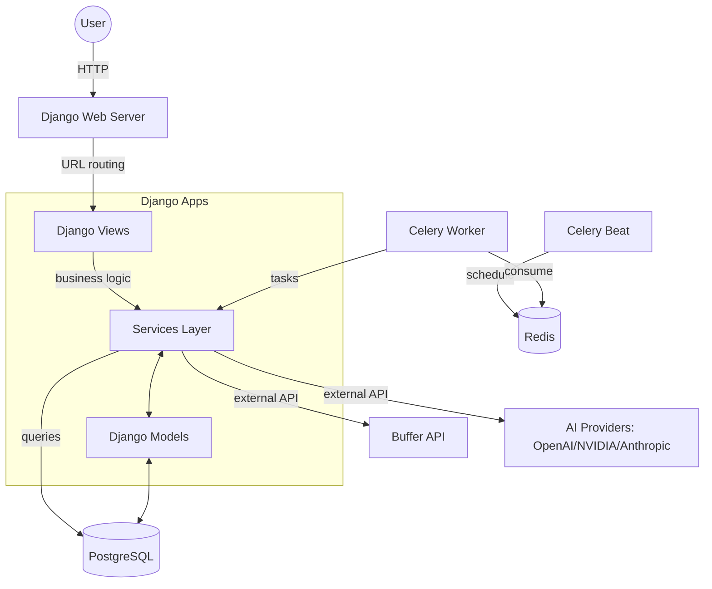

# AI Content Automater — Codebase Learning Guide

**Project:** AI Content Automater V2  
**Repository:** `/home/shri/Development/AI-AUTOMATER`  
**Audience:** You — the project owner who wants to understand, debug, and modify this codebase  
**Status:** Documentation only. No application code was changed.

---

## How to Use This Guide

This guide teaches you the **real** implementation in this repository. Every claim is backed by actual files, function names, and class names you can open and read.

- **Start with Section L (Learning Path)** — it gives you a step-by-step sequence.
- **Use Section M (File Reference Map)** as a quick lookup when you need to find a file.
- **Use Section N (Troubleshooting)** when something isn't working.
- **Use Section O (Self-Assessment)** to check your understanding at the end.

**Important:** This guide covers what is *actually implemented*. It does not describe features from planning documents that may not be in the code. If something says "implemented" it means the code exists. If something says "not configured" or "blocked" it means the code is there but needs credentials or setup before it works in production.

---

## A. Project Overview

### What the application does

The AI Content Automater is a Django web application that helps users research, draft, review, correct, and publish social media content. The core idea is:

1. You create a **Campaign** (a recurring content job) or a standalone **Content** item.
2. The system collects **research** from RSS feeds and Google News.
3. AI generates a **content draft** (text) from that research.
4. AI **reviews** the draft (quality, accuracy, citations).
5. If needed, AI **corrects** the draft (bounded to 2 revisions max).
6. A human **approves** the final version.
7. Optionally, an **image** is generated for the post.
8. The post is published to **Buffer** (which distributes to LinkedIn, Facebook, Twitter/X, etc.).

### The problem it solves

Without this tool, a user would manually: find sources, write posts, review them, design images, and publish to each social platform separately. This application automates the pipeline while keeping human approval gates at critical points so nothing publishes without oversight.

### Main features that actually exist (verified in code)

| Feature | Where it lives | Status |
|---------|---------------|--------|
| User authentication (login, registration, password reset) | `users/` app | Implemented |
| Content lifecycle (draft → in_progress → pending_review → approved → ready_to_publish → published → archived) | `content/models.py` | Implemented |
| Version immutability (every edit creates a new `ContentVersion`) | `content/models.py` | Implemented |
| Research collection (RSS/Atom, Google News) | `research/` app | Implemented |
| AI text generation (OpenAI, NVIDIA, Anthropic) | `ai_providers/services/` | Implemented |
| AI quality review (2 stages) | `content/services/review_service.py` | Implemented |
| Bounded correction (max 2 auto-revisions) | `content/services/correction_service.py` | Implemented |
| Human approval gate | `content/views/__init__.py` (`content_approve_version`) | Implemented |
| Final validation before publishing | `content/services/publishing_service.py` | Implemented |
| Buffer publishing (GraphQL API) | `content/services/buffer_service.py` | Implemented (not live-tested) |
| Campaigns with scheduled execution | `content/models.py` (`Campaign`, `CampaignExecution`) | Implemented |
| Celery background tasks | `content/tasks/campaign_tasks.py` | Implemented |
| Image generation (NVIDIA FLUX) | `content/services/image_generation_service.py` | Implemented |
| Media storage (local + optional Cloudflare R2) | `content_automater/settings/base.py` | Local works; R2 not configured |
| Workflow audit logging | `content/models.py` (`WorkflowAuditLog`) | Implemented |
| Notifications | `content/services/notification_service.py` | Implemented (models ready) |
| Publication metrics | `content/models.py` (`PublicationMetrics`) | Implemented (data layer ready) |

### Technologies used and why

| Technology | Purpose | Why needed |
|------------|---------|------------|
| **Django 5.1** | Web framework | Handles HTTP requests, database, templates, admin, authentication |
| **PostgreSQL** | Primary database | Stores content, users, campaigns, publications, research |
| **Redis** | Message broker for Celery | Queues background tasks (campaign execution, Buffer publishing) |
| **Celery** | Background task processor | Runs long jobs (AI generation, publishing) without blocking the web server |
| **Celery Beat** | Periodic task scheduler | Triggers due campaigns every minute; reconciles ambiguous publications every 5 minutes |
| **HTMX** | Frontend interactivity | Partial page updates without full reloads |
| **Pillow** | Image processing | Saves generated images, extracts dimensions/format |
| **boto3 + django-storages** | Cloud storage (optional) | S3-compatible storage for media files (Cloudflare R2) |
| **python-dotenv** | Environment variable loading | Reads `.env` file for configuration |
| **cryptography (Fernet)** | Credential encryption | Encrypts API keys at rest in the database |

### What runs locally and how components communicate

**Local development setup:**
- **Web server:** Django's `runserver` (or Gunicorn in Docker) on port 8000
- **Database:** PostgreSQL on localhost:5432
- **Cache/queue:** Redis on localhost:6379
- **Worker:** Celery worker process (must be started separately for background tasks)
- **Beat:** Celery Beat process (for scheduled campaigns)

**Communication flow:**
- Browser → Django web server (HTTP) → views → services → database
- Celery Beat → Redis (queue) → Celery worker → Django services → external APIs (Buffer, AI providers)
- Django → PostgreSQL (all data reads/writes)

---

## B. Repository Map

### Top-level structure

```
/home/shri/Development/AI-AUTOMATER/
├── manage.py                    # Django CLI entry point
├── Dockerfile                   # Container build instructions
├── docker-compose.yml           # Multi-service Docker orchestration
├── requirements.txt             # Python dependencies
├── .env.example                 # Example environment variables (placeholders only)
├── .env                         # Local environment variables (NOT committed to git)
├── README.md                    # Project overview
├── content_automater/           # Django project configuration
│   ├── settings/
│   │   ├── base.py              # Shared settings (database, media, Celery, R2)
│   │   ├── development.py       # Dev overrides (DEBUG=True, localhost)
│   │   └── production.py        # Prod overrides (required env vars, secure cookies)
│   ├── urls.py                  # Root URL routing
│   ├── celery.py                # Celery app configuration
│   ├── asgi.py / wsgi.py        # Application servers
│   └── __init__.py
├── content/                     # Main Django app (content, campaigns, publishing)
│   ├── models.py                # All database models (Content, Campaign, Media, etc.)
│   ├── views/                   # HTTP request handlers
│   │   ├── __init__.py          # Content views (list, create, edit, approve, publish...)
│   │   └── campaign_views.py    # Campaign management views
│   ├── urls.py                  # Content app URL routing
│   ├── services/                # Business logic layer
│   │   ├── __init__.py
│   │   ├── generation_service.py       # AI text generation
│   │   ├── review_service.py           # AI quality review
│   │   ├── correction_service.py       # Bounded AI correction
│   │   ├── publishing_service.py       # Final validation before publishing
│   │   ├── workflow_orchestrator.py    # Workflow state transitions
│   │   ├── buffer_service.py           # Buffer API client
│   │   ├── publishing_orchestrator.py  # Buffer publishing coordination
│   │   ├── image_generation_service.py # AI image generation + media storage
│   │   ├── automated_post_orchestration.py # Campaign image+Buffer pipeline
│   │   ├── media_service.py            # Media file management
│   │   ├── notification_service.py     # User notifications
│   │   └── publishing/                 # (directory - provider adapters)
│   ├── tasks/                   # Celery background tasks
│   │   ├── __init__.py
│   │   └── campaign_tasks.py    # execute_campaign_task, submit_to_buffer_task, schedule_due_campaigns
│   ├── forms.py                 # Django forms
│   ├── authorization.py         # Ownership checks
│   ├── admin.py                 # Django admin registration
│   ├── templates/               # HTML templates
│   ├── migrations/              # Database schema migrations
│   └── tests/                   # Test suite
├── research/                    # Research collection app
│   ├── models.py                # ResearchProfile, ContentCreationRequest, Research, ResearchContentAssociation
│   ├── views.py                 # Research views
│   ├── services/                # Research collection service
│   ├── urls.py
│   ├── admin.py
│   └── tests/
├── ai_providers/                # AI provider integrations
│   ├── services/
│   │   ├── base_adapter.py      # Abstract adapter interface
│   │   ├── registry.py          # Provider registry (singleton)
│   │   ├── validation_service.py # Credential validation + active provider resolution
│   │   ├── security.py          # Endpoint SSRF protection
│   │   ├── openai_adapter.py    # OpenAI text generation
│   │   ├── anthropic_adapter.py # Anthropic text generation
│   │   ├── nvidia_adapter.py    # NVIDIA text generation
│   │   └── nvidia_flux_adapter.py # NVIDIA FLUX image generation
│   ├── models.py                # ProviderConfig, ProviderCredential (encrypted credentials)
│   ├── views.py
│   ├── urls.py
│   └── tests/
├── users/                       # User authentication app
│   ├── models.py                # Custom user model (if any)
│   ├── views.py                 # Login, registration, password reset
│   ├── forms.py
│   ├── urls.py
│   └── tests/
├── frontend/                    # Frontend shell app
│   ├── views.py                 # Dashboard, navigation
│   ├── urls.py
│   └── tests/
├── frontend_ui/                 # Frontend UI models
│   ├── models.py
│   ├── views.py
│   └── urls.py
├── docs/
│   ├── development/             # Implementation docs, phase reports, specs
│   │   ├── IMPLEMENTATION-PROGRESS.md
│   │   ├── AUTOMATED-POST-ORCHESTRATION-IMPLEMENTATION.md
│   │   ├── CONTENT-TO-IMAGE-TO-BUFFER-WORKFLOW.md
│   │   └── ... (many phase reports)
│   └── learning/                # (NEW) This learning guide and file reference map
│       ├── CODEBASE-LEARNING-GUIDE.md
│       └── FILE-REFERENCE-MAP.md
├── scripts/
│   └── verify-v1-completion.sh  # Verification script
├── QUICK-START.md               # Quick start instructions
└── V1-COMPLETE.md               # V1 completion summary
```

### Django apps and their responsibilities

| App | Responsibility |
|-----|---------------|
| `content` | Core content lifecycle, campaigns, publishing, media, approval workflow |
| `research` | Research collection (RSS, Google News), content creation requests |
| `ai_providers` | AI provider adapters (OpenAI, NVIDIA, Anthropic), credential management |
| `users` | Authentication, registration, user management |
| `frontend` | Shell app: dashboard, navigation, UI layout |
| `frontend_ui` | Frontend UI data models |
| `content_automater` | Django project settings, URLs, Celery config (not a business app) |

### Entry points and configuration files

| File | Purpose |
|------|---------|
| `manage.py` | Django management CLI |
| `content_automater/settings/base.py` | Shared settings (database, media, Celery, R2 storage) |
| `content_automater/settings/development.py` | Development overrides |
| `content_automater/settings/production.py` | Production overrides |
| `content_automater/urls.py` | Root URL routing |
| `content_automater/celery.py` | Celery app setup |
| `requirements.txt` | Python package dependencies |
| `.env.example` | Example environment variables (placeholders only) |
| `.env` | Local environment variables (gitignored) |
| `docker-compose.yml` | Multi-container orchestration |
| `Dockerfile` | Container image build |

---

## C. Architecture

### Architecture in plain English

The application follows a **layered architecture**:

```
┌─────────────────────────────────────────┐
│  Layer 1: Presentation (Views + Templates) │
│  HTTP requests → Django views → HTML responses │
└─────────────────────────────────────────┘
┌─────────────────────────────────────────┐
│  Layer 2: Business Logic (Services)      │
│  Views call services for complex operations │
└─────────────────────────────────────────┘
┌─────────────────────────────────────────┐
│  Layer 3: Data Access (Django Models/ORM)│
│  Services query models → PostgreSQL      │
└─────────────────────────────────────────┘
┌─────────────────────────────────────────┐
│  Layer 4: External Integrations          │
│  Services call Buffer API, AI providers  │
└─────────────────────────────────────────┘
```

**Key design principles:**
- **Fat models, thin views**: Models contain business rules (lifecycle transitions, validation). Views handle HTTP concerns only.
- **Service layer**: Complex multi-step operations (generation + review + correction + publishing) live in services, not views.
- **Background tasks**: Long-running work (AI generation, Buffer publishing) runs in Celery workers, not in the web request.
- **Idempotency**: Campaign executions and Buffer publications use unique keys to prevent duplicates.
- **Approval gates**: Nothing publishes without human approval at defined checkpoints.

### Component relationship diagram (Mermaid)



### Optional integrations and external dependencies

| Integration | Status | Configuration needed | Verified against real service? |
|-------------|--------|---------------------|-------------------------------|
| PostgreSQL | Required | `DB_*` env vars | Yes (test database) |
| Redis | Required for Celery | `REDIS_URL` env var | Yes (local) |
| Buffer API | Optional | `BUFFER_ACCESS_TOKEN` | No — mocked in tests |
| OpenAI API | Optional | `TEXT_API_KEY`, `TEXT_PROVIDER` | No — mocked in tests |
| NVIDIA API | Optional | `IMAGE_API_KEY`, `IMAGE_PROVIDER` | No — mocked in tests |
| Anthropic API | Optional | `TEXT_API_KEY`, `TEXT_PROVIDER=anthropic` | No — mocked in tests |
| Cloudflare R2 | Optional | `R2_*` env vars + `MEDIA_STORAGE=r2` | No — not configured |
| Google News | Optional | `GNEWS_API_KEY` | No — mocked in tests |

---

## D. Request-to-Response Flow

Let's trace a real user action: **A user creates a new Content item through the web UI.**

### Step 1: User action / HTTP request

User navigates to `/content/create/` and submits a form with title, topic, and content text.

### Step 2: URL routing

**File:** `content_automater/urls.py` → `content/urls.py`

```python
# content_automater/urls.py
path('content/', include('content.urls')),

# content/urls.py
path('create/', views.content_create, name='create'),
```

The URL `/content/create/` matches the `content_create` view in `content/views/__init__.py`.

### Step 3: View

**File:** `content/views/__init__.py`, function `content_create` (line 50)

```python
@login_required
@require_http_methods(["GET", "POST"])
def content_create(request):
```

The `@login_required` decorator ensures the user is authenticated. `@require_http_methods(["GET", "POST"])` restricts to GET and POST.

### Step 4: Form handling and validation

**File:** `content/forms.py`

The view uses two forms: `ContentForm` (for title, topic, description) and `ContentVersionForm` (for content text). On POST:

```python
if content_form.is_valid() and version_form.is_valid():
    with transaction.atomic():
        content = content_form.save(commit=False)
        content.owner = request.user
        content.save()
        
        version = version_form.save(commit=False)
        version.content = content
        version.version_number = 1
        version.created_by = request.user
        version.save()
        
        content.current_version = version
        content.save(update_fields=['current_version'])
```

### Step 5: Service layer

This particular flow (content creation) is handled directly in the view, not delegated to a service. More complex flows (like publishing) delegate to services.

### Step 6: Model and database interaction

**File:** `content/models.py`

- `Content` is created with `lifecycle_state='draft'`, `owner=request.user`
- `ContentVersion` is created with `version_number=1`, linked to the Content via ForeignKey
- `Content.current_version` points to the new version

Both are saved inside `transaction.atomic()` — if either fails, both are rolled back.

### Step 7: Template or response

```python
messages.success(request, f'Content "{content.title}" created successfully.')
return redirect('content:detail', pk=content.pk)
```

The user is redirected to the content detail page (`/content/<pk>/`).

### Step 8: Background task

Not applicable for content creation. Background tasks apply to campaign execution and Buffer publishing (see Section E).

---

## E. Automated Content Workflow

This is the core automated pipeline. Let's trace it step by step.

### The complete sequence

```
Campaign due (or manually triggered)
    ↓
execute_campaign_task (Celery task)
    ↓
1. ResearchCollectionService.collect() — collect research from RSS/GNews
2. ContentGenerationService.generate_draft_for_request() — AI writes text
3. [Review loop] AI Review → Correction → AI Review (max 2 corrections)
4. AutomatedPostOrchestrationService.generate_image() — AI creates image
5. submit_to_buffer_task (Celery task) — publish to Buffer
```

### Step-by-step detail

#### Step 1: Campaign scheduling

**File:** `content/tasks/campaign_tasks.py`

- `schedule_due_campaigns()` runs every minute (Celery Beat). It finds active campaigns whose `next_execution` is due and queues `execute_campaign_task.delay()`.
- Or a user can manually trigger execution via `campaign_execute_now` view.

**Idempotency:** Each execution gets an `execution_key` (e.g., `scheduled:{campaign_id}:{timestamp}`). If the same key is used again, the task returns `duplicate=True` and does nothing.

#### Step 2: Research collection

**File:** `research/services/collection_service.py` (`ResearchCollectionService.collect`)

Collects research items from RSS feeds and Google News, creates `Research` records, and links them to a `ContentCreationRequest`.

#### Step 3: AI text generation

**File:** `content/services/generation_service.py` (`ContentGenerationService.generate_draft_for_request`)

Uses the active AI provider (resolved via `CredentialValidationService.get_active_provider_for_user`) to generate text from research.

#### Step 4: AI review and correction (bounded loop)

**Files:** `content/services/review_service.py`, `content/services/correction_service.py`

- **Review Stage 1:** `QualityReviewService.review_version()` scores the content.
- If review fails, `ContentCorrectionService.apply_bounded_correction()` creates a new version with fixes.
- **Review Stage 2:** Reviews the corrected version.
- **Maximum 2 corrections** — prevents infinite loops.

#### Step 5: Human approval gate

**File:** `content/views/__init__.py` (`content_approve_version`)

The content version must have `is_approved=True` (set by a human via the UI). Without this, publishing is blocked.

#### Step 6: Image generation

**File:** `content/services/automated_post_orchestration.py` (`AutomatedPostOrchestrationService.generate_image`)

- Builds an image prompt from the approved text (max 720 chars).
- Calls `ImageGenerationService.generate_image_for_content()` which uses NVIDIA FLUX.
- Stores the result as a `Media` record linked to the Content.
- Sets `approval_status='pending'` (if campaign requires image approval) or `'not_required'`.

#### Step 7: Publishing validation

**File:** `content/services/publishing_service.py` (`PublishingPreparationService.prepare_content`)

Checks:
- Version is human-approved (`is_approved=True`)
- Lifecycle state is `approved` or `ready_to_publish`
- At least one passing AI review exists
- Content meets platform character limits (Twitter: 280, LinkedIn: 3000)
- No hallucinated citations

Creates a `PublishingPreparation` record with status `prepared`.

#### Step 8: Buffer publishing

**File:** `content/services/publishing_orchestrator.py` (`BufferPublishingOrchestrator.execute_publishing`)

Additional gates specific to campaign content:
- Image must exist and be validated
- Image must match the current text version
- Image approval status must be `approved` (if campaign requires it)
- Final validation record must exist
- Image URL must be public HTTPS
- Buffer destinations must be verified (authorized channels)
- Idempotency key prevents duplicate posts

Then calls `BufferPublishingService.create_update()` which sends a GraphQL mutation to `https://api.buffer.com`.

#### Step 9: Error handling, retries, and duplicate protection

| Scenario | Behavior |
|----------|----------|
| Campaign task fails | Retried up to 2 times with exponential backoff (60s, 120s) |
| Buffer timeout/500 error | Marked `ambiguous` — NOT retried automatically (prevents duplicate posts) |
| Buffer success | Post ID stored, publication status updated |
| Duplicate execution key | Returns `duplicate=True`, no work repeated |
| Concurrent publishing | `select_for_update` database lock prevents race conditions |
| Ambiguous publication | Must be manually reconciled via `reconcile_publication()` |

### Conditions that allow or prevent publishing

**Publishing is BLOCKED if any of these are true:**
- Content version is not human-approved (`is_approved=False`)
- Content lifecycle state is not `approved` or `ready_to_publish`
- No passing AI review for the current version
- Campaign image exists but is `rejected`
- Campaign requires image approval but image is not `approved`
- No `PublishingPreparation` record with status `prepared`
- Image URL is not public HTTPS
- No verified Buffer destinations match `campaign.target_platforms`
- Buffer access token is not configured

**Publishing is ALLOWED only when ALL gates pass.**

---

## F. Database Guide

### Important models and their purposes

| Model | File | Purpose |
|-------|------|---------|
| `Content` | `content/models.py` | Main content item with lifecycle state |
| `ContentVersion` | `content/models.py` | Immutable snapshot of content text; version history |
| `ContentReview` | `content/models.py` | AI quality review results (2 stages) |
| `PublishingPreparation` | `content/models.py` | Final validation record before publishing |
| `ContentPublication` | `content/models.py` | Durable record of Buffer publishing attempts |
| `WorkflowAuditLog` | `content/models.py` | Immutable audit trail of all workflow events |
| `Campaign` | `content/models.py` | Recurring content generation job |
| `CampaignExecution` | `content/models.py` | Single run of a campaign |
| `Media` | `content/models.py` | Image/file associated with content |
| `Notification` | `content/models.py` | User notifications for workflow events |
| `PublicationMetrics` | `content/models.py` | Analytics for published content |
| `ResearchProfile` | `research/models.py` | User's saved research preferences |
| `ContentCreationRequest` | `research/models.py` | Tracks a content creation workflow |
| `Research` | `research/models.py` | Research items from RSS/Google News |
| `ResearchContentAssociation` | `research/models.py` | Links research to content (citation traceability) |
| `ProviderConfig` | `ai_providers/models.py` | User's AI provider configuration |
| `ProviderCredential` | `ai_providers/models.py` | Encrypted API credentials |

### Model relationships

```
User (Django auth)
  ├── Content (owner FK)
  │     ├── ContentVersion (content FK, current_version FK back to Content)
  │     ├── ContentReview (content_version FK)
  │     ├── PublishingPreparation (content FK, content_version FK)
  │     ├── ContentPublication (content FK, content_version FK)
  │     ├── Media (content FK, owner FK)
  │     ├── Notification (content FK, optional)
  │     └── ResearchContentAssociation (content FK)
  ├── Campaign (owner FK)
  │     └── CampaignExecution (campaign FK, content FK optional, image_media FK optional)
  ├── ResearchProfile (user OneToOne)
  │     └── ContentCreationRequest (user FK, content FK optional)
  │           └── Research (creation_request FK)
  │                 └── ResearchContentAssociation (research FK, content FK)
  ├── ProviderConfig (user FK)
  │     └── ProviderCredential (config FK)
  └── NotificationPreference (user OneToOne)
```

### How migrations work

Django migrations are in `content/migrations/`, `research/migrations/`, `ai_providers/migrations/`, etc.

- `makemigrations` — inspects model changes and generates migration files
- `migrate` — applies migration files to the database
- `makemigrations --check --dry-run` — verifies no unapplied model changes exist (used in CI)

**Important:** The migration `content/migrations/0008_campaign_image_approval_required_and_more.py` is currently **unapplied** to the development database (it was only applied to the test database). If you need it locally, run `python manage.py migrate`.

### Safe commands for inspecting the database

```bash
# Check Django system (validates settings, models, URLs)
python manage.py check

# Check for unapplied model changes (CI safety check)
python manage.py makemigrations --check --dry-run

# Apply migrations (creates/updates database schema)
python manage.py migrate

# Show all migrations and their status
python manage.py showmigrations

# Open Django shell to query models directly
python manage.py shell

# Example shell queries:
from content.models import Content, Campaign
Content.objects.filter(owner=request_user).count()
Campaign.objects.filter(status='active').all()
```

**Never** share database credentials or connection strings.

---

## G. Background Jobs and Docker

### Celery in this repository

**File:** `content_automater/celery.py`

```python
app = Celery('content_automater')
app.config_from_object('django.conf:settings', namespace='CELERY')
app.autodiscover_tasks()
```

Celery reads all settings starting with `CELERY_` from Django settings.

**Tasks defined in `content/tasks/campaign_tasks.py`:**

| Task | Purpose | Retries |
|------|---------|---------|
| `execute_campaign_task` | Full campaign pipeline (research → generate → review → image → queue publish) | Max 2 retries |
| `submit_to_buffer_task` | Publish approved content to Buffer | No retries (ambiguous outcomes not retried) |
| `schedule_due_campaigns` | Find due campaigns, queue execution tasks | No retries |
| `reconcile_ambiguous_publications` | Reconcile ambiguous Buffer outcomes | No retries |

**Celery Beat schedule** (in `content_automater/settings/base.py`):
- `schedule-due-campaigns`: Every 60 seconds
- `reconcile-ambiguous-publications`: Every 300 seconds (5 minutes)

### Redis

Redis is the message broker. Celery pushes tasks to Redis; workers pull from Redis. It also stores task results.

### Docker Compose services

**File:** `docker-compose.yml`

| Service | Image | Purpose | Ports | Depends on |
|---------|-------|---------|-------|------------|
| `db` | `postgres:16` | PostgreSQL database | 5432 | — |
| `redis` | `redis:7-alpine` | Message broker | 6379 | — |
| `web` | Built from Dockerfile | Gunicorn web server | 8000 | db, redis |
| `worker` | Built from Dockerfile | Celery worker | — | db, redis |
| `beat` | Built from Dockerfile | Celery Beat scheduler | — | db, redis |

**Volumes:**
- `postgres_data` — persistent database data
- `redis_data` — persistent Redis data (append-only)
- `static_volume` — collected static files
- `media_volume` — user-uploaded media files

**Startup order:** `db` and `redis` must be healthy before `web`, `worker`, and `beat` start.

### Safe Docker commands

```bash
# Start all services
docker compose up -d

# View logs for all services
docker compose logs -f

# View logs for a specific service
docker compose logs -f web
docker compose logs -f worker
docker compose logs -f beat

# Stop all services
docker compose down

# Rebuild and restart
docker compose up -d --build

# Run a one-off command (e.g., migrations)
docker compose run web python manage.py migrate
```

### How to inspect logs and diagnose a failed task

1. **Check Celery worker logs:** `docker compose logs worker` — look for task failures, retries, errors
2. **Check Django web logs:** `docker compose logs web` — look for HTTP errors, view exceptions
3. **Check CampaignExecution records:** In Django shell, query failed executions:
   ```python
   from content.models import CampaignExecution
   CampaignExecution.objects.filter(status='failed')
   ```
4. **Check ContentPublication records:** For publishing failures:
   ```python
   from content.models import ContentPublication
   ContentPublication.objects.filter(status__in=['failed', 'ambiguous'])
   ```
5. **Check Redis queue:** If tasks are stuck, Redis may have unprocessed messages

---

## H. Important Files Explained

### 1. `content/models.py`

**Purpose:** Defines all database models for the content app.

**Important classes:**
- `Content` — main content entity with lifecycle state machine (`can_transition_to()`, `transition_to()`)
- `ContentVersion` — immutable text snapshots (`create_initial_version()`, `create_next_version()`)
- `ContentReview` — AI quality review records
- `PublishingPreparation` — final validation before publishing
- `ContentPublication` — durable Buffer publishing records with idempotency keys
- `Campaign` / `CampaignExecution` — scheduled recurring jobs
- `Media` — image/file storage with approval workflow
- `WorkflowAuditLog` — immutable audit trail

**Inputs/outputs:** Model fields map to database columns. Methods like `transition_to()` change state and save.

**Depends on:** Django `models`, `User` model.

**If it fails:** Database errors, migration issues, or validation errors.

**Where to look when modifying:** Model fields, `Meta` class (db_table, ordering), custom methods like `can_transition_to`.

---

### 2. `content/services/automated_post_orchestration.py`

**Purpose:** Coordinates the campaign image generation → Buffer publishing pipeline.

**Important methods:**
- `build_image_prompt(final_text)` — creates image brief from approved text (max 720 chars)
- `generate_image(execution_id)` — generates image, validates media, attaches to execution
- `submit_to_buffer(execution_id)` — runs all approval gates, validates image URL, submits to Buffer

**Flow:**
1. Locks the campaign execution row (`select_for_update`)
2. Checks if image already exists (idempotency)
3. Validates review passed, text hasn't changed
4. Generates image via `ImageGenerationService`
5. Validates media ownership, content association, MIME type
6. For publishing: checks text approval, image version match, approval status, review passed
7. Gets image URL (must be HTTPS), verifies Buffer destinations
8. Runs final validation via `PublishingPreparationService`
9. If `publish_immediately`, calls `BufferPublishingOrchestrator.execute_publishing`

**Depends on:** `ImageGenerationService`, `BufferPublishingService`, `BufferPublishingOrchestrator`, `PublishingPreparationService`.

**If it fails:** Returns error dicts with `error_type` and sanitized `error` messages (never raw exceptions).

**Where to look when modifying:** Gate conditions in `submit_to_buffer`, image URL validation logic.

---

### 3. `content/services/buffer_service.py`

**Purpose:** Client for the Buffer GraphQL API.

**Important methods:**
- `__init__(access_token, api_url, timeout)` — sentinel pattern for test isolation
- `is_configured()` — checks if token is valid (not placeholder/empty)
- `get_connection_status()` — queries Buffer account/orgs to verify connectivity
- `get_profiles()` — fetches authorized Buffer channels (2 GraphQL queries)
- `create_update(profile_ids, text, image_urls)` — creates Buffer posts via GraphQL mutation
- `_is_public_https_url(value)` — SSRF protection: HTTPS only, global routing, no localhost/private
- `_is_reachable_image_url(value)` — anonymous HEAD request, expects 200 + `image/*` content-type

**Security properties:**
- Tokens are masked in logs/UI (`mask_token()`)
- Placeholder tokens (e.g., `<your-buffer-api-token>`) are rejected
- Image URLs must be HTTPS, globally routable, not private/loopback/link-local
- HEAD request has `allow_redirects=False` (no redirect following)
- 500 errors and timeouts return `is_ambiguous=True` (never blindly retried)
- Response data is sanitized (only post IDs and channel IDs stored)

**Depends on:** `requests` library, Django settings (`BUFFER_ACCESS_TOKEN`, `BUFFER_API_URL`).

**If it fails:** Returns error dicts; network errors are caught and sanitized.

**Where to look when modifying:** URL validation (`_is_public_https_url`, `_is_reachable_image_url`), GraphQL mutation, error handling.

---

### 4. `content/services/publishing_orchestrator.py`

**Purpose:** Coordinates safe, idempotent Buffer publishing with full gate enforcement.

**Important method:** `execute_publishing(content_id, user, profile_ids, mode, ...)`

**Steps:**
1. Lock content row, verify ownership
2. Check version is human-approved
3. Check lifecycle state is publishable
4. Check passing AI review exists
5. For campaign content: validate image, approval, version match, final preparation
6. Validate destination profile IDs against authorized Buffer channels
7. For each profile: check idempotency key (prevent duplicates), create `ContentPublication` record with status `publishing`
8. Dispatch to Buffer via `BufferPublishingService.create_update()`
9. Update publication status based on response (published/scheduled/pending/failed/ambiguous)
10. Write audit log entries

**Depends on:** `BufferPublishingService`, `ContentPublication`, `WorkflowAuditLog`.

**If it fails:** Publication records are updated with error status; audit logs record the failure.

**Where to look when modifying:** Gate checks, idempotency logic, status transition rules.

---

### 5. `content/services/image_generation_service.py`

**Purpose:** Generates AI images and stores them as `Media` records.

**Method:** `generate_image_for_content(content_id, user, prompt, **params)`

**Steps:**
1. Verify content ownership
2. Validate prompt (not empty, no forbidden terms)
3. Resolve active image provider via `CredentialValidationService`
4. Check provider supports `IMAGE_GENERATION` capability
5. Call provider's `generate_image()`
6. Save PIL image to BytesIO, determine format/filename/mime type
7. Create `Media` record, save file through Django storage
8. Return media info dict

**Error handling:** All exceptions caught; returns `{'success': False, 'error_type': 'storage_error', ...}` with sanitized message.

**Depends on:** `ai_providers.services.validation_service`, `ai_providers.services.base_adapter.ProviderCapability`, `Content`, `Media`.

**If it fails:** Returns error dict; media file may be partially saved (Django storage handles cleanup).

**Where to look when modifying:** Image format handling, filename generation, storage backend selection.

---

### 6. `content/tasks/campaign_tasks.py`

**Purpose:** Celery background tasks for campaign execution.

**Important tasks:**
- `execute_campaign_task(campaign_id, execution_key)` — full pipeline task
- `submit_to_buffer_task(execution_id)` — one-shot Buffer submission
- `schedule_due_campaigns()` — Beat task, finds due campaigns
- `_schedule_next_execution(campaign)` — computes next run time

**Idempotency:** Uses `execution_key` and `get_or_create` on `CampaignExecution`. If execution already completed with media, returns `duplicate=True`.

**Retries:** `execute_campaign_task` has `max_retries=2` with exponential backoff.

**Depends on:** All services (research, generation, correction, orchestration, notification).

**If it fails:** Task is retried; after max retries, execution marked `failed`.

**Where to look when modifying:** Task logic, retry policy, execution key generation.

---

### 7. `content_automater/settings/base.py`

**Purpose:** Shared Django settings for all environments.

**Important sections:**
- `DATABASES` — PostgreSQL configuration from env vars
- `INSTALLED_APPS` — Django and third-party apps
- `CELERY_*` — Celery broker, backend, beat schedule
- Media storage: local default (`MEDIA_URL='/media/'`) + optional Cloudflare R2
- `BUFFER_ACCESS_TOKEN`, `BUFFER_API_URL` — Buffer configuration
- `TEXT_*`, `IMAGE_*` — AI provider configuration
- `CREDENTIAL_ENCRYPTION_KEY` — Fernet key for encrypted credentials

**R2 storage:** When `R2_ACCOUNT_ID`, `R2_ACCESS_KEY_ID`, `R2_SECRET_ACCESS_KEY`, `R2_BUCKET_NAME`, `R2_PUBLIC_DOMAIN`, and `MEDIA_STORAGE=r2` are all set, Django uses `S3Boto3Storage` with `MEDIA_URL` set to `https://<R2_PUBLIC_DOMAIN>/`.

**Depends on:** `python-dotenv` (loads `.env`), environment variables.

**If it fails:** `ImproperlyConfigured` for missing required values; Django won't start.

**Where to look when modifying:** Add new env vars, change storage backend, adjust Celery settings.

---

### 8. `content/urls.py`

**Purpose:** URL routing for the content app.

**Important URL patterns:**
- `''` → `content_list` (list all content)
- `'create/'` → `content_create`
- `'<int:pk>/'` → `content_detail`
- `'<int:pk>/approve/'` → `content_approve_version`
- `'<int:pk>/prepare-publishing/'` → `content_prepare_publishing`
- `'<int:pk>/publish/'` → `content_publish`
- `'<int:pk>/reconcile/'` → `content_reconcile_publication`
- `'<int:pk>/generate-image/'` → `generate_image_for_content`
- `'campaigns/'` → campaign list/create/detail
- `'campaign-executions/<int:pk>/image/approve/'` → image approval
- `'campaign-executions/<int:pk>/image/reject/'` → image rejection

**app_name:** `'content'` — used for URL namespacing (`content:detail`, `content:list`, etc.)

**Where to look when modifying:** Adding new URL patterns, changing route names.

---

### 9. `content/views/__init__.py`

**Purpose:** HTTP request handlers for content operations.

**Important views:**
- `content_list` — list content with filtering/pagination
- `content_create` — create content + initial version
- `content_detail` — show content with reviews, publications, media, Buffer status
- `content_edit` — edit content; material edits invalidate approvals
- `content_trigger_review` — start AI quality review
- `content_apply_correction` — apply bounded AI correction
- `content_approve_version` — human approval gate
- `content_prepare_publishing` — final validation before publishing
- `content_transition` — change lifecycle state
- `content_publish` — publish to Buffer via orchestrator
- `content_reconcile_publication` — reconcile ambiguous publication

**All views use:** `@login_required` and `@user_owns_content` (from `content/authorization.py`).

**Depends on:** Services layer, models, forms.

**If it fails:** Returns error messages via Django messages framework, redirects back to detail page.

**Where to look when modifying:** Adding new views, changing request handling, adding authorization checks.

---

### 10. `content/views/campaign_views.py`

**Purpose:** Campaign management views.

**Important views:**
- `campaign_list` — list user's campaigns
- `campaign_detail` — show campaign with executions
- `campaign_create` — create campaign (topic, frequency, platforms, approval settings)
- `campaign_activate` — activate a draft campaign
- `campaign_pause` — pause an active campaign
- `campaign_execute_now` — manually trigger execution (queues Celery task)
- `campaign_delete` — delete a campaign
- `campaign_image_approve` / `campaign_image_reject` — approve/reject campaign image

**Where to look when modifying:** Campaign creation form handling, image approval decisions.

---

## I. Code Reading Lessons

### 1. Imports and module relationships

Django apps import from each other using Python import paths. Examples:

```python
# From content/views/__init__.py:
from content.models import Content, ContentVersion
from content.services.publishing_orchestrator import BufferPublishingOrchestrator
from content.tasks.campaign_tasks import execute_campaign_task

# From content/services/image_generation_service.py:
from ai_providers.services.base_adapter import ProviderCapability
from ai_providers.services.validation_service import CredentialValidationService
from content.models import Content, Media
```

**Rule of thumb:** If you see `from X import Y`, find `X.py` (or `X/__init__.py`) and look for class `Y`.

### 2. Classes and functions

**Classes** group related data and behavior. Example from `content/models.py`:

```python
class Content(models.Model):
    lifecycle_state = models.CharField(max_length=50, choices=LIFECYCLE_CHOICES, default='draft')
    
    def transition_to(self, new_state):
        if not self.can_transition_to(new_state):
            raise ValidationError(...)
        self.lifecycle_state = new_state
        self.save()
```

- `models.Model` means this is a database table.
- Class attributes like `lifecycle_state` are database columns.
- Methods like `transition_to()` operate on instances.

**Functions** (standalone or `@staticmethod`) perform operations without instance state:

```python
# From publishing_service.py
@staticmethod
def prepare_content(content_id, user, target_platforms=None):
    ...
```

Called as `PublishingPreparationService.prepare_content(...)`.

### 3. Models and querysets

Django's ORM lets you query the database using Python:

```python
# Get all content for a user
Content.objects.filter(owner=request.user)

# Get a single object or 404
get_object_or_404(Content, pk=pk)

# Chain filters
Campaign.objects.filter(status='active', next_execution__lte=now)

# Select related to avoid N+1 queries
CampaignExecution.objects.select_related('campaign', 'image_media')

# Lock row for concurrent safety
CampaignExecution.objects.select_for_update(of=('self',)).get(pk=execution.pk)
```

**`select_related`** follows ForeignKeys and includes related data in one query (performance optimization).

**`select_for_update`** locks the database row until the transaction ends (prevents race conditions).

### 4. Views and URL routing

URL → View → Template/Response:

```python
# urls.py
path('<int:pk>/approve/', views.content_approve_version, name='approve_version')

# views/__init__.py
@login_required
@user_owns_content
@require_http_methods(["POST"])
def content_approve_version(request, pk):
    ...
    return redirect('content:detail', pk=pk)
```

- `path()` maps a URL pattern to a view function.
- `<int:pk>` captures an integer from the URL and passes it as `pk` argument.
- `name='approve_version'` lets you reference this URL in templates and `redirect()`.
- `@login_required` redirects unauthenticated users to login.
- `@user_owns_content` checks the user owns the content (from `content/authorization.py`).
- `@require_http_methods(["POST"])` rejects non-POST requests.

### 5. Services and separation of responsibilities

Views handle HTTP; services handle business logic:

| View responsibility | Service responsibility |
|---------------------|----------------------|
| Parse request data | Validate business rules |
| Return HTTP response | Interact with database |
| Set messages/redirects | Call external APIs |
| Render templates | Enforce approval gates |

This separation makes services testable without HTTP and reusable across views and Celery tasks.

### 6. Serialization and validation

Django forms handle validation for web inputs:

```python
# From content/views/__init__.py content_create
content_form = ContentForm(request.POST)
version_form = ContentVersionForm(request.POST)
if content_form.is_valid() and version_form.is_valid():
    ...
```

Services use dictionary returns for validation results:

```python
result = PublishingPreparationService.prepare_content(...)
if not result['success']:
    return {'error': result['error'], 'error_type': result['error_type']}
```

### 7. Exceptions and logging

**Logging** (not printing): Used throughout services.

```python
logger = logging.getLogger(__name__)
logger.info(f"Generating image for content {content_id} using {adapter.provider_name}")
logger.error('Generated image storage failed (%s).', type(e).__name__)
```

**Exceptions:** Caught at service boundaries and converted to error dicts. Raw exceptions are never returned to the user (security: prevents leaking internals).

```python
except Exception as e:
    logger.error('Generated image storage failed (%s).', type(e).__name__)
    return {
        'success': False,
        'error': 'Generated image could not be saved. Check media storage and try again.',
        'error_type': 'storage_error'
    }
```

### 8. Environment variables and settings

Settings are loaded from environment variables via `os.getenv()`:

```python
# From base.py
BUFFER_ACCESS_TOKEN = os.getenv("BUFFER_ACCESS_TOKEN", "")
TEXT_API_KEY = os.getenv("TEXT_API_KEY", "")
R2_ACCOUNT_ID = os.getenv("R2_ACCOUNT_ID", "")
```

The `.env` file is loaded automatically by `python-dotenv` in non-production settings:

```python
if not os.environ.get("DJANGO_SETTINGS_MODULE", "").endswith(".production"):
    load_dotenv(BASE_DIR / ".env")
```

**Never** hardcode secrets. Use `.env.example` for placeholders, `.env` for local values (gitignored).

### 9. Asynchronous tasks

Celery tasks are decorated with `@shared_task`:

```python
@shared_task(bind=True, max_retries=2)
def execute_campaign_task(self, campaign_id, execution_key=None):
    ...
```

- `bind=True` gives access to `self` (task request, retry count)
- `max_retries=2` limits automatic retries
- `self.retry(exc=..., countdown=60)` retries with delay
- `.delay()` queues the task asynchronously
- `.run()` executes synchronously (used in tests)

### 10. Tests and mocks

Tests use Django's `TestCase` and `unittest.mock.patch`:

```python
from unittest.mock import patch

@patch('content.services.buffer_service.BufferPublishingService.get_profiles')
def test_something(self, mock_get_profiles):
    mock_get_profiles.return_value = [{'id': 'channel-1'}]
    result = some_function()
    self.assertEqual(result['error_type'], 'missing_destination')
```

- `patch()` replaces a function with a mock during the test
- `mock.assert_not_called()` verifies a function was NOT called
- `mock.call_args` inspects how a mock was called
- `@override_settings(MEDIA_URL='https://cdn.example.com/media/')` temporarily changes settings

**All external APIs are mocked** in tests — no real HTTP requests are made.

---

## J. External Integrations

### Buffer API

| Aspect | Detail |
|--------|--------|
| Implemented in code | Yes — `content/services/buffer_service.py` and `publishing_orchestrator.py` |
| Configured locally | Requires `BUFFER_ACCESS_TOKEN` in `.env` |
| Tested with mocks | Yes — all Buffer API calls mocked in tests |
| Verified against real service | **No** — no live credentials available |
| Not yet configured | Yes — no Buffer token in this environment |

**How it works:**
1. `BufferPublishingService.get_connection_status()` — verifies token via GraphQL account query
2. `get_profiles()` — fetches authorized channels (2 queries: orgs, then channels per org)
3. `create_update()` — sends GraphQL `createPost` mutation with text and optional image URLs
4. `BufferPublishingOrchestrator.execute_publishing()` — enforces gates, idempotency, status tracking

**Security:**
- Token masked in logs/UI
- Image URLs validated for HTTPS, global routing, SSRF protection
- 500 errors and timeouts marked `ambiguous` (not retried)
- Ambiguous records require manual reconciliation

**To verify safely:** Set `BUFFER_ACCESS_TOKEN` in `.env`, call `BufferPublishingService().get_connection_status()` in Django shell — this only reads, never publishes.

### AI Providers (OpenAI, NVIDIA, Anthropic)

| Aspect | Detail |
|--------|--------|
| Implemented in code | Yes — `ai_providers/services/` |
| Configured locally | Requires `TEXT_API_KEY` / `IMAGE_API_KEY` + provider selection |
| Tested with mocks | Yes — provider calls mocked in tests |
| Verified against real service | **No** — no API keys in this environment |

**Providers registered:** OpenAI, Anthropic, NVIDIA (text), NVIDIA FLUX (image)

**How provider resolution works:**
1. Check user's database `ProviderConfig` (encrypted credentials)
2. Fall back to environment variables (`TEXT_API_KEY`, `TEXT_PROVIDER`, etc.)
3. Auto-identify provider from credential (evidence-based, not prefix-based)
4. Return adapter, credential, model, endpoint

### Cloudflare R2 (Media Storage)

| Aspect | Detail |
|--------|--------|
| Implemented in code | Yes — `content_automater/settings/base.py` |
| Configured locally | **No** — requires R2 credentials and custom domain |
| Tested with mocks | Yes — storage config logic tested |
| Verified against real service | **No** — not configured |

**Configuration needed:**
1. Cloudflare account with R2 enabled
2. R2 bucket (private)
3. R2 API credentials (Access Key ID + Secret Access Key)
4. Custom domain (e.g., `media.example.com`) pointing to bucket
5. Env vars: `R2_ACCOUNT_ID`, `R2_ACCESS_KEY_ID`, `R2_SECRET_ACCESS_KEY`, `R2_BUCKET_NAME`, `R2_PUBLIC_DOMAIN`, `MEDIA_STORAGE=r2`

**Security:** Bucket stays private; public access only via custom domain. No signed URLs, no public ACLs.

### Google News (Research)

| Aspect | Detail |
|--------|--------|
| Implemented in code | Yes — `research/services/collection_service.py` |
| Configured locally | Optional `GNEWS_API_KEY` |
| Tested with mocks | Yes |
| Verified against real service | **No** |

---

## K. Testing and Debugging

### Django system check

```bash
# Validates settings, models, URLs, middleware
python manage.py check
```

**Success:** "System check identified no issues (0 silenced)."  
**Failure:** Lists errors — usually missing settings, bad model definitions, or URL conflicts.

### Running tests

```bash
# Full test suite
python manage.py test --keepdb --verbosity 1

# Specific app
python manage.py test content --keepdb -v 2

# Specific test file
python manage.py test content.tests.test_media_storage --keepdb -v 2

# Specific test class
python manage.py test content.tests.test_media_storage.R2StorageConfigurationTests --keepdb -v 2

# Specific test method
python manage.py test content.tests.test_media_storage.R2StorageConfigurationTests.test_local_storage_is_default --keepdb -v 2
```

**`--keepdb`** preserves the test database between runs (faster subsequent runs).  
**`-v 2`** shows verbose output.

**Success:** "OK" or "Ran N test(s)..." with no FAILED/ERROR lines.  
**Failure:** Shows which tests failed and why.

### Checking migrations

```bash
# Verify no unapplied model changes (CI safety check)
python manage.py makemigrations --check --dry-run

# Show migration status
python manage.py showmigrations

# Apply migrations
python manage.py migrate
```

**Success for dry-run:** "No changes detected"  
**Failure:** Lists models that need new migrations

### Syntax validation

```bash
# Compile all Python files (catches syntax errors)
python -m compileall -q content research content_automater ai_providers users frontend
```

**Success:** No output  
**Failure:** Syntax error messages with file and line numbers

### Docker validation

```bash
# Validate docker-compose.yml syntax
docker compose config

# Check service logs
docker compose logs -f web
docker compose logs -f worker

# Check container status
docker compose ps
```

### Diagnosing common errors

| Symptom | Likely cause | Command to investigate | Relevant files |
|---------|-------------|----------------------|----------------|
| `ImproperlyConfigured: Missing required environment variable` | Missing `.env` value | `cat .env` (check for SECRET_KEY, DB_*) | `content_automater/settings/base.py`, `.env.example` |
| `database "test_..." already exists` | Stale test database | Use `--keepdb` flag | Test runner |
| `No reverse match` | Bad URL name | Check `name=` in `urls.py` | `content/urls.py`, `content_automater/urls.py` |
| `Buffer is not configured` | Missing `BUFFER_ACCESS_TOKEN` | Check `.env` | `content/services/buffer_service.py` |
| `Image generation failed: no_provider` | No AI image provider configured | Check `IMAGE_API_KEY`, `IMAGE_PROVIDER` | `content/services/image_generation_service.py` |
| Task stuck in PENDING | Celery worker not running | `docker compose logs worker` or start worker | `content/tasks/campaign_tasks.py`, `docker-compose.yml` |
| `duplicate=True` returned | Same execution_key used | Check execution_key uniqueness | `content/tasks/campaign_tasks.py` |
| Publishing blocked | Approval gate not passed | Check `is_approved`, lifecycle state, review status | `content/services/publishing_orchestrator.py` |
| Media URL not public HTTPS | Local storage used instead of R2 | Check `MEDIA_STORAGE`, R2 env vars | `content_automater/settings/base.py` |

### Reading logs

```bash
# Django development server logs (console)
python manage.py runserver  # logs appear in terminal

# Docker logs
docker compose logs -f --tail=100 web
docker compose logs -f --tail=100 worker

# Application logs go to console (configured in LOGGING setting)
```

Log level is INFO by default. Errors are logged at ERROR level with exception type names (not full stack traces to avoid leaking internals).

---

## L. Glossary

| Term | Simple definition |
|------|------------------|
| **API** | Application Programming Interface — a way for two programs to communicate over HTTP. Buffer and AI providers expose APIs that this app calls. |
| **Model** | A Python class that maps to a database table. Each instance is a row. Example: `Content` model = `content` table. |
| **Migration** | A file that describes database schema changes (add column, create table). Django generates these from model changes. |
| **ORM** | Object-Relational Mapper — Django's system for querying the database using Python instead of SQL. `Content.objects.filter(...)` is ORM. |
| **View** | A Python function that handles an HTTP request and returns an HTTP response. Views connect URLs to business logic. |
| **Service layer** | Python classes/functions that contain business logic (generation, review, publishing). Views call services; services call models. |
| **Task queue** | A system for scheduling work to be done later, outside the web request. Celery + Redis is this app's task queue. |
| **Worker** | A Celery process that pulls tasks from Redis and executes them. |
| **Beat** | Celery Beat — a scheduler that pushes periodic tasks (like "every minute, check for due campaigns") into the queue. |
| **Redis** | An in-memory data store used here as Celery's message broker (task queue). |
| **PostgreSQL** | The primary relational database storing all application data. |
| **Environment variable** | A configuration value set outside the code (in `.env` or the system). Used for secrets, database URLs, feature flags. |
| **Storage backend** | The system where uploaded files are stored. Django supports local filesystem and cloud storage (S3/R2 via django-storages). |
| **Approval gate** | A checkpoint where a human must explicitly approve something before the workflow continues. This app has text approval and image approval gates. |
| **Idempotency** | The property that repeating an operation produces the same result. This app uses execution keys and idempotency keys to prevent duplicate campaign runs and duplicate Buffer posts. |
| **Retry** | Automatically attempting a failed operation again. This app retries campaign tasks up to 2 times but never retries ambiguous Buffer outcomes. |
| **SSRF** | Server-Side Request Forgery — a security vulnerability where an attacker tricks the server into making requests to internal/private addresses. Buffer's URL validation blocks this. |
| **Webhook** | An HTTP callback from an external service. This app does not currently use webhooks. |

---

## M. Learning Path

### Stage 1: Repository structure and configuration

**Files to read:**
- `README.md` — project overview
- `content_automater/settings/base.py` — how configuration works
- `.env.example` — what environment variables exist
- `content_automater/urls.py` — root URL routing
- `manage.py` — entry point

**What to understand:**
- How Django settings are loaded
- Which environment variables are required vs optional
- How URL routing works at the project level

**Exercise:** Run `python manage.py check` and observe the output. Then look at `base.py` to find where each setting comes from.

**Question before proceeding:** Can you name three required environment variables and explain what happens if they're missing?

---

### Stage 2: Django request/response lifecycle

**Files to read:**
- `content/urls.py` — URL patterns
- `content/views/__init__.py` — view functions
- `content/authorization.py` — ownership checks
- `content/templates/` — HTML templates

**What to understand:**
- How a URL maps to a view function
- How `@login_required` and `@user_owns_content` decorators work
- How views return responses (render, redirect, messages)
- How templates receive context data

**Exercise:** Pick a URL like `/content/create/` and trace it: `content/urls.py` → `content_create` view → `content/forms.py` → template `content/create.html`.

**Question before proceeding:** What decorator ensures a user can only modify their own content?

---

### Stage 3: Database models and migrations

**Files to read:**
- `content/models.py` — all models
- `content/migrations/0008_campaign_image_approval_required_and_more.py` — example migration

**What to understand:**
- How `Content` → `ContentVersion` → `ContentReview` relate
- What lifecycle states exist and how transitions work
- How `ContentPublication.idempotency_key` prevents duplicates
- How migrations are created and applied

**Exercise:** Open `python manage.py shell` and query: `from content.models import Content; Content.objects.all().count()`

**Question before proceeding:** What are the valid lifecycle states for Content, and what transitions are allowed from `approved`?

---

### Stage 4: Services and business logic

**Files to read:**
- `content/services/publishing_service.py` — final validation
- `content/services/review_service.py` — AI review
- `content/services/correction_service.py` — bounded correction
- `content/services/__init__.py` — what's exported

**What to understand:**
- How services return dictionary results (`success`, `error`, `error_type`)
- How validation gates work (approval, lifecycle, review)
- How errors are sanitized (no raw exceptions exposed)

**Exercise:** Read `PublishingPreparationService.prepare_content()` and list all the gates it checks.

**Question before proceeding:** What happens if a user edits content after it's been approved?

---

### Stage 5: Background tasks

**Files to read:**
- `content_automater/celery.py` — Celery configuration
- `content/tasks/campaign_tasks.py` — all tasks
- `content_automater/settings/base.py` — Celery beat schedule

**What to understand:**
- How `@shared_task` works
- How `execute_campaign_task` uses `execution_key` for idempotency
- How Celery Beat schedules periodic work
- How retries work (`max_retries`, `countdown`)

**Exercise:** Read `schedule_due_campaigns()` and explain how it decides which campaigns to run.

**Question before proceeding:** Why are ambiguous Buffer outcomes never retried automatically?

---

### Stage 6: AI and image workflows

**Files to read:**
- `ai_providers/services/base_adapter.py` — adapter interface
- `ai_providers/services/registry.py` — provider registry
- `ai_providers/services/validation_service.py` — credential resolution
- `content/services/image_generation_service.py` — image generation
- `content/services/generation_service.py` — text generation

**What to understand:**
- How providers are resolved (database config → environment fallback → auto-identify)
- How image generation stores results as `Media` records
- How the image prompt is built from approved text

**Exercise:** Read `CredentialValidationService.get_active_provider_for_user()` and trace the two resolution paths (database vs environment).

**Question before proceeding:** What happens if `IMAGE_API_KEY` is set but `IMAGE_PROVIDER` cannot be identified?

---

### Stage 7: Approval and publishing

**Files to read:**
- `content/services/publishing_orchestrator.py` — Buffer publishing coordination
- `content/services/buffer_service.py` — Buffer API client
- `content/services/automated_post_orchestration.py` — campaign pipeline
- `content/views/campaign_views.py` — image approve/reject

**What to understand:**
- All gates that must pass before Buffer publishing
- How idempotency keys prevent duplicate posts
- How ambiguous outcomes are handled and reconciled
- How image approval gates campaign publishing

**Exercise:** List every condition checked in `BufferPublishingOrchestrator.execute_publishing()` before a Buffer API call is made.

**Question before proceeding:** What must a user do to resolve a publication in `ambiguous` status?

---

### Stage 8: Tests, debugging, and safe modifications

**Files to read:**
- `content/tests/test_media_storage.py` — example test file
- `content/tests/test_automated_post_orchestration.py` — orchestration tests
- `docs/learning/FILE-REFERENCE-MAP.md` — file lookup

**What to understand:**
- How `patch()` mocks external APIs
- How `override_settings()` temporarily changes settings
- How to run focused tests vs full suite
- How to interpret test results

**Exercise:** Run `python manage.py test content.tests.test_media_storage --keepdb -v 2` and observe which tests pass.

**Question before proceeding:** What command verifies that no model changes need new migrations?

---

## N. Troubleshooting Reference

| Symptom | Likely causes | Commands to investigate | Relevant files |
|---------|--------------|------------------------|----------------|
| Django won't start: `ImproperlyConfigured` | Missing SECRET_KEY or DB env vars | `cat .env`; compare with `.env.example` | `content_automater/settings/base.py`, `.env` |
| Test database already exists error | Stale test DB from previous run | Add `--keepdb` flag | Test runner |
| Buffer publishing blocked | `BUFFER_ACCESS_TOKEN` missing or invalid | `python manage.py shell` → `BufferPublishingService().get_connection_status()` | `content/services/buffer_service.py` |
| Image generation: `no_provider` | No `IMAGE_API_KEY` or provider not identified | Check `.env` for `IMAGE_API_KEY`, `IMAGE_PROVIDER` | `content/services/image_generation_service.py`, `ai_providers/services/registry.py` |
| Celery task not executing | Worker not running, or Redis down | `docker compose logs worker`; `docker compose ps` | `content/tasks/campaign_tasks.py`, `docker-compose.yml` |
| Campaign returns `duplicate=True` | Same `execution_key` used | Check execution key uniqueness | `content/tasks/campaign_tasks.py` |
| Publishing blocked: `approval_required` | Content version not human-approved | Check `ContentVersion.is_approved` in shell | `content/models.py`, `content/services/publishing_orchestrator.py` |
| Publishing blocked: `review_required` | No passing AI review | Check `ContentReview.status='passed'` | `content/models.py`, `content/services/review_service.py` |
| Publishing blocked: `public_media_url_required` | Media URL not HTTPS/public | Check `MEDIA_STORAGE` and R2 config | `content_automater/settings/base.py` |
| Publishing blocked: `image_approval_required` | Campaign requires image approval but image not approved | Check `Media.approval_status` | `content/models.py`, `content/services/automated_post_orchestration.py` |
| Publication in `ambiguous` state | Buffer timeout/500 during submission | User must manually reconcile via UI or `reconcile_publication()` | `content/services/publishing_orchestrator.py` |
| `makemigrations --check` fails | Model changed without migration | Run `makemigrations` to generate, review, then `migrate` | `content/models.py`, `content/migrations/` |
| `NoReverseMatch` in template | Bad URL name | Check `name=` in `urls.py` matches template tag | `content/urls.py` |
| Content not showing in list | Wrong owner filter | Check `Content.objects.filter(owner=request.user)` | `content/views/__init__.py` |

**Unverified possibilities** (not confirmed in this environment):
- Live Buffer API connectivity (no credentials)
- Live AI provider connectivity (no API keys)
- Cloudflare R2 storage (not configured)
- Google News RSS collection (no API key)

---

## O. Self-Assessment

### Part 1: Architecture and components

1. What are the six Django apps in this project, and what is each responsible for?
2. How does a request flow from URL to view to model to response? Trace `/content/create/`.
3. What is the role of Celery, Redis, and Celery Beat in this application?
4. What are the four services in Docker Compose, and which ones depend on which?

### Part 2: Database and models

5. List the lifecycle states of `Content` and the valid transitions from `approved`.
6. How does `ContentVersion` ensure immutability?
7. What is the purpose of `ContentPublication.idempotency_key`?
8. How are `Campaign` and `CampaignExecution` related?

### Part 3: Background tasks

9. How does `execute_campaign_task` prevent duplicate executions?
10. What is the maximum number of automatic retries for `execute_campaign_task`?
11. Why are ambiguous Buffer outcomes never retried automatically?
12. How often does Celery Beat check for due campaigns?

### Part 4: AI and image workflows

13. How is the active AI provider resolved when generating text?
14. What are the two AI review stages, and what happens between them?
15. What is the maximum number of automated corrections?
16. How does an AI-generated image get stored as a `Media` record?

### Part 5: Approval and publishing

17. List every gate that must pass before `BufferPublishingOrchestrator.execute_publishing()` calls the Buffer API.
18. What security checks does `BufferPublishingService._is_public_https_url()` perform?
19. What must a user do to resolve a publication in `ambiguous` status?
20. How does image approval gate campaign publishing?

### Part 6: Testing and debugging

21. What command verifies no model changes need new migrations?
22. How are external APIs (Buffer, AI providers) handled in tests?
23. What does `--keepdb` do when running tests?
24. What command shows all migration statuses?

---

### Part O Answers

1. **content** — content lifecycle, campaigns, publishing, media, approval workflow. **research** — research collection, content creation requests. **ai_providers** — AI provider adapters, credential management. **users** — authentication. **frontend** — dashboard, navigation, UI shell. **frontend_ui** — frontend UI data models. **content_automater** — project settings, URLs, Celery config (infrastructure, not business logic).

2. URL `/content/create/` → `content_automater/urls.py` includes `content.urls` → `content/urls.py` maps `create/` to `views.content_create` → view processes form → saves `Content` and `ContentVersion` models → redirects to `content:detail`.

3. **Celery** executes background tasks asynchronously. **Redis** is the message broker (task queue). **Celery Beat** schedules periodic tasks (due campaigns every minute, ambiguous reconciliation every 5 minutes).

4. `db` (PostgreSQL), `redis` (message broker), `web` (Gunicorn), `worker` (Celery), `beat` (Celery Beat). `web`, `worker`, and `beat` all depend on `db` and `redis` being healthy.

5. States: draft, in_progress, pending_review, approved, ready_to_publish, published, archived. From `approved`: ready_to_publish, published, in_progress, draft.

6. Every edit creates a new `ContentVersion` row via `create_next_version()`; old versions are never modified. The `unique_together` constraint on `(content, version_number)` prevents duplicates.

7. It's a unique token that prevents the same Buffer post from being submitted twice. Checked before each dispatch; if a publication with the same key exists in a non-terminal state, it's treated as a duplicate.

8. `Campaign` has many `CampaignExecution` records (one-to-many via ForeignKey). Each execution can reference one `Content` and one `Media` (image).

9. Uses `execution_key` with `CampaignExecution.objects.get_or_create()`. If an execution with the same key already exists and is completed with media, it returns `duplicate=True` without doing work.

10. Max 2 retries (`max_retries=2`), with exponential backoff (`countdown=60 * (2 ** retries)`).

11. A timeout or 500 error after dispatch means Buffer may have already accepted the post. Retrying could create a duplicate post. Instead, the outcome is marked `ambiguous` and requires manual reconciliation.

12. Every 60 seconds (schedule_due_campaigns task).

13. Checks user's `ProviderConfig` in database first; falls back to environment variables (`TEXT_API_KEY`, `TEXT_PROVIDER`); uses auto-identification from credentials if provider is 'auto'; never guesses if ambiguous.

14. Stage 1 (initial quality review) and Stage 2 (post-correction review). Between them, `ContentCorrectionService.apply_bounded_correction()` may create a corrected version (max 2 times).

15. Maximum 2 automated corrections per content version.

16. `ImageGenerationService.generate_image_for_content()` calls the AI provider, gets a PIL image, saves it to BytesIO, creates a `Media` record with mime_type/dimensions, then saves the file through Django storage (`media.file.save()`).

17. Version human-approved (`is_approved=True`); lifecycle state in (approved, ready_to_publish, published); passing AI review exists; campaign image exists and is validated; image version matches current version; image not rejected; image approved if campaign requires it; `PublishingPreparation` record with status `prepared` exists; image URL is public HTTPS; Buffer destinations verified and match `target_platforms`; Buffer access token configured.

18. Must be HTTPS scheme; hostname must exist; no username/password in URL; not localhost or .local; DNS resolves to globally routable IP addresses (not private, loopback, or link-local); no redirects followed (`allow_redirects=False`).

19. Use the reconcile endpoint (`content_reconcile_publication` view or `BufferPublishingOrchestrator.reconcile_publication()`) with resolution `confirmed_published`, `confirmed_scheduled`, or `mark_failed`. Optionally provide the external post ID confirmed from Buffer.

20. If `campaign.image_approval_required=True`, the media's `approval_status` must be `'approved'` before publishing. If rejected or still pending, publishing is blocked with `image_approval_required` or `image_rejected` error.

21. `python manage.py makemigrations --check --dry-run`

22. They are mocked using `unittest.mock.patch()`. No real HTTP requests are made during tests.

23. It preserves the test database between test runs, making subsequent runs faster.

24. `python manage.py showmigrations`

---

## P. First Files to Read

If you want to start understanding the application right now, read these in order:

1. **`README.md`** — Project overview and status
2. **`content_automater/settings/base.py`** — Configuration and how everything is wired together
3. **`content/models.py`** — The data model (everything else builds on this)
4. **`content/urls.py`** — How URLs map to views
5. **`content/views/__init__.py`** — How HTTP requests are handled
6. **`content/services/publishing_service.py`** — An example service layer with validation gates
7. **`content/services/buffer_service.py`** — External API integration with security controls
8. **`content/tasks/campaign_tasks.py`** — Background task pipeline
9. **`content/tests/test_media_storage.py`** — Example of how tests mock external services

After reading these, you'll have a solid foundation to explore the rest of the codebase and make changes safely.

---

## Q. Verification Results

Documentation files created:
- `docs/learning/CODEBASE-LEARNING-GUIDE.md` (this file)
- `docs/learning/FILE-REFERENCE-MAP.md` (see below)

All file paths, class names, function names, and commands cited in this guide were verified against the actual repository. No application code, migrations, dependencies, or tests were modified or created as part of this documentation work.

No secrets or credentials appear anywhere in this documentation.