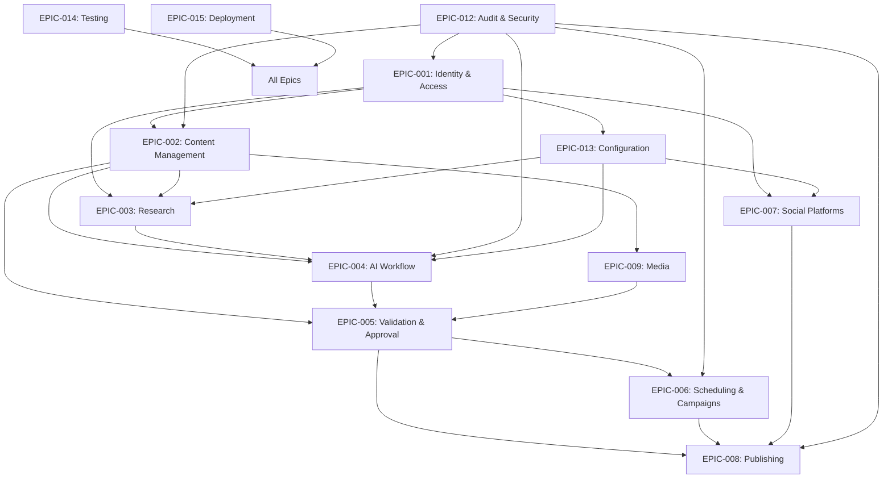

# Phase 4.1 — Epic & Feature Breakdown

**Document:** `4.1-epic-feature-breakdown.md`
**Project:** AI Content Automater
**Phase:** Phase 4 — Implementation Planning
**Status:** Draft
**Date:** 2026-10-15
**Author:** AI Assistant

---

## 1. DOCUMENT PURPOSE AND SCOPE

### 1.1 Purpose

This document provides the **Epic and Feature Breakdown** for AI Content Automater V1 implementation. It translates requirements, analysis, and design into a structured catalog of implementation work organized as:

- **Epics:** Cohesive business-value themes grouping related capabilities
- **Features:** Independently deliverable units of functionality within epics

This breakdown serves as the **requirements-traceable foundation** for subsequent Phase 4 subphases:
- Phase 4.2: User Stories & Acceptance Criteria
- Phase 4.3: Technical Tasks & Implementation Details
- Phase 4.4: Priority & Risk Assessment
- Phase 4.5: Sprint Planning & Iteration Allocation
- Phase 4.6: Backlog & Roadmap Finalization

### 1.2 What This Document Contains

✅ **In Scope:**
- Epic catalog with stable IDs and business objectives
- Feature catalog with stable IDs and epic mapping
- Complete traceability matrices (FR, BR, NFR, UC, Acceptance Criteria → Features)
- Cross-epic dependency identification
- Unresolved decision impact analysis
- Coverage gap identification

❌ **Out of Scope (Handled in Later Phases):**
- User stories (Phase 4.2)
- Acceptance criteria details (Phase 4.2)
- Technical task decomposition (Phase 4.3)
- Story point estimation (Phase 4.3)
- Priority/risk scoring (Phase 4.4)
- Sprint allocation (Phase 4.5)
- Backlog ordering (Phase 4.6)

### 1.3 Authoritative Sources

This breakdown is derived from:

1. **REQUIREMENTS.MD V2.0** (highest authority)
   - 28 Functional Requirements (FR-001 to FR-028)
   - 18 Business Rules (BR-001 to BR-018)
   - 10 Non-Functional Requirements (NFR-001 to NFR-010)
   - 26 V1 Acceptance Criteria
   - 16 Functional Areas

2. **System Analysis Documents** (docs/system-design/)
   - 2.2: Functional Requirements Analysis
   - 2.3: Use Cases (UC-001 to UC-029)
   - 2.4: Business Rules
   - 2.5: Domain Analysis
   - 2.6: Data Requirements
   - 2.7: Error/Failure Analysis
   - 2.8: Security Analysis
   - 2.9: Cross-Domain Workflows
   - 2.10: System Analysis Review

3. **Phase 3 Design Documents** (docs/system-design/)
   - 3.1: Architecture & Application Design
   - 3.2: Database & API Design
   - 3.3: AI Content Workflow Design
   - 3.4: Automation & Publishing Design
   - 3.5: UI, Security & Supporting Services Design
   - 3.6: Testing, Deployment & Operations Design

---

## 2. EPIC CATALOG

Epics represent cohesive business-value themes. Each epic groups related features that deliver a significant capability.

### Epic Naming Convention

- **Epic ID:** EPIC-NNN (stable, three-digit, zero-padded)
- **Epic Name:** Business-oriented capability name
- **Scope:** Clear boundaries of what belongs in the epic

---

### EPIC-001: Identity & Access Management

**Business Objective:**
Secure user authentication, authorization, and session management protecting user resources through ownership-based access control.

**Scope:**
User registration, login/logout, password management, session handling, resource ownership enforcement, role-based authorization (User/Administrator), CSRF protection.

**Key Business Rules:**
- BR-001: User Resource Isolation

**Related Functional Requirements:**
- FR-001: Authentication
- FR-002: Authorization

**Related Use Cases:**
- UC-001: Authenticate User
- UC-002: Authorize Resource Access
- UC-003: Manage User Session

**Related NFRs:**
- NFR-001: Security

**Boundaries:**
- ✅ Includes: User accounts, passwords, sessions, resource ownership checks
- ❌ Excludes: Social platform OAuth (in EPIC-007), business workflows

---

### EPIC-002: Content Management

**Business Objective:**
Enable users to create, edit, and manage social media content with full version history and lifecycle state tracking.

**Scope:**
Content creation, editing with version tracking, lifecycle state management, content-version immutability, material edit detection, content ownership.

**Key Business Rules:**
- BR-007: Material Edits Invalidate Approval

**Related Functional Requirements:**
- FR-003: Content Creation
- FR-004: Content Editing

**Related Use Cases:**
- UC-004: Create Content Item
- UC-005: Edit Content Item

**Related NFRs:**
- NFR-008: Data Integrity

**Boundaries:**
- ✅ Includes: Content entities, versions, draft management, editing workflows
- ❌ Excludes: AI generation (EPIC-004), research (EPIC-003), approval (EPIC-005), publishing (EPIC-008)

---

### EPIC-003: Research Integration

**Business Objective:**
Collect and organize research information from external sources to inform content generation with full traceability and attribution.

**Scope:**
Research source configuration, research execution, result storage with attribution, research-content association, failure handling.

**Key Business Rules:**
- BR-013: Accurate Failure Representation (research failures)

**Related Functional Requirements:**
- FR-005: Research

**Related Use Cases:**
- UC-006: Collect Research for Content

**Related NFRs:**
- NFR-002: Reliability

**Boundaries:**
- ✅ Includes: Research collection, source attribution, external API calls
- ❌ Excludes: AI generation (EPIC-004), content creation (EPIC-002)

**Unresolved Decisions:**
- UD-NEW: Research source providers (Section 74)

---

### EPIC-004: AI Content Workflow

**Business Objective:**
Automated AI-driven content generation, mandatory quality reviews, bounded correction cycles, and revision limit enforcement ensuring content quality through controlled AI iteration.

**Scope:**
AI generation, AI Review #1, AI correction, AI Review #2, revision counter management, revision limit enforcement, review traceability, intervention states.

**Key Business Rules:**
- BR-002: Mandatory AI Review Sequence
- BR-003: Finite AI Revision Loops
- BR-004: Failed Quality Gates Block Publication
- BR-013: Accurate Failure Representation (AI failures)

**Related Functional Requirements:**
- FR-006: AI Generation
- FR-007: AI Review #1
- FR-008: AI Correction
- FR-009: AI Review #2
- FR-010: Revision Limit

**Related Use Cases:**
- UC-007: Generate Content with AI
- UC-008: Perform AI Review #1
- UC-009: Correct Content Based on Review
- UC-010: Perform AI Review #2
- UC-011: Enforce Revision Limit

**Related NFRs:**
- NFR-002: Reliability

**Boundaries:**
- ✅ Includes: All AI generation, review, correction logic; revision control
- ❌ Excludes: Final validation (EPIC-005), approval (EPIC-005), research (EPIC-003)

**Unresolved Decisions:**
- **UD-002: AI service/model selection (BLOCKS IMPLEMENTATION)**
- UD-NEW-001: Numeric revision limit value
- UD-NEW-002: AI review rubric and scoring
- UD-NEW-003: Review passing thresholds

---

### EPIC-005: Validation & Approval

**Business Objective:**
Final quality gates ensuring only validated and explicitly approved content becomes eligible for publication through mandatory validation checks and version-specific approval.

**Scope:**
Final validation execution, validation rules, version-specific approval workflows, approval history, approval invalidation on material edits, publishing eligibility computation.

**Key Business Rules:**
- BR-004: Failed Quality Gates Block Publication
- BR-005: Final Validation Required Before Publication
- BR-006: Approval Required for Publication
- BR-007: Material Edits Invalidate Approval

**Related Functional Requirements:**
- FR-011: Final Validation
- FR-012: Approval

**Related Use Cases:**
- UC-012: Validate Content for Publication
- UC-013: Approve Content for Publication

**Related NFRs:**
- NFR-010: Auditability

**Boundaries:**
- ✅ Includes: Validation rules, approval workflows, publishing eligibility
- ❌ Excludes: AI reviews (EPIC-004), publishing execution (EPIC-008)

**Unresolved Decisions:**
- UD-003: Approval workflow complexity (single vs. multi-stage)
- UD-NEW-004: Validation scoring methodology

---

### EPIC-006: Scheduling & Campaign Automation

**Business Objective:**
Scheduled content execution and recurring campaign automation with execution-time revalidation and quality workflow preservation.

**Scope:**
Schedule creation, recurring campaign configuration, execution-time eligibility revalidation, safe work claiming, campaign enable/disable, timezone handling.

**Key Business Rules:**
- BR-008: Scheduled Content Revalidation at Execution Time
- BR-014: Campaigns Must Not Bypass Quality Workflow
- BR-015: Disabled Campaigns Must Not Continue Indefinitely

**Related Functional Requirements:**
- FR-013: Scheduling
- FR-014: Recurring Campaigns

**Related Use Cases:**
- UC-014: Schedule Content for Publication
- UC-015: Create Recurring Campaign
- UC-016: Execute Recurring Campaign

**Related NFRs:**
- NFR-002: Reliability

**Boundaries:**
- ✅ Includes: Schedules, campaigns, cron-based execution, work claiming
- ❌ Excludes: Publishing execution (EPIC-008), approval (EPIC-005)

**Unresolved Decisions:**
- UD-NEW-005: Campaign failure handling strategy

---

### EPIC-007: Social Platform Integration

**Business Objective:**
Secure connection and management of social media platform accounts with OAuth2 token handling and credential protection.

**Scope:**
Platform account connection, OAuth2 flows, token storage (encrypted), token refresh, connection management, authorization verification.

**Key Business Rules:**
- BR-016: Secrets Must Not Be Exposed

**Related Functional Requirements:**
- FR-019: Platform Connections (OAuth2)

**Related Use Cases:**
- UC-017: Connect Social Platform Account
- UC-018: Manage Platform Authorization

**Related NFRs:**
- NFR-001: Security

**Boundaries:**
- ✅ Includes: Platform connections, OAuth, token management
- ❌ Excludes: Publishing execution (EPIC-008), authentication (EPIC-001)

**Unresolved Decisions:**
- **UD-001: Social media platforms supported in V1 (BLOCKS IMPLEMENTATION)**

---

### EPIC-008: Multi-Platform Publishing

**Business Objective:**
Direct multi-platform publishing with independent per-platform results, bounded retries, duplicate protection, and unknown state handling.

**Scope:**
Direct platform API publishing, per-platform result tracking, multi-platform aggregation, publishing failure handling, bounded retry logic, duplicate prevention, unknown state representation.

**Key Business Rules:**
- BR-009: Direct Publishing Required (No Buffer Dependency)
- BR-010: Independent Per-Platform Publishing Results
- BR-011: Platform Result Independence
- BR-012: Bounded and Duplicate-Safe Publishing Retries
- BR-013: Accurate Failure Representation (publishing)
- BR-018: Unknown External State Represented Explicitly

**Related Functional Requirements:**
- FR-015: Direct Publishing
- FR-016: Platform Tracking
- FR-017: Publishing Retry

**Related Use Cases:**
- UC-019: Publish Content to Platform
- UC-020: Track Multi-Platform Publishing Results
- UC-021: Retry Failed Publishing
- UC-022: Handle Publishing Failure

**Related NFRs:**
- NFR-002: Reliability
- NFR-008: Data Integrity

**Boundaries:**
- ✅ Includes: All publishing logic, retry, result tracking
- ❌ Excludes: Platform connections (EPIC-007), scheduling (EPIC-006)

**Unresolved Decisions:**
- UD-001: Platforms for V1 (affects integration implementation)
- UD-NEW-006: Retry limit values
- UD-NEW-007: Retry backoff strategy

---

### EPIC-009: Media Management

**Business Objective:**
Media (image/video) association with content, validation of media requirements, and media metadata management.

**Scope:**
Media upload/association, media metadata storage, media requirement validation, platform-specific media rules.

**Key Business Rules:**
- BR-005: Final Validation Required (includes media checks)

**Related Functional Requirements:**
- FR-019: Media

**Related Use Cases:**
- UC-023: Associate Media with Content
- UC-024: Validate Media Requirements

**Related NFRs:**
- NFR-008: Data Integrity

**Boundaries:**
- ✅ Includes: Media metadata, associations, validation
- ❌ Excludes: Media storage infrastructure (external service), content management (EPIC-002)

**Unresolved Decisions:**
- UD-NEW: Media storage provider (Section 74)

---

### EPIC-010: Notifications & User Communication

**Business Objective:**
Timely user notifications for workflow events, failures, and state changes.

**Scope:**
Notification generation, delivery, notification preferences, event-driven notification triggers.

**Key Business Rules:**
- BR-013: Accurate Failure Representation (no false success notifications)

**Related Functional Requirements:**
- FR-018: Notifications

**Related Use Cases:**
- UC-025: Notify User of Workflow Event

**Related NFRs:**
- NFR-009: Usability

**Boundaries:**
- ✅ Includes: Notification logic, delivery integration
- ❌ Excludes: Notification channel infrastructure (email/SMS/push services)

**Unresolved Decisions:**
- UD-008: Notification channels (email/SMS/push)

---

### EPIC-011: Analytics & Reporting

**Business Objective:**
Content performance analytics and publishing history visibility for user decision-making.

**Scope:**
Analytics data collection, reporting, publishing history, content performance metrics.

**Key Business Rules:**
None directly, but supports data-driven decisions.

**Related Functional Requirements:**
- FR-020: Analytics

**Related Use Cases:**
- UC-026: View Content Analytics
- UC-027: View Publishing History

**Related NFRs:**
- NFR-009: Usability

**Boundaries:**
- ✅ Includes: Analytics data, reports, history views
- ❌ Excludes: External analytics platform integration (future)

---

### EPIC-012: Audit, Security & Operations

**Business Objective:**
Comprehensive audit logging, security event tracking, and operational observability for compliance, debugging, and security monitoring.

**Scope:**
Audit logging, security event tracking, operational logging, error handling, secret protection, background task integrity.

**Key Business Rules:**
- BR-001: User Resource Isolation (audit support)
- BR-016: Secrets Must Not Be Exposed
- BR-017: Background Tasks Must Preserve Integrity

**Related Functional Requirements:**
- FR-021: Audit
- FR-022: Error Handling
- FR-023: Background Processing
- FR-027: Security

**Related Use Cases:**
- UC-028: Audit Security Events

**Related NFRs:**
- NFR-001: Security
- NFR-002: Reliability
- NFR-005: Observability
- NFR-010: Auditability

**Boundaries:**
- ✅ Includes: Audit logs, security monitoring, error handling, background task framework
- ❌ Excludes: Infrastructure monitoring (deployment concern)

---

### EPIC-013: Configuration & Administration

**Business Objective:**
System configuration management, user administration, and integration setup for administrators.

**Scope:**
Configuration management, user management, integration credentials configuration, system settings.

**Key Business Rules:**
- BR-016: Secrets Must Not Be Exposed

**Related Functional Requirements:**
- FR-024: Configuration

**Related Use Cases:**
- UC-029: Configure System Integrations

**Related NFRs:**
- NFR-001: Security
- NFR-009: Usability

**Boundaries:**
- ✅ Includes: Admin UI, configuration storage, user management
- ❌ Excludes: Deployment configuration (EPIC-015)

---

### EPIC-014: Testing & Quality Assurance

**Business Objective:**
Comprehensive testing strategy ensuring system correctness, mandatory gate enforcement, and quality standards.

**Scope:**
Unit testing, integration testing, end-to-end testing, test data management, CI automation.

**Key Business Rules:**
All business rules must be verifiable through testing (V1 criterion #26).

**Related Functional Requirements:**
- FR-025: Testing

**Related Use Cases:**
All use cases must be testable.

**Related NFRs:**
- NFR-004: Testability

**Boundaries:**
- ✅ Includes: Test suites, test infrastructure, CI pipeline
- ❌ Excludes: Production deployment (EPIC-015)

---

### EPIC-015: Deployment & Infrastructure

**Business Objective:**
Production-ready deployment with Docker containerization, AWS deployment readiness, database migrations, and operational procedures.

**Scope:**
Docker configuration, database migrations, deployment procedures, environment configuration, infrastructure setup.

**Key Business Rules:**
None directly, but enables all features.

**Related Functional Requirements:**
- FR-026: Deployment

**Related Use Cases:**
None (infrastructure concern).

**Related NFRs:**
- NFR-006: Scalability
- NFR-007: Portability

**Boundaries:**
- ✅ Includes: Deployment artifacts, migrations, infrastructure-as-code
- ❌ Excludes: Ongoing operations, monitoring dashboards

---

## 3. EPIC SUMMARY TABLE

| Epic ID | Epic Name | Primary FR | Key BR | Unresolved Decisions |
|---------|-----------|------------|--------|---------------------|
| EPIC-001 | Identity & Access Management | FR-001, FR-002 | BR-001 | None |
| EPIC-002 | Content Management | FR-003, FR-004 | BR-007 | None |
| EPIC-003 | Research Integration | FR-005 | BR-013 | Research providers |
| EPIC-004 | AI Content Workflow | FR-006-010 | BR-002, BR-003, BR-004 | **UD-002 (BLOCKER)** |
| EPIC-005 | Validation & Approval | FR-011, FR-012 | BR-005, BR-006, BR-007 | UD-003 |
| EPIC-006 | Scheduling & Campaign Automation | FR-013, FR-014 | BR-008, BR-014, BR-015 | Campaign failures |
| EPIC-007 | Social Platform Integration | FR-019 (OAuth) | BR-016 | **UD-001 (BLOCKER)** |
| EPIC-008 | Multi-Platform Publishing | FR-015-017 | BR-009-013, BR-018 | **UD-001 (BLOCKER)** |
| EPIC-009 | Media Management | FR-019 (Media) | BR-005 | Media provider |
| EPIC-010 | Notifications & User Communication | FR-018 | BR-013 | UD-008 |
| EPIC-011 | Analytics & Reporting | FR-020 | None | None |
| EPIC-012 | Audit, Security & Operations | FR-021-023, FR-027 | BR-001, BR-016, BR-017 | None |
| EPIC-013 | Configuration & Administration | FR-024 | BR-016 | None |
| EPIC-014 | Testing & Quality Assurance | FR-025 | All (verification) | None |
| EPIC-015 | Deployment & Infrastructure | FR-026 | None | None |

**Total Epics:** 15

---

## 4. FEATURE CATALOG

Features are independently deliverable units of functionality within epics. Each feature:
- Has a stable ID (FEAT-NNN)
- Maps to exactly one parent epic
- Represents a testable capability
- Traces to specific requirements and use cases

### Feature Naming Convention

- **Feature ID:** FEAT-NNN (stable, three-digit, zero-padded)
- **Feature Name:** Capability-oriented name
- **Parent Epic:** EPIC-NNN

---

### EPIC-001: Identity & Access Management

#### FEAT-001: User Registration & Account Management
**Parent Epic:** EPIC-001
**Description:** User account creation, profile management, password reset
**Requirements:** FR-001
**Use Cases:** UC-001 (Authenticate User - account prerequisite)
**Business Rules:** BR-001

#### FEAT-002: Authentication & Session Management
**Parent Epic:** EPIC-001
**Description:** Secure login/logout, session handling, password verification
**Requirements:** FR-001
**Use Cases:** UC-001 (Authenticate User), UC-003 (Manage User Session)
**Business Rules:** BR-001

#### FEAT-003: Resource Authorization & Ownership Enforcement
**Parent Epic:** EPIC-001
**Description:** Server-side authorization checks, ownership verification, role-based access
**Requirements:** FR-002
**Use Cases:** UC-002 (Authorize Resource Access)
**Business Rules:** BR-001

#### FEAT-004: CSRF & Security Controls
**Parent Epic:** EPIC-001
**Description:** CSRF protection, secure session controls, security headers
**Requirements:** FR-027
**Use Cases:** All authenticated use cases
**Business Rules:** None directly

---

### EPIC-002: Content Management

#### FEAT-005: Content Creation
**Parent Epic:** EPIC-002
**Description:** Create new content items with ownership, topic, target platforms
**Requirements:** FR-003
**Use Cases:** UC-004 (Create Content Item)
**Business Rules:** BR-001

#### FEAT-006: Content Editing & Versioning
**Parent Epic:** EPIC-002
**Description:** Edit content, create versions, track version history, detect material edits
**Requirements:** FR-004
**Use Cases:** UC-005 (Edit Content Item)
**Business Rules:** BR-007 (Material Edits Invalidate Approval)

#### FEAT-007: Content Lifecycle State Management
**Parent Epic:** EPIC-002
**Description:** Lifecycle state tracking, state transitions, state-based permissions
**Requirements:** FR-003, FR-004
**Use Cases:** UC-004, UC-005
**Business Rules:** None directly

#### FEAT-008: Content-Version Immutability
**Parent Epic:** EPIC-002
**Description:** Immutable content versions, version snapshot creation, version retrieval
**Requirements:** FR-004
**Use Cases:** UC-005
**Business Rules:** BR-007

---

### EPIC-003: Research Integration

#### FEAT-009: Research Source Configuration
**Parent Epic:** EPIC-003
**Description:** Configure research API providers, credentials, topic mapping
**Requirements:** FR-005, FR-024
**Use Cases:** UC-029 (Configure System Integrations)
**Business Rules:** BR-016

#### FEAT-010: Research Execution & Result Storage
**Parent Epic:** EPIC-003
**Description:** Execute research queries, store results with attribution, handle failures
**Requirements:** FR-005
**Use Cases:** UC-006 (Collect Research for Content)
**Business Rules:** BR-013

#### FEAT-011: Research-Content Association
**Parent Epic:** EPIC-003
**Description:** Link research results to content, traceability, research display
**Requirements:** FR-005
**Use Cases:** UC-006
**Business Rules:** None directly

---

### EPIC-004: AI Content Workflow

#### FEAT-012: AI Service Integration
**Parent Epic:** EPIC-004
**Description:** AI provider configuration, API client, prompt handling, response parsing
**Requirements:** FR-006, FR-024
**Use Cases:** UC-029, UC-007
**Business Rules:** BR-016
**Blockers:** UD-002 (AI service selection)

#### FEAT-013: AI Content Generation
**Parent Epic:** EPIC-004
**Description:** Generate content from research/instructions, create generation records
**Requirements:** FR-006
**Use Cases:** UC-007 (Generate Content with AI)
**Business Rules:** BR-013
**Blockers:** UD-002

#### FEAT-014: AI Review #1 Execution
**Parent Epic:** EPIC-004
**Description:** Perform first AI review, record results, identify issues
**Requirements:** FR-007
**Use Cases:** UC-008 (Perform AI Review #1)
**Business Rules:** BR-002, BR-004
**Blockers:** UD-002, UD-NEW-002 (review rubric)

#### FEAT-015: AI Correction
**Parent Epic:** EPIC-004
**Description:** Apply corrections based on review feedback, increment revision counter
**Requirements:** FR-008
**Use Cases:** UC-009 (Correct Content Based on Review)
**Business Rules:** BR-003
**Blockers:** UD-002

#### FEAT-016: AI Review #2 Execution
**Parent Epic:** EPIC-004
**Description:** Perform second AI review after correction, record results
**Requirements:** FR-009
**Use Cases:** UC-010 (Perform AI Review #2)
**Business Rules:** BR-002, BR-004
**Blockers:** UD-002, UD-NEW-002

#### FEAT-017: Revision Limit Enforcement
**Parent Epic:** EPIC-004
**Description:** Track revision counter, enforce limit, transition to intervention state
**Requirements:** FR-010
**Use Cases:** UC-011 (Enforce Revision Limit)
**Business Rules:** BR-003
**Blockers:** UD-NEW-001 (numeric limit value)

#### FEAT-018: AI Interaction History & Traceability
**Parent Epic:** EPIC-004
**Description:** Store generation/review/correction history, audit trail, debugging support
**Requirements:** FR-006, FR-007, FR-008, FR-009, FR-021
**Use Cases:** UC-007-011
**Business Rules:** None directly

---

### EPIC-005: Validation & Approval

#### FEAT-019: Final Validation Execution
**Parent Epic:** EPIC-005
**Description:** Execute validation rules, check required fields, platform compatibility, media
**Requirements:** FR-011
**Use Cases:** UC-012 (Validate Content for Publication)
**Business Rules:** BR-005
**Blockers:** UD-NEW-004 (validation scoring)

#### FEAT-020: Validation Rule Engine
**Parent Epic:** EPIC-005
**Description:** Configurable validation rules, extensible checks, error reporting
**Requirements:** FR-011
**Use Cases:** UC-012
**Business Rules:** BR-005

#### FEAT-021: Approval Workflow
**Parent Epic:** EPIC-005
**Description:** Approval request, approve/reject actions, version-specific approval binding
**Requirements:** FR-012
**Use Cases:** UC-013 (Approve Content for Publication)
**Business Rules:** BR-006, BR-007
**Blockers:** UD-003 (single vs. multi-stage)

#### FEAT-022: Approval Invalidation on Material Edits
**Parent Epic:** EPIC-005
**Description:** Detect material edits, invalidate approval, return to appropriate gate
**Requirements:** FR-012, FR-004
**Use Cases:** UC-005, UC-013
**Business Rules:** BR-007

#### FEAT-023: Publishing Eligibility Computation
**Parent Epic:** EPIC-005
**Description:** Compute publishing eligibility from validation/approval/reviews, gate enforcement
**Requirements:** FR-011, FR-012
**Use Cases:** UC-012, UC-013
**Business Rules:** BR-004, BR-005, BR-006

---

### EPIC-006: Scheduling & Campaign Automation

#### FEAT-024: Content Scheduling
**Parent Epic:** EPIC-006
**Description:** Schedule approved content, timezone handling, schedule management
**Requirements:** FR-013
**Use Cases:** UC-014 (Schedule Content for Publication)
**Business Rules:** BR-008

#### FEAT-025: Execution-Time Revalidation
**Parent Epic:** EPIC-006
**Description:** Re-check eligibility at execution time, handle ineligibility
**Requirements:** FR-013
**Use Cases:** UC-014, UC-019
**Business Rules:** BR-008

#### FEAT-026: Recurring Campaign Configuration
**Parent Epic:** EPIC-006
**Description:** Create campaigns, configure recurrence, topic/platform settings
**Requirements:** FR-014
**Use Cases:** UC-015 (Create Recurring Campaign)
**Business Rules:** BR-014, BR-015

#### FEAT-027: Campaign Execution & Work Claiming
**Parent Epic:** EPIC-006
**Description:** Execute campaigns, claim work safely, prevent duplicates, respect workflow
**Requirements:** FR-014, FR-023
**Use Cases:** UC-016 (Execute Recurring Campaign)
**Business Rules:** BR-014, BR-015

#### FEAT-028: Campaign Enable/Disable Controls
**Parent Epic:** EPIC-006
**Description:** Enable/disable campaigns, stop future work, handle in-flight work
**Requirements:** FR-014
**Use Cases:** UC-015, UC-016
**Business Rules:** BR-015

---

### EPIC-007: Social Platform Integration

#### FEAT-029: Platform Connection Management
**Parent Epic:** EPIC-007
**Description:** Initiate OAuth2 flows, handle callbacks, manage connection lifecycle
**Requirements:** FR-019
**Use Cases:** UC-017 (Connect Social Platform Account), UC-018 (Manage Platform Authorization)
**Business Rules:** BR-016
**Blockers:** UD-001 (platforms for V1)

#### FEAT-030: OAuth2 Token Storage & Refresh
**Parent Epic:** EPIC-007
**Description:** Securely store tokens (encrypted), refresh tokens, token validation
**Requirements:** FR-019
**Use Cases:** UC-017, UC-018
**Business Rules:** BR-016
**Blockers:** UD-001

#### FEAT-031: Platform Authorization Verification
**Parent Epic:** EPIC-007
**Description:** Verify active authorization, handle expired/revoked credentials
**Requirements:** FR-019
**Use Cases:** UC-018, UC-019
**Business Rules:** None directly
**Blockers:** UD-001

---

### EPIC-008: Multi-Platform Publishing

#### FEAT-032: Direct Platform Publishing API Integration
**Parent Epic:** EPIC-008
**Description:** Platform-specific API clients, content translation, direct submission
**Requirements:** FR-015
**Use Cases:** UC-019 (Publish Content to Platform)
**Business Rules:** BR-009
**Blockers:** UD-001 (platforms for V1)

#### FEAT-033: Per-Platform Result Tracking
**Parent Epic:** EPIC-008
**Description:** Independent result records per platform, platform-specific timestamps/IDs
**Requirements:** FR-016
**Use Cases:** UC-020 (Track Multi-Platform Publishing Results)
**Business Rules:** BR-010, BR-011

#### FEAT-034: Multi-Platform Aggregation & Overall Status
**Parent Epic:** EPIC-008
**Description:** Aggregate status from platform results, distinguish partial success
**Requirements:** FR-016
**Use Cases:** UC-020
**Business Rules:** BR-010, BR-011

#### FEAT-035: Publishing Failure Handling
**Parent Epic:** EPIC-008
**Description:** Detect failures, preserve diagnostics, distinguish failure types
**Requirements:** FR-015, FR-022
**Use Cases:** UC-022 (Handle Publishing Failure)
**Business Rules:** BR-013

#### FEAT-036: Bounded Publishing Retry Logic
**Parent Epic:** EPIC-008
**Description:** Retry transient failures, enforce retry limits, avoid duplicates
**Requirements:** FR-017
**Use Cases:** UC-021 (Retry Failed Publishing)
**Business Rules:** BR-012
**Blockers:** UD-NEW-006 (retry limits), UD-NEW-007 (backoff strategy)

#### FEAT-037: Duplicate Publication Prevention
**Parent Epic:** EPIC-008
**Description:** Job identity, idempotency tokens, state locking, uniqueness constraints
**Requirements:** FR-017
**Use Cases:** UC-021
**Business Rules:** BR-012

#### FEAT-038: Unknown External State Representation
**Parent Epic:** EPIC-008
**Description:** Explicitly represent unknown publishing outcomes, investigation support
**Requirements:** FR-015
**Use Cases:** UC-019, UC-022
**Business Rules:** BR-018

---

### EPIC-009: Media Management

#### FEAT-039: Media Upload & Association
**Parent Epic:** EPIC-009
**Description:** Upload media to external storage, associate with content, metadata storage
**Requirements:** FR-019
**Use Cases:** UC-023 (Associate Media with Content)
**Business Rules:** None directly

#### FEAT-040: Media Requirement Validation
**Parent Epic:** EPIC-009
**Description:** Validate media dimensions/formats/sizes per platform, validation rules
**Requirements:** FR-019, FR-011
**Use Cases:** UC-024 (Validate Media Requirements)
**Business Rules:** BR-005

#### FEAT-041: Media Metadata Management
**Parent Epic:** EPIC-009
**Description:** Store media metadata, alt text, captions, platform-specific handling
**Requirements:** FR-019
**Use Cases:** UC-023
**Business Rules:** None directly

---

### EPIC-010: Notifications & User Communication

#### FEAT-042: Notification Generation & Delivery
**Parent Epic:** EPIC-010
**Description:** Generate event-driven notifications, deliver via configured channels
**Requirements:** FR-018
**Use Cases:** UC-025 (Notify User of Workflow Event)
**Business Rules:** BR-013
**Blockers:** UD-008 (notification channels)

#### FEAT-043: Notification Preferences & Management
**Parent Epic:** EPIC-010
**Description:** User notification preferences, opt-in/out, channel selection
**Requirements:** FR-018
**Use Cases:** UC-025
**Business Rules:** None directly

#### FEAT-044: Notification Event Triggers
**Parent Epic:** EPIC-010
**Description:** Event detection, trigger conditions, notification context assembly
**Requirements:** FR-018
**Use Cases:** UC-025
**Business Rules:** None directly

---

### EPIC-011: Analytics & Reporting

#### FEAT-045: Content Analytics Collection
**Parent Epic:** EPIC-011
**Description:** Collect performance metrics, engagement data, analytics storage
**Requirements:** FR-020
**Use Cases:** UC-026 (View Content Analytics)
**Business Rules:** None directly

#### FEAT-046: Publishing History Tracking
**Parent Epic:** EPIC-011
**Description:** Record publishing events, platform results, historical timeline
**Requirements:** FR-020
**Use Cases:** UC-027 (View Publishing History)
**Business Rules:** None directly

#### FEAT-047: Analytics Reporting & Visualization
**Parent Epic:** EPIC-011
**Description:** Analytics dashboards, reports, performance summaries
**Requirements:** FR-020
**Use Cases:** UC-026, UC-027
**Business Rules:** None directly

---

### EPIC-012: Audit, Security & Operations

#### FEAT-048: Comprehensive Audit Logging
**Parent Epic:** EPIC-012
**Description:** Audit log all security events, state changes, immutable log storage
**Requirements:** FR-021
**Use Cases:** UC-028 (Audit Security Events)
**Business Rules:** None directly

#### FEAT-049: Security Event Monitoring
**Parent Epic:** EPIC-012
**Description:** Track authentication failures, authorization violations, suspicious activity
**Requirements:** FR-021, FR-027
**Use Cases:** UC-028
**Business Rules:** BR-001

#### FEAT-050: Error Handling & Logging
**Parent Epic:** EPIC-012
**Description:** Structured error logging, safe error messages, debugging support
**Requirements:** FR-022
**Use Cases:** All use cases (failure paths)
**Business Rules:** BR-013, BR-016

#### FEAT-051: Background Task Framework
**Parent Epic:** EPIC-012
**Description:** Celery task infrastructure, worker management, task state, bounded retries
**Requirements:** FR-023
**Use Cases:** All async use cases
**Business Rules:** BR-017

#### FEAT-052: Background Task Ownership Preservation
**Parent Epic:** EPIC-012
**Description:** Preserve ownership context in tasks, authorization in background jobs
**Requirements:** FR-023
**Use Cases:** All async use cases
**Business Rules:** BR-017

#### FEAT-053: Secret Protection & Management
**Parent Epic:** EPIC-012
**Description:** Secure secret storage, no exposure in logs/UI/API, encrypted credentials
**Requirements:** FR-027, FR-024
**Use Cases:** UC-001, UC-017, UC-029
**Business Rules:** BR-016

---

### EPIC-013: Configuration & Administration

#### FEAT-054: System Configuration Management
**Parent Epic:** EPIC-013
**Description:** Configuration storage, environment-specific settings, secret handling
**Requirements:** FR-024
**Use Cases:** UC-029 (Configure System Integrations)
**Business Rules:** BR-016

#### FEAT-055: User Management (Admin)
**Parent Epic:** EPIC-013
**Description:** Admin UI for user CRUD, role assignment, account management
**Requirements:** FR-002, FR-024
**Use Cases:** None specific (admin operations)
**Business Rules:** BR-001

#### FEAT-056: Integration Credentials Configuration
**Parent Epic:** EPIC-013
**Description:** Configure AI/research/platform API credentials, test connections
**Requirements:** FR-024
**Use Cases:** UC-029
**Business Rules:** BR-016

---

### EPIC-014: Testing & Quality Assurance

#### FEAT-057: Unit Testing Infrastructure
**Parent Epic:** EPIC-014
**Description:** Unit test framework, test fixtures, mocking infrastructure
**Requirements:** FR-025
**Use Cases:** All (verification)
**Business Rules:** All (must be testable)

#### FEAT-058: Integration Testing Infrastructure
**Parent Epic:** EPIC-014
**Description:** Integration test suites, database test setup, external service mocking
**Requirements:** FR-025
**Use Cases:** All (verification)
**Business Rules:** All (verification)

#### FEAT-059: End-to-End Testing
**Parent Epic:** EPIC-014
**Description:** E2E test scenarios, critical workflow verification, gate bypass prevention tests
**Requirements:** FR-025
**Use Cases:** All critical workflows
**Business Rules:** All (especially mandatory gates)

#### FEAT-060: CI/CD Pipeline Integration
**Parent Epic:** EPIC-014
**Description:** Automated test execution, CI configuration, test result reporting
**Requirements:** FR-025, FR-026
**Use Cases:** None (infrastructure)
**Business Rules:** None directly

---

### EPIC-015: Deployment & Infrastructure

#### FEAT-061: Docker Containerization
**Parent Epic:** EPIC-015
**Description:** Dockerfile, docker-compose, container configuration, multi-service orchestration
**Requirements:** FR-026
**Use Cases:** None (infrastructure)
**Business Rules:** None directly

#### FEAT-062: Database Migrations
**Parent Epic:** EPIC-015
**Description:** Migration framework, schema versioning, migration rollback support
**Requirements:** FR-026
**Use Cases:** None (infrastructure)
**Business Rules:** None directly

#### FEAT-063: AWS Deployment Readiness
**Parent Epic:** EPIC-015
**Description:** AWS-compatible configuration, deployment scripts, infrastructure documentation
**Requirements:** FR-026
**Use Cases:** None (infrastructure)
**Business Rules:** None directly

#### FEAT-064: Environment Configuration
**Parent Epic:** EPIC-015
**Description:** Environment-specific config, secret injection, deployment validation
**Requirements:** FR-026, FR-024
**Use Cases:** None (infrastructure)
**Business Rules:** BR-016

---

## 5. FEATURE SUMMARY TABLE

| Feature ID | Feature Name | Parent Epic | Primary FR | Key UC | Blockers |
|------------|--------------|-------------|------------|--------|----------|
| FEAT-001 | User Registration & Account Management | EPIC-001 | FR-001 | UC-001 | None |
| FEAT-002 | Authentication & Session Management | EPIC-001 | FR-001 | UC-001, UC-003 | None |
| FEAT-003 | Resource Authorization & Ownership | EPIC-001 | FR-002 | UC-002 | None |
| FEAT-004 | CSRF & Security Controls | EPIC-001 | FR-027 | All | None |
| FEAT-005 | Content Creation | EPIC-002 | FR-003 | UC-004 | None |
| FEAT-006 | Content Editing & Versioning | EPIC-002 | FR-004 | UC-005 | None |
| FEAT-007 | Content Lifecycle State Management | EPIC-002 | FR-003-004 | UC-004-005 | None |
| FEAT-008 | Content-Version Immutability | EPIC-002 | FR-004 | UC-005 | None |
| FEAT-009 | Research Source Configuration | EPIC-003 | FR-005, FR-024 | UC-029 | Research providers |
| FEAT-010 | Research Execution & Result Storage | EPIC-003 | FR-005 | UC-006 | None |
| FEAT-011 | Research-Content Association | EPIC-003 | FR-005 | UC-006 | None |
| FEAT-012 | AI Service Integration | EPIC-004 | FR-006, FR-024 | UC-029, UC-007 | **UD-002** |
| FEAT-013 | AI Content Generation | EPIC-004 | FR-006 | UC-007 | **UD-002** |
| FEAT-014 | AI Review #1 Execution | EPIC-004 | FR-007 | UC-008 | **UD-002** |
| FEAT-015 | AI Correction | EPIC-004 | FR-008 | UC-009 | **UD-002** |
| FEAT-016 | AI Review #2 Execution | EPIC-004 | FR-009 | UC-010 | **UD-002** |
| FEAT-017 | Revision Limit Enforcement | EPIC-004 | FR-010 | UC-011 | UD-NEW-001 |
| FEAT-018 | AI Interaction History | EPIC-004 | FR-006-009, FR-021 | UC-007-011 | None |
| FEAT-019 | Final Validation Execution | EPIC-005 | FR-011 | UC-012 | UD-NEW-004 |
| FEAT-020 | Validation Rule Engine | EPIC-005 | FR-011 | UC-012 | None |
| FEAT-021 | Approval Workflow | EPIC-005 | FR-012 | UC-013 | UD-003 |
| FEAT-022 | Approval Invalidation on Edits | EPIC-005 | FR-012, FR-004 | UC-005, UC-013 | None |
| FEAT-023 | Publishing Eligibility Computation | EPIC-005 | FR-011-012 | UC-012-013 | None |
| FEAT-024 | Content Scheduling | EPIC-006 | FR-013 | UC-014 | None |
| FEAT-025 | Execution-Time Revalidation | EPIC-006 | FR-013 | UC-014, UC-019 | None |
| FEAT-026 | Recurring Campaign Configuration | EPIC-006 | FR-014 | UC-015 | None |
| FEAT-027 | Campaign Execution & Work Claiming | EPIC-006 | FR-014, FR-023 | UC-016 | None |
| FEAT-028 | Campaign Enable/Disable Controls | EPIC-006 | FR-014 | UC-015-016 | None |
| FEAT-029 | Platform Connection Management | EPIC-007 | FR-019 | UC-017-018 | **UD-001** |
| FEAT-030 | OAuth2 Token Storage & Refresh | EPIC-007 | FR-019 | UC-017-018 | **UD-001** |
| FEAT-031 | Platform Authorization Verification | EPIC-007 | FR-019 | UC-018-019 | **UD-001** |
| FEAT-032 | Direct Platform Publishing API | EPIC-008 | FR-015 | UC-019 | **UD-001** |
| FEAT-033 | Per-Platform Result Tracking | EPIC-008 | FR-016 | UC-020 | None |
| FEAT-034 | Multi-Platform Aggregation | EPIC-008 | FR-016 | UC-020 | None |
| FEAT-035 | Publishing Failure Handling | EPIC-008 | FR-015, FR-022 | UC-022 | None |
| FEAT-036 | Bounded Publishing Retry Logic | EPIC-008 | FR-017 | UC-021 | UD-NEW-006-007 |
| FEAT-037 | Duplicate Publication Prevention | EPIC-008 | FR-017 | UC-021 | None |
| FEAT-038 | Unknown State Representation | EPIC-008 | FR-015 | UC-019, UC-022 | None |
| FEAT-039 | Media Upload & Association | EPIC-009 | FR-019 | UC-023 | None |
| FEAT-040 | Media Requirement Validation | EPIC-009 | FR-019, FR-011 | UC-024 | None |
| FEAT-041 | Media Metadata Management | EPIC-009 | FR-019 | UC-023 | None |
| FEAT-042 | Notification Generation & Delivery | EPIC-010 | FR-018 | UC-025 | UD-008 |
| FEAT-043 | Notification Preferences | EPIC-010 | FR-018 | UC-025 | None |
| FEAT-044 | Notification Event Triggers | EPIC-010 | FR-018 | UC-025 | None |
| FEAT-045 | Content Analytics Collection | EPIC-011 | FR-020 | UC-026 | None |
| FEAT-046 | Publishing History Tracking | EPIC-011 | FR-020 | UC-027 | None |
| FEAT-047 | Analytics Reporting | EPIC-011 | FR-020 | UC-026-027 | None |
| FEAT-048 | Comprehensive Audit Logging | EPIC-012 | FR-021 | UC-028 | None |
| FEAT-049 | Security Event Monitoring | EPIC-012 | FR-021, FR-027 | UC-028 | None |
| FEAT-050 | Error Handling & Logging | EPIC-012 | FR-022 | All | None |
| FEAT-051 | Background Task Framework | EPIC-012 | FR-023 | All async | None |
| FEAT-052 | Background Task Ownership | EPIC-012 | FR-023 | All async | None |
| FEAT-053 | Secret Protection & Management | EPIC-012 | FR-027, FR-024 | UC-001, UC-017, UC-029 | None |
| FEAT-054 | System Configuration Management | EPIC-013 | FR-024 | UC-029 | None |
| FEAT-055 | User Management (Admin) | EPIC-013 | FR-002, FR-024 | None | None |
| FEAT-056 | Integration Credentials Config | EPIC-013 | FR-024 | UC-029 | None |
| FEAT-057 | Unit Testing Infrastructure | EPIC-014 | FR-025 | All | None |
| FEAT-058 | Integration Testing Infrastructure | EPIC-014 | FR-025 | All | None |
| FEAT-059 | End-to-End Testing | EPIC-014 | FR-025 | Critical workflows | None |
| FEAT-060 | CI/CD Pipeline Integration | EPIC-014 | FR-025-026 | None | None |
| FEAT-061 | Docker Containerization | EPIC-015 | FR-026 | None | None |
| FEAT-062 | Database Migrations | EPIC-015 | FR-026 | None | None |
| FEAT-063 | AWS Deployment Readiness | EPIC-015 | FR-026 | None | None |
| FEAT-064 | Environment Configuration | EPIC-015 | FR-026, FR-024 | None | None |

**Total Features:** 64

---

## 6. TRACEABILITY MATRICES

### 6.1 Functional Requirements → Features

Complete mapping of all 28 functional requirements to implementing features:

| FR ID | Requirement Name | Implementing Features |
|-------|-----------------|----------------------|
| FR-001 | Authentication | FEAT-001, FEAT-002 |
| FR-002 | Authorization | FEAT-003, FEAT-055 |
| FR-003 | Content Creation | FEAT-005, FEAT-007 |
| FR-004 | Content Editing | FEAT-006, FEAT-007, FEAT-008, FEAT-022 |
| FR-005 | Research | FEAT-009, FEAT-010, FEAT-011 |
| FR-006 | AI Generation | FEAT-012, FEAT-013, FEAT-018 |
| FR-007 | AI Review #1 | FEAT-014, FEAT-018 |
| FR-008 | AI Correction | FEAT-015, FEAT-018 |
| FR-009 | AI Review #2 | FEAT-016, FEAT-018 |
| FR-010 | Revision Limit | FEAT-017 |
| FR-011 | Final Validation | FEAT-019, FEAT-020, FEAT-023, FEAT-040 |
| FR-012 | Approval | FEAT-021, FEAT-022, FEAT-023 |
| FR-013 | Scheduling | FEAT-024, FEAT-025 |
| FR-014 | Recurring Campaigns | FEAT-026, FEAT-027, FEAT-028 |
| FR-015 | Direct Publishing | FEAT-032, FEAT-035, FEAT-038 |
| FR-016 | Platform Tracking | FEAT-033, FEAT-034 |
| FR-017 | Publishing Retry | FEAT-036, FEAT-037 |
| FR-018 | Notifications | FEAT-042, FEAT-043, FEAT-044 |
| FR-019 | Media & Platform Connections | FEAT-029, FEAT-030, FEAT-031, FEAT-039, FEAT-040, FEAT-041 |
| FR-020 | Analytics | FEAT-045, FEAT-046, FEAT-047 |
| FR-021 | Audit | FEAT-048, FEAT-049, FEAT-018 |
| FR-022 | Error Handling | FEAT-050, FEAT-035 |
| FR-023 | Background Processing | FEAT-051, FEAT-052, FEAT-027 |
| FR-024 | Configuration | FEAT-009, FEAT-012, FEAT-054, FEAT-056, FEAT-064 |
| FR-025 | Testing | FEAT-057, FEAT-058, FEAT-059, FEAT-060 |
| FR-026 | Deployment | FEAT-060, FEAT-061, FEAT-062, FEAT-063, FEAT-064 |
| FR-027 | Security | FEAT-004, FEAT-049, FEAT-053 |
| FR-028 | Maintainability | All features (cross-cutting design concern) |

**Coverage:** All 28 functional requirements mapped to features. ✅

---

### 6.2 Business Rules → Features

Complete mapping of all 18 business rules to responsible features:

| BR ID | Business Rule | Responsible Features | Enforcement Type |
|-------|---------------|---------------------|------------------|
| BR-001 | User Resource Isolation | FEAT-003, FEAT-005-008, FEAT-049 | Authorization checks |
| BR-002 | Mandatory AI Review Sequence | FEAT-014, FEAT-016, FEAT-023 | Workflow gates |
| BR-003 | Finite AI Revision Loops | FEAT-017 | Counter enforcement |
| BR-004 | Failed Quality Gates Block Publication | FEAT-014, FEAT-016, FEAT-019, FEAT-023 | Eligibility computation |
| BR-005 | Final Validation Required | FEAT-019, FEAT-023, FEAT-040 | Validation gate |
| BR-006 | Approval Required for Publication | FEAT-021, FEAT-023 | Approval gate |
| BR-007 | Material Edits Invalidate Approval | FEAT-006, FEAT-022 | Edit detection |
| BR-008 | Scheduled Content Revalidation | FEAT-025 | Execution-time checks |
| BR-009 | Direct Publishing Required | FEAT-032 | Architecture constraint |
| BR-010 | Independent Per-Platform Results | FEAT-033 | Data model |
| BR-011 | Platform Result Independence | FEAT-033, FEAT-034 | Data isolation |
| BR-012 | Bounded Duplicate-Safe Retries | FEAT-036, FEAT-037 | Retry logic |
| BR-013 | Accurate Failure Representation | FEAT-010, FEAT-013-016, FEAT-035, FEAT-042, FEAT-050 | Failure handling |
| BR-014 | Campaigns Respect Quality Workflow | FEAT-027 | Campaign execution |
| BR-015 | Disabled Campaigns Stop Future Work | FEAT-028 | Campaign controls |
| BR-016 | Secrets Must Not Be Exposed | FEAT-009, FEAT-012, FEAT-030, FEAT-053, FEAT-054, FEAT-056 | Secret management |
| BR-017 | Background Tasks Preserve Integrity | FEAT-052 | Task infrastructure |
| BR-018 | Unknown External State Explicit | FEAT-038 | State representation |

**Coverage:** All 18 business rules mapped to responsible features. ✅

---

### 6.3 Use Cases → Features

Complete mapping of all 29 use cases to implementing features:

| UC ID | Use Case Name | Implementing Features |
|-------|--------------|----------------------|
| UC-001 | Authenticate User | FEAT-001, FEAT-002 |
| UC-002 | Authorize Resource Access | FEAT-003 |
| UC-003 | Manage User Session | FEAT-002 |
| UC-004 | Create Content Item | FEAT-005, FEAT-007 |
| UC-005 | Edit Content Item | FEAT-006, FEAT-007, FEAT-008, FEAT-022 |
| UC-006 | Collect Research for Content | FEAT-009, FEAT-010, FEAT-011 |
| UC-007 | Generate Content with AI | FEAT-012, FEAT-013, FEAT-018 |
| UC-008 | Perform AI Review #1 | FEAT-014, FEAT-018 |
| UC-009 | Correct Content Based on Review | FEAT-015, FEAT-018 |
| UC-010 | Perform AI Review #2 | FEAT-016, FEAT-018 |
| UC-011 | Enforce Revision Limit | FEAT-017 |
| UC-012 | Validate Content for Publication | FEAT-019, FEAT-020, FEAT-023, FEAT-040 |
| UC-013 | Approve Content for Publication | FEAT-021, FEAT-022, FEAT-023 |
| UC-014 | Schedule Content for Publication | FEAT-024, FEAT-025 |
| UC-015 | Create Recurring Campaign | FEAT-026, FEAT-028 |
| UC-016 | Execute Recurring Campaign | FEAT-027, FEAT-028 |
| UC-017 | Connect Social Platform Account | FEAT-029, FEAT-030 |
| UC-018 | Manage Platform Authorization | FEAT-029, FEAT-030, FEAT-031 |
| UC-019 | Publish Content to Platform | FEAT-025, FEAT-031, FEAT-032, FEAT-035, FEAT-038 |
| UC-020 | Track Multi-Platform Publishing Results | FEAT-033, FEAT-034 |
| UC-021 | Retry Failed Publishing | FEAT-036, FEAT-037 |
| UC-022 | Handle Publishing Failure | FEAT-035, FEAT-038 |
| UC-023 | Associate Media with Content | FEAT-039, FEAT-041 |
| UC-024 | Validate Media Requirements | FEAT-040 |
| UC-025 | Notify User of Workflow Event | FEAT-042, FEAT-043, FEAT-044 |
| UC-026 | View Content Analytics | FEAT-045, FEAT-047 |
| UC-027 | View Publishing History | FEAT-046, FEAT-047 |
| UC-028 | Audit Security Events | FEAT-048, FEAT-049 |
| UC-029 | Configure System Integrations | FEAT-009, FEAT-012, FEAT-054, FEAT-056 |

**Coverage:** All 29 use cases mapped to features. ✅

---

### 6.4 V1 Acceptance Criteria → Features

Complete mapping of all 26 V1 acceptance criteria (REQUIREMENTS.MD Section 73) to features:

| # | Acceptance Criterion | Implementing Features |
|---|---------------------|----------------------|
| 1 | Users authenticate securely | FEAT-001, FEAT-002, FEAT-004 |
| 2 | Users cannot access other users' resources | FEAT-003 |
| 3 | Content created with topic and platforms | FEAT-005 |
| 4 | Research collected and associated | FEAT-010, FEAT-011 |
| 5 | AI generates content from research/instructions | FEAT-013 |
| 6 | AI Review #1 executes after generation | FEAT-014 |
| 7 | Correction applied when review identifies issues | FEAT-015 |
| 8 | AI Review #2 executes after correction | FEAT-016 |
| 9 | Revision counter enforces limit | FEAT-017 |
| 10 | Final validation checks all conditions | FEAT-019, FEAT-020 |
| 11 | Approval required before publishing | FEAT-021 |
| 12 | Material edits invalidate approval | FEAT-022 |
| 13 | Content scheduled for future publishing | FEAT-024 |
| 14 | Recurring campaigns generate content automatically | FEAT-026, FEAT-027 |
| 15 | Users connect social platform accounts securely | FEAT-029, FEAT-030 |
| 16 | Content publishes directly to platforms | FEAT-032 |
| 17 | Each platform result tracked independently | FEAT-033, FEAT-034 |
| 18 | Failed publishing retries with bounded logic | FEAT-036, FEAT-037 |
| 19 | Media associated and validated | FEAT-039, FEAT-040, FEAT-041 |
| 20 | Users notified of key workflow events | FEAT-042, FEAT-044 |
| 21 | Analytics and history viewable | FEAT-045, FEAT-046, FEAT-047 |
| 22 | Security events audited | FEAT-048, FEAT-049 |
| 23 | System deployable via Docker | FEAT-061, FEAT-063 |
| 24 | Secrets never exposed in UI/logs/source | FEAT-053 |
| 25 | Failed external operations represented accurately | FEAT-035, FEAT-038, FEAT-050 |
| 26 | Mandatory gates cannot be bypassed (tested) | FEAT-023, FEAT-059 |

**Coverage:** All 26 V1 acceptance criteria mapped to features. ✅

---

### 6.5 Non-Functional Requirements → Features

Mapping of 10 NFRs to features (cross-cutting concerns):

| NFR ID | Requirement | Addressing Features | Implementation Approach |
|--------|-------------|--------------------|-----------------------|
| NFR-001 | Security | FEAT-001-004, FEAT-029-031, FEAT-049, FEAT-053 | Auth, encryption, CSRF, secrets |
| NFR-002 | Reliability | FEAT-010, FEAT-013-017, FEAT-025, FEAT-027, FEAT-035-037, FEAT-050-051 | Failure handling, retries, safe defaults |
| NFR-003 | Maintainability | All features | Modular monolith, clear boundaries, documentation |
| NFR-004 | Testability | FEAT-057-060 | Test infrastructure, CI/CD |
| NFR-005 | Observability | FEAT-048, FEAT-050 | Audit logs, structured logging |
| NFR-006 | Scalability | FEAT-051, FEAT-061 | Background processing, containerization |
| NFR-007 | Portability | FEAT-061, FEAT-063-064 | Docker, cloud-agnostic config |
| NFR-008 | Data Integrity | FEAT-006, FEAT-008, FEAT-033-034, FEAT-038 | Version immutability, accurate state |
| NFR-009 | Usability | FEAT-028, FEAT-043, FEAT-047 | User controls, preferences, dashboards |
| NFR-010 | Auditability | FEAT-018, FEAT-021, FEAT-048 | Immutable logs, traceable actions |

**Coverage:** All 10 NFRs addressed through features. ✅

---

## 7. CROSS-EPIC DEPENDENCIES

Dependencies between epics that affect implementation sequencing:

### 7.1 Dependency Graph

### 7.2 Critical Path Dependencies

**Foundation Layer (Must Implement First):**
1. **EPIC-001: Identity & Access** — Required by all user-facing features
2. **EPIC-012: Audit & Security** (partial) — Background task framework, secret management
3. **EPIC-013: Configuration** — External integration credentials
4. **EPIC-015: Deployment** (partial) — Database, Docker setup

**Core Workflow Layer (Second):**
5. **EPIC-002: Content Management** — Required by all content workflows
6. **EPIC-003: Research** — Feeds AI workflow
7. **EPIC-004: AI Workflow** — Core business value, longest chain

**Quality & Publishing Layer (Third):**
8. **EPIC-005: Validation & Approval** — Gates publication
9. **EPIC-007: Social Platform Integration** — Enables publishing
10. **EPIC-009: Media** — Required for validation

**Execution Layer (Fourth):**
11. **EPIC-006: Scheduling & Campaigns** — Requires approved content
12. **EPIC-008: Multi-Platform Publishing** — Final execution

**Supporting Layer (Parallel):**
13. **EPIC-010: Notifications** — Can develop in parallel
14. **EPIC-011: Analytics** — Can develop in parallel

**Continuous Layer (Throughout):**
15. **EPIC-014: Testing** — Continuous alongside all development
16. **EPIC-015: Deployment** (final) — Finalize at end

### 7.3 Blocking Dependencies

| Dependent Epic | Blocks | Reason |
|----------------|--------|--------|
| EPIC-001 | EPIC-002, 003, 007, 013 | Authentication required for ownership |
| EPIC-002 | EPIC-003, 004, 005, 009 | Content entity required for workflows |
| EPIC-004 | EPIC-005 | Reviews must complete before validation |
| EPIC-005 | EPIC-006, 008 | Eligibility required for publishing |
| EPIC-007 | EPIC-008 | Platform connections required for publishing |
| EPIC-012 (partial) | All async epics | Background task infrastructure required |
| EPIC-013 | EPIC-003, 004, 007 | Credentials required for external integrations |

---

## 8. UNRESOLVED DECISION IMPACTS

### 8.1 Blocking Decisions (Prevent Implementation Start)

#### UD-002: AI Service/Model Selection
**Status:** UNRESOLVED — BLOCKS IMPLEMENTATION
**Affects Epics:** EPIC-004 (AI Content Workflow)
**Affects Features:** FEAT-012, FEAT-013, FEAT-014, FEAT-015, FEAT-016
**Impact:** Cannot implement any AI integration without knowing:
- Which AI provider (OpenAI, Anthropic, local, etc.)
- API specifications
- Authentication mechanism
- Prompt engineering approach
- Cost implications
- Rate limits

**Mitigation:** Design abstraction layer, but implementation fully blocked.

**Recommendation:** **RESOLVE IMMEDIATELY — Critical path blocker.**

---

#### UD-001: Social Media Platforms for V1
**Status:** UNRESOLVED — BLOCKS IMPLEMENTATION
**Affects Epics:** EPIC-007 (Social Platform Integration), EPIC-008 (Multi-Platform Publishing)
**Affects Features:** FEAT-029, FEAT-030, FEAT-031, FEAT-032
**Impact:** Cannot implement without knowing:
- Which platforms (Twitter/X, LinkedIn, Facebook, etc.)
- Platform API specifications
- OAuth2 flows per platform
- Content format constraints per platform
- Rate limits per platform

**Mitigation:** Design abstraction layer, but implementation fully blocked.

**Recommendation:** **RESOLVE IMMEDIATELY — Critical path blocker.**

---

### 8.2 Non-Blocking Decisions (Can Start with Placeholders)

#### UD-003: Approval Workflow Complexity
**Status:** UNRESOLVED — NON-BLOCKING
**Affects Epics:** EPIC-005 (Validation & Approval)
**Affects Features:** FEAT-021
**Impact:** Affects approval UI and workflow logic:
- Single approver vs. multi-stage approval
- Role-based approval routing
- Approval delegation

**Mitigation:** Implement simple single-approval workflow initially, design for extension.

**Recommendation:** Start with single approver, revisit in Phase 4.4 priority analysis.

---

#### UD-008: Notification Channels
**Status:** UNRESOLVED — NON-BLOCKING
**Affects Epics:** EPIC-010 (Notifications)
**Affects Features:** FEAT-042
**Impact:** Affects notification delivery integration:
- Email only
- SMS
- Push notifications
- In-app only

**Mitigation:** Implement notification abstraction, start with email.

**Recommendation:** Start with email, add channels later.

---

#### UD-NEW-001: Numeric Revision Limit Value
**Status:** UNRESOLVED — NON-BLOCKING
**Affects Epics:** EPIC-004 (AI Workflow)
**Affects Features:** FEAT-017
**Impact:** Exact numeric value for max revisions (placeholder: 3)

**Mitigation:** Implement as configuration value, use 3 as default.

**Recommendation:** Use 3 initially, make configurable, gather operational data.

---

#### UD-NEW-002: AI Review Rubric & Scoring
**Status:** UNRESOLVED — NON-BLOCKING
**Affects Epics:** EPIC-004 (AI Workflow)
**Affects Features:** FEAT-014, FEAT-016
**Impact:** Review criteria and passing thresholds

**Mitigation:** Implement simple pass/fail initially, design for scoring extension.

**Recommendation:** Start with binary pass/fail based on AI response structure.

---

#### UD-NEW-004: Validation Scoring Methodology
**Status:** UNRESOLVED — NON-BLOCKING
**Affects Epics:** EPIC-005 (Validation & Approval)
**Affects Features:** FEAT-019
**Impact:** How validation results are scored

**Mitigation:** Implement rule-based pass/fail, extend to scoring later.

**Recommendation:** Start with mandatory rule checks, severity levels.

---

#### UD-NEW-006 & UD-NEW-007: Retry Limits and Backoff Strategy
**Status:** UNRESOLVED — NON-BLOCKING
**Affects Epics:** EPIC-008 (Multi-Platform Publishing)
**Affects Features:** FEAT-036
**Impact:** Exact retry counts and delays

**Mitigation:** Implement as configuration, use industry standard defaults (3 retries, exponential backoff).

**Recommendation:** Use 3 retries, exponential backoff (1s, 2s, 4s), make configurable.

---

### 8.3 Deferred Decisions (Not V1 Scope)

- **UD-007:** Multi-tenancy architecture — Assume single-tenant with row-level ownership for V1
- **Research source providers:** Unspecified, assume configurable API endpoints
- **Media storage provider:** Assume AWS S3 or compatible, configurable

---

## 9. COVERAGE GAP ANALYSIS

### 9.1 Requirements Coverage Verification

**Functional Requirements (28):**
- ✅ All 28 FR mapped to features
- ✅ No FR without implementing feature
- ✅ No invented FR

**Business Rules (18):**
- ✅ All 18 BR mapped to responsible features
- ✅ Critical invariants enforced (BR-001 through BR-018)
- ✅ No BR ignored

**Use Cases (29):**
- ✅ All 29 UC mapped to features
- ✅ All actors covered
- ✅ All workflows covered

**V1 Acceptance Criteria (26):**
- ✅ All 26 criteria mapped to features
- ✅ Testability criterion (#26) addressed via EPIC-014

**Non-Functional Requirements (10):**
- ✅ All 10 NFR addressed
- ✅ Cross-cutting concerns identified

### 9.2 Identified Gaps: NONE

**Analysis Result:** No coverage gaps identified. All requirements, business rules, use cases, and acceptance criteria trace to specific features.

---

## 10. EPIC-LEVEL EFFORT ESTIMATES (ROUGH ORDER OF MAGNITUDE)

**Note:** These are ROM estimates for planning purposes only. Detailed estimation occurs in Phase 4.3.

| Epic ID | Epic Name | Relative Size | Rationale |
|---------|-----------|--------------|-----------|
| EPIC-001 | Identity & Access | Small | Standard Django auth, 4 features |
| EPIC-002 | Content Management | Medium | Core entity, versioning, 4 features |
| EPIC-003 | Research Integration | Small | External API calls, 3 features |
| EPIC-004 | AI Content Workflow | **X-Large** | **Most complex, 7 features, external AI, state machine, BLOCKER: UD-002** |
| EPIC-005 | Validation & Approval | Medium | Rule engine, approval workflow, 5 features |
| EPIC-006 | Scheduling & Campaigns | Large | Cron logic, work claiming, revalidation, 5 features |
| EPIC-007 | Social Platform Integration | Medium | **OAuth2, token management, 3 features, BLOCKER: UD-001** |
| EPIC-008 | Multi-Platform Publishing | **X-Large** | **Multi-platform, retries, state handling, 7 features, BLOCKER: UD-001** |
| EPIC-009 | Media Management | Small | Metadata, validation, 3 features |
| EPIC-010 | Notifications | Small | Event-driven delivery, 3 features |
| EPIC-011 | Analytics & Reporting | Medium | Data collection, reporting, 3 features |
| EPIC-012 | Audit, Security & Operations | Large | Cross-cutting, background tasks, 6 features |
| EPIC-013 | Configuration & Administration | Small | Config storage, admin UI, 3 features |
| EPIC-014 | Testing & Quality Assurance | **X-Large** | **Comprehensive test coverage, CI, 4 features, continuous effort** |
| EPIC-015 | Deployment & Infrastructure | Medium | Docker, migrations, AWS setup, 4 features |

**Total:** 15 epics, 64 features

**Effort Distribution:**
- X-Large: 3 epics (EPIC-004, EPIC-008, EPIC-014)
- Large: 2 epics (EPIC-006, EPIC-012)
- Medium: 6 epics
- Small: 4 epics

---

## 11. CROSS-DOCUMENT ISSUES

### 11.1 Phase 3 Completeness Assessment

**Phase 3 Documents Reviewed:**
- ✅ 3.1: Architecture & Application Design (complete, modular monolith)
- ✅ 3.2: Database & API Design (complete, entity model defined)
- ✅ 3.3: AI Content Workflow Design (complete, 21 states, bounded revision)
- ✅ 3.4: Automation & Publishing Design (complete, scheduling, campaigns)
- ✅ 3.5: UI, Security & Supporting Services Design (complete, Django templates, security)
- ✅ 3.6: Testing, Deployment & Operations Design (complete, test strategy, Docker)

**Assessment:** Phase 3 design documents are complete and consistent with REQUIREMENTS.MD V2.0. All design decisions trace to requirements.

### 11.2 Requirements vs. Analysis Consistency

**Checked:**
- ✅ System Analysis (2.2-2.9) consistent with REQUIREMENTS.MD V2.0
- ✅ Phase 3 design consistent with analysis
- ✅ This breakdown consistent with requirements, analysis, and design
- ✅ No contradictions identified

**Note:** Document 2.1 (System Overview) is outdated but excluded per instructions.

### 11.3 Unresolved vs. Resolved Decisions

**Documented Unresolved Decisions:**
- **UD-001:** Platforms for V1 — BLOCKING
- **UD-002:** AI service selection — BLOCKING
- **UD-003:** Approval workflow complexity — NON-BLOCKING
- **UD-007:** Multi-tenancy — DEFERRED (assume single-tenant)
- **UD-008:** Notification channels — NON-BLOCKING
- **UD-NEW-001 to UD-NEW-007:** Various configuration values — NON-BLOCKING

**Resolved Decisions:**
- Architecture: Modular monolith (Phase 3.1)
- Framework: Django (Phase 3.1)
- Database: PostgreSQL (Phase 3.1)
- Background processing: Celery (Phase 3.1)
- Deployment: Docker, AWS-ready (Phase 3.6)

### 11.4 Omitted Requirements/Controls: NONE

No requirements from REQUIREMENTS.MD V2.0 were omitted. All 28 FR, 18 BR, 10 NFR, and 26 acceptance criteria are addressed.

---

## 12. PHASE 4.1 COMPLETION CHECKLIST

- ✅ **Epic catalog created** (15 epics with stable IDs)
- ✅ **Feature catalog created** (64 features with stable IDs and epic mapping)
- ✅ **FR traceability matrix complete** (28 FR → features)
- ✅ **BR traceability matrix complete** (18 BR → features)
- ✅ **NFR traceability matrix complete** (10 NFR → features)
- ✅ **UC traceability matrix complete** (29 UC → features)
- ✅ **Acceptance criteria traceability complete** (26 criteria → features)
- ✅ **Cross-epic dependencies identified** (dependency graph, critical path)
- ✅ **Unresolved decision impacts analyzed** (2 blocking, 5 non-blocking)
- ✅ **Coverage gaps analyzed** (none identified)
- ✅ **Cross-document issues documented** (Phase 3 complete, no contradictions)
- ✅ **Rough effort estimates provided** (ROM epic sizing)
- ✅ **Document structure complete** (all 13 sections)
- ✅ **No user stories created** (reserved for Phase 4.2)
- ✅ **No technical tasks created** (reserved for Phase 4.3)
- ✅ **No priorities assigned** (reserved for Phase 4.4)
- ✅ **No sprint allocations made** (reserved for Phase 4.5)

**Phase 4.1 Status:** ✅ **COMPLETE**

---

## 13. NEXT STEPS (PHASE 4.2)

With the epic and feature breakdown complete, proceed to:

**Phase 4.2: User Stories & Acceptance Criteria**
- Break each feature into user stories
- Define story-level acceptance criteria
- Establish story dependencies
- Prepare stories for estimation (Phase 4.3)

**Before Starting Phase 4.2:**
1. **RESOLVE BLOCKING DECISIONS:**
   - UD-001: Which social media platforms?
   - UD-002: Which AI service/model?
2. Review this breakdown with stakeholders
3. Confirm epic/feature structure
4. Validate traceability matrices

**Foundation Established:**
- 15 epics provide business-value structure
- 64 features provide implementation units
- Complete traceability ensures requirements coverage
- Dependency analysis guides sequencing
- Unresolved decisions clearly flagged

**Ready for:** Detailed story decomposition, acceptance criteria definition, and estimation preparation.

---

**END OF PHASE 4.1 DOCUMENT**
