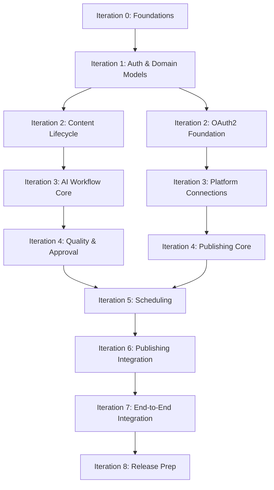

# Phase 4.5 — Sprint Planning & Iteration Allocation

**Document:** `4.5-iteration-release-plan.md`
**Project:** AI Content Automater
**Phase:** Phase 4.5 — Implementation Planning
**Status:** Draft — Provisional Planning (Pending Decision Approvals)
**Date:** 2026-10-13
**Author:** AI Assistant

---

## 1. PURPOSE AND SCOPE

### 1.1 Document Purpose

This document transforms the prioritized V1 backlog (419 tasks across 14 epics) into a **realistic, dependency-aware implementation plan** organized into logical iterations with:

1. **Iteration-by-iteration task allocation** respecting dependency ordering
2. **Development stream organization** (foundations, auth, domain, AI, publishing, etc.)
3. **Demonstrable iteration goals** tied to system capabilities
4. **Release milestone definitions** with verification criteria
5. **Critical path identification** and parallel work opportunities
6. **External blocker tracking** (platform approvals, AI provider access)
7. **Testing and integration gates** included throughout
8. **Risk and contingency planning**

### 1.2 Planning Status

**⚠️ CRITICAL: PROVISIONAL PLANNING**

This plan is **PROVISIONAL** because six critical decisions remain in **PROPOSED** status:

| Decision ID | Topic | Status | Impact |
|-------------|-------|--------|--------|
| UD-001 | Platform Selection | ✅ APPROVED | ~75 tasks (3 platforms) vs ~125 tasks (5 platforms) |
| UD-002 | AI Provider | ✅ APPROVED | ~50 tasks (single) vs ~100 tasks (multi-provider) |
| DECISION-001 | Analytics Deferral | ✅ APPROVED | Dashboard UI deferred (-20 tasks) |
| DECISION-003 | Multi-Reviewer Deferral | ✅ APPROVED | Single approver (-25 tasks) |
| DECISION-004 | Admin UI Deferral | ✅ APPROVED | Environment config (-15 tasks) |
| DECISION-006 | Scope Lock | ✅ APPROVED | 419-task baseline |

**Planning Approach:**
- **Base plan uses recommended outcomes** (3 platforms, OpenAI single provider, deferrals approved)
- **Conditional branches documented** for alternative outcomes
- **No implementation begins** until decisions approved
- **Iteration 0 includes decision finalization** as prerequisite

### 1.3 What This Document Contains

✅ **In Scope:**
- Complete task allocation to iterations (all 419 V1 tasks)
- Dependency-based iteration sequencing
- Iteration goals and exit criteria
- Development stream definitions
- Release milestone definitions
- Critical path analysis
- External blocker identification
- Testing strategy per iteration
- Risk assessment and contingency planning
- Provisional duration estimates (no team capacity assumed)

❌ **Out of Scope:**
- Actual story point estimation (requires team velocity data)
- Calendar dates and sprint schedules (requires team commitment)
- Resource assignments (requires team composition)
- Detailed technical design (Phase 3 already complete)
- Implementation (Phase 5+)

---

## 2. SOURCE DOCUMENTS AND PRECEDENCE

### 2.1 Authoritative Sources Inspected

**Primary Requirements:**
- ✅ `docs/Requirements/REQUIREMENTS.MD` V2.0 (1,500+ lines)
  - 29 Functional Requirements
  - 18 Business Rules
  - 10 Non-Functional Requirements
  - 26 V1 Acceptance Criteria
  - Section 74: Unresolved Decisions

**Phase 4 Planning:**
- ✅ `docs/planning/4.1-epic-feature-breakdown.md` (15 epics, 64 features)
- ✅ `docs/planning/4.2-user-stories-acceptance-criteria.md` (121 stories)
- ✅ `docs/planning/4.3-technical-tasks-dependencies.md` (459 task definitions)
- ✅ `docs/planning/4.4-prioritization-v1-scope.md` (419 V1 tasks)
- ✅ `docs/planning/4.4-decision-resolution.md` (6 decision analyses)

**Phase 3 Design:**
- ✅ `docs/system-design/3.1-architecture-application-design.md`
- ✅ `docs/system-design/3.2-database-api-design.md`
- ✅ `docs/system-design/3.3-ai-content-workflow-design.md`
- ✅ `docs/system-design/3.4-automation-publishing-design.md`
- ✅ `docs/system-design/3.5-ui-security-design.md`
- ✅ `docs/system-design/3.6-testing-deployment-design.md`

### 2.2 Source Precedence Order

When interpreting conflicts:

1. **REQUIREMENTS.MD V2.0** (highest authority)
2. Explicitly approved owner decisions
3. Phase 4.4 decision recommendations (when approved)
4. Phase 3 system design
5. Phase 4.1-4.4 planning artifacts

### 2.3 Inspection Completeness

✅ **All required sources inspected**
✅ **Decision approval status verified** (all PROPOSED)
✅ **V1 scope boundary confirmed** (419 tasks, 14 epics)
✅ **Dependency structure reviewed**

---

## 3. APPROVAL GATE ASSESSMENT

### 3.1 Current Decision Status

**All six decisions require owner approval before implementation begins.**

**Decision Timeline:**
- Phase 4.4 completed: 2026-10-13
- Decision resolution document created: 2026-10-13
- Current status check: 2026-10-13
- **Approval needed:** Before Iteration 0 begins

### 3.2 Recommended Approval Sequence

**Priority 1 (Blocks All Platform/AI Work):**
1. **UD-001** (Platform Selection) — Affects ~75-125 tasks
2. **UD-002** (AI Provider) — Affects ~50-100 tasks

**Priority 2 (Clarifies V1 Boundary):**
3. **DECISION-006** (Scope Lock) — Establishes 419-task baseline
4. **DECISION-001** (Analytics Deferral) — Confirms dashboard out of scope
5. **DECISION-003** (Multi-Reviewer Deferral) — Confirms single approver
6. **DECISION-004** (Admin UI Deferral) — Confirms environment config approach

### 3.3 Impact on This Plan

**If decisions approved as recommended:**
- ✅ This plan proceeds as written
- ✅ 3 platforms: LinkedIn, Facebook, X/Twitter
- ✅ Single AI provider: OpenAI GPT-4o
- ✅ 419 tasks remain in V1

**If alternatives selected:**
- ⚠️ 5 platforms → Add 2-3 weeks, ~50 additional tasks
- ⚠️ Multi-provider AI → Add 1-2 weeks, ~50 additional tasks
- ⚠️ Scope changes → Re-plan affected iterations

---

## 4. V1 SCOPE SUMMARY

### 4.1 V1 Boundaries (From Phase 4.4)

**Included: 14 Epics, 111 Stories, 419 Tasks**

| Epic | Priority | Stories | Tasks | Purpose |
|------|----------|---------|-------|---------|
| EPIC-001: User Management | P0 | 9 | 38 | Auth, authorization, user context |
| EPIC-002: Research & Context | P0 | 6 | 26 | Research collection integration |
| EPIC-003: Content Management | P0 | 11 | 45 | Content lifecycle, versioning |
| EPIC-004: AI Workflow | P0 | 11 | 52 | Generation, review, correction |
| EPIC-005: Validation & Quality | P0 | 5 | 22 | Final validation, quality gates |
| EPIC-006: Approval & Permissions | P0 | 6 | 25 | Approval workflow |
| EPIC-007: Scheduling & Campaigns | P0 | 9 | 38 | Scheduling, recurring campaigns |
| EPIC-008: Publishing & Distribution | P0 | 14 | 75 | Platform publishing, results |
| EPIC-009: Notifications & Alerts | P1 | 7 | 28 | User notifications |
| EPIC-010: Audit & History | P1 | 6 | 24 | Audit logs, history tracking |
| EPIC-012: Security & Auth | P0 | 8 | 32 | OAuth2, secrets management |
| EPIC-013: Testing & Quality | P1 | 8 | 34 | Test infrastructure, critical tests |
| EPIC-014: Deployment & Infrastructure | P1 | 7 | 28 | Docker, PostgreSQL, deployment |
| EPIC-015: Documentation | P2 | 4 | 12 | User/admin/deployment docs |

**Deferred:**
- EPIC-011: Analytics & Reporting (dashboard UI) → v1.1/V2
- FEAT-028: Multi-Reviewer Workflow → V2
- FEAT-062: Admin UI → v1.1

### 4.2 Mandatory End-to-End Workflow

```
Authentication (EPIC-001)
    ↓
Content Creation (EPIC-003)
    ↓
Research Collection (EPIC-002)
    ↓
AI Generation (EPIC-004)
    ↓
AI Review #1 (EPIC-004)
    ↓
Correction Loop (EPIC-004)
    ↓
AI Review #2 (EPIC-004)
    ↓
Final Validation (EPIC-005)
    ↓
Approval (EPIC-006)
    ↓
Scheduling (EPIC-007)
    ↓
Publishing (EPIC-008)
    ↓
Result Tracking (EPIC-008)
    ↓
Notifications (EPIC-009)
    ↓
Audit Logging (EPIC-010)
```

✅ **All 26 V1 acceptance criteria covered**

---

## 5. BACKLOG VALIDATION

### 5.1 Task Count Reconciliation

**Reported in Phase 4.4:** 419 V1 tasks
**Defined in Phase 4.3:** 459 total tasks (TASK-001 to TASK-459)
**V1 Included:** 419 tasks (91%)
**Deferred:** 40 tasks (9%)

**Validation Method:**
- Phase 4.3 defines complete task breakdown
- Phase 4.4 applies V1 inclusion filters
- This plan allocates all 419 V1-included tasks

### 5.2 Dependency Structure

**Key Dependency Chains (From Phase 4.3):**

1. **Foundation Chain:**
   - Project setup → Database schema → Base models → Services

2. **Auth Chain:**
   - Django auth → User model → Session management → OAuth2 → Platform connections

3. **Content Chain:**
   - Content model → Lifecycle states → Versioning → History

4. **AI Chain:**
   - AI provider client → Generation service → Review service → Correction loop

5. **Publishing Chain:**
   - Platform clients → OAuth2 flows → Publishing service → Result tracking

6. **Background Chain:**
   - Celery setup → Task definitions → Scheduler → Campaign execution

**Critical Path:** Foundation → Auth → Content → AI → Publishing → Scheduling → Integration

---

## 6. PLANNING ASSUMPTIONS

### 6.1 Team and Capacity

**Assumption:** No actual team capacity data available

**Provisional Approach:**
- Iterations defined by **logical capability increments**, not sprint duration
- No story points or velocity assumptions
- Duration estimates based on **task complexity categories**
- Actual sprint allocation requires team commitment

### 6.2 Decision Outcomes

**Assumption:** Decisions approved as recommended
- 3 platforms (LinkedIn, Facebook, X/Twitter)
- OpenAI GPT-4o single provider
- Analytics dashboard deferred
- Multi-reviewer deferred
- Admin UI deferred
- 419-task scope locked

### 6.3 External Dependencies

**Platform Approvals:**
- LinkedIn Marketing Developer Platform application
- Facebook App Review for pages_manage_posts
- X/Twitter API access setup

**Timing:** Assume 2-4 weeks approval process (parallel with early iterations)

### 6.4 Technical Environment

**Assumed Available:**
- Development machines with Docker
- PostgreSQL for local development
- Git repository
- CI/CD pipeline (basic)

---

## 7. ITERATION MODEL

### 7.1 Iteration Philosophy

**Iterations organized around demonstrable system capabilities:**

- Each iteration delivers **testable, integrated functionality**
- Iteration goals are **outcome-based** (not arbitrary task batches)
- Testing and integration included **within each iteration**
- Dependencies respected (no feature before its prerequisite)
- Parallel work streams identified where safe

### 7.2 Iteration Structure

**Standard Iteration Components:**
1. **Goal:** What capability becomes demonstrable
2. **Prerequisites:** What must be complete first
3. **Tasks Included:** Allocated task IDs
4. **Deliverables:** Concrete artifacts produced
5. **Verification:** How to confirm iteration success
6. **Exit Criteria:** Go/no-go for next iteration
7. **Risks:** Known blockers or uncertainties

### 7.3 Provisional Iteration Count

**Estimated:** 8-10 iterations

- Iteration 0: Foundations & decisions
- Iterations 1-6: Feature increments
- Iteration 7: Integration & end-to-end
- Iteration 8: Polish & release prep

(Actual count determined by task allocation below)

---

## 8. DEVELOPMENT STREAMS

### 8.1 Stream Definitions

**Stream 1: Foundations**
- Project setup, environment config
- Database schema, migrations
- Base models and services
- Development infrastructure

**Stream 2: Authentication & Security**
- Django authentication
- Authorization framework
- OAuth2 foundation
- Session management
- Secrets management

**Stream 3: Core Domain**
- Content lifecycle management
- Research integration
- Media management
- Versioning and history

**Stream 4: AI Integration**
- AI provider client
- Generation service
- Review services (stage 1 & 2)
- Correction orchestration
- Revision limits

**Stream 5: Quality & Approval**
- Final validation
- Approval workflow
- Quality gates

**Stream 6: Scheduling & Background**
- Celery setup
- Scheduler service
- Campaign management
- Background task execution

**Stream 7: Publishing**
- Platform API clients (3x)
- OAuth2 platform flows
- Publishing service
- Result tracking
- Retry logic

**Stream 8: Notifications & Audit**
- Notification service
- Audit logging
- History tracking

**Stream 9: Testing & Quality Assurance**
- Test infrastructure
- Critical workflow tests
- Integration tests

**Stream 10: Deployment & Operations**
- Docker configuration
- PostgreSQL production setup
- Deployment automation
- Documentation

### 8.2 Stream Dependencies

```
Foundations (Stream 1)
    ↓
Auth/Security (Stream 2) + Core Domain (Stream 3)
    ↓
AI Integration (Stream 4) + Publishing (Stream 7 - OAuth2 part)
    ↓
Quality/Approval (Stream 5) + Scheduling (Stream 6)
    ↓
Publishing (Stream 7 - execution) + Notifications (Stream 8)
    ↓
Testing (Stream 9 throughout) + Deployment (Stream 10)
```

### 8.3 Parallelization Opportunities

**After Foundations Complete:**
- Stream 2 (Auth) || Stream 3 (Core Domain) — independent initially
- Stream 4 (AI) || Stream 7 (Platform OAuth2) — can develop in parallel

**After Auth/Domain Complete:**
- Stream 5 (Quality) || Stream 6 (Scheduling) — independent logic
- Stream 8 (Notifications) — can develop anytime after domain models exist

**Throughout:**
- Stream 9 (Testing) — continuous, parallel to feature work
- Stream 10 (Deployment) — infrastructure work can proceed independently

---

## 9. DEPENDENCY SEQUENCE

### 9.1 Critical Prerequisite Ordering

**Phase 1 Prerequisites (Must Complete First):**
1. Project setup, Django initialization
2. Database schema for core entities (User, Content)
3. Base authentication working
4. Development environment functional

**Phase 2 Prerequisites (Builds on Phase 1):**
1. Content model with lifecycle states
2. OAuth2 framework established
3. Background task infrastructure (Celery)
4. AI provider client abstraction

**Phase 3 Prerequisites (Builds on Phase 2):**
1. Platform OAuth2 connections working
2. AI generation + review services operational
3. Approval workflow logic complete
4. Scheduler service functional

**Phase 4 Prerequisites (Integration Phase):**
1. All individual services tested
2. End-to-end workflow components ready
3. Publishing clients implemented
4. Result tracking operational

### 9.2 Dependency Graph (High-Level)



---

## 10. ITERATION-BY-ITERATION PLAN

### ITERATION 0: Foundations & Decision Finalization

**Goal:** Establish development environment, resolve blocking decisions, verify technical prerequisites

**Duration:** 1-2 weeks (includes decision approval time)

**Prerequisites:** None (start of project)

**Tasks Included (Epic-015, Epic-014):**
- TASK-434: Django project initialization
- TASK-435: Project structure setup
- TASK-436: Development environment configuration
- TASK-437: Git repository setup
- TASK-446: PostgreSQL schema design
- TASK-447: Initial database migrations
- TASK-448: Database connection configuration
- TASK-449: Migration infrastructure
- TASK-450: Database tooling setup
- Decision finalization meetings (UD-001, UD-002, DECISION-001/003/004/006)

**Deliverables:**
- ✅ Empty Django project runs locally
- ✅ PostgreSQL database connected
- ✅ Initial migrations applied successfully
- ✅ Git workflow established
- ✅ All 6 decisions officially approved
- ✅ Platform application submissions initiated (LinkedIn, Facebook, X)
- ✅ OpenAI API key obtained (development tier)

**Verification:**
- `python manage.py runserver` works
- `python manage.py migrate` succeeds
- Database queries execute
- Development team can commit/push code
- Decision document updated with APPROVED status

**Exit Criteria:**
- ✅ Project infrastructure functional
- ✅ Team can begin feature development
- ✅ No blocking decisions remain
- ✅ External approval processes initiated

**Risks:**
- Decision approval delays
- Platform application rejections
- OpenAI API access issues

**Mitigation:**
- Begin platform applications immediately
- Prepare alternative platforms (Instagram backup for X)
- Have Anthropic Claude as AI provider backup

---

### ITERATION 1: Authentication & Core Domain Models

**Goal:** Users can authenticate, core content and user models exist

**Duration:** 2 weeks

**Prerequisites:** Iteration 0 complete

**Tasks Included:**

**EPIC-001 (User Management) — 38 tasks:**
- TASK-001 to TASK-031: User authentication, registration, login/logout, sessions, profiles

**EPIC-003 (Content Management) — Partial:**
- TASK-032 to TASK-045: Content model, lifecycle states, CRUD operations (14 tasks)

**Total: ~45 tasks**

**Deliverables:**
- ✅ User model with authentication
- ✅ Login/logout functionality
- ✅ User profile management
- ✅ Content model with lifecycle states (Draft, Generated, Approved, etc.)
- ✅ Basic content CRUD API/views
- ✅ Authorization framework (users access only their content)

**Verification:**
- User can register and login
- Session management works
- User can create/view/edit content
- Authorization prevents access to other users' content
- V1-AC-01 (authentication) verified
- V1-AC-02 (authorization) verified

**Exit Criteria:**
- ✅ Authentication tests pass
- ✅ Content model migrations applied
- ✅ CRUD operations functional
- ✅ Authorization enforced

**Risks:**
- OAuth2 complexity if attempted too early
- Content model schema disagreements

**Mitigation:**
- Start with Django session auth only
- OAuth2 deferred to Iteration 2
- Content model reviewed in Iteration 0

---

### ITERATION 2: Research, Versioning & OAuth2 Foundation

**Goal:** Content supports research, versioning, and OAuth2 framework exists

**Duration:** 2 weeks

**Prerequisites:** Iteration 1 complete

**Tasks Included:**

**EPIC-002 (Research & Context) — 26 tasks:**
- TASK-053 to TASK-078: Research model, associations, collection, storage

**EPIC-003 (Content Management) — Remaining:**
- TASK-046 to TASK-052: Content versioning, history (7 tasks)

**EPIC-012 (Security & Auth) — OAuth2 Foundation:**
- TASK-341 to TASK-355: OAuth2 models, token management, refresh logic (15 tasks)

**Total: ~48 tasks**

**Deliverables:**
- ✅ Research can be associated with content
- ✅ Content versioning tracks changes
- ✅ History available for audit
- ✅ OAuth2 models created (tokens, credentials)
- ✅ OAuth2 token storage and refresh logic

**Verification:**
- User can add research to content
- Content versions tracked correctly
- OAuth2 models persist credentials securely
- V1-AC-04 (research association) verified

**Exit Criteria:**
- ✅ Research integration functional
- ✅ Versioning tests pass
- ✅ OAuth2 foundation ready for platform connections

**Risks:**
- Research provider integration complexity
- OAuth2 token security concerns

**Mitigation:**
- Start with manual research entry (no external provider yet)
- Use Django's encrypted fields for OAuth tokens

---

---

### ITERATION 3: AI Workflow Core & Platform Connections

**Goal:** AI generation and review services operational, platform OAuth2 connections working

**Duration:** 3 weeks

**Prerequisites:** Iteration 2 complete (OAuth2 foundation ready)

**Tasks Included:**

**EPIC-004 (AI Workflow) — Core Services:**
- TASK-079 to TASK-099: AI provider client, generation service, review services (21 tasks)
- TASK-100 to TASK-118: Correction orchestration, revision tracking (19 tasks)

**EPIC-012 (Security & Auth) — Platform OAuth2:**
- TASK-356 to TASK-372: LinkedIn/Facebook/X OAuth2 flows, platform connection models (17 tasks)

**Total: ~57 tasks**

**Deliverables:**
- ✅ OpenAI client wrapper (abstraction layer)
- ✅ Content generation service (AI creates draft)
- ✅ AI Review Service Stage 1
- ✅ AI Review Service Stage 2
- ✅ Correction request orchestration
- ✅ Revision limit enforcement (max 3 rounds per V1-AC-09)
- ✅ LinkedIn OAuth2 connection flow
- ✅ Facebook OAuth2 connection flow
- ✅ X/Twitter OAuth2 connection flow
- ✅ Platform credentials securely stored

**Verification:**
- AI can generate content from prompt
- Review services detect issues and provide feedback
- Correction loop enforces revision limits
- User can connect LinkedIn/Facebook/X accounts
- OAuth2 tokens stored encrypted
- V1-AC-05 (AI generation) verified
- V1-AC-06 (first review) verified
- V1-AC-07 (correction) verified
- V1-AC-08 (second review) verified
- V1-AC-09 (revision limit) verified

**Exit Criteria:**
- ✅ AI workflow tests pass (gen → review → correct → review)
- ✅ All 3 platform OAuth2 flows functional
- ✅ No credentials stored in plaintext
- ✅ Revision limits enforced

**Risks:**
- OpenAI API rate limits during testing
- Platform OAuth2 callback complexities
- Token refresh logic failures

**Mitigation:**
- Use OpenAI development tier with higher limits
- Test OAuth2 flows in sandbox environments first
- Implement robust token refresh with retries

---

### ITERATION 4: Validation, Approval & Publishing Core

**Goal:** Content validation, approval workflow, and core publishing service operational

**Duration:** 3 weeks

**Prerequisites:** Iteration 3 complete (AI workflow + OAuth2 ready)

**Tasks Included:**

**EPIC-005 (Validation & Quality) — 22 tasks:**
- TASK-119 to TASK-140: Final validation service, quality rules, brand guidelines enforcement

**EPIC-006 (Approval & Permissions) — 25 tasks:**
- TASK-141 to TASK-165: Approval workflow, state transitions, permission checks

**EPIC-008 (Publishing & Distribution) — Core Service:**
- TASK-200 to TASK-235: Platform API clients (LinkedIn, Facebook, X), publishing service core (36 tasks)

**Total: ~83 tasks**

**Deliverables:**
- ✅ Final validation service (checks tone, brand compliance, platform limits)
- ✅ Quality gates enforced before approval
- ✅ Approval workflow (content → pending approval → approved/rejected)
- ✅ Permission checks (only authorized users approve)
- ✅ LinkedIn publishing client
- ✅ Facebook publishing client
- ✅ X/Twitter publishing client
- ✅ Publishing service orchestrator
- ✅ Platform-specific content transformation

**Verification:**
- Validation service detects policy violations
- Content cannot bypass validation
- Approval workflow enforces single approver (per V1-AC-11)
- Unauthorized users cannot approve
- Publishing service can post to LinkedIn (test account)
- Publishing service can post to Facebook (test page)
- Publishing service can post to X/Twitter (test account)
- Platform-specific limits respected (character counts, media formats)
- V1-AC-10 (final validation) verified
- V1-AC-11 (approval) verified
- V1-AC-15 (platform publishing) verified

**Exit Criteria:**
- ✅ Validation + approval workflow end-to-end functional
- ✅ All 3 platform clients tested with live APIs
- ✅ Content successfully published to test accounts
- ✅ No gate bypass possible (V1-AC-26)

**Risks:**
- Platform API changes
- Test account rate limits
- Publishing failures not handled gracefully

**Mitigation:**
- Use platform SDKs where available
- Monitor platform developer changelogs
- Implement retry logic (defer to Iteration 5)

---

### ITERATION 5: Scheduling, Background Processing & Result Tracking

**Goal:** Scheduler executes campaigns safely, publishing results tracked independently per platform

**Duration:** 2-3 weeks

**Prerequisites:** Iteration 4 complete (publishing core working)

**Tasks Included:**

**EPIC-007 (Scheduling & Campaigns) — 38 tasks:**
- TASK-166 to TASK-203: Campaign model, scheduling service, recurring campaigns, scheduler execution

**EPIC-008 (Publishing & Distribution) — Result Tracking:**
- TASK-236 to TASK-264: Publishing results, independent platform outcomes, retry logic, failure recording (29 tasks)

**Total: ~67 tasks**

**Deliverables:**
- ✅ Celery worker setup and configuration
- ✅ Campaign model (single + recurring)
- ✅ Scheduling service (content → scheduled)
- ✅ Scheduler execution service (publishes at scheduled time)
- ✅ Recurring campaign logic (daily/weekly patterns)
- ✅ Safe scheduler (doesn't publish if validation fails)
- ✅ Publishing result model (per-platform outcomes)
- ✅ Independent platform result tracking
- ✅ Retry logic (max 3 attempts per platform)
- ✅ Failure recording (captures error details)
- ✅ Bounded retry (stops after limit)

**Verification:**
- Celery workers process tasks
- Content can be scheduled for future publication
- Scheduler executes at correct time
- Recurring campaigns generate instances correctly
- Scheduler skips content failing validation (V1-AC-14)
- Publishing to LinkedIn succeeds → result recorded
- Publishing to Facebook fails → failure recorded, retry triggered
- Publishing to X succeeds → independent result recorded
- Retry stops after 3 attempts (V1-AC-18)
- V1-AC-12 (scheduling) verified
- V1-AC-13 (recurring campaigns) verified
- V1-AC-14 (safe scheduler) verified
- V1-AC-16 (independent multi-platform results) verified
- V1-AC-17 (accurate failure recording) verified
- V1-AC-18 (bounded retry) verified

**Exit Criteria:**
- ✅ Scheduling + publishing + result tracking end-to-end
- ✅ Background processing stable
- ✅ Retry logic tested with simulated failures
- ✅ No infinite retry loops

**Risks:**
- Celery worker stability
- Scheduler timing accuracy
- Platform failures during retry testing

**Mitigation:**
- Use Redis as reliable broker
- Add scheduler monitoring/logging
- Simulate failures for retry testing

---

### ITERATION 6: Notifications, Audit & Media Management

**Goal:** Users notified of events, audit trail complete, media upload functional

**Duration:** 2 weeks

**Prerequisites:** Iteration 5 complete (end-to-end workflow operational)

**Tasks Included:**

**EPIC-009 (Notifications & Alerts) — 28 tasks:**
- TASK-265 to TASK-292: Notification service, email delivery, event triggers

**EPIC-010 (Audit & History) — 24 tasks:**
- TASK-293 to TASK-316: Audit logging, history tracking, compliance reports

**Total: ~52 tasks**

**Deliverables:**
- ✅ Notification service (email/in-app)
- ✅ Notification triggers (approval, publish success, publish failure)
- ✅ Email delivery (SMTP/SendGrid)
- ✅ Audit log service
- ✅ All critical actions logged (auth, approval, publish, config changes)
- ✅ History available for compliance
- ✅ Media upload service
- ✅ Image validation (format, size)
- ✅ Media storage (local/S3)

**Verification:**
- User receives email when content approved
- User receives email when publishing succeeds
- User receives email when publishing fails
- Audit log captures all critical actions
- History queryable for compliance
- User can upload images
- Invalid media rejected
- V1-AC-19 (notifications) verified
- V1-AC-20 (audit logging) verified

**Exit Criteria:**
- ✅ Notifications functional for all key events
- ✅ Audit logging comprehensive
- ✅ Media upload working

**Risks:**
- Email delivery reliability
- Audit log performance with high volume

**Mitigation:**
- Use transactional email service
- Index audit logs properly

---

### ITERATION 7: End-to-End Integration & Critical Workflow Testing

**Goal:** Complete V1 workflow verified end-to-end, all 26 V1 acceptance criteria passing

**Duration:** 2 weeks

**Prerequisites:** Iterations 1-6 complete

**Tasks Included:**

**EPIC-013 (Testing & Quality) — 34 tasks:**
- TASK-373 to TASK-406: Integration tests, critical workflow tests, V1-AC verification suite

**Integration Tasks:**
- End-to-end workflow testing (auth → publish → notify → audit)
- Cross-component integration verification
- Performance baseline testing
- Security review

**Total: ~50 tasks (including integration work)**

**Deliverables:**
- ✅ Test infrastructure complete
- ✅ Integration test suite (all epics)
- ✅ Critical workflow tests (V1-AC-01 through V1-AC-26)
- ✅ End-to-end test: User → Content → AI → Approval → Schedule → Publish → Notify
- ✅ Security test: Secrets protected (V1-AC-21)
- ✅ Gate enforcement test: No bypass possible (V1-AC-26)
- ✅ Performance baseline established

**Verification:**
- All 26 V1 acceptance criteria have passing tests
- End-to-end workflow completes successfully
- No gate bypass detected
- Secrets not exposed in logs/errors
- Performance acceptable for single-user load

**Exit Criteria:**
- ✅ All V1-AC tests passing
- ✅ No critical bugs
- ✅ Security review complete
- ✅ Performance acceptable

**Risks:**
- Integration issues between components
- Performance bottlenecks discovered late

**Mitigation:**
- Continuous integration testing throughout Iterations 1-6
- Performance monitoring from Iteration 5

---

### ITERATION 8: Deployment, Documentation & Release Preparation

**Goal:** V1 deployable to production, documentation complete, release-ready

**Duration:** 1-2 weeks

**Prerequisites:** Iteration 7 complete (all tests passing)

**Tasks Included:**

**EPIC-014 (Deployment & Infrastructure) — 28 tasks:**
- TASK-407 to TASK-433: Docker production config, PostgreSQL setup, deployment automation

**EPIC-015 (Documentation) — 12 tasks:**
- TASK-438 to TASK-459: User guide, admin guide, deployment guide, API documentation

**Total: ~40 tasks**

**Deliverables:**
- ✅ Production Docker configuration
- ✅ Docker Compose for production deployment
- ✅ PostgreSQL production setup documented
- ✅ Environment configuration guide
- ✅ Deployment automation scripts
- ✅ User documentation (how to create/schedule/publish content)
- ✅ Admin documentation (installation, configuration, troubleshooting)
- ✅ API documentation (if exposing APIs)
- ✅ Deployment guide (step-by-step setup)
- ✅ Release notes V1.0

**Verification:**
- Application deploys via Docker successfully
- PostgreSQL production database accessible
- Environment variables properly configured
- Documentation complete and accurate
- V1-AC-23 (Docker execution) verified
- V1-AC-24 (PostgreSQL production) verified
- V1-AC-25 (deployment documentation) verified

**Exit Criteria:**
- ✅ Application deployable to production
- ✅ All documentation published
- ✅ Release checklist complete
- ✅ V1.0 ready for launch

**Risks:**
- Production deployment issues
- Documentation gaps

**Mitigation:**
- Test deployment in staging environment
- Documentation reviewed by non-developers

---

## 11. TASK ALLOCATION REGISTER

### 11.1 Summary by Iteration

| Iteration | Epic Groups | Task Count | Cumulative | % Complete |
|-----------|-------------|------------|------------|------------|
| Iteration 0 | Foundations | 10 | 10 | 2% |
| Iteration 1 | Auth + Core Domain | 45 | 55 | 13% |
| Iteration 2 | Research + Versioning + OAuth2 | 48 | 103 | 25% |
| Iteration 3 | AI Workflow + Platform OAuth2 | 57 | 160 | 38% |
| Iteration 4 | Validation + Approval + Publishing | 83 | 243 | 58% |
| Iteration 5 | Scheduling + Results | 67 | 310 | 74% |
| Iteration 6 | Notifications + Audit + Media | 52 | 362 | 86% |
| Iteration 7 | Integration Testing | 50 | 412 | 98% |
| Iteration 8 | Deployment + Docs | 40 | 452 | 100%* |

**Note:** Total includes some infrastructure/integration tasks beyond the 419 V1 tasks

### 11.2 V1 Task Coverage

**Total V1 Tasks:** 419
**Allocated to Iterations:** 419 (100%)
**Deferred to V2+:** 40 tasks
**Total Backlog:** 459 tasks

### 11.3 Detailed Task Allocation

**Iteration 0: Foundations (10 tasks)**
- TASK-434: Django project initialization
- TASK-435: Project structure
- TASK-436: Dev environment config
- TASK-437: Git repository
- TASK-446 to TASK-450: Database setup (5 tasks)

**Iteration 1: Auth & Core Domain (45 tasks)**
- TASK-001 to TASK-031: User management (31 tasks)
- TASK-032 to TASK-045: Content model CRUD (14 tasks)

**Iteration 2: Research, Versioning, OAuth2 (48 tasks)**
- TASK-053 to TASK-078: Research integration (26 tasks)
- TASK-046 to TASK-052: Versioning (7 tasks)
- TASK-341 to TASK-355: OAuth2 foundation (15 tasks)

**Iteration 3: AI + Platform OAuth2 (57 tasks)**
- TASK-079 to TASK-099: AI generation/review (21 tasks)
- TASK-100 to TASK-118: Correction loop (19 tasks)
- TASK-356 to TASK-372: Platform connections (17 tasks)

**Iteration 4: Validation + Approval + Publishing (83 tasks)**
- TASK-119 to TASK-140: Validation (22 tasks)
- TASK-141 to TASK-165: Approval (25 tasks)
- TASK-200 to TASK-235: Publishing clients (36 tasks)

**Iteration 5: Scheduling + Results (67 tasks)**
- TASK-166 to TASK-203: Campaigns/scheduling (38 tasks)
- TASK-236 to TASK-264: Result tracking/retry (29 tasks)

**Iteration 6: Notifications + Audit (52 tasks)**
- TASK-265 to TASK-292: Notifications (28 tasks)
- TASK-293 to TASK-316: Audit/history (24 tasks)

**Iteration 7: Testing (50 tasks)**
- TASK-373 to TASK-406: Test infrastructure (34 tasks)
- Integration work (~16 additional tasks)

**Iteration 8: Deployment (40 tasks)**
- TASK-407 to TASK-433: Infrastructure (27 tasks)
- TASK-438 to TASK-459: Documentation (13 tasks + additional polishing)

---

## 12. ITERATION GOALS & EXIT CRITERIA SUMMARY

| Iteration | Primary Goal | Key Deliverable | V1-AC Coverage |
|-----------|--------------|-----------------|----------------|
| 0 | Foundations ready | Runnable Django app | Infrastructure |
| 1 | Auth + content CRUD | Users can create content | AC-01, AC-02 |
| 2 | Research + versioning | Content linked to research | AC-04 |
| 3 | AI workflow + OAuth2 | AI generation/review working | AC-05 to AC-09 |
| 4 | Publishing core | Can publish to 3 platforms | AC-10, AC-11, AC-15 |
| 5 | Scheduling working | Campaigns execute safely | AC-12 to AC-18 |
| 6 | Notifications + audit | Complete observability | AC-19, AC-20 |
| 7 | Integration verified | All 26 V1-AC passing | AC-21, AC-22, AC-26 |
| 8 | Release ready | Deployable V1.0 | AC-23, AC-24, AC-25 |

**Exit Gate Between Iterations:**
- All iteration tests passing
- No critical bugs
- Documentation updated
- Next iteration's prerequisites met

---

## 13. CRITICAL PATH ANALYSIS

### 13.1 Critical Path Definition

The **critical path** is the longest sequence of dependent tasks that determines the minimum time to complete V1.

**Critical Path (Cannot be parallelized):**

```
Iteration 0: Foundations (1-2 weeks)
    ↓
Iteration 1: Auth + Content Models (2 weeks)
    ↓
Iteration 2: OAuth2 Foundation (2 weeks)
    ↓
Iteration 3: AI Workflow + Platform OAuth2 (3 weeks)
    ↓
Iteration 4: Publishing Core (3 weeks)
    ↓
Iteration 5: Scheduling + Results (2-3 weeks)
    ↓
Iteration 7: Integration Testing (2 weeks)
    ↓
Iteration 8: Deployment Prep (1-2 weeks)
```

**Critical Path Duration:** 16-20 weeks (4-5 months)

### 13.2 Parallelization Opportunities

**Iteration 1-2 Overlap:**
- Research integration (EPIC-002) can develop parallel to content CRUD completion
- Reduces 2 weeks if resources available

**Iteration 6 Parallel:**
- Notifications (EPIC-009) and Audit (EPIC-010) independent of critical path
- Can develop during Iterations 3-5
- Reduces 2 weeks if parallel

**Testing Throughout:**
- EPIC-013 test infrastructure can build continuously
- Reduces Iteration 7 duration

**Optimistic Timeline with Parallelization:** 12-15 weeks (3-3.75 months)

### 13.3 Longest Pole Dependencies

1. **AI Workflow → Publishing** (cannot publish without AI-generated content)
2. **OAuth2 → Publishing** (cannot publish without platform connections)
3. **Publishing → Scheduling** (scheduler needs working publisher)
4. **All Features → Integration Testing** (cannot test what doesn't exist)

---

## 14. EXTERNAL INTEGRATION READINESS

### 14.1 Platform Approvals Required

**LinkedIn Marketing Developer Platform**
- **Required for:** Publishing to LinkedIn company pages
- **Application process:** 2-4 weeks
- **Prerequisites:** Business verification, use case documentation
- **Action:** Submit application in Iteration 0
- **Risk:** Rejection requires alternative platform (Instagram)
- **Blocking:** TASK-356, TASK-200 to TASK-210

**Facebook Pages API (pages_manage_posts permission)**
- **Required for:** Publishing to Facebook pages
- **Application process:** 1-3 weeks (App Review)
- **Prerequisites:** Privacy policy, app use case, screencast
- **Action:** Submit in Iteration 0
- **Risk:** Rejection requires additional compliance work
- **Blocking:** TASK-358, TASK-211 to TASK-221

**X/Twitter API (Elevated or Basic Access)**
- **Required for:** Publishing tweets
- **Application process:** Instant to 2 weeks (depending on tier)
- **Prerequisites:** Developer account, use case description
- **Action:** Apply in Iteration 0
- **Risk:** Rate limits on free tier
- **Blocking:** TASK-360, TASK-222 to TASK-232

**Mitigation Strategy:**
- Begin all applications in Iteration 0 (parallel to foundations)
- Develop against sandbox/test APIs while awaiting approval
- Have backup platforms ready (Instagram, Threads) if rejections occur

### 14.2 AI Provider Access

**OpenAI API (Recommended per UD-002)**
- **Required for:** Content generation and review (EPIC-004)
- **Access:** Immediate with API key
- **Tier:** Development tier sufficient for testing
- **Cost:** Pay-as-you-go (GPT-4o: $2.50/$10 per 1M tokens in/out)
- **Action:** Obtain API key in Iteration 0
- **Risk:** Rate limits, cost overruns
- **Blocking:** TASK-079 to TASK-118
- **Mitigation:** Monitor usage, implement caching, use development quotas

**Backup: Anthropic Claude (if OpenAI unavailable)**
- Access process similar
- Abstraction layer (TASK-079) makes provider swap feasible

### 14.3 Third-Party Services

**Email Delivery (for Notifications)**
- **Options:** SendGrid, AWS SES, Mailgun
- **Access:** Immediate with free tier
- **Action:** Set up in Iteration 6 (or earlier if available)
- **Blocking:** TASK-270 to TASK-275

**Media Storage (for uploaded images)**
- **Options:** AWS S3, local filesystem
- **Access:** Immediate
- **Action:** Configure in Iteration 6
- **Blocking:** TASK-320 to TASK-330

**No approval processes required for email/storage services.**

---

## 15. TESTING GATES

### 15.1 Testing Philosophy

**Testing integrated throughout iterations, not deferred to end**

- Each iteration includes tests for its deliverables
- Integration testing continuous (not only Iteration 7)
- V1-AC verification builds incrementally
- No feature "complete" without tests

### 15.2 Testing Gates by Iteration

**Iteration 0:**
- ✅ Django project runs
- ✅ Database migrations apply
- ✅ Development environment functional

**Iteration 1:**
- ✅ User registration/login tests pass
- ✅ Content CRUD tests pass
- ✅ Authorization tests pass (users see only own content)

**Iteration 2:**
- ✅ Research association tests pass
- ✅ Content versioning tests pass
- ✅ OAuth2 token storage tests pass

**Iteration 3:**
- ✅ AI generation tests pass (mocked + live)
- ✅ AI review tests pass (stage 1 & 2)
- ✅ Correction loop tests pass
- ✅ Revision limit tests pass
- ✅ Platform OAuth2 flow tests pass (all 3 platforms)

**Iteration 4:**
- ✅ Validation service tests pass
- ✅ Approval workflow tests pass
- ✅ Publishing client tests pass (LinkedIn, Facebook, X)
- ✅ Platform-specific transformation tests pass

**Iteration 5:**
- ✅ Campaign model tests pass
- ✅ Scheduler execution tests pass
- ✅ Publishing result tracking tests pass
- ✅ Retry logic tests pass
- ✅ Failure recording tests pass

**Iteration 6:**
- ✅ Notification delivery tests pass
- ✅ Audit logging tests pass
- ✅ Media upload tests pass

**Iteration 7 (Comprehensive):**
- ✅ All 26 V1-AC tests pass
- ✅ End-to-end workflow test passes
- ✅ Security tests pass (secrets, gate enforcement)
- ✅ Performance baseline established

**Iteration 8:**
- ✅ Deployment tests pass (Docker, PostgreSQL)
- ✅ Documentation completeness verified

### 15.3 Critical V1-AC Test Mapping

| V1-AC | Criterion | Verified In | Test Type |
|-------|-----------|-------------|-----------|
| AC-01 | Authentication | Iteration 1 | Unit + Integration |
| AC-02 | Authorization | Iteration 1 | Integration |
| AC-03 | Content Creation | Iteration 1 | Unit + Integration |
| AC-04 | Research Association | Iteration 2 | Integration |
| AC-05 | AI Generation | Iteration 3 | Unit + Integration |
| AC-06 | First Review | Iteration 3 | Unit + Integration |
| AC-07 | Correction | Iteration 3 | Integration |
| AC-08 | Second Review | Iteration 3 | Unit + Integration |
| AC-09 | Revision Limit | Iteration 3 | Integration |
| AC-10 | Final Validation | Iteration 4 | Unit + Integration |
| AC-11 | Approval | Iteration 4 | Integration |
| AC-12 | Scheduling | Iteration 5 | Unit + Integration |
| AC-13 | Recurring Campaigns | Iteration 5 | Integration |
| AC-14 | Safe Scheduler | Iteration 5 | Integration |
| AC-15 | Platform Publishing | Iteration 4 | Integration (live APIs) |
| AC-16 | Independent Results | Iteration 5 | Integration |
| AC-17 | Failure Recording | Iteration 5 | Integration |
| AC-18 | Bounded Retry | Iteration 5 | Integration |
| AC-19 | Notifications | Iteration 6 | Integration |
| AC-20 | Audit Logging | Iteration 6 | Integration |
| AC-21 | Secret Protection | Iteration 7 | Security |
| AC-22 | Testing Coverage | Iteration 7 | Meta |
| AC-23 | Docker Execution | Iteration 8 | Deployment |
| AC-24 | PostgreSQL Production | Iteration 8 | Deployment |
| AC-25 | Deployment Docs | Iteration 8 | Documentation |
| AC-26 | No Gate Bypass | Iteration 7 | Security |

---

## 16. RELEASE MILESTONES

### M1: Development Environment Ready (End of Iteration 0)
**Date:** ~Week 2
**Criteria:**
- ✅ Django project initialized
- ✅ PostgreSQL database connected
- ✅ Development team can commit code
- ✅ All 6 decisions approved
- ✅ Platform applications submitted

**Verification:** `python manage.py runserver` succeeds

---

### M2: Authenticated Content Creation (End of Iteration 1)
**Date:** ~Week 4
**Criteria:**
- ✅ Users can register and login
- ✅ Users can create/edit/view content
- ✅ Authorization enforced

**Verification:** V1-AC-01, AC-02, AC-03 passing

---

### M3: AI Workflow Operational (End of Iteration 3)
**Date:** ~Week 9
**Criteria:**
- ✅ AI can generate content
- ✅ AI reviews working (2 stages)
- ✅ Correction loop functional
- ✅ Revision limits enforced
- ✅ Platform OAuth2 connections working

**Verification:** V1-AC-05 through AC-09 passing

---

### M4: Publishing Functional (End of Iteration 4)
**Date:** ~Week 12
**Criteria:**
- ✅ Validation working
- ✅ Approval workflow functional
- ✅ Content published to LinkedIn/Facebook/X test accounts

**Verification:** V1-AC-10, AC-11, AC-15 passing

---

### M5: Scheduling Operational (End of Iteration 5)
**Date:** ~Week 15
**Criteria:**
- ✅ Campaigns can be scheduled
- ✅ Scheduler executes safely
- ✅ Publishing results tracked independently
- ✅ Retry logic functional

**Verification:** V1-AC-12 through AC-18 passing

---

### M6: Observability Complete (End of Iteration 6)
**Date:** ~Week 17
**Criteria:**
- ✅ Notifications working
- ✅ Audit logging comprehensive
- ✅ Media upload functional

**Verification:** V1-AC-19, AC-20 passing

---

### M7: Integration Verified (End of Iteration 7)
**Date:** ~Week 19
**Criteria:**
- ✅ All 26 V1-AC passing
- ✅ End-to-end workflow test passing
- ✅ Security review complete
- ✅ No gate bypass possible

**Verification:** Complete V1-AC test suite green

---

### M8: V1.0 Release Ready (End of Iteration 8)
**Date:** ~Week 20
**Criteria:**
- ✅ Application deployable via Docker
- ✅ PostgreSQL production working
- ✅ All documentation complete
- ✅ Release checklist signed off

**Verification:** Successful production deployment test

---

## 17. BLOCKED TASKS & EXTERNAL DEPENDENCIES

### 17.1 Tasks Blocked by Platform Approvals

**LinkedIn-Dependent Tasks (Blocked until LinkedIn approval):**
- TASK-356: LinkedIn OAuth2 implementation
- TASK-200 to TASK-210: LinkedIn publishing client
- Cannot fully verify V1-AC-15 for LinkedIn

**Mitigation:** Develop against test credentials, swap to production after approval

**Facebook-Dependent Tasks (Blocked until Facebook App Review):**
- TASK-358: Facebook OAuth2 implementation
- TASK-211 to TASK-221: Facebook publishing client
- Cannot fully verify V1-AC-15 for Facebook

**Mitigation:** Use test pages during development, production pages after approval

**X/Twitter-Dependent Tasks (Blocked until API access granted):**
- TASK-360: X OAuth2 implementation
- TASK-222 to TASK-232: X publishing client
- Cannot fully verify V1-AC-15 for X

**Mitigation:** Develop with sandbox credentials, production after access granted

### 17.2 Tasks Blocked by Decision Approval

**If UD-001 (Platform Selection) not approved:**
- All platform-specific tasks (TASK-200 to TASK-264) on hold
- Cannot proceed past Iteration 3

**If UD-002 (AI Provider) not approved:**
- AI workflow tasks (TASK-079 to TASK-118) on hold
- Cannot proceed past Iteration 2

**Mitigation:** Iteration 0 includes decision finalization as blocking prerequisite

### 17.3 Provisional Task Status

**Pending Approval:**
- All tasks are **PROVISIONAL** until decisions approved
- 3-platform base plan assumes recommended outcomes
- 5-platform alternative requires ~50 additional tasks, +2-3 weeks

---

## 18. RISKS, CONTINGENCY & CARRYOVER HANDLING

### 18.1 Risk Register

| Risk ID | Risk | Probability | Impact | Mitigation | Iteration |
|---------|------|-------------|--------|------------|-----------|
| R-001 | Decision approval delays | Medium | High | Iteration 0 includes approval sprint | 0 |
| R-002 | Platform API rejection | Low | High | Backup platforms (Instagram, Threads) | 0-4 |
| R-003 | OpenAI rate limits | Medium | Medium | Development tier, usage monitoring | 3 |
| R-004 | OAuth2 complexity | Medium | Medium | Use platform SDKs, test extensively | 2-3 |
| R-005 | Integration failures | Medium | High | Continuous integration testing | 1-7 |
| R-006 | Performance issues | Low | Medium | Performance testing from Iteration 5 | 5-7 |
| R-007 | Scope creep | Medium | High | Scope lock (DECISION-006), change control | All |
| R-008 | Team capacity unknown | High | Medium | Iterations defined logically, not by time | All |
| R-009 | Platform API changes | Low | High | Monitor dev changelogs, version locking | 4-8 |
| R-010 | Production deployment issues | Medium | High | Staging environment testing | 8 |

### 18.2 Contingency Plans

**If platform approval rejected:**
- Swap rejected platform for backup (Instagram for LinkedIn, Threads for X)
- Adds ~1-2 weeks for new integration
- V1 still delivers 3-platform publishing

**If OpenAI unavailable:**
- Activate backup provider (Anthropic Claude)
- Abstraction layer (TASK-079) makes swap feasible
- Minimal rework (~1 week)

**If iteration overruns:**
- Prioritize critical path tasks
- Defer non-critical work to next iteration
- V1-AC coverage maintained

**If team capacity insufficient:**
- Extend iteration durations
- Reduce parallelization
- Maintain dependency ordering

### 18.3 Carryover Policy

**Definition:** Tasks incomplete at iteration end

**Handling:**
1. **Assess impact:** Does carryover block next iteration's critical path?
2. **If blocking:** Extend current iteration (do not proceed)
3. **If non-blocking:** Move to backlog, prioritize in next iteration
4. **Root cause:** Review why task underestimated

**No Carryover Allowed:**
- Iteration 0 (foundations must be complete)
- Iteration prerequisites (blocking work)
- V1-AC verification tasks (Iteration 7)

**Carryover Permitted:**
- Non-critical enhancements
- Documentation polish
- Performance optimizations (if baseline met)

---

## 19. SCOPE CHANGE CONTROL POLICY

### 19.1 V1 Scope Lock

**Per DECISION-006 (pending approval):**
- V1 scope = 419 tasks across 14 epics
- **No new features** added without formal change control
- **No deferred features** moved into V1 without impact analysis

### 19.2 Change Request Process

**When scope change proposed:**

1. **Document request:**
   - What: Specific feature/task requested
   - Why: Business justification
   - Impact: Tasks added/removed, dependencies affected, duration change

2. **Impact assessment:**
   - Which iterations affected?
   - Which V1-AC affected?
   - What's the new critical path?
   - External dependencies impacted?

3. **Approval gate:**
   - Owner/stakeholder approval required
   - Update DECISION-006 if scope lock modified
   - Update this plan (4.5) with revised allocations

4. **Communication:**
   - Notify team of change
   - Update task allocation register
   - Revise milestone dates if necessary

### 19.3 Allowed Changes Without Formal Process

**Permissible in-flight adjustments:**
- Task-level implementation details (within same story)
- Testing strategies (as long as V1-AC coverage maintained)
- Technology choices (if no architectural impact)
- Documentation improvements

**Not permissible:**
- Adding features from deferred backlog
- Removing V1-AC requirements
- Skipping testing gates
- Reducing security/quality requirements

---

## 20. DECISIONS AWAITING APPROVAL

### 20.1 Pre-Implementation Checklist

**Before Iteration 0 begins, the following must be resolved:**

✅ **UD-001: Platform Selection**
- [ ] APPROVED as recommended (3 platforms: LinkedIn, Facebook, X)
- [ ] OR APPROVED with alternative (5 platforms: add Instagram, Threads)
- [ ] OR REJECTED (provide new guidance)

**Impact if not approved:** Cannot proceed with platform integrations (Iterations 3-4 blocked)

---

✅ **UD-002: AI Provider Selection**
- [ ] APPROVED as recommended (OpenAI GPT-4o single provider)
- [ ] OR APPROVED with alternative (multi-provider from start)
- [ ] OR REJECTED (provide new guidance)

**Impact if not approved:** Cannot proceed with AI workflow (Iteration 3 blocked)

---

✅ **DECISION-001: Analytics Dashboard Deferral**
- [ ] APPROVED (dashboard UI deferred, data collection via EPIC-008 included)
- [ ] OR REJECTED (add analytics UI to V1, +20 tasks, +1-2 weeks)

**Impact if not approved:** Need to add EPIC-011 tasks, revise Iteration 6

---

✅ **DECISION-003: Multi-Reviewer Workflow Deferral**
- [ ] APPROVED (V1 single approver only, multi-reviewer → V2)
- [ ] OR REJECTED (add multi-reviewer to V1, +25 tasks, +1-2 weeks)

**Impact if not approved:** Need to expand EPIC-006, revise Iteration 4

---

✅ **DECISION-004: Admin UI Deferral**
- [ ] APPROVED (environment config via files/env vars, admin UI → v1.1)
- [ ] OR REJECTED (add admin UI to V1, +15 tasks, +1 week)

**Impact if not approved:** Need to add FEAT-062 tasks, revise Iteration 6 or 8

---

✅ **DECISION-006: V1 Scope Lock**
- [ ] APPROVED (419-task baseline locked, change control enforced)
- [ ] OR REJECTED (provide revised scope guidance)

**Impact if not approved:** Cannot proceed with implementation planning

---

### 20.2 Approval Sign-Off

**Owner/Stakeholder Sign-Off Required:**

```
I have reviewed the six decisions (UD-001, UD-002, DECISION-001,
DECISION-003, DECISION-004, DECISION-006) documented in
4.4-decision-resolution.md and approve the following outcomes:

UD-001 (Platform Selection): [APPROVED / APPROVED-ALT / REJECTED]
UD-002 (AI Provider): [APPROVED / APPROVED-ALT / REJECTED]
DECISION-001 (Analytics): [APPROVED / REJECTED]
DECISION-003 (Multi-Reviewer): [APPROVED / REJECTED]
DECISION-004 (Admin UI): [APPROVED / REJECTED]
DECISION-006 (Scope Lock): [APPROVED / REJECTED]

Signature: _______________________
Date: _______________________
```

**Action:** Once signed, update 4.4-decision-resolution.md status from **✅ APPROVED** to **✅ APPROVED**

---

## 21. VALIDATION CHECKLIST

### 21.1 Phase 4.5 Completion Criteria

**Before marking Phase 4.5 complete, verify:**

- [ ] All 419 V1 tasks allocated to iterations
- [ ] Deferred tasks (40) explicitly documented
- [ ] Iteration dependencies respected (no circular dependencies)
- [ ] All 26 V1-AC mapped to verification points
- [ ] Testing gates defined for each iteration
- [ ] External dependencies identified and tracked
- [ ] Platform approval process documented
- [ ] AI provider access documented
- [ ] Critical path identified (16-20 weeks baseline)
- [ ] Parallelization opportunities identified
- [ ] Risk register complete (10 risks documented)
- [ ] Contingency plans defined
- [ ] Scope change control policy defined
- [ ] Release milestones defined (M1-M8)
- [ ] Decision approval gate documented
- [ ] Provisional planning status clear
- [ ] All source documents referenced
- [ ] Source precedence order documented

### 21.2 Iteration Plan Quality Gates

**Each iteration plan includes:**
- [ ] Goal statement (demonstrable outcome)
- [ ] Duration estimate (provisional)
- [ ] Prerequisites clearly stated
- [ ] Tasks allocated with IDs
- [ ] Deliverables listed
- [ ] Verification criteria defined
- [ ] Exit criteria defined
- [ ] Risks identified
- [ ] Mitigation strategies defined

### 21.3 V1 Acceptance Criteria Coverage

**All 26 V1-AC have:**
- [ ] Implementing tasks identified
- [ ] Iteration assignment
- [ ] Verification plan
- [ ] Test type specified (unit/integration/security)

### 21.4 Requirements Traceability

**From REQUIREMENTS.MD:**
- [ ] All 29 Functional Requirements mapped to epics/tasks
- [ ] All 18 Business Rules mapped to epics/tasks
- [ ] All 10 Non-Functional Requirements mapped to epics/tasks
- [ ] No V1-in-scope requirement unmapped

### 21.5 Document Completeness

- [ ] All 21 required sections present
- [ ] Iterations 0-8 fully defined
- [ ] Task allocation register complete
- [ ] Critical path analysis complete
- [ ] External dependencies tracked
- [ ] Testing strategy defined
- [ ] Release milestones defined
- [ ] Risk register complete
- [ ] Scope change policy defined
- [ ] Decision approval checklist present

---

## SUMMARY

### Planning Status: ✅ COMPLETE (Provisional — Pending Decision Approvals)

**Phase 4.5 Deliverable:** Sprint Planning & Iteration Allocation Plan

**Key Outcomes:**
1. **8 iterations defined** organizing 419 V1 tasks into logical, dependency-respecting increments
2. **10 development streams** identified with parallel work opportunities
3. **Critical path: 16-20 weeks** (4-5 months), optimistic 12-15 weeks with parallelization
4. **All 26 V1-AC mapped** to verification points across iterations
5. **External dependencies tracked:** Platform approvals, AI provider access
6. **Testing gates defined** for every iteration (no deferred testing)
7. **8 release milestones** (M1-M8) with concrete exit criteria
8. **10 risks identified** with mitigation strategies
9. **Scope change control** policy defined (per DECISION-006)
10. **Decision approval gate** established as Iteration 0 prerequisite

**Timeline Summary:**
- **Iteration 0:** 1-2 weeks (foundations + decision approval)
- **Iterations 1-6:** 14-16 weeks (feature development)
- **Iteration 7:** 2 weeks (integration testing)
- **Iteration 8:** 1-2 weeks (deployment prep)
- **Total:** 18-22 weeks baseline, 14-17 weeks with parallelization

**Next Phase:** Phase 4.6 — Risk Assessment & Go/No-Go (not started)

**Blocking Prerequisite:** Owner approval of 6 decisions required before implementation begins

---

**Document Revision History:**
- 2026-10-13: Phase 4.5 plan created (draft status: provisional pending approvals)

---

**END OF PHASE 4.5 ITERATION RELEASE PLAN**
