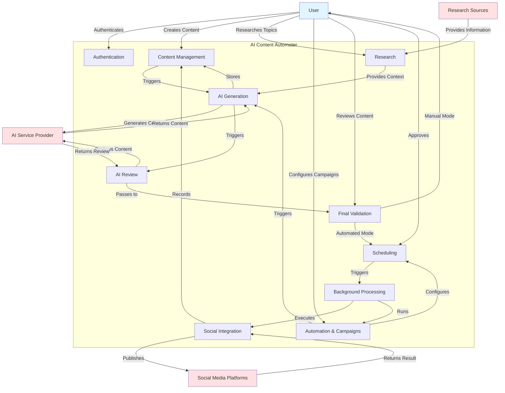

# System Analysis — 2.1 System Overview

**Document:** `2.1-system-overview.md`  
**Project:** AI Content Automater  
**Phase:** System Analysis  
**Status:** Draft  
**Date:** 2024  
**Source:** REQUIREMENTS.MD (Sections 1-3)

---

## Document Notes

This System Overview is based on REQUIREMENTS.MD, which currently contains:
- Section 1: Project Overview (high-level system description)
- Section 2: Primary Project Requirement (code understandability)
- Section 3: Development Methodology (Agile SDLC process)

The requirements document does not yet contain detailed functional specifications, technology stack details, V1 scope boundaries, or feature-level requirements. This analysis extracts what can be determined from the available information and notes areas requiring further specification.

---

## 3.1 Purpose

The AI Content Automater exists to help users create and manage social media content with AI assistance while maintaining quality through systematic review processes.

**Problem it solves:**

Users need to research topics, generate social media content, ensure quality through review, and publish to multiple platforms. Manual content creation is time-consuming, and users may want to automate recurring content campaigns while maintaining quality standards.

**Intended outcome:**

Users can:
1. Research topics to inform content creation
2. Generate social media content using AI
3. Review generated content through multiple AI quality-control stages
4. Choose between manual review or automated validation for final approval
5. Schedule content for publication
6. Publish directly to connected social media platforms

The system supports both manual AI-assisted content creation (user controls each step) and fully/partially automated recurring content campaigns (system operates autonomously based on user configuration).

---

## 3.2 System Scope

### What the system is responsible for:

Based on REQUIREMENTS.MD Section 1, the system must:

1. **Research capability** — Help users research topics (mechanism not specified in requirements)
2. **AI content generation** — Generate social media content using AI
3. **Multiple AI quality-review passes** — Review generated content through multiple AI quality-control stages
4. **Final validation** — Support both manual and automated final validation modes
5. **Content scheduling** — Schedule content for future publication
6. **Direct social publishing** — Publish directly to connected social media platforms
7. **Manual content workflow** — Support manual AI-assisted content creation
8. **Automated campaigns** — Support fully/partially automated recurring content campaigns

### V1 Scope Boundaries:

**REQUIREMENTS.MD does not specify:**
- Which social media platforms are included in V1
- What research sources or methods are supported
- How many AI review passes are required
- What AI providers are supported
- What content types or formats are supported
- What analytics or tracking capabilities exist
- What notification mechanisms are included
- Which features are deferred to future versions

**Note:** The system description mentions "multiple AI quality-review passes" but does not specify the minimum number or the review criteria.

### Explicitly outside V1 scope:

REQUIREMENTS.MD does not contain a "future versions" or "not in V1" section. Scope boundaries beyond V1 are not defined in the available requirements.

---

## 3.3 System Actors

Based on analysis of REQUIREMENTS.MD, the following actors interact with the system:

### Human Actors:

1. **User**
   - Primary human actor
   - Creates and manages content
   - Configures automated campaigns
   - Reviews content when using manual validation mode
   - Connects social media accounts
   - Manages research and topics

### External Systems/Services:

2. **AI Service Provider(s)**
   - External system
   - Generates content based on user input
   - Performs quality reviews of generated content
   - Specific provider(s) not identified in requirements

3. **Research Sources**
   - External system(s)
   - Provides information for topic research
   - Nature and type not specified in requirements

4. **Social Media Platforms**
   - External systems
   - Receive published content from the system
   - Specific platforms not identified in requirements
   - User connects their accounts to these platforms

### Internal System Processes:

5. **Background Task Executor**
   - Internal process mentioned in Section 2 ("How Celery tasks work")
   - Executes scheduled and automated operations
   - Handles asynchronous processing

**Note:** REQUIREMENTS.MD Section 2 mentions "Celery tasks" as something the project owner must understand, suggesting background task processing is part of the system architecture, though implementation details belong to system design.

### Actors not yet specified:

REQUIREMENTS.MD does not specify:
- Email or notification service providers
- Object storage services
- Database systems (though operations are mentioned in Section 2)
- Authentication providers (if external auth is used)

---

## 3.4 System Responsibilities

Based on REQUIREMENTS.MD Section 1 and Section 2, the system has the following major responsibilities:

### 1. User and Account Management
The system must manage user accounts and authentication. Section 2 states the project owner must understand "How authentication works," indicating this is a system responsibility.

### 2. Research Management
The system must help users research topics. The specific mechanism, sources, and storage of research are not detailed in requirements.

### 3. Content Management
The system must manage content throughout its lifecycle from creation through publication. This includes storing, organizing, and tracking content state.

### 4. AI Content Generation
The system must generate social media content using AI services. This involves:
- Accepting user input or automated campaign parameters
- Calling AI service provider(s)
- Storing generated content
- Handling generation failures

### 5. AI Quality Review
The system must perform "multiple AI quality-control stages" on generated content. Section 2 mentions "How AI reviews work" as a core concept. The number of review passes and review criteria are not specified in requirements.

### 6. Final Validation
The system must support two modes:
- **Manual validation**: User reviews and approves content
- **Automated validation**: System automatically validates content

The validation criteria and process are not detailed in requirements.

### 7. Content Scheduling
The system must schedule content for future publication. Scheduling mechanisms and granularity are not specified in requirements.

### 8. Automated Campaign Management
The system must support "fully/partially automated recurring content campaigns." This implies:
- Configuration of campaign parameters
- Automatic execution of research, generation, review, validation, and scheduling
- Recurring operation based on schedule
- Campaign lifecycle management

Campaign configuration details are not specified in requirements.

### 9. Social Account Management
Users must be able to connect social media platform accounts to the system. Connection mechanism and credentials management are not specified in requirements.

### 10. Social Publishing
The system must "publish directly to connected social-media platforms." This involves:
- Integration with social platform APIs (Section 2: "How social APIs are called")
- Content formatting for each platform
- Publishing orchestration
- Publishing result tracking (implied but not explicitly stated)

### 11. Error Handling
Section 2 states the project owner must understand "How errors are handled," indicating error handling is a system-wide responsibility across all workflows.

### Responsibilities not yet specified:

REQUIREMENTS.MD does not explicitly mention:
- Analytics or reporting
- Notifications to users
- Content performance tracking
- User collaboration or multi-user access
- Content templates or reusability
- Draft management
- Publishing history

---

## 3.5 Major Conceptual Components

The following are conceptual responsibility areas of the system, not implementation modules:

### Authentication and Authorization
Manages user identity, session management, and access control. Users must securely access the system and manage their resources. Multi-user access model is not specified in requirements.

### Research
Handles topic research functionality. Users research topics to inform content creation. This component is responsible for:
- Providing research capabilities to users
- Interfacing with research sources
- Storing research information for later use in content generation

The nature of research (manual links, automated fetching, RSS, API calls, etc.) is not specified in requirements.

### Content Management
Manages the content lifecycle from creation through publication. Responsible for:
- Storing content in various states (generated, under review, validated, scheduled, published)
- Organizing content (by campaign, topic, platform, date, etc.)
- Tracking content metadata and state transitions
- Providing content access to other components

Content data model details belong to system design.

### AI Generation
Orchestrates content generation using AI services. Responsible for:
- Accepting generation requests (manual or from automated campaigns)
- Preparing prompts or inputs for AI services
- Calling external AI service providers
- Handling AI service responses and errors
- Storing generated content
- Triggering the review process

AI provider selection, prompt engineering, and error recovery strategies are not specified in requirements.

### AI Review
Performs multiple quality-control passes on generated content using AI. Responsible for:
- Executing AI review passes (number not specified in requirements)
- Evaluating content against quality criteria (criteria not specified)
- Determining pass/fail for each review stage
- Triggering corrections or re-generation when reviews fail
- Passing successfully reviewed content to final validation

The requirements state "multiple AI quality-control stages" but do not specify the minimum number of passes, review criteria, or correction mechanisms.

### Final Validation
Provides two modes for final content approval:

**Manual validation mode:**
- Present content to user for review
- Allow user to approve, edit, or reject
- Handle user edits and resubmission
- Progress approved content to scheduling

**Automated validation mode:**
- Apply automated validation rules (rules not specified in requirements)
- Automatically approve content that passes validation
- Handle content that fails automated validation (mechanism not specified)
- Progress approved content to scheduling

The choice between modes may be per-content-item, per-campaign, or user-level (not specified in requirements).

### Automation and Campaign Management
Manages automated recurring content campaigns. Responsible for:
- Storing campaign configuration (parameters not detailed in requirements)
- Triggering campaign execution based on schedule
- Orchestrating the full workflow: research → generation → review → validation → scheduling
- Managing campaign lifecycle (start, pause, stop, edit)
- Handling campaign execution failures

"Fully/partially automated" suggests varying levels of automation, but the distinction is not defined in requirements.

### Scheduling
Manages when content should be published. Responsible for:
- Accepting scheduled publication times
- Storing scheduled content
- Triggering publication at the scheduled time
- Handling scheduling conflicts or changes
- Managing time zones (not mentioned in requirements but likely necessary)

Scheduling granularity and capabilities are not specified in requirements.

### Social Integration
Manages connections to social media platforms and handles publishing. Responsible for:
- Authenticating and storing credentials for social platform accounts
- Maintaining active connections to platforms
- Formatting content appropriately for each platform
- Executing publication API calls
- Handling platform-specific errors and rate limits
- Tracking publication results (implied but not explicit in requirements)

Specific platforms and integration approaches are not specified in requirements.

### Background Processing
Executes tasks asynchronously outside the request-response cycle. Section 2 mentions "How Celery tasks work" must be understood, indicating background processing is a key concept. Responsible for:
- Executing scheduled publications
- Running automated campaigns
- Performing AI generation and review operations
- Handling long-running operations without blocking users

Implementation technology (Celery) is mentioned in Section 2 but detailed requirements belong to system design.

---

## 3.6 Overall System Workflow

### A. Manual Content Workflow

In manual mode, the user controls each step:

1. **Research**: User researches topics (mechanism not specified)
2. **Content Request**: User requests AI content generation
3. **AI Generation**: System generates content using AI service
4. **AI Review Pass(es)**: System performs multiple AI quality-control stages
   - If review fails: System may regenerate or correct (mechanism not specified)
   - If review passes: Continue to final validation
5. **Manual Final Validation**: User reviews the content
   - **Approve**: Content proceeds to scheduling
   - **Edit**: User modifies content, may trigger re-review (not specified)
   - **Reject**: Content is discarded or saved as draft (not specified)
6. **Scheduling**: User schedules publication time
7. **Publication**: System publishes to connected social platform(s) at scheduled time
8. **Result**: Publication result is recorded (implied but not explicit)

### B. Automated Content Workflow

In automated mode, the system executes without user intervention:

1. **Campaign Trigger**: System triggers campaign based on schedule/configuration
2. **Automated Research**: System researches topics (if configured, mechanism not specified)
3. **AI Generation**: System generates content using AI service
4. **AI Review Pass(es)**: System performs multiple AI quality-control stages
   - If review fails: System handles correction (mechanism not specified in requirements)
   - If review passes: Continue to final validation
5. **Final Validation**: Depends on campaign configuration:
   - **Automated validation**: System applies validation rules
     - Pass: Proceed to scheduling
     - Fail: Handle failure (mechanism not specified—may notify user, retry, or discard)
   - **Manual validation**: System notifies user and waits for approval
6. **Scheduling**: System schedules publication based on campaign configuration
7. **Publication**: System publishes to connected social platform(s) at scheduled time
8. **Result**: Publication result is recorded
9. **Next Iteration**: Campaign continues if recurring

### Failure Handling

REQUIREMENTS.MD Section 2 states the project owner must understand "How errors are handled" but does not specify error handling strategies.

**Areas requiring failure handling (not detailed in requirements):**
- AI service unavailable or returns errors
- AI review fails repeatedly
- Automated validation fails
- Social platform API errors
- Publishing failures
- Scheduling conflicts

**Likely behaviors (not specified in requirements):**
- Retry with backoff
- Notify user of failures
- Log errors for investigation
- Mark content/campaign as failed
- Provide manual intervention options

---

## 3.7 Automation Concept

An **automation** or **campaign** is a user-configured recurring content generation and publication process.

### Conceptual Definition

From the user's perspective, an automation allows them to define:

**What to create:**
- Topics or subject areas (specific configuration not detailed in requirements)
- Content parameters (tone, length, style—not specified in requirements)
- Research requirements (if any)

**When to publish:**
- Posting schedule (daily, weekly, specific times—not specified)
- Recurring pattern (how often, which days—not specified)
- Campaign duration (start/end dates, or indefinite—not specified)

**Where to publish:**
- Selected social media accounts
- May publish to multiple platforms simultaneously or separately (not specified)

**How to validate:**
- Manual: System generates content and waits for user approval before scheduling
- Automated: System validates and publishes without user intervention

**Campaign lifecycle:**
- User creates and configures campaign
- User activates campaign
- System executes campaign according to schedule
- User can pause, resume, modify, or stop campaign
- Campaign continues until user stops it or end date is reached (if configured)

### Behavioral Characteristics

**"Fully automated"**: System handles all steps from research through publication without user intervention (requires automated final validation)

**"Partially automated"**: System handles generation and review, but user must approve content before publication (uses manual final validation)

### Configuration Details Not Specified

REQUIREMENTS.MD does not detail:
- How users specify topics or content parameters
- Scheduling interface or capabilities
- How many posts per campaign execution
- Rate limiting or throttling
- Campaign templates or presets
- Campaign analytics or success tracking
- Modification of running campaigns
- Handling of failed executions

---

## 3.8 Manual vs Automated Final Validation

The system supports two distinct final validation modes:

### Manual Final Validation

**Process:**
1. Content completes all AI review passes
2. System presents content to user for review
3. User evaluates content
4. User takes action:
   - **Approve**: Content proceeds to scheduling/publication
   - **Edit**: User modifies content (subsequent handling not specified)
   - **Reject**: Content is not published (storage/archival not specified)

**Behavioral characteristics:**
- Requires user intervention before publication
- User has final control over what gets published
- Provides human oversight for quality and appropriateness
- Creates a manual checkpoint in the workflow
- May create delays between generation and publication

**Use cases (inferred, not specified in requirements):**
- User wants final approval authority
- Content is high-stakes or brand-sensitive
- User wants to learn from AI output and refine over time
- Partially automated campaigns

### Automated Final Validation

**Process:**
1. Content completes all AI review passes
2. System applies automated validation rules
3. System evaluates result:
   - **Pass**: Content proceeds to scheduling/publication automatically
   - **Fail**: Content handling not specified (may discard, notify user, retry, or hold for manual review)

**Behavioral characteristics:**
- No user intervention required
- Enables fully automated campaigns
- Faster time from generation to publication
- Relies on automated rules and AI review quality
- May require robust error handling for edge cases

**Use cases (inferred, not specified in requirements):**
- Fully automated campaigns
- High-volume content generation
- User trusts AI review process
- Lower-stakes content
- User unavailable for manual review

### Why Both Modes Exist

**From a system behavior perspective:**

The dual validation approach allows the system to support different user needs and trust levels:

1. **User control vs. automation trade-off**: Some users want full control; others want full automation
2. **Trust building**: Users may start with manual validation to build trust in AI quality, then transition to automated
3. **Content sensitivity**: Different content types may warrant different validation approaches
4. **Availability**: Users may not always be available to review content manually
5. **Learning**: Manual mode allows users to understand and improve AI output over time

**Validation criteria not specified in requirements:**
- What automated validation rules check for
- How automated validation differs from AI review passes
- Whether validation can be customized per campaign or content type

---

## 3.9 External System Boundaries

### Inside the AI Content Automater:

The system is responsible for:

- **User accounts and authentication** — Identity, credentials, sessions
- **Content storage and management** — All content states from generation through publication
- **Research records** — Whatever research information is collected
- **Campaign configuration** — Automation rules, schedules, parameters
- **Scheduling logic** — When content should be published
- **Social account connections** — Stored credentials and connection state for social platforms
- **Workflow orchestration** — Coordinating research → generation → review → validation → scheduling → publishing
- **Publishing orchestration** — Triggering and managing publication to social platforms
- **Publishing results** — Records of what was published, when, and the outcome
- **Background task management** — Scheduling and executing asynchronous operations
- **Error handling and logging** — Capturing and managing failures across the system

### Outside the AI Content Automater:

External systems the AI Content Automater depends on but does not control:

- **AI Service Provider APIs** — Content generation and review services
  - System calls these services but does not own them
  - Must handle service unavailability, rate limits, and errors
  - Specific provider(s) not identified in requirements

- **Research Information Sources** — External data for topic research
  - Nature not specified (could be RSS feeds, news APIs, web scraping, manual entry, etc.)
  - System accesses but does not own these sources

- **Social Media Platform APIs** — Target platforms for content publication
  - Each platform has its own API, authentication, rate limits, and constraints
  - System publishes through these APIs but does not control them
  - Specific platforms not identified in requirements
  - Must handle platform downtime, API changes, and publishing errors

- **User's Social Media Accounts** — Actual accounts on social platforms
  - Owned by the user, not by the system
  - System acts on behalf of the user
  - User maintains the accounts outside the system

**External systems potentially used but not mentioned in REQUIREMENTS.MD:**
- Email or notification services (if notifications are sent)
- Object storage (if media files are stored externally)
- External databases (though database operations mentioned in Section 2)
- Payment processors (if this is a paid service)
- Analytics platforms (if external analytics are integrated)

### Integration Boundaries

The system must integrate with external systems through:
- **API calls** to AI providers, social platforms, research sources
- **Authentication** handling user credentials for external platforms securely
- **Error handling** when external systems are unavailable or return errors
- **Rate limiting** respecting external service limits

Integration details belong to system design and implementation.

---

## 3.10 V1 Boundaries

### Critical Gap in Requirements

**REQUIREMENTS.MD does not define V1 boundaries.**

The requirements document does not contain:
- A "V1 Features" section
- A "Future Versions" section
- A "Not in V1" section
- Specific version boundaries or roadmap

### What Can Be Determined from REQUIREMENTS.MD

**Capabilities mentioned in Section 1 Project Overview:**

These capabilities are described as part of the system, suggesting they are intended for V1:

✓ Topic research  
✓ AI content generation  
✓ Multiple AI quality-review passes  
✓ Manual final validation mode  
✓ Automated final validation mode  
✓ Content scheduling  
✓ Direct social media publishing  
✓ Manual AI-assisted content creation workflow  
✓ Fully/partially automated recurring campaigns  

**However, the scope and depth of each capability is not specified.**

### V1 Must Support (Based on Project Overview):

1. Both manual and automated content workflows
2. Multiple AI review passes (number not specified)
3. Both manual and automated final validation modes
4. Direct publishing to social media platforms (which platforms not specified)
5. Automated recurring campaigns
6. User authentication (implied by multi-user system)
7. Research capability (mechanism not specified)

### V1 Scope Questions Requiring Clarification:

**Not specified in REQUIREMENTS.MD:**
- Which social media platforms are included in V1?
- Which AI providers are supported in V1?
- What research sources/methods are included in V1?
- Are analytics/reporting included in V1?
- Are notifications included in V1?
- Is media content (images/video) supported in V1, or only text?
- Is multi-user collaboration included in V1?
- Are content templates included in V1?
- Is content editing after generation supported in V1?
- Are there content limits (posts per day, campaigns per user, etc.) in V1?

### What V1 Intentionally Does Not Support:

REQUIREMENTS.MD does not identify any features explicitly deferred to future versions.

**To complete V1 boundary definition, the requirements document needs:**
- Explicit list of V1 features with acceptance criteria
- Explicit list of capabilities deferred to V2 or later
- Definition of MVP vs. full V1 vs. future enhancements

---

## 3.11 System-Level Constraints

Based on REQUIREMENTS.MD, the following constraints apply to the system:

### Primary Constraint: Code Understandability

**"The entire codebase must be understandable by the project owner."** (Section 2)

This is the most important constraint. It affects all technical decisions:

- Architecture must be comprehensible
- Components and their interactions must be clear
- Request flow must be traceable
- Code must prioritize readability over cleverness
- Abstractions must be justified and simple
- Generated code must remain understandable

The project owner must understand:
- Why each major component exists
- How components communicate
- How requests flow through the system
- How database operations work
- How authentication works
- How AI generation works
- How AI reviews work
- How automated campaigns work
- How scheduling works
- How background tasks (Celery) work
- How social APIs are called
- How errors are handled
- How tests verify behavior
- How the system is deployed

### Development Approach Constraints

From Section 2 (Codebase rules):

**Prefer:**
- Clear naming
- Simple control flow
- Small focused modules
- Explicit behavior
- Readable code
- Appropriate comments
- Straightforward patterns (implies Django patterns)
- Simple abstractions
- Well-tested functionality

**Avoid:**
- Unnecessary abstractions
- Excessive design patterns
- Clever code that sacrifices readability
- Giant files
- Unexplained generated code
- Unnecessary dependencies
- Premature optimization
- Premature microservices
- Architecture created only for hypothetical future requirements

### Project Priority Constraints

From Section 1, the system must prioritize (in order):

1. **Correctness** — System must work correctly
2. **Security** — System must be secure
3. **Maintainability** — System must be maintainable over time
4. **Understandability** — System must be comprehensible
5. **Testability** — System must be testable
6. **Practical functionality** — System must provide real value
7. **Incremental development** — System must be built incrementally
8. **Learning value** — System should facilitate learning

"The project must not become unnecessarily complicated simply to use more technologies." (Section 1)

### Workflow Constraints

From Section 1:

- **Multiple AI review passes required** — System must perform more than one AI quality-control stage (minimum number not specified)
- **Both validation modes required** — System must support both manual and automated final validation
- **Direct social publishing required** — System must publish directly to platforms (not through intermediary services)
- **Automated campaigns required** — Automation is a core feature, not optional

### Technology Constraints Not in REQUIREMENTS.MD

**Your instructions mention:**
- Django + HTMX for V1
- Modular monolith architecture
- No Buffer (direct social integrations)
- Celery for background tasks
- PostgreSQL (implied by "database operations")
- Redis (not mentioned in requirements)

**However, these are NOT in REQUIREMENTS.MD.** 

Only "Celery tasks" is mentioned in Section 2 as something the project owner must understand.

If these technology constraints are real requirements, they should be added to REQUIREMENTS.MD in a "Technology Stack" or "V1 Technical Constraints" section.

### Testing Constraint

From Section 2: "How tests verify behavior" must be understood, indicating testing is a first-class concern throughout the system.

### Incremental Development Constraint

From Section 3: The project follows "Agile SDLC with iterative and incremental development."

This constrains how the system is built:
- Features must be developed iteratively
- Each iteration should produce working functionality
- System should be testable at each stage
- AI coding agents must work incrementally (from Section 2)

### Constraints Not Specified in REQUIREMENTS.MD

The following common constraints are not mentioned:
- Performance requirements (response time, throughput, etc.)
- Scalability requirements (number of users, content volume, etc.)
- Availability requirements (uptime, disaster recovery, etc.)
- Compliance requirements (GDPR, data privacy, accessibility, etc.)
- Budget constraints
- Timeline constraints
- Deployment environment constraints
- Browser or device compatibility requirements

---

## 3.12 System Overview Diagram

### Diagram Notes

This diagram shows:

**Human Actor:**
- User (blue) — primary human actor

**External Systems:**
- AI Service Provider (red) — generates and reviews content
- Research Sources (red) — provides research information
- Social Media Platforms (red) — receives published content

**Internal Conceptual Components:**
- Authentication — manages user identity
- Research — helps users research topics
- Content Management — central content storage and lifecycle
- AI Generation — orchestrates content generation with AI provider
- AI Review — orchestrates multiple quality-control passes
- Final Validation — manages manual or automated approval
- Automation & Campaigns — manages recurring automated campaigns
- Scheduling — determines when content publishes
- Social Integration — publishes to social platforms
- Background Processing — executes asynchronous operations

**Key Workflows Shown:**
1. Manual content flow: User → Research → Generation → Review → Validation → Scheduling → Publishing
2. Automated campaign flow: Automation → Generation → Review → Validation → Scheduling → Publishing
3. External dependencies: AI Provider for generation and review, Social Platforms for publishing

**Not shown** (belong to system design):
- Database structure
- API endpoints
- Django apps or modules
- Specific technologies (Celery, Redis, PostgreSQL, HTMX)
- Class hierarchies
- Message queues
- Caching layers

---

## Cross-Check Against REQUIREMENTS.MD

### Requirements Coverage Analysis

| Requirement | Covered in System Overview | Notes |
|------------|---------------------------|-------|
| Research topics | ✓ Section 3.4, 3.5, 3.6 | Mechanism not specified in requirements |
| AI content generation | ✓ Section 3.4, 3.5, 3.6 | Provider not specified in requirements |
| Multiple AI quality-review passes | ✓ Section 3.4, 3.5, 3.6 | Number not specified in requirements |
| Optional manual/automated validation | ✓ Section 3.8 | Detailed in Manual vs Automated section |
| Content scheduling | ✓ Section 3.4, 3.5, 3.6 | Scheduling capabilities not specified |
| Direct social publishing | ✓ Section 3.4, 3.5, 3.9 | Platforms not specified in requirements |
| Manual AI-assisted content creation | ✓ Section 3.6 (Manual Workflow) | Fully documented |
| Automated recurring campaigns | ✓ Section 3.6, 3.7 | Configuration details not specified |
| Authentication | ✓ Section 3.3, 3.5, 3.11 | Based on Section 2 mention |
| Error handling | ✓ Section 3.6, 3.11 | Based on Section 2 mention, details not specified |
| Background tasks (Celery) | ✓ Section 3.3, 3.5 | Based on Section 2 mention |
| Social API integration | ✓ Section 3.4, 3.5, 3.9 | Based on Section 2 mention |
| Code understandability | ✓ Section 3.11 | Primary constraint documented |

### Requirements Not Found in REQUIREMENTS.MD

The following were mentioned in the task instructions but are **not in REQUIREMENTS.MD**:

- Django + HTMX technology constraint
- Modular monolith architecture
- PostgreSQL database
- Redis
- No Buffer requirement
- Minimum two AI review passes (requirements say "multiple" but not minimum)
- Per-platform publishing results
- Notifications
- Analytics
- V1 boundaries and future versions
- Specific social platforms
- AI correction between review passes
- Retry logic for failures

---

## Ambiguities and Conflicts Discovered

### 1. Incomplete Requirements Document

**Issue:** REQUIREMENTS.MD contains only 3 sections (Project Overview, Primary Requirement, Development Methodology) but lacks functional specifications.

**Impact:** System Overview is based solely on high-level description in Section 1. Many details are marked as "not specified in requirements."

**Resolution needed:** Complete functional requirements document with detailed feature specifications.

### 2. V1 Scope Undefined

**Issue:** REQUIREMENTS.MD does not define what is in V1 vs. future versions.

**Impact:** Cannot accurately define V1 boundaries in Section 3.10.

**Resolution needed:** Add V1 scope definition to requirements.

### 3. Technology Stack Partially Defined

**Issue:** Task instructions mention Django, HTMX, PostgreSQL, Redis, Celery, modular monolith, and "no Buffer" as constraints. REQUIREMENTS.MD only mentions "Celery tasks" in Section 2.

**Impact:** Unclear whether these are real constraints or assumptions.

**Resolution needed:** If these are requirements, add "Technology Stack" section to REQUIREMENTS.MD.

### 4. AI Review Pass Count Unspecified

**Issue:** Requirements say "multiple AI quality-review passes" but don't specify minimum number. Task instructions mention "minimum two AI review passes."

**Impact:** Cannot define exact workflow in Section 3.6.

**Resolution needed:** Specify minimum number of review passes in requirements.

### 5. AI Correction Not Mentioned

**Issue:** Task instructions describe "AI Review #1 → AI Correction → AI Review #2 → AI Correction if required" but REQUIREMENTS.MD does not mention correction between reviews.

**Impact:** Workflow in Section 3.6 cannot include correction details.

**Resolution needed:** Add AI correction process to requirements if it's part of the system.

### 6. Research Mechanism Undefined

**Issue:** Requirements mention "research topics" but provide no details about what research means or how it works.

**Impact:** Section 3.5 (Research component) is vague.

**Resolution needed:** Define research capabilities and sources in requirements.

### 7. Social Platforms Unspecified

**Issue:** Requirements mention "social-media platforms" but don't identify which ones.

**Impact:** Cannot determine V1 scope for social integrations.

**Resolution needed:** List specific platforms for V1 (e.g., Twitter, Facebook, LinkedIn, Instagram).

### 8. Validation Criteria Missing

**Issue:** Requirements mention automated validation but don't define what it validates or how it differs from AI review.

**Impact:** Section 3.8 explains modes but cannot define validation logic.

**Resolution needed:** Define automated validation criteria and process.

### 9. Failure Handling Unspecified

**Issue:** Section 2 mentions "How errors are handled" as a key concept, but requirements don't specify error handling strategies, retry logic, or failure modes.

**Impact:** Section 3.6 mentions failure handling but cannot provide details.

**Resolution needed:** Define error handling approach and retry strategies in requirements.

### 10. Analytics and Notifications Not Mentioned

**Issue:** Task instructions ask about analytics, notifications, and publishing result tracking. REQUIREMENTS.MD does not mention these capabilities.

**Impact:** Cannot include in System Responsibilities (Section 3.4) without inventing requirements.

**Resolution needed:** Clarify whether these are V1 features and add to requirements if yes.

### 11. Content Types Unspecified

**Issue:** Requirements mention "social-media content" but don't specify whether this includes text only, images, video, links, etc.

**Impact:** Cannot define content management scope.

**Resolution needed:** Specify supported content types in V1.

### 12. Campaign Configuration Details Missing

**Issue:** Requirements mention automated campaigns but don't describe configurable parameters (frequency, topics, posting times, etc.).

**Impact:** Section 3.7 describes concept but cannot detail configuration options.

**Resolution needed:** Define campaign configuration parameters in requirements.

---

## Confirmations

### 1. Source Code Not Modified

✓ **Confirmed:** This is an analysis document only. No source code was created or modified.

### 2. No Implementation Decisions Outside Scope

✓ **Confirmed:** This document:
- Does NOT define Django models, apps, or class structure
- Does NOT define PostgreSQL database schema
- Does NOT define API endpoints
- Does NOT define Celery task implementations
- Does NOT define Redis configuration
- Does NOT define HTMX implementation details
- Does NOT define file structure or project layout
- Does NOT define Docker configuration
- Does NOT create sprint plans or implementation tasks

This document focuses on WHAT the system must do and HOW it behaves conceptually, not HOW it will be implemented technically.

Implementation details belong to System Design (Section 2.2+) and later phases.

---

## Summary

### File Created

`docs/system-analysis/2.1-system-overview.md`

### Sections Completed

All 12 required sections:
1. ✓ Purpose (3.1)
2. ✓ System Scope (3.2)
3. ✓ System Actors (3.3)
4. ✓ System Responsibilities (3.4)
5. ✓ Major Conceptual Components (3.5)
6. ✓ Overall System Workflow (3.6)
7. ✓ Automation Concept (3.7)
8. ✓ Manual vs Automated Final Validation (3.8)
9. ✓ External System Boundaries (3.9)
10. ✓ V1 Boundaries (3.10) — with note about missing specifications
11. ✓ System-Level Constraints (3.11)
12. ✓ System Overview Diagram (3.12)

### REQUIREMENTS.MD Sections Referenced

- **Section 1: Project Overview** — Primary source for system capabilities and purpose
- **Section 2: Primary Project Requirement** — Source for understandability constraint and technical concepts
- **Section 3: Development Methodology** — Source for development approach constraint

### Key Limitation

This System Overview is based on an incomplete requirements document. REQUIREMENTS.MD contains only high-level descriptions and lacks:
- Detailed functional requirements
- Feature specifications
- V1 scope boundaries
- Technology stack (mostly)
- Platform specifications
- Workflow details
- Validation criteria
- Error handling strategies

Many sections note "not specified in requirements" where detail is needed.

### Recommendation

Before proceeding to System Design (Section 2.2), the REQUIREMENTS.MD document should be expanded to include:
- Section 4: Functional Requirements (detailed feature specifications)
- Section 5: Technology Stack and Constraints
- Section 6: V1 Scope and Future Versions
- Section 7: Non-Functional Requirements (performance, security, etc.)

This will enable more detailed and accurate system design.

---

**END OF SYSTEM OVERVIEW — SECTION 2.1**

---

This completes Section 2.1 System Overview. Do not proceed to Section 2.2 or any other phases without explicit authorization.
