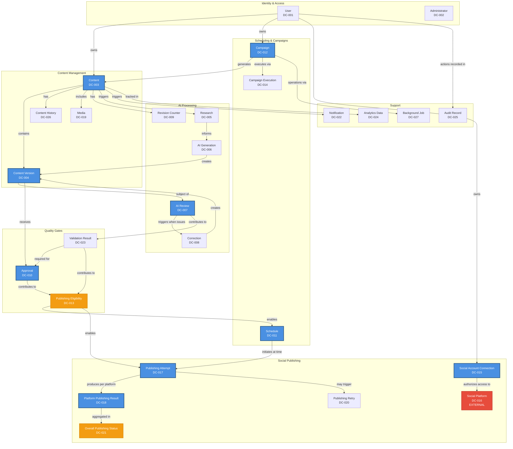

# System Analysis — 2.5 Domain Analysis

**Document:** `2.5-domain-analysis.md`
**Project:** AI Content Automater
**Phase:** System Analysis
**Status:** Draft
**Date:** 2026-09-28
**Source:** REQUIREMENTS.MD V2.0

---

## 2.5.1 Purpose

### What is Domain Analysis?

Domain analysis identifies and defines the **business concepts** that exist in the problem domain, independent of how they will be implemented technically.

This document answers: **"What concepts exist in the AI Content Automater business domain, what do they mean, and how are they related?"**

This document does NOT answer: **"How will these concepts be implemented in code, databases, or infrastructure?"**

### Objectives

This domain analysis:

1. **Identifies** all significant domain concepts from REQUIREMENTS.MD V2.0
2. **Defines** the meaning and business purpose of each concept
3. **Establishes** relationships between concepts
4. **Analyzes** ownership, lifecycle, and constraints
5. **Maps** concepts to requirements, business rules, and use cases
6. **Provides** the conceptual foundation for system design

### Relationship to Requirements

Domain concepts are **derived strictly from REQUIREMENTS.MD V2.0**. Every concept documented here can be traced to explicit requirements. Concepts not supported by requirements are not invented.

### Relationship to Business Rules

Business rules (BR-001 through BR-018 from document 2.4) govern how domain concepts behave and interact. Domain analysis identifies WHAT concepts exist; business rules define WHAT constraints apply to them.

### Relationship to System Design

Domain analysis is **conceptual** and **implementation-independent**. Later system design phases will use these domain concepts to create:
- Database schemas
- Class hierarchies
- API structures
- Component designs

But those are implementation decisions, not domain analysis.

### Critical Distinction

**Domain Analysis (This Document):**
- Content = a conceptual business entity representing social media material
- Content Version = a conceptual version of content at a point in time
- Approval = a business concept representing authorization to publish a specific version

**System Design (Later Phase):**
- Content table with columns and indexes
- ContentVersion Django model with foreign keys
- Approval API endpoint with JSON payload structure

---

## 2.5.2 Domain Scope

### Business Domain

The AI Content Automater operates in the **social media content production and publication domain**.

**Business Activities Within System Boundary:**

- Content creation and management
- Research collection for content topics
- AI-assisted content generation
- AI-based quality review and correction
- Content validation and approval
- Content scheduling for future publication
- Recurring campaign automation
- Direct social platform publishing
- Publishing result tracking
- Content analytics and history
- User and authorization management
- Audit trail maintenance

**Business Activities Outside System Boundary:**

- Actual social media platform operation (external)
- AI model training (external AI provider)
- Research source content creation (external sources)
- End-user social media consumption (external)
- Platform engagement analytics generation (external platforms)

### External Systems

**Important External Systems:**

1. **AI Service Providers** — Generate, review, and correct content
2. **Research Sources** — Provide topic information
3. **Social Media Platforms** — Receive and publish content
4. **Notification Services** — Deliver notifications (if external)
5. **Media Storage** — Store media files (if external)

### System Boundaries

The system boundary (from 2.1 System Overview) encompasses:

**Inside:** Content lifecycle management, AI workflow orchestration, user management, scheduling, campaign automation, publishing orchestration, result tracking

**Outside:** AI model execution, platform publishing infrastructure, research content, external account management

---

## 2.5.3 Domain Concepts Catalog

This section provides a comprehensive catalog of domain concepts identified from REQUIREMENTS.MD V2.0.

### DC-001: User

**Type:** Core Domain Concept
**Definition:** An authenticated person who creates, manages, and publishes content through the system.

**Business Purpose:** Represents the primary actor who owns content, campaigns, and platform connections. Provides identity and authorization context for all operations.

**Ownership:** Self-owned identity

**Lifecycle Relevance:** Persistent; exists throughout system usage

**Key Responsibilities:**
- Own content items
- Own campaigns
- Own social platform connections
- Initiate content creation and editing
- Approve content for publication
- Configure recurring campaigns
- Connect social accounts

**Important Business Constraints:**
- Must be authenticated to access protected functionality (Section 7)
- Can only access own resources or explicitly permitted resources (BR-001, Section 8)
- Cannot access another user's protected resources without authorization (BR-001)

**Related Concepts:**
- DC-002 (Administrator) - specialized user
- DC-004 (Content) - owned by user
- DC-012 (Campaign) - owned by user
- DC-015 (Social Account Connection) - owned by user

**Related Use Cases:** UC-001 (Authenticate), UC-002 (Authorize), UC-004 (Create Content), UC-013 (Approve), UC-015 (Create Campaign)

**Related Business Rules:** BR-001 (User Resource Isolation)

**Related Requirements:** FR-001 (Authentication), FR-002 (Authorization), Section 6.1, Section 9

---

### DC-002: Administrator

**Type:** Core Domain Concept
**Definition:** A user with elevated privileges for system configuration, user management, and operational oversight.

**Business Purpose:** Manages system-wide configuration, integrations, and administrative operations.

**Ownership:** Self-owned identity with elevated authorization

**Lifecycle Relevance:** Persistent; administrative role

**Key Responsibilities:**
- Configure system integrations (AI, research, social platforms)
- Manage users and permissions
- Access operational information
- Review audit trails
- Configure system settings

**Important Business Constraints:**
- Administrative operations require appropriate administrative authorization (Section 8)
- Administrative access is deliberate and auditable (Section 9, BR-001)

**Related Concepts:**
- DC-001 (User) - base concept
- DC-027 (Audit Record) - reviews audit information

**Related Use Cases:** UC-028 (Audit Security Events), UC-029 (Configure System Integrations)

**Related Business Rules:** BR-001 (administrative access auditable)

**Related Requirements:** FR-002 (Authorization), Section 6.2, Section 8

---

### DC-003: Content

**Type:** Core Domain Concept (Central)
**Definition:** A managed social media item representing the identity and container for all versions, reviews, approvals, and publishing activities.

**Business Purpose:** Serves as the primary business entity for social media content production. Provides identity continuity across generation, review, approval, and publishing.

**Ownership:** User-owned (Section 9, BR-001)

**Lifecycle Relevance:** Entire content lifecycle from creation through publication

**Key Responsibilities:**
- Maintain identity across versions
- Container for content versions
- Container for research associations
- Container for review results
- Container for approval records
- Container for schedule information
- Container for publishing results
- Track overall lifecycle status
- Maintain ownership relationship

**Important Business Constraints:**
- Every content item has clear ownership (Section 9, BR-001)
- Must remain traceable from creation through final outcome (Section 10)
- Cannot be published without passing mandatory gates (BR-004, BR-005, BR-006)

**Related Concepts:**
- DC-004 (Content Version) - contains versions
- DC-005 (Research) - associated research
- DC-007 (AI Review) - review results
- DC-010 (Approval) - approval records
- DC-011 (Schedule) - scheduling information
- DC-017 (Publishing Attempt) - publishing operations
- DC-019 (Media) - associated media

**Related Use Cases:** UC-004 (Create Content), UC-005 (Edit Content), UC-019 (Publish Content)

**Related Business Rules:** BR-001 (ownership), BR-002 (mandatory reviews), BR-004 (gates block publication)

**Related Requirements:** FR-003 (Content Creation), FR-004 (Content Editing), Section 10, Section 11

**Notes:** Content and Content Version are distinct concepts. Content provides identity; versions capture state at specific points in time.

---

### DC-004: Content Version

**Type:** Core Domain Concept (Central)
**Definition:** A specific version of content at a point in time, capturing the text/media state for generation, review, editing, approval, and publishing.

**Business Purpose:** Enables version-aware approval (BR-007), preserves history, allows tracking which specific version was approved or published.

**Ownership:** Belongs to parent Content, transitively owned by User

**Lifecycle Relevance:** Created on generation, correction, or manual edit; persists for history

**Key Responsibilities:**
- Capture content text/media at specific point in time
- Be subject of AI reviews
- Be subject of validation
- Be target of approval (version-specific per BR-007)
- Be published (specific version)
- Enable history tracking
- Support version-aware approval integrity

**Important Business Constraints:**
- Approval applies to specific version (BR-006, BR-007, Section 25)
- Material edit creates new version and invalidates previous approval (BR-007)
- Obsolete approved version shall not be published (Section 12)
- Correction shall not erase previous versions (Section 19)

**Related Concepts:**
- DC-003 (Content) - parent container
- DC-007 (AI Review) - reviews this version
- DC-008 (Correction) - produces new version
- DC-010 (Approval) - approves specific version
- DC-017 (Publishing Attempt) - publishes specific version

**Related Use Cases:** UC-005 (Edit - creates new version), UC-008 (Review #1), UC-009 (Correct), UC-010 (Review #2), UC-013 (Approve specific version)

**Related Business Rules:** BR-007 (Material Edits Invalidate Approval), BR-002 (version-specific reviews)

**Related Requirements:** FR-004 (editing creates versions), FR-008 (correction creates versions), Section 12, Section 19, Section 23, Section 25, Section 43

**Notes:** Critical concept for approval integrity. System must never publish version N+1 when only version N is approved.

---

### DC-005: Research

**Type:** Supporting Domain Concept
**Definition:** Information collected from external sources to inform content generation for a specific topic.

**Business Purpose:** Provides factual basis and context for AI content generation.

**Ownership:** Associated with Content, transitively owned by User

**Lifecycle Relevance:** Created during research phase, used during generation, preserved for traceability

**Key Responsibilities:**
- Record source information (title, URL, identifier)
- Capture retrieved information
- Track retrieval timestamp
- Maintain source metadata
- Remain distinguishable from generated content (Section 13)
- Provide traceability (Section 13)

**Important Business Constraints:**
- Research failure blocks dependent generation when research is mandatory (Section 14, BR-013)
- System shall never fabricate research results (Section 14)
- Research results shall remain distinguishable from generated content (Section 13)

**Related Concepts:**
- DC-003 (Content) - associated with content
- DC-006 (AI Generation) - informs generation

**Related Use Cases:** UC-006 (Collect Research)

**Related Business Rules:** BR-013 (Accurate Failure Representation)

**Related Requirements:** FR-005 (Research), Section 13, Section 14

---

### DC-006: AI Generation

**Type:** Supporting Domain Concept
**Definition:** The process and result of AI-assisted content generation for a content item.

**Business Purpose:** Produces initial generated content version using AI service.

**Ownership:** Operation on user-owned content

**Lifecycle Relevance:** Occurs after research, before first review

**Key Responsibilities:**
- Submit generation request to AI service
- Capture generation input (topic, instructions, research, platform, format)
- Receive generated content
- Create initial content version
- Trigger mandatory AI Review #1 (BR-002)

**Important Business Constraints:**
- Generation failure must not be represented as success (BR-013, Section 16)
- Timeouts, invalid responses, malformed responses never treated as successful generation (Section 16)
- Generated content distinguishable from manual edits (Section 15)
- Must trigger Review #1 (BR-002)

**Related Concepts:**
- DC-004 (Content Version) - produces version
- DC-005 (Research) - uses research input
- DC-007 (AI Review) - follows generation

**Related Use Cases:** UC-007 (Generate Content)

**Related Business Rules:** BR-002 (Mandatory AI Review Sequence), BR-013 (Accurate Failure)

**Related Requirements:** FR-006 (AI Generation), Section 15, Section 16

---

### DC-007: AI Review

**Type:** Core Domain Concept
**Definition:** A mandatory quality evaluation of a content version by AI service, identifying issues against quality criteria.

**Business Purpose:** Enforces quality gates before publication. Prevents publication of low-quality or problematic content.

**Ownership:** Operation on user-owned content version

**Lifecycle Relevance:** Two mandatory review stages (Review #1 and Review #2 per BR-002)

**Key Responsibilities:**
- Evaluate content version against quality requirements
- Identify issues (instruction non-compliance, factual concerns, clarity, structure, platform suitability, unsafe content, formatting - Section 18)
- Determine if correction required
- Produce traceable review result
- Operate on known content version (Section 17)
- Block publication if failed (BR-004)

**Important Business Constraints:**
- Two AI review stages mandatory (BR-002, Section 17)
- Cannot be bypassed (Section 17, BR-002)
- Review #2 shall not operate on obsolete version (Section 20)
- Each review operates on known content version (Section 17)
- Failed review blocks publication (BR-004)

**Related Concepts:**
- DC-004 (Content Version) - subject of review
- DC-008 (Correction) - triggered by review failure
- DC-009 (Revision Counter) - tracks correction cycles

**Related Use Cases:** UC-008 (AI Review #1), UC-010 (AI Review #2)

**Related Business Rules:** BR-002 (Mandatory AI Review Sequence), BR-004 (Failed Gates Block Publication)

**Related Requirements:** FR-007 (AI Review #1), FR-009 (AI Review #2), Section 17, Section 18, Section 20

**Notes:** Central to quality control. Dual review stages ensure thoroughness.

---

### DC-008: Correction

**Type:** Supporting Domain Concept
**Definition:** AI-driven content revision based on review findings, producing a new corrected content version.

**Business Purpose:** Addresses issues identified by AI reviews while maintaining version history.

**Ownership:** Operation on user-owned content version

**Lifecycle Relevance:** Occurs between Review #1 and Review #2, or after Review #2 if revision limit not exhausted

**Key Responsibilities:**
- Operate on reviewed version and review findings (Section 19)
- Produce corrected content
- Create new version or immutable revision (Section 19)
- Preserve history (original, review findings, correction input, corrected output - Section 19)
- Increment revision counter (DC-009)
- NOT erase previous versions (Section 19)

**Important Business Constraints:**
- Subject to bounded revision limits (BR-003)
- Correction creates new version without erasing history (Section 19)
- Revision counter incremented on each correction (Section 21)
- When revision limit exhausted, correction stops (Section 21, BR-003)

**Related Concepts:**
- DC-004 (Content Version) - produces new version
- DC-007 (AI Review) - triggered by review
- DC-009 (Revision Counter) - bounded by counter

**Related Use Cases:** UC-009 (Correct Content), UC-011 (Enforce Revision Limit)

**Related Business Rules:** BR-002 (correction in review sequence), BR-003 (Finite AI Revision Loops)

**Related Requirements:** FR-008 (AI Correction), Section 19, Section 21

---

### DC-009: Revision Counter

**Type:** Supporting Domain Concept
**Definition:** A counter tracking the number of AI correction/review cycles for a content item, enforcing bounded revision limits.

**Business Purpose:** Prevents unbounded autonomous AI revision loops (BR-003).

**Ownership:** Associated with Content

**Lifecycle Relevance:** Maintained throughout AI review/correction cycles

**Key Responsibilities:**
- Track number of correction attempts
- Compare against configured maximum
- Trigger intervention state when limit exhausted
- Block automatic publishing at limit (Section 21)
- Stop automated revision at limit (Section 21)

**Important Business Constraints:**
- Maximum revision count must be finite (BR-003, Section 21)
- When limit exhausted: automated revision stops, publishing blocked, intervention required (Section 21)
- No unbounded autonomous correction loop permitted (Section 21)

**Related Concepts:**
- DC-003 (Content) - counter per content
- DC-008 (Correction) - increments counter
- DC-007 (AI Review) - triggers correction

**Related Use Cases:** UC-009 (Correct - increments), UC-011 (Enforce Revision Limit)

**Related Business Rules:** BR-003 (Finite AI Revision Loops)

**Related Requirements:** FR-010 (Revision Limit), Section 21

**Notes:** Exact numeric limit unspecified (Section 74), must be configured before production.

---

### DC-010: Approval

**Type:** Core Domain Concept
**Definition:** Explicit authorization by user to publish a specific content version, creating version-specific approval record.

**Business Purpose:** Provides human oversight gate before publication. Ensures accountability.

**Ownership:** Approval action by authorized user on user-owned content

**Lifecycle Relevance:** After validation, before scheduling; may be invalidated by material edits

**Key Responsibilities:**
- Tie approval to specific content version (BR-007, Section 25)
- Record approver identity
- Record approval timestamp
- Record approved version identifier
- Be invalidated by material edits (BR-007)
- Enable publishing eligibility (BR-006)

**Important Business Constraints:**
- Approval applies to specific content version (BR-007, Section 25)
- Material changes invalidate previous approval (BR-007, Section 12, Section 25)
- Publication requires valid approval where approval is required (BR-006, Section 26)
- System shall never publish obsolete approved version (Section 12)

**Related Concepts:**
- DC-004 (Content Version) - approves specific version
- DC-011 (Schedule) - approval enables scheduling
- DC-013 (Publishing Eligibility) - approval contributes to eligibility

**Related Use Cases:** UC-013 (Approve Content), UC-005 (Edit - may invalidate approval)

**Related Business Rules:** BR-006 (Approval Required), BR-007 (Material Edits Invalidate Approval)

**Related Requirements:** FR-012 (Approval), Section 25, Section 26

**Notes:** Version-aware approval is critical to preventing publishing of unapproved changes.

---

### DC-011: Schedule

**Type:** Core Domain Concept
**Definition:** A future execution plan for publishing content to specified platforms at a specific time with explicit timezone.

**Business Purpose:** Enables deferred publication and recurring content automation.

**Ownership:** User-owned, associated with user's content

**Lifecycle Relevance:** Created after approval, executed at scheduled time

**Key Responsibilities:**
- Identify content to publish
- Specify target platform(s)
- Specify execution date/time with explicit timezone (Section 28)
- Track schedule status
- Trigger execution at scheduled time
- Trigger execution-time eligibility revalidation (BR-008)

**Important Business Constraints:**
- Only eligible content may be scheduled (Section 27)
- Scheduling must use explicit timezone (Section 28, BR-008)
- Scheduled content revalidated at execution time (BR-008, Section 29)
- If content ineligible at execution, publication refused (Section 27)
- Concurrent workers shall not duplicate publication (Section 29)

**Related Concepts:**
- DC-003 (Content) - schedules content
- DC-010 (Approval) - requires approval first
- DC-013 (Publishing Eligibility) - rechecked at execution
- DC-017 (Publishing Attempt) - initiated at scheduled time
- DC-012 (Campaign) - may create schedules

**Related Use Cases:** UC-014 (Schedule Content), UC-019 (Publish at scheduled time)

**Related Business Rules:** BR-006 (requires approval), BR-008 (Scheduled Content Revalidation)

**Related Requirements:** FR-013 (Scheduling), Section 27, Section 28, Section 29

**Notes:** Timezone handling critical; system shall not silently use arbitrary server timezone (Section 28).

---

### DC-012: Campaign

**Type:** Core Domain Concept
**Definition:** A recurring automation configuration defining how to generate and publish content automatically on a schedule.

**Business Purpose:** Enables recurring content automation while preserving quality gates.

**Ownership:** User-owned

**Lifecycle Relevance:** Persistent; can be Active or Disabled

**Key Responsibilities:**
- Define recurring automation intent (Section 30)
- Specify topic/theme
- Specify generation instructions
- Specify research instructions
- Specify target platforms
- Specify recurring schedule pattern
- Specify content constraints
- Trigger recurring content generation
- NOT bypass quality workflow (BR-014)

**Important Business Constraints:**
- Campaigns shall not bypass review, validation, approval, or publishing gates (BR-014, Section 30)
- Each generated content item remains individually traceable (Section 30)
- Users shall be able to disable active campaigns (BR-015, Section 31)
- Disabling prevents creation of new future work (BR-015, Section 31)
- Campaigns shall not create unlimited work (Section 31)
- Campaign failures recorded without silently disabling unrelated campaigns (Section 31)

**Related Concepts:**
- DC-003 (Content) - generates content items
- DC-011 (Schedule) - creates schedules
- DC-014 (Campaign Execution) - execution instances

**Related Use Cases:** UC-015 (Create Campaign), UC-016 (Execute Campaign)

**Related Business Rules:** BR-014 (Campaigns Must Not Bypass Quality Workflow), BR-015 (Disabled Campaigns Must Not Continue)

**Related Requirements:** FR-014 (Recurring Campaigns), Section 30, Section 31

**Notes:** Campaign configuration vs. campaign execution should be conceptually distinct.

---

### DC-013: Publishing Eligibility

**Type:** Core Domain Concept
**Definition:** The composite state representing whether all mandatory publication conditions are satisfied for content.

**Business Purpose:** Enforces publication gate, preventing publication of ineligible content.

**Ownership:** Derived state of content

**Lifecycle Relevance:** Evaluated before scheduling and re-evaluated at execution time

**Key Responsibilities:**
- Aggregate all mandatory publication conditions (Section 26):
  - Content is valid
  - Required AI reviews completed
  - Required corrections completed
  - Final validation passed
  - Required approval exists
  - Target platform is authorized
  - Required content/media is available
  - Scheduled execution is valid
- Block publication if any condition false
- Be re-checked at execution time (BR-008)

**Important Business Constraints:**
- If ANY mandatory condition is false, publication shall NOT occur (Section 26)
- Publishing subsystem enforces eligibility independently of UI state (Section 26)
- Scheduled content must be revalidated at execution time (BR-008)

**Related Concepts:**
- DC-003 (Content) - eligibility state of content
- DC-007 (AI Review) - required reviews completed
- DC-010 (Approval) - approval condition
- DC-011 (Schedule) - checked at scheduling and execution
- DC-015 (Social Account Connection) - platform authorization

**Related Use Cases:** UC-012 (Validate), UC-014 (Schedule - checks eligibility), UC-019 (Publish - rechecks eligibility)

**Related Business Rules:** BR-004 (Failed Gates Block), BR-005 (Validation Required), BR-006 (Approval Required), BR-008 (Revalidation)

**Related Requirements:** Section 26

**Notes:** Not a stored entity but a derived business state aggregating multiple conditions.

---

### DC-014: Campaign Execution

**Type:** Supporting Domain Concept
**Definition:** A single execution instance of a recurring campaign, generating content and following the complete quality workflow.

**Business Purpose:** Represents one iteration of campaign automation.

**Ownership:** Associated with Campaign, transitively owned by user

**Lifecycle Relevance:** Created at scheduled campaign time, generates content, completes workflow

**Key Responsibilities:**
- Execute campaign at scheduled time
- Generate content per campaign configuration
- Follow complete workflow (research, generation, review, validation, approval, scheduling, publishing)
- Track execution outcome
- Associate generated content with campaign (Section 30)
- Schedule next execution if recurring

**Important Business Constraints:**
- Must follow complete quality workflow (BR-014)
- Cannot bypass mandatory gates (BR-014)
- Execution blocked if campaign disabled (BR-015)
- Duplicate execution prevented (Section 31)

**Related Concepts:**
- DC-012 (Campaign) - parent configuration
- DC-003 (Content) - generates content
- DC-011 (Schedule) - scheduled execution

**Related Use Cases:** UC-016 (Execute Campaign)

**Related Business Rules:** BR-014 (quality workflow), BR-015 (disabled campaigns)

**Related Requirements:** FR-014 (Recurring Campaigns), Section 30, Section 31

**Notes:** Conceptually distinct from Campaign configuration.

---

### DC-015: Social Account Connection

**Type:** Core Domain Concept
**Definition:** A user's connected social media account authorization, enabling publishing to that platform.

**Business Purpose:** Represents user's authorization to publish through their social media accounts.

**Ownership:** User-owned

**Lifecycle Relevance:** Active, Expired, or Revoked

**Key Responsibilities:**
- Store platform authorization credentials/tokens (Section 33)
- Enable publishing to platform
- Track connection status
- Provide clear integration state when expired/revoked (Section 33)

**Important Business Constraints:**
- Credentials/tokens stored securely (BR-016, Section 33)
- Tokens and secrets not displayed in normal UI (BR-016, Section 33)
- Expired or revoked credentials produce clear integration state (Section 33)
- Failure of one platform authorization does not invalidate unrelated connections (Section 33)
- User connects own accounts (ownership)

**Related Concepts:**
- DC-001 (User) - owns connection
- DC-016 (Social Platform) - platform being connected
- DC-013 (Publishing Eligibility) - authorization required for eligibility
- DC-017 (Publishing Attempt) - uses connection

**Related Use Cases:** UC-017 (Connect Platform), UC-018 (Manage Authorization), UC-019 (Publish - requires connection)

**Related Business Rules:** BR-001 (ownership), BR-009 (Direct Publishing), BR-016 (Secrets Must Not Be Exposed)

**Related Requirements:** FR-015 (Direct Publishing), Section 33

---

### DC-016: Social Platform

**Type:** External Domain Concept
**Definition:** An external social media platform (Twitter, Facebook, LinkedIn, etc.) that receives published content.

**Business Purpose:** Target destination for content publication.

**Ownership:** External (not system-owned)

**Lifecycle Relevance:** External; system connects to platform

**Key Responsibilities:**
- Receive published content via API
- Return publishing result
- Enforce platform-specific constraints
- Provide platform-specific media requirements
- Maintain external publication state

**Important Business Constraints:**
- System publishes directly through platform APIs (BR-009, Section 32)
- Buffer NOT required intermediary (BR-009)
- Each platform integration translates content independently (Section 32)
- Platform-specific limitations handled by integration (Section 32)
- System does not claim publication until platform confirms (Section 32)

**Related Concepts:**
- DC-015 (Social Account Connection) - authorization to platform
- DC-017 (Publishing Attempt) - publishes to platform
- DC-018 (Platform Publishing Result) - result from platform

**Related Use Cases:** UC-017 (Connect to platform), UC-019 (Publish to platform)

**Related Business Rules:** BR-009 (Direct Publishing Required)

**Related Requirements:** FR-015 (Direct Publishing), Section 32

**Notes:** External system; system does not control platform behavior or data.

---

### DC-017: Publishing Attempt

**Type:** Core Domain Concept
**Definition:** A single attempt to publish content to one or more platforms, initiated at scheduled time or manually.

**Business Purpose:** Represents the publishing operation, tracking submission to platforms and results.

**Ownership:** Associated with user's content

**Lifecycle Relevance:** Created at publishing time, completes with result

**Key Responsibilities:**
- Initiate publishing to target platform(s)
- Track attempt number (for retries)
- Track submission time
- Coordinate platform-specific publishing
- Receive platform responses
- Record overall outcome
- Maintain stable job identity for duplicate detection (Section 35)

**Important Business Constraints:**
- Independent attempt per platform when multi-platform (BR-010)
- Concurrent workers shall not duplicate publication (Section 29)
- Each publishing job has stable identity (Section 35)
- Retries preserve duplicate-publication protection (BR-012, Section 35, Section 37)

**Related Concepts:**
- DC-003 (Content) - publishes content
- DC-004 (Content Version) - publishes specific version
- DC-016 (Social Platform) - target platform(s)
- DC-018 (Platform Publishing Result) - results per platform
- DC-020 (Publishing Retry) - retry attempts

**Related Use Cases:** UC-019 (Publish Content), UC-021 (Retry Publishing)

**Related Business Rules:** BR-008 (revalidation), BR-009 (direct publishing), BR-010 (independent per platform), BR-012 (bounded duplicate-safe retry)

**Related Requirements:** FR-015 (Direct Publishing), FR-016 (Platform Tracking), Section 29, Section 35

---

### DC-018: Platform Publishing Result

**Type:** Core Domain Concept
**Definition:** The outcome of publishing attempt to a specific platform, recording success, failure, or unknown state.

**Business Purpose:** Tracks independent outcome per platform, enabling accurate partial-success reporting.

**Ownership:** Associated with Publishing Attempt, transitively owned by user

**Lifecycle Relevance:** Created when platform responds or publishing fails

**Key Responsibilities:**
- Record platform-specific outcome (Published, Failed, Unknown)
- Capture platform response details
- Record timestamp
- Preserve failure diagnostics if failed (Section 36)
- Distinguish transient vs. permanent failure (Section 36)
- Remain independent from other platform results (BR-011)
- NOT be overwritten by other platform failures (BR-011)

**Important Business Constraints:**
- Results tracked independently per platform (BR-010, Section 34)
- Platform A result NOT overwritten by Platform B result (BR-011, Section 34)
- Failed attempt never recorded as successful (BR-013, Section 36)
- Unknown external state represented explicitly (BR-018, Section 47)
- Overall status distinguishes all-successful, partially-successful, all-failed, pending, cancelled (Section 34)

**Related Concepts:**
- DC-017 (Publishing Attempt) - parent attempt
- DC-016 (Social Platform) - platform for this result
- DC-021 (Overall Publishing Status) - aggregates results

**Related Use Cases:** UC-019 (Publish - creates result), UC-020 (Track Multi-Platform Results), UC-022 (Handle Failure)

**Related Business Rules:** BR-010 (Independent Per-Platform Results), BR-011 (Platform Result Independence), BR-013 (Accurate Failure), BR-018 (Unknown State Explicit)

**Related Requirements:** FR-016 (Platform Tracking), Section 34, Section 36

**Notes:** Critical for multi-platform publishing integrity. Example: Platform A Published, Platform B Failed, Platform C Published.

---

### DC-019: Media

**Type:** Supporting Domain Concept
**Definition:** Images, videos, or other media files associated with content for publication.

**Business Purpose:** Visual/multimedia component of social media content.

**Ownership:** Associated with Content, transitively owned by user

**Lifecycle Relevance:** Associated during content creation/editing, validated before publication

**Key Responsibilities:**
- Store media metadata
- Link to owning content (Section 39)
- Satisfy platform-specific requirements
- Be available for publication
- NOT block unrelated platforms if invalid for one platform (Section 39)

**Important Business Constraints:**
- Media metadata linked to owning content (Section 39)
- Required media must be available before publication (Section 39)
- Missing or invalid media blocks affected platform publication (Section 39)
- Media failure for one platform does not invalidate another platform (Section 39)

**Related Concepts:**
- DC-003 (Content) - media associated with content
- DC-013 (Publishing Eligibility) - media validation affects eligibility

**Related Use Cases:** UC-023 (Associate Media), UC-024 (Validate Media)

**Related Business Rules:** BR-005 (validation includes media)

**Related Requirements:** FR-019 (Media), Section 39

**Notes:** Exact storage provider unspecified (Section 74).

---

### DC-020: Publishing Retry

**Type:** Supporting Domain Concept
**Definition:** A bounded retry attempt for failed publishing operation, with duplicate-safe retry logic.

**Business Purpose:** Handles transient failures while preventing unbounded retries and duplicate publications.

**Ownership:** Associated with Publishing Attempt

**Lifecycle Relevance:** Created on publishing failure, bounded by retry limit

**Key Responsibilities:**
- Track retry count
- Compare against maximum retry limit
- Schedule retry with appropriate delay
- Maintain job identity for duplicate detection (Section 35)
- Re-check content eligibility before retry (Section 37)
- Prevent duplicate publication (BR-012)
- Stop at retry limit (Section 37)

**Important Business Constraints:**
- Retries must be bounded (BR-012, Section 37)
- System shall not retry indefinitely (Section 37)
- Authentication failures not retried as ordinary API failures (Section 37)
- Retry execution preserves duplicate-publication protection (BR-012, Section 37)
- Retry re-checks eligibility (Section 37)

**Related Concepts:**
- DC-017 (Publishing Attempt) - parent attempt
- DC-018 (Platform Publishing Result) - retrying to achieve success

**Related Use Cases:** UC-021 (Retry Failed Publishing), UC-022 (Handle Failure)

**Related Business Rules:** BR-012 (Bounded and Duplicate-Safe Publishing Retries)

**Related Requirements:** FR-017 (Publishing Retry), Section 35, Section 37

**Notes:** Exact retry limits and delays unspecified (Section 74).

---

### DC-021: Overall Publishing Status

**Type:** Supporting Domain Concept
**Definition:** Aggregated publishing outcome across all target platforms for multi-platform content.

**Business Purpose:** Provides composite view of multi-platform publishing result.

**Ownership:** Derived from Platform Publishing Results

**Lifecycle Relevance:** Computed from platform results

**Key Responsibilities:**
- Aggregate platform-specific results
- Distinguish status types:
  - All-Successful (all platforms succeeded)
  - Partially-Successful (some succeeded, some failed)
  - All-Failed (all platforms failed)
  - Pending (some platforms still executing)
  - Cancelled

**Important Business Constraints:**
- Derived from independent platform results (BR-010, BR-011)
- Accurately represents partial success (Section 34)

**Related Concepts:**
- DC-017 (Publishing Attempt) - overall attempt
- DC-018 (Platform Publishing Result) - aggregates these results

**Related Use Cases:** UC-020 (Track Multi-Platform Results)

**Related Business Rules:** BR-010 (independent results), BR-011 (result independence)

**Related Requirements:** FR-016 (Platform Tracking), Section 34

**Notes:** Not a stored entity but a derived status.

---

### DC-022: Notification

**Type:** Supporting Domain Concept
**Definition:** A message sent to user about important workflow events.

**Business Purpose:** Keeps user informed of workflow progress, failures, and required actions.

**Ownership:** Sent to user about user's content/campaigns

**Lifecycle Relevance:** Created on configured events

**Key Responsibilities:**
- Notify user of configured events (Section 38):
  - Generation completion/failure
  - Review failure
  - Revision exhaustion
  - Validation failure
  - Approval required/completed
  - Schedule creation
  - Publication success/failure
  - Authorization failure
  - Campaign failure
- Reflect actual system state (BR-013, Section 38)
- NOT send success notification for failed operation (Section 38)

**Important Business Constraints:**
- Notifications shall reflect actual system state (Section 38)
- System shall never send success notification for failed operation (BR-013, Section 38)

**Related Concepts:**
- DC-003 (Content) - content-related notifications
- DC-012 (Campaign) - campaign-related notifications
- DC-018 (Publishing Result) - publishing notifications

**Related Use Cases:** UC-025 (Notify User)

**Related Business Rules:** BR-013 (Accurate Failure Representation)

**Related Requirements:** FR-018 (Notifications), Section 38

**Notes:** Exact notification provider unspecified (Section 74).

---

### DC-023: Validation Result

**Type:** Supporting Domain Concept
**Definition:** The outcome of final validation checks before approval, verifying all mandatory publication conditions.

**Business Purpose:** Final quality gate before approval.

**Ownership:** Associated with Content Version

**Lifecycle Relevance:** After AI Review #2, before Approval

**Key Responsibilities:**
- Check all mandatory publication conditions (Section 24):
  - Required fields
  - Platform compatibility
  - Media requirements
  - Length/format rules
  - Required metadata
  - Approval conditions
  - Other business rules
- Record validation outcome (pass/fail)
- Record specific failures
- Block publication if failed (BR-005)

**Important Business Constraints:**
- Final validation must pass before publication (BR-005, Section 24)
- Failed validation blocks publication (BR-005)

**Related Concepts:**
- DC-004 (Content Version) - validates version
- DC-013 (Publishing Eligibility) - validation contributes to eligibility

**Related Use Cases:** UC-012 (Validate Content)

**Related Business Rules:** BR-004 (Failed Gates Block), BR-005 (Final Validation Required)

**Related Requirements:** FR-011 (Final Validation), Section 24

**Notes:** Exact validation scoring rules unspecified (Section 74).

---

### DC-024: Analytics Data

**Type:** Supporting Domain Concept
**Definition:** Operational and content metrics aggregated for reporting purposes.

**Business Purpose:** Provides insight into system usage and content performance.

**Ownership:** Associated with user's content and operations

**Lifecycle Relevance:** Accumulated over time

**Key Responsibilities:**
- Report counts/states (Section 40):
  - Content created, generated, reviewed, approved, scheduled
  - Publication attempts, successes, failures
  - Partial publication outcomes
  - Platform-level results
  - Campaign activity
- Distinguish observed data from derived statistics (Section 40)
- NOT fabricate unavailable metrics (Section 40)

**Important Business Constraints:**
- Unavailable metrics shall never be fabricated (Section 40)
- Analytics shall distinguish observed data from derived statistics (Section 40)

**Related Concepts:**
- DC-003 (Content) - content metrics
- DC-018 (Platform Publishing Result) - publishing metrics
- DC-012 (Campaign) - campaign metrics

**Related Use Cases:** UC-026 (View Analytics)

**Related Business Rules:** BR-013 (accurate data)

**Related Requirements:** FR-020 (Analytics), Section 40

**Notes:** Exact metrics from each provider unspecified (Section 74).

---

### DC-025: Audit Record

**Type:** Supporting Domain Concept
**Definition:** A record of security-sensitive or workflow-significant events for investigation and compliance.

**Business Purpose:** Provides accountability and investigation trail.

**Ownership:** System-owned, records events on user resources

**Lifecycle Relevance:** Created on auditable events, persisted

**Key Responsibilities:**
- Record auditable events (Section 44):
  - Authentication events
  - Permission changes
  - Approval/rejection
  - Integration connection changes
  - Schedule changes
  - Campaign enable/disable
  - Publishing attempts/outcomes
  - Administrative configuration changes
- Contain context for investigation without exposing secrets (Section 44)
- NOT be casually edited/deleted by ordinary users (Section 44)

**Important Business Constraints:**
- Audit records shall contain enough context without exposing secrets (Section 44)
- Ordinary users shall not casually edit or delete audit records (Section 44)
- Administrative access is auditable (BR-001, Section 9)

**Related Concepts:**
- DC-001 (User) - user events audited
- DC-002 (Administrator) - reviews audit records
- DC-003 (Content) - content operations audited

**Related Use Cases:** UC-028 (Audit Security Events)

**Related Business Rules:** BR-001 (administrative access auditable), BR-016 (secrets not in audit)

**Related Requirements:** FR-021 (Audit), Section 44

---

### DC-026: Content History

**Type:** Supporting Domain Concept
**Definition:** The complete traceable record of content changes, versions, reviews, and publishing activities.

**Business Purpose:** Enables understanding of content evolution and outcome traceability.

**Ownership:** Associated with Content, owned by user

**Lifecycle Relevance:** Accumulated throughout content lifecycle

**Key Responsibilities:**
- Identify versions (Section 43):
  - Generated versions
  - Reviewed versions
  - Corrected versions
  - Manually edited versions
  - Approved versions
  - Published versions
- Maintain traceability from creation through final outcome (Section 10)
- Preserve published content/version relationships (Section 43)

**Important Business Constraints:**
- Every content item shall remain traceable from creation through final outcome (Section 10)
- Published content/version relationships shall remain traceable after later edits (Section 43)

**Related Concepts:**
- DC-003 (Content) - history of content
- DC-004 (Content Version) - versions in history
- DC-007 (AI Review) - review history
- DC-010 (Approval) - approval history

**Related Use Cases:** UC-027 (View Publishing History)

**Related Requirements:** Section 10, Section 43

---

### DC-027: Background Job

**Type:** Technical/Supporting Concept
**Definition:** An asynchronous task executing long-running operations outside request-response cycle.

**Business Purpose:** Enables non-blocking execution of generation, reviews, publishing, etc.

**Ownership:** System-owned, operates on user resources

**Lifecycle Relevance:** Created for async operations, completes with success/failure

**Key Responsibilities:**
- Execute long-running operations (Section 49):
  - Research, generation, review, correction
  - Publishing
  - Analytics synchronization
  - Campaign execution
- Have stable identifier (Section 50)
- Report success/failure (Section 50)
- Handle expected exceptions (Section 50)
- Use bounded retries (Section 50)
- Avoid duplicate side effects (Section 50)
- Preserve debugging context (Section 50)
- Re-check preconditions before irreversible actions (Section 50)
- NOT leave entities falsely marked complete (Section 50)

**Important Business Constraints:**
- Background tasks must preserve workflow and ownership integrity (BR-017)
- Failed task shall not leave business entity falsely marked complete (Section 50)
- Background tasks preserve ownership context (Section 9)

**Related Concepts:**
- Multiple domain concepts rely on background processing

**Related Use Cases:** Multiple use cases involve background processing

**Related Business Rules:** BR-017 (Background Tasks Must Preserve Integrity)

**Related Requirements:** FR-023 (Background Processing), Section 49, Section 50

**Notes:** Celery-based background processing expected (Section 49). This is more technical than pure domain concept but has business significance.

---


## 2.5.4 Core Domain Concepts

Core domain concepts are central to the system's business behavior. They represent the primary business entities that the system exists to manage.

### Central Core Concepts

**DC-003: Content**
**Why Core:** The primary business entity. The entire system exists to create, manage, review, approve, schedule, and publish content. All other concepts support or operate on content.

**DC-004: Content Version**
**Why Core:** Enables version-aware approval (BR-007), which is critical to system integrity. Without version tracking, material edits could bypass approval, violating BR-007.

**DC-007: AI Review**
**Why Core:** Mandatory quality gates (BR-002, BR-004) that cannot be bypassed. Central to the system's quality control mission.

**DC-010: Approval**
**Why Core:** Human oversight gate (BR-006) providing accountability. Version-specific approval (BR-007) is a critical business invariant.

**DC-017: Publishing Attempt**
**Why Core:** Represents the culminating business operation—publication to external platforms. All prior workflow steps lead to this.

**DC-018: Platform Publishing Result**
**Why Core:** Independent per-platform outcomes (BR-010, BR-011) enable accurate partial-success reporting, which is essential for multi-platform publishing integrity.

### Essential Core Concepts

**DC-001: User**
**Why Core:** Establishes ownership (BR-001) and authorization context for all operations.

**DC-011: Schedule**
**Why Core:** Enables deferred publication and execution-time revalidation (BR-008), which is critical to scheduled content safety.

**DC-012: Campaign**
**Why Core:** Enables recurring automation while preserving quality gates (BR-014), which is a key product feature.

**DC-013: Publishing Eligibility**
**Why Core:** Aggregates all mandatory publication conditions (Section 26), enforcing the publication gate that prevents premature publication.

**DC-015: Social Account Connection**
**Why Core:** Enables publishing; without platform authorization, no publication can occur.

---

## 2.5.5 Supporting Domain Concepts

Supporting concepts enable core concepts but are not themselves central business entities.

### Quality Workflow Support

**DC-006: AI Generation** — Produces initial content version
**DC-008: Correction** — Improves content based on reviews
**DC-009: Revision Counter** — Enforces bounded revision (BR-003)
**DC-023: Validation Result** — Final quality gate result

### Content Support

**DC-005: Research** — Informs generation
**DC-019: Media** — Visual/multimedia content component
**DC-026: Content History** — Traceability record

### Publishing Support

**DC-020: Publishing Retry** — Handles transient failures
**DC-021: Overall Publishing Status** — Aggregates platform results

### Operational Support

**DC-022: Notification** — User communication
**DC-024: Analytics Data** — Operational metrics
**DC-025: Audit Record** — Security and compliance trail
**DC-027: Background Job** — Asynchronous execution

### Automation Support

**DC-014: Campaign Execution** — Single campaign iteration

---

## 2.5.6 External Domain Concepts

External concepts are owned or controlled by systems outside our boundary.

### DC-016: Social Platform

**External Owner:** Platform company (Twitter, Facebook, LinkedIn, etc.)

**System Boundary:** OUTSIDE

**What System Owns:**
- Connection to platform (DC-015)
- Publishing attempts to platform (DC-017)
- Results received from platform (DC-018)

**What System Does NOT Own:**
- Platform infrastructure
- Platform API behavior
- External publication state after confirmation
- Platform user accounts
- Platform engagement data

**Why This Matters:**
- System cannot control platform availability (affects publishing)
- System cannot control platform API changes (affects integrations)
- System cannot definitively know external publication state in all cases (BR-018)
- Platform-specific constraints must be handled per platform (Section 32)

### External AI Service

**External Owner:** AI provider (OpenAI, Anthropic, etc.)

**System Boundary:** OUTSIDE

**What System Owns:**
- Generation requests (DC-006)
- Review requests (DC-007)
- Correction requests (DC-008)
- Results received from AI service

**What System Does NOT Own:**
- AI model architecture
- AI service availability
- AI service response quality
- AI provider infrastructure

### External Research Sources

**External Owner:** Research content providers

**System Boundary:** OUTSIDE

**What System Owns:**
- Research collection operations (DC-005)
- Retrieved research data

**What System Does NOT Own:**
- Source content
- Source availability
- Source accuracy

---

## 2.5.7 Domain Relationships

This section documents key relationships between domain concepts.

### User → Content

**Relationship:** owns
**Business Meaning:** User creates and owns content items
**Cardinality:** One User owns many Content items
**Ownership Implications:** User can only access own content (BR-001)
**Lifecycle Implications:** Content lifecycle tied to user ownership
**Business Rules:** BR-001 (User Resource Isolation)
**Use Cases:** UC-004 (Create Content)

---

### Content → Content Version

**Relationship:** contains/has
**Business Meaning:** Content identity contains multiple versions over time
**Cardinality:** One Content has many Content Versions
**Ownership Implications:** Versions inherit content ownership
**Lifecycle Implications:** New version created on generation, correction, or edit
**Business Rules:** BR-007 (versions distinct for approval integrity)
**Use Cases:** UC-005 (Edit creates version), UC-009 (Correct creates version)

**Critical Note:** Content provides identity continuity; versions capture state at specific times.

---

### Content Version → AI Review

**Relationship:** is subject of
**Business Meaning:** Specific version undergoes quality review
**Cardinality:** One Content Version has multiple AI Reviews (Review #1, Review #2)
**Ownership Implications:** Reviews associated with user's content
**Lifecycle Implications:** Reviews occur after generation, after correction
**Business Rules:** BR-002 (Mandatory AI Review Sequence)
**Use Cases:** UC-008 (Review #1), UC-010 (Review #2)

---

### AI Review → Correction

**Relationship:** triggers (when issues found)
**Business Meaning:** Failed review triggers correction
**Cardinality:** One Review may trigger one Correction
**Ownership Implications:** Correction operates on user's content
**Lifecycle Implications:** Correction creates new version
**Business Rules:** BR-002 (correction in sequence), BR-003 (bounded)
**Use Cases:** UC-009 (Correct Content)

---

### Content → Revision Counter

**Relationship:** has
**Business Meaning:** Content tracks correction/review cycles
**Cardinality:** One Content has one Revision Counter
**Ownership Implications:** Counter part of content state
**Lifecycle Implications:** Incremented on each correction, enforces limit
**Business Rules:** BR-003 (Finite AI Revision Loops)
**Use Cases:** UC-011 (Enforce Revision Limit)

---

### Content Version → Approval

**Relationship:** receives (version-specific)
**Business Meaning:** Specific version is approved for publication
**Cardinality:** One Content Version may have one Approval at a time
**Ownership Implications:** Authorized user approves user's content
**Lifecycle Implications:** Approval enables scheduling; material edit invalidates
**Business Rules:** BR-006 (Approval Required), BR-007 (Material Edits Invalidate)
**Use Cases:** UC-013 (Approve Content)

**Critical Note:** Approval tied to specific version (BR-007). Version N+1 does NOT inherit approval from version N.

---

### Content → Schedule

**Relationship:** is scheduled via
**Business Meaning:** Approved content scheduled for future publication
**Cardinality:** One Content may have multiple Schedules (different platforms/times)
**Ownership Implications:** User schedules own content
**Lifecycle Implications:** Schedule triggers execution-time revalidation
**Business Rules:** BR-008 (Scheduled Content Revalidation)
**Use Cases:** UC-014 (Schedule Content)

---

### User → Campaign

**Relationship:** owns
**Business Meaning:** User configures recurring automation
**Cardinality:** One User owns many Campaigns
**Ownership Implications:** User owns campaign configuration
**Lifecycle Implications:** Campaign generates content on schedule
**Business Rules:** BR-014 (Campaigns Must Not Bypass Workflow), BR-015 (Disabled Campaigns)
**Use Cases:** UC-015 (Create Campaign)

---

### Campaign → Content

**Relationship:** generates
**Business Meaning:** Campaign execution creates content items
**Cardinality:** One Campaign generates many Content items over time
**Ownership Implications:** Generated content owned by campaign owner
**Lifecycle Implications:** Each generated content individually traceable
**Business Rules:** BR-014 (full workflow per content)
**Use Cases:** UC-016 (Execute Campaign)

---

### User → Social Account Connection

**Relationship:** owns
**Business Meaning:** User connects their social media accounts
**Cardinality:** One User owns many Social Account Connections
**Ownership Implications:** User's credentials for user's platforms
**Lifecycle Implications:** Connection enables publishing
**Business Rules:** BR-001 (ownership), BR-016 (credentials secured)
**Use Cases:** UC-017 (Connect Platform)

---

### Social Account Connection → Social Platform

**Relationship:** authorizes access to
**Business Meaning:** Connection provides authorization to publish to external platform
**Cardinality:** One Connection to one Platform (multiple connections possible per platform)
**Ownership Implications:** Connection owned by user, platform external
**Lifecycle Implications:** Active/Expired/Revoked states
**Business Rules:** BR-009 (Direct Publishing), BR-016 (secrets secured)
**Use Cases:** UC-017 (Connect), UC-019 (Publish)

---

### Content → Publishing Attempt

**Relationship:** is published via
**Business Meaning:** Content published through attempt at scheduled time
**Cardinality:** One Content may have multiple Publishing Attempts (retries, different times)
**Ownership Implications:** Publishing attempt on user's content
**Lifecycle Implications:** Attempt creates results
**Business Rules:** BR-008 (revalidation), BR-009 (direct publishing)
**Use Cases:** UC-019 (Publish Content)

---

### Publishing Attempt → Platform Publishing Result

**Relationship:** produces (per platform)
**Business Meaning:** Attempt yields independent result per target platform
**Cardinality:** One Publishing Attempt produces one Platform Publishing Result per target platform
**Ownership Implications:** Results associated with user's content
**Lifecycle Implications:** Results remain independent (BR-011)
**Business Rules:** BR-010 (Independent Results), BR-011 (Result Independence)
**Use Cases:** UC-020 (Track Multi-Platform Results)

**Critical Note:** Multi-platform publishing creates multiple independent results. Platform A success does NOT affect Platform B result.

---

### Publishing Attempt → Publishing Retry

**Relationship:** may trigger
**Business Meaning:** Failed attempt may trigger bounded retries
**Cardinality:** One Publishing Attempt may have multiple Publishing Retries (bounded)
**Ownership Implications:** Retry operates on user's content
**Lifecycle Implications:** Retry count bounded, eventual permanent failure
**Business Rules:** BR-012 (Bounded and Duplicate-Safe Retries)
**Use Cases:** UC-021 (Retry Failed Publishing)

---

### Content → Media

**Relationship:** has associated
**Business Meaning:** Content includes media files
**Cardinality:** One Content has many Media (images, videos)
**Ownership Implications:** Media owned by content owner
**Lifecycle Implications:** Media validated before publication
**Business Rules:** BR-005 (validation includes media)
**Use Cases:** UC-023 (Associate Media), UC-024 (Validate Media)

---

### Content → Notification

**Relationship:** triggers
**Business Meaning:** Content workflow events generate notifications
**Cardinality:** One Content triggers many Notifications (events)
**Ownership Implications:** Notifications sent to content owner
**Lifecycle Implications:** Notifications at key workflow points
**Business Rules:** BR-013 (Accurate notifications)
**Use Cases:** UC-025 (Notify User)

---

### Content → Content History

**Relationship:** accumulates
**Business Meaning:** Content builds traceable history over lifecycle
**Cardinality:** One Content has one Content History (aggregate)
**Ownership Implications:** History associated with user's content
**Lifecycle Implications:** History preserved throughout lifecycle
**Business Rules:** Traceability requirements (Section 10, Section 43)
**Use Cases:** UC-027 (View History)

---

### User Operations → Audit Record

**Relationship:** generate
**Business Meaning:** Security-sensitive operations create audit records
**Cardinality:** Many operations create many Audit Records
**Ownership Implications:** Audit records track user actions
**Lifecycle Implications:** Audit records persistent
**Business Rules:** BR-001 (administrative access auditable), BR-016 (secrets not in audit)
**Use Cases:** UC-028 (Audit Security Events)

---

## 2.5.8 Content Domain Model

### Conceptual Distinction: Content vs. Content Version

**Content (DC-003):**
- **Identity:** Provides stable identity across entire lifecycle
- **Purpose:** Container and aggregation point
- **Mutability:** Metadata mutable (title, topic, target platforms)
- **Ownership:** Owned by user
- **Lifecycle:** Persists from creation through all versions

**Content Version (DC-004):**
- **Identity:** Specific snapshot at point in time
- **Purpose:** Captures content state for approval, review, publishing
- **Mutability:** Immutable once created
- **Ownership:** Belongs to parent Content
- **Lifecycle:** Created on generation, correction, or manual edit

### Version Creation Triggers

**New Content Version Created When:**
1. AI generates initial content (UC-007)
2. AI corrects content (UC-009)
3. User manually edits content (UC-005)

**Version NOT Created When:**
- Metadata changes (title, topic - if not material)
- Workflow state changes
- Reviews completed
- Approval granted (approval references existing version)

### Version-Specific Approval Integrity

**The Problem BR-007 Solves:**

Without version-aware approval:
1. User approves content version N
2. User edits content, creating version N+1
3. System could publish unapproved version N+1 using approval for version N
4. Result: Unapproved content published

**The Solution:**

Approval explicitly tied to Content Version (DC-010 → DC-004 relationship).

**Enforcement:**
- Approval record references specific version identifier
- Material edit creates new version
- System detects version mismatch
- Previous approval invalidated (BR-007)
- Content returns to validation/approval workflow
- System SHALL NEVER publish version N+1 when only version N approved (Section 12)

### Content States (Conceptual)

**These represent business meaning, not implementation state machine:**

**Draft:** Initial state, user creating content

**Researching:** Research being collected (DC-005)

**Generated:** AI generation completed (DC-006)

**Under Review (Review #1):** First AI quality review (DC-007)

**Correction:** AI correction in progress (DC-008)

**Under Review (Review #2):** Second AI quality review (DC-007)

**Intervention Required:** Revision limit exhausted (DC-009, BR-003)

**Validated:** Final validation passed (DC-023)

**Approved:** Authorized for publication (DC-010)

**Scheduled:** Queued for future publication (DC-011)

**Publishing:** Publication in progress (DC-017)

**Published:** Successfully published to all platforms (DC-018)

**Partially Published:** Some platforms succeeded, others failed (DC-018)

**Failed:** Publishing failed on all platforms (DC-018)

**Unknown:** External publishing state cannot be determined (DC-018, BR-018)

### Version History Preservation

**Requirements:**
- Original generated content preserved (Section 19)
- Review findings preserved (Section 19)
- Correction input preserved (Section 19)
- Corrected output preserved (Section 19)
- Manual edits preserved (Section 23)
- Approved versions preserved (Section 25)
- Published versions preserved (Section 43)

**Business Purpose:**
- Traceability from creation through final outcome (Section 10)
- Investigation of approval/publishing decisions
- Understanding content evolution
- Compliance and audit support

**Constraint:**
- Correction shall NOT silently erase previous versions (Section 19)

---

## 2.5.9 AI Processing Domain

### Conceptual AI Workflow

```
Research (optional)
    ↓
Generation (mandatory) → Content Version 1
    ↓
AI Review #1 (mandatory)
    ↓
  Issues Found? ─→ YES ─→ Correction → Content Version 2
        ↓ NO                    ↓
        ↓                 AI Review #2
        ↓                       ↓
        ↓                 Issues Found? ─→ YES ─→ Check Revision Limit
        ↓ NO                    ↓                      ↓
        ↓                       ↓ NO             Under Limit? ─→ YES ─→ Return to Correction
        ↓                       ↓                      ↓ NO
        └───────────→ AI Review #2                Intervention Required
                           ↓
                    Final Validation
```

### What Is Being Evaluated

**AI Review #1 (DC-007) evaluates:**
- Generated content version (after DC-006)
- Against quality rubric (Section 18)
- Identifies issues requiring correction

**AI Review #2 (DC-007) evaluates:**
- Latest corrected content version (after DC-008)
- Must NOT evaluate obsolete version (Section 20)
- Against quality rubric
- Determines if further correction needed

### What Is Being Changed

**AI Generation (DC-006) changes:**
- Nothing → creates first content version

**AI Correction (DC-008) changes:**
- Reviewed version → creates new corrected version
- Does NOT erase original (Section 19)

**Manual Edit (UC-005) changes:**
- Current version → creates new edited version
- May invalidate approval if material (BR-007)

### What Is Being Preserved

**Throughout AI workflow:**
- Original generated content (Section 19)
- Review findings for each review (Section 19, Section 22)
- Correction input and output (Section 19)
- Version history chain (Section 19, Section 43)
- Revision counter state (Section 21)

### What Causes Another Revision

**Triggers for revision (Correction → Review #2 loop):**
- AI Review #2 identifies correctable issues
- Revision limit NOT exhausted (DC-009)
- System increments revision counter
- Correction produces new version
- Review #2 evaluates new version

### Where Bounded Revision Applies

**Bounded Revision (BR-003, DC-009) enforced:**
- After each correction attempt
- Revision counter checked against maximum
- When limit reached:
  - Automated revision STOPS (Section 21)
  - Automatic publishing BLOCKED (Section 21)
  - Workflow enters Intervention Required state (Section 21)
  - Reason recorded (Section 21)
  - Human intervention required

**Why Bounded:**
- Prevents unbounded autonomous operation (BR-003)
- Prevents infinite cost/resource consumption
- Ensures human oversight when AI cannot meet quality threshold

### Conditions Required Before Moving Forward

**Generation → Review #1:**
- Generation successful (not timeout, not error - Section 16, BR-013)

**Review #1 → Correction:**
- Review #1 identified correctable issues

**Review #1 → Review #2:**
- Review #1 passed without issues (rare)

**Correction → Review #2:**
- Correction completed successfully
- New corrected version created

**Review #2 → Correction:**
- Review #2 identified issues
- Revision limit NOT exhausted (BR-003)

**Review #2 → Final Validation:**
- Review #2 passed
- All AI quality gates satisfied (BR-002)

---

## 2.5.10 Approval Domain

### What Is Approved

**Approved Entity:** Specific Content Version (DC-004)

**NOT Approved:**
- Content identity generally (DC-003)
- Future versions
- Modified versions

**Example:**
- Content Version 3 approved
- User edits, creating Content Version 4
- Approval does NOT apply to Version 4 (BR-007)
- Version 4 requires new approval

### Which Version Is Approved

**Approval Record (DC-010) Contains:**
- Reference to specific Content Version identifier
- Approver user identifier
- Approval timestamp
- Optional comments

**Version Matching:**
- At publication time, system verifies current version matches approved version
- Version mismatch blocks publication
- Obsolete approved version never published (Section 12)

### Who/What Can Approve

**From Requirements:**
- Authorized user (Section 25)
- User with approval authority
- Exact authorization rules: unspecified (requires design decision)

**NOT Specified:**
- Whether owner can self-approve
- Whether designated approvers exist beyond owner
- Whether administrator can approve
- Multi-level approval workflows

**Assumption:** Manual approval where configured; automated validation alternative exists (Section 24, Section 25).

### Approval Conditions

**Prerequisites for Approval (DC-013, Section 26):**
- Content version exists
- AI Review #1 completed successfully
- AI Review #2 completed successfully
- Final validation passed
- All mandatory publication conditions satisfied

**Approval Decision:**
- User inspects content, research, review findings, validation results (Section 25)
- User chooses: Approve, Reject, or Request Changes

### Effect of Material Changes

**Material Edit (BR-007):**

**When:** User makes material change to approved content

**Effect:**
1. System creates new Content Version
2. System invalidates previous Approval (BR-007)
3. Content returns to appropriate quality gate (Section 23)
4. New version requires validation and re-approval

**Why:** Previous approval does not apply to materially different content (Section 12, BR-007)

**Material Definition:** Change that makes previous approval no longer applicable (Section 12). Exact criteria unspecified (requires design decision).

### Relationship Between Approval and Publishing Eligibility

**Approval (DC-010) is ONE condition of Publishing Eligibility (DC-013).**

**Publishing Eligibility requires (Section 26):**
- Content valid
- Reviews completed
- Corrections completed
- Final validation passed
- **Required approval exists** ← Approval contributes here
- Platform authorized
- Media available
- Schedule valid

**Approval alone is NOT sufficient for publication.**

**Missing approval (when required) makes content ineligible for publication (BR-006).**

---


## 2.5.11 Scheduling and Campaign Domain

### Scheduled Content

**Schedule (DC-011) Concept:**
- Deferred execution plan
- Specifies WHEN (date/time + timezone)
- Specifies WHAT (content)
- Specifies WHERE (target platforms)

**Critical Requirement:** Explicit timezone (Section 28, BR-008)
- System shall NOT silently use arbitrary server timezone
- User-facing times use configured timezone
- Handles daylight-saving changes

### Execution Time

**At Scheduled Time (Section 29):**
1. Scheduler identifies due work
2. Scheduler acquires work safely (prevents duplicate)
3. Scheduler RE-CHECKS publishing eligibility (BR-008)
4. If eligible: Initiate publishing
5. If not eligible: Refuse publication, keep schedule pending
6. Record result
7. Update schedule state

**Why Execution-Time Revalidation (BR-008):**
- Approval may have been revoked
- Content may have been edited (invalidating approval)
- Platform authorization may have expired
- Media may have been deleted
- Other eligibility conditions may have changed

### Recurring Campaigns

**Campaign (DC-012) vs. Campaign Execution (DC-014):**

**Campaign (DC-012):**
- Configuration/definition
- Persistent entity
- States: Active, Disabled
- Owned by user

**Campaign Execution (DC-014):**
- Single iteration instance
- Transient operation
- Generates one or more content items
- Follows complete workflow per item

### Campaign Execution Workflow

**Each Campaign Execution (DC-014):**
1. Triggered at scheduled time
2. Checks campaign status (Active/Disabled)
3. If Disabled: Do NOT create new work (BR-015)
4. If Active: Generate content
5. Content follows COMPLETE workflow:
   - Research (if configured)
   - Generation
   - AI Review #1
   - Correction (if needed)
   - AI Review #2
   - Final Validation
   - Approval (manual or automated)
   - Scheduling
   - Publishing
6. Each content item individually traceable (Section 30)
7. Schedule next execution if recurring

**Critical:** Campaign CANNOT bypass quality gates (BR-014)

### Execution-Time Validation

**For Scheduled Content:**
- All eligibility conditions rechecked (Section 29, BR-008)
- Same checks as initial scheduling
- Prevents publishing stale/invalid content

**For Campaign Execution:**
- Campaign status checked (Active/Disabled)
- Each generated content follows full validation

### Duplicate Prevention

**Concurrent Workers (Section 29):**
- Multiple scheduler workers possible
- System prevents duplicate publication
- Safe job acquisition mechanisms
- Only one worker claims each job

**Campaign Execution (Section 31):**
- System prevents unlimited work due to scheduler defects
- Campaign execution tracking prevents duplicates

### Execution Outcome

**Scheduled Content:**
- Published (success)
- Partially Published (multi-platform partial success)
- Failed (all platforms failed)
- Blocked (eligibility check failed)

**Campaign Execution:**
- Success (content generated and processed)
- Failure (workflow stage failed)
- Campaign continues unless user disables (Section 31)
- Campaign failures do NOT silently disable unrelated campaigns (Section 31)

---

## 2.5.12 Social Publishing Domain

### Social Account Connection (DC-015)

**Purpose:** Represents user's authorization to publish through their social platform accounts.

**Authorization Flow:**
- User initiates platform connection
- System uses supported authorization flow (OAuth, etc. - Section 33)
- Platform returns credentials/tokens
- System securely stores credentials (BR-016)
- Connection active

**States:**
- Active (can publish)
- Expired (credentials expired)
- Revoked (user or platform revoked access)

### Social Platform (DC-016)

**External Entity:** Not system-owned

**System Interaction:**
- System publishes TO platform (BR-009)
- Platform receives content
- Platform returns result
- System records result

**Platform-Specific:**
- Each platform has own API (Section 32)
- Each platform has own limitations (Section 32)
- Platform integration translates content independently (Section 32)

### Publishing Attempt (DC-017)

**Represents:** The act of attempting to publish content

**Single-Platform Attempt:**
- One content version
- One target platform
- One attempt (may have retries)
- One result

**Multi-Platform Attempt:**
- One content version
- Multiple target platforms
- INDEPENDENT attempts per platform (BR-010)
- INDEPENDENT results per platform (BR-011)

### Platform-Specific Outcome (DC-018)

**Per-Platform Result:**
- Platform identifier
- Outcome: Published, Failed, or Unknown
- Timestamp
- Attempt number
- Failure details (if failed)
- Platform response (safe information)

**Independence (BR-010, BR-011):**
- Platform A result stored independently
- Platform B result stored independently
- Platform C result stored independently
- Platform B failure does NOT overwrite Platform A success
- Each result immutable once recorded

**Example (Section 34):**
```
Content Publishing Attempt
  ├─ Platform A: Published ✓
  ├─ Platform B: Failed ✗
  └─ Platform C: Published ✓

Overall Status: Partially-Successful
```

### Overall Publishing Operation (DC-021)

**Aggregated Status:**
- All-Successful: All platforms published
- Partially-Successful: Some published, some failed
- All-Failed: All platforms failed
- Pending: Some platforms still executing
- Cancelled: Operation cancelled

**Derived from platform results, not stored separately**

### Confirmed Success vs. Attempt

**System Attempted Publication:**
- Publishing Attempt (DC-017) initiated
- Request sent to platform
- Waiting for response

**Platform Confirmed Publication:**
- Platform response received
- Response indicates success
- System does NOT claim success until platform confirms (Section 32)
- Only then: Platform Publishing Result marked "Published"

**Critical Distinction (BR-018):**
- System cannot assume success without confirmation
- Timeout does NOT mean success
- No response does NOT mean success
- Unknown state represented explicitly (BR-018)

### Failure State

**Failed Publishing Result (DC-018):**
- Failure recorded accurately (BR-013)
- Failure category identified (Section 36)
- Transient vs. permanent distinguished (Section 36)
- Safe platform response information recorded
- Failure never represented as success (BR-013)

**Failure Types:**
- Network failure
- Platform unavailable
- Authentication expired
- API error
- Content rejected
- Rate limit exceeded
- Unknown/timeout

### Unknown External State (BR-018)

**Scenario:**
- System sends publishing request
- Platform does not respond
- Timeout occurs
- OR: Response ambiguous

**System Response:**
- Does NOT assume success
- Does NOT assume failure
- Records state as "Unknown" (BR-018)
- Unknown state SHALL NOT be silently converted to success or failure (Section 47)
- Requires investigation

**Why Important:**
- Prevents false success reporting
- Prevents false failure reporting
- Maintains data integrity (NFR-008)

### Retry (DC-020)

**Purpose:** Handle transient failures

**Bounded Retry (BR-012):**
- Maximum retry count enforced (Section 37)
- System does NOT retry indefinitely
- Retry delays configured
- Authentication failures NOT retried as ordinary failures (Section 37)

**Duplicate-Safe (BR-012):**
- Stable job identity (Section 35)
- Platform idempotency features used where available (Section 35)
- Application-level locking and uniqueness (Section 35)
- Retries do NOT cause duplicate publication

**Eligibility Recheck:**
- Each retry rechecks content eligibility (Section 37)
- Prevents publishing content that became ineligible during retries

### Why Multi-Platform Independence Matters

**Problem Without Independence:**
- Content targets platforms A, B, C
- Platform A publishes successfully
- Platform B fails
- System overwrites Platform A result with failure
- Result: Lost knowledge of Platform A success
- User cannot know partial success occurred

**Solution (BR-010, BR-011):**
- Each platform result stored independently
- Platform B failure does NOT overwrite Platform A success
- System accurately reports: A published, B failed, C published
- User can see partial success
- User can retry only failed platforms

---

## 2.5.13 Lifecycle and State Analysis

### Content Lifecycle States

**Derived from REQUIREMENTS.MD Section 11:**

```
Draft
  ↓
Researching (if research initiated)
  ↓
Generated (AI generation completed)
  ↓
AI Review 1 (mandatory review in progress)
  ↓
Correction (if Review #1 found issues)
  ↓
AI Review 2 (mandatory review in progress)
  ↓ (if Review #2 found issues and under limit)
Correction (may loop back to Review #2)
  ↓ (if limit exhausted)
Intervention Required (automation stopped)
  ↓ (if Review #2 passed)
Final Validation (last quality gate)
  ↓
Approved (authorization to publish granted)
  ↓
Scheduled (queued for future publication)
  ↓
Publishing (publication in progress)
  ↓
Published / Partially Published / Failed / Unknown
```

### State Transition Conditions

**Draft → Researching:**
- User initiates research

**Researching → Generated:**
- Research completes, generation initiates

**Generated → AI Review 1:**
- Automatic (mandatory per BR-002)

**AI Review 1 → Correction:**
- Review #1 identified correctable issues

**AI Review 1 → AI Review 2:**
- Review #1 passed without issues (rare)

**Correction → AI Review 2:**
- Correction completed

**AI Review 2 → Correction:**
- Review #2 found issues AND revision limit not exhausted

**AI Review 2 → Intervention Required:**
- Review #2 found issues AND revision limit exhausted (BR-003)

**AI Review 2 → Final Validation:**
- Review #2 passed

**Final Validation → Approved:**
- Validation passed, user approves (or automated)

**Approved → Scheduled:**
- User/system schedules content

**Scheduled → Publishing:**
- Scheduled time arrives, eligibility confirmed (BR-008)

**Publishing → Published/Partially Published/Failed/Unknown:**
- Platform(s) respond or timeout

### Invalid State Transitions

**Prohibited Transitions (Section 11):**
- Draft → Published (must go through all gates)
- Generated → Approved (must complete reviews)
- AI Review Failed → Published (failed gate blocks per BR-004)
- Unapproved → Scheduled (approval required per BR-006)
- Any bypass of mandatory AI reviews (BR-002)

**Enforcement:**
- Invalid transitions shall be rejected (Section 11)
- Failed stage shall never silently advance content (Section 11)

### Social Account Connection Lifecycle

**States:**
- Active: Credentials valid, can publish
- Expired: Credentials expired, cannot publish
- Revoked: Access revoked, cannot publish

**Transitions:**
- (No connection) → Active: User authorizes platform
- Active → Expired: Credentials expire
- Active → Revoked: User or platform revokes
- Expired → Active: User re-authorizes
- Revoked → Active: User re-authorizes

### Campaign Lifecycle

**States:**
- Inactive/Draft: Created but not activated
- Active: Executing on schedule
- Disabled: User disabled, no new work created

**Transitions:**
- (No campaign) → Inactive: User creates campaign
- Inactive → Active: User activates
- Active → Disabled: User disables (BR-015)
- Disabled → Active: User re-enables (if supported)

---

## 2.5.14 Ownership and Identity Analysis

### Conceptual Ownership

**User (DC-001) Owns:**
- Content (DC-003)
- Content Versions (DC-004) - via Content
- Research (DC-005) - via Content
- Approvals (DC-010) - on user's content
- Schedules (DC-011) - for user's content
- Campaigns (DC-012)
- Social Account Connections (DC-015)
- Publishing Results (DC-018) - for user's content
- Media (DC-019) - via Content
- Analytics Data (DC-024) - for user's content
- Content History (DC-026) - via Content

**System Owns:**
- Audit Records (DC-025)
- Background Jobs (DC-027) - execution context

**External Entities Own:**
- Social Platforms (DC-016)
- External publication state
- External AI services
- External research sources

### Identity vs. Ownership

**Identity:** What makes an entity distinguishable

**Ownership:** Who has rights to the entity

**Example:**
- Content has identity (distinguishable from other content)
- User has ownership of content (rights to access/modify)
- Content Version has identity (distinguishable from other versions of same content)
- User has ownership of versions (via owning parent content)

### Authorization vs. Ownership

**Ownership:** User owns content

**Authorization:** User authorized to perform operations on owned content

**Example:**
- User owns Content (ownership)
- User authorized to edit Content (authorization based on ownership)
- User authorized to approve Content (authorization based on ownership + approval permission)
- Administrator may be authorized to view Content (authorization without ownership)

**Business Rule:** Users cannot access another user's protected resources without authorization (BR-001)

### External Ownership

**What System Does NOT Own:**
- Social platform infrastructure
- External publication once confirmed
- Platform user accounts (user's accounts, but platform-owned)
- AI model execution
- Research source content

**Implication:** System cannot control external entities, only interact with them

---

## 2.5.15 Domain Invariants

Domain invariants are conditions that must ALWAYS remain true, derived from business rules.

### Invariant 1: User Resource Isolation

**Statement:** Content belongs to an authorized owner; users cannot access other users' protected content without authorization.

**Source:** BR-001, Section 9

**Affected Concepts:** DC-001 (User), DC-003 (Content), all user-owned concepts

**Verification:** Every resource access operation checks ownership

---

### Invariant 2: Version-Specific Approval

**Statement:** Approval applies to a specific content version; approval for version N does NOT authorize publishing version N+1.

**Source:** BR-007, Section 12, Section 25

**Affected Concepts:** DC-004 (Content Version), DC-010 (Approval)

**Verification:** Approval record references specific version; system checks version match before publishing

---

### Invariant 3: Material Modification Invalidates Approval

**Statement:** Material edit creates new version and invalidates previous approval.

**Source:** BR-007, Section 12, Section 23

**Affected Concepts:** DC-004 (Content Version), DC-010 (Approval)

**Verification:** Edit operation creates new version; system invalidates old approval

---

### Invariant 4: Mandatory AI Reviews Cannot Be Bypassed

**Statement:** Content cannot reach publication without passing AI Review #1 and AI Review #2.

**Source:** BR-002, Section 17

**Affected Concepts:** DC-006 (Generation), DC-007 (AI Review), DC-013 (Publishing Eligibility)

**Verification:** Publishing eligibility requires completed reviews; reviews cannot be skipped

---

### Invariant 5: AI Revision Loops Are Finite

**Statement:** Automated correction/review cycles cannot execute indefinitely; bounded by revision limit.

**Source:** BR-003, Section 21

**Affected Concepts:** DC-008 (Correction), DC-009 (Revision Counter)

**Verification:** Revision counter incremented on each correction; limit enforced; automation stops at limit

---

### Invariant 6: Failed Quality Gates Block Publication

**Statement:** Unapproved or invalid content cannot become publishable.

**Source:** BR-004, BR-005, BR-006, Section 26

**Affected Concepts:** DC-013 (Publishing Eligibility)

**Verification:** Publishing eligibility checks all mandatory conditions; any failure blocks publication

---

### Invariant 7: Scheduled Content Revalidated at Execution

**Statement:** Content eligible when scheduled must be revalidated at execution time; ineligible content not published.

**Source:** BR-008, Section 27, Section 29

**Affected Concepts:** DC-011 (Schedule), DC-013 (Publishing Eligibility)

**Verification:** Scheduler rechecks eligibility before initiating publication

---

### Invariant 8: Platform Publishing Outcomes Remain Independent

**Statement:** Publishing result for Platform A cannot be overwritten by result for Platform B.

**Source:** BR-010, BR-011, Section 34

**Affected Concepts:** DC-017 (Publishing Attempt), DC-018 (Platform Publishing Result)

**Verification:** Each platform result stored independently; results immutable once recorded

---

### Invariant 9: Failed Operations Not Represented as Successful

**Statement:** A failed external operation (research, generation, publishing) shall never be recorded as successful.

**Source:** BR-013, multiple sections

**Affected Concepts:** DC-005 (Research), DC-006 (Generation), DC-018 (Publishing Result)

**Verification:** Failures recorded accurately; timeouts/errors not treated as success

---

### Invariant 10: Unknown External State Represented Explicitly

**Statement:** When external publishing state cannot be determined, system represents it as unknown rather than guessing success or failure.

**Source:** BR-018, Section 47

**Affected Concepts:** DC-018 (Platform Publishing Result)

**Verification:** Unknown state explicitly recorded; not silently converted

---

### Invariant 11: Campaigns Cannot Bypass Quality Workflow

**Statement:** Recurring campaign automation cannot circumvent mandatory quality gates.

**Source:** BR-014, Section 30

**Affected Concepts:** DC-012 (Campaign), DC-014 (Campaign Execution)

**Verification:** Campaign-generated content follows complete workflow including all reviews

---

### Invariant 12: Disabled Campaigns Stop Creating New Work

**Statement:** Disabled campaigns must not continue creating new future content indefinitely.

**Source:** BR-015, Section 31

**Affected Concepts:** DC-012 (Campaign)

**Verification:** Campaign execution checks campaign status; disabled campaigns do not trigger new work

---

### Invariant 13: Publishing Retries Are Bounded and Duplicate-Safe

**Statement:** Publishing retries cannot execute indefinitely or cause duplicate publications.

**Source:** BR-012, Section 35, Section 37

**Affected Concepts:** DC-017 (Publishing Attempt), DC-020 (Publishing Retry)

**Verification:** Retry counter enforced; stable job identity prevents duplicates

---

### Invariant 14: Secrets Are Not Exposed

**Statement:** Credentials, tokens, and secrets must not be exposed through UI, logs, or source control.

**Source:** BR-016, Section 33, Section 45, Section 51

**Affected Concepts:** DC-015 (Social Account Connection), DC-025 (Audit Record)

**Verification:** Secrets stored securely; not displayed in UI; not logged; not committed to source control

---

### Invariant 15: Background Tasks Preserve Integrity

**Statement:** Background tasks preserve workflow and ownership integrity.

**Source:** BR-017, Section 9, Section 50

**Affected Concepts:** DC-027 (Background Job)

**Verification:** Background operations maintain ownership context; failed tasks do not leave false success state

---

## 2.5.16 Domain Events and Significant Occurrences

**Note:** REQUIREMENTS.MD does not explicitly define an event-driven architecture. These represent conceptually significant business occurrences, not implementation events.

### Content Generated

**Meaning:** AI generation completed successfully
**Trigger:** DC-006 (AI Generation) succeeds
**Affected Concepts:** DC-003 (Content), DC-004 (Content Version)
**Business Consequence:** Content version created; AI Review #1 triggered (BR-002)
**Related Requirements:** FR-006, Section 15

---

### Review Completed

**Meaning:** AI review (Review #1 or #2) finished evaluation
**Trigger:** DC-007 (AI Review) completes
**Affected Concepts:** DC-004 (Content Version), DC-008 (Correction)
**Business Consequence:** If issues found, correction triggered; if passed, workflow advances
**Related Requirements:** FR-007, FR-009, BR-002

---

### Revision Limit Exhausted

**Meaning:** Maximum AI correction attempts reached
**Trigger:** DC-009 (Revision Counter) reaches limit
**Affected Concepts:** DC-003 (Content)
**Business Consequence:** Automated revision stops; publishing blocked; intervention required
**Related Requirements:** FR-010, BR-003, Section 21

---

### Content Validated

**Meaning:** Final validation passed
**Trigger:** DC-023 (Validation Result) passes
**Affected Concepts:** DC-004 (Content Version)
**Business Consequence:** Content eligible for approval
**Related Requirements:** FR-011, BR-005

---

### Content Approved

**Meaning:** User granted authorization to publish specific version
**Trigger:** DC-010 (Approval) created
**Affected Concepts:** DC-004 (Content Version), DC-013 (Publishing Eligibility)
**Business Consequence:** Content eligible for scheduling
**Related Requirements:** FR-012, BR-006

---

### Approval Invalidated

**Meaning:** Material edit invalidated previous approval
**Trigger:** Material edit creates new DC-004 (Content Version)
**Affected Concepts:** DC-010 (Approval) - invalidated
**Business Consequence:** Content returns to validation/approval workflow
**Related Requirements:** FR-004, BR-007

---

### Content Scheduled

**Meaning:** Content queued for future publication
**Trigger:** DC-011 (Schedule) created
**Affected Concepts:** DC-003 (Content)
**Business Consequence:** Publication will occur at scheduled time if still eligible
**Related Requirements:** FR-013, BR-008

---

### Campaign Execution Started

**Meaning:** Recurring campaign iteration began
**Trigger:** Scheduler invokes DC-014 (Campaign Execution)
**Affected Concepts:** DC-012 (Campaign)
**Business Consequence:** Content generation and workflow initiated
**Related Requirements:** FR-014, BR-014

---

### Publishing Attempted

**Meaning:** System initiated publication to platform(s)
**Trigger:** DC-017 (Publishing Attempt) created
**Affected Concepts:** DC-003 (Content), DC-016 (Social Platform)
**Business Consequence:** Platform(s) receive publication request
**Related Requirements:** FR-015, BR-009

---

### Platform Publication Confirmed

**Meaning:** External platform confirmed successful publication
**Trigger:** Platform response indicates success
**Affected Concepts:** DC-018 (Platform Publishing Result)
**Business Consequence:** Result recorded as Published; content state updated
**Related Requirements:** FR-016, BR-010, Section 32

---

### Platform Publication Failed

**Meaning:** External platform publication failed
**Trigger:** Platform error or rejection
**Affected Concepts:** DC-018 (Platform Publishing Result), DC-020 (Retry)
**Business Consequence:** Failure recorded; retry may be triggered
**Related Requirements:** FR-017, BR-012, BR-013

---

### External State Unknown

**Meaning:** Publishing outcome could not be determined
**Trigger:** Timeout or ambiguous platform response
**Affected Concepts:** DC-018 (Platform Publishing Result)
**Business Consequence:** State recorded as Unknown; requires investigation
**Related Requirements:** BR-018, Section 47

---

### Notification Generated

**Meaning:** User notified of workflow event
**Trigger:** Configured event occurs
**Affected Concepts:** DC-022 (Notification)
**Business Consequence:** User informed of event
**Related Requirements:** FR-018, BR-013

---

## 2.5.17 Domain Boundaries

Conceptual boundaries within the domain (NOT microservices):

**Identity & Access:**
- DC-001 (User), DC-002 (Administrator)
- Authentication, authorization, ownership

**Content Management:**
- DC-003 (Content), DC-004 (Content Version), DC-026 (Content History)
- Content identity, versioning, history

**Research:**
- DC-005 (Research)
- External source integration

**AI Processing:**
- DC-006 (AI Generation), DC-007 (AI Review), DC-008 (Correction), DC-009 (Revision Counter)
- AI workflow, quality control, bounded revision

**Review & Validation:**
- DC-007 (AI Review), DC-023 (Validation Result)
- Quality gates

**Approval:**
- DC-010 (Approval)
- Human oversight, version-specific authorization

**Scheduling & Campaigns:**
- DC-011 (Schedule), DC-012 (Campaign), DC-014 (Campaign Execution)
- Deferred execution, recurring automation

**Social Publishing:**
- DC-015 (Social Account Connection), DC-016 (Social Platform), DC-017 (Publishing Attempt), DC-018 (Platform Publishing Result), DC-020 (Publishing Retry), DC-021 (Overall Publishing Status)
- Platform integration, multi-platform publishing, result tracking

**Media:**
- DC-019 (Media)
- Visual/multimedia content

**Notifications:**
- DC-022 (Notification)
- User communication

**Analytics:**
- DC-024 (Analytics Data)
- Operational metrics

**Audit:**
- DC-025 (Audit Record)
- Compliance and investigation

**Background Processing:**
- DC-027 (Background Job)
- Asynchronous execution

---

## 2.5.18 Domain Dependencies

**Content Version depends on Content**
Version cannot exist without parent content.

**AI Review depends on Content Version**
Review evaluates specific version.

**Correction depends on AI Review**
Correction triggered by review findings.

**Revision Counter depends on Content**
Counter tracks corrections for specific content.

**Approval depends on Content Version**
Approval applies to specific version.

**Schedule depends on Approved Content**
Scheduling requires approval where applicable (BR-006).

**Publishing Eligibility depends on multiple conditions**
Aggregates reviews, validation, approval, platform authorization, media.

**Publishing Attempt depends on Publishing Eligibility**
Cannot publish ineligible content.

**Platform Publishing Result depends on Publishing Attempt and Platform Response**
Result created from attempt and platform interaction.

**Campaign Execution depends on Campaign**
Execution instantiates campaign configuration.

**Social Account Connection depends on User and Platform**
Connection links user to external platform.

**Media depends on Content**
Media associated with content.

**Notification depends on domain events**
Notifications triggered by workflow occurrences.

**Analytics Data depends on operational activity**
Metrics derived from content and publishing operations.

**Audit Record depends on auditable operations**
Audit trail created by security-sensitive events.

---

## 2.5.19 Domain Traceability Matrix

| Domain Concept | Related Requirements | Related Business Rules | Related Use Cases |
|----------------|---------------------|----------------------|-------------------|
| DC-001 User | FR-001, FR-002, Section 6.1, Section 9 | BR-001 | UC-001, UC-002, UC-004, UC-013, UC-015 |
| DC-002 Administrator | FR-002, Section 6.2, Section 8 | BR-001 | UC-028, UC-029 |
| DC-003 Content | FR-003, FR-004, Section 10, Section 11 | BR-001, BR-002, BR-004 | UC-004, UC-005, UC-019 |
| DC-004 Content Version | FR-004, FR-008, Section 12, Section 19, Section 23, Section 25, Section 43 | BR-007 | UC-005, UC-008, UC-009, UC-010, UC-013 |
| DC-005 Research | FR-005, Section 13, Section 14 | BR-013 | UC-006 |
| DC-006 AI Generation | FR-006, Section 15, Section 16 | BR-002, BR-013 | UC-007 |
| DC-007 AI Review | FR-007, FR-009, Section 17, Section 18, Section 20 | BR-002, BR-004 | UC-008, UC-010 |
| DC-008 Correction | FR-008, Section 19 | BR-002, BR-003 | UC-009 |
| DC-009 Revision Counter | FR-010, Section 21 | BR-003 | UC-011 |
| DC-010 Approval | FR-012, Section 25, Section 26 | BR-006, BR-007 | UC-013 |
| DC-011 Schedule | FR-013, Section 27, Section 28, Section 29 | BR-006, BR-008 | UC-014, UC-019 |
| DC-012 Campaign | FR-014, Section 30, Section 31 | BR-014, BR-015 | UC-015, UC-016 |
| DC-013 Publishing Eligibility | Section 26 | BR-004, BR-005, BR-006, BR-008 | UC-012, UC-014, UC-019 |
| DC-014 Campaign Execution | FR-014, Section 30, Section 31 | BR-014, BR-015 | UC-016 |
| DC-015 Social Account Connection | FR-015, Section 33 | BR-001, BR-009, BR-016 | UC-017, UC-018, UC-019 |
| DC-016 Social Platform | FR-015, Section 32 | BR-009 | UC-017, UC-019 |
| DC-017 Publishing Attempt | FR-015, FR-016, Section 29, Section 35 | BR-008, BR-009, BR-010, BR-012 | UC-019, UC-021 |
| DC-018 Platform Publishing Result | FR-016, Section 34, Section 36 | BR-010, BR-011, BR-013, BR-018 | UC-019, UC-020, UC-022 |
| DC-019 Media | FR-019, Section 39 | BR-005 | UC-023, UC-024 |
| DC-020 Publishing Retry | FR-017, Section 35, Section 37 | BR-012 | UC-021, UC-022 |
| DC-021 Overall Publishing Status | FR-016, Section 34 | BR-010, BR-011 | UC-020 |
| DC-022 Notification | FR-018, Section 38 | BR-013 | UC-025 |
| DC-023 Validation Result | FR-011, Section 24 | BR-004, BR-005 | UC-012 |
| DC-024 Analytics Data | FR-020, Section 40 | BR-013 | UC-026 |
| DC-025 Audit Record | FR-021, Section 44 | BR-001, BR-016 | UC-028 |
| DC-026 Content History | Section 10, Section 43 | - | UC-027 |
| DC-027 Background Job | FR-023, Section 49, Section 50 | BR-017 | Multiple |

---

## 2.5.20 Requirement → Domain Concept Coverage

| Functional Requirement | Primary Domain Concepts |
|----------------------|------------------------|
| FR-001 Authentication | DC-001 (User) |
| FR-002 Authorization | DC-001 (User), DC-002 (Administrator) |
| FR-003 Content Creation | DC-003 (Content) |
| FR-004 Content Editing | DC-004 (Content Version) |
| FR-005 Research | DC-005 (Research) |
| FR-006 AI Generation | DC-006 (AI Generation), DC-004 (Content Version) |
| FR-007 AI Review #1 | DC-007 (AI Review) |
| FR-008 AI Correction | DC-008 (Correction), DC-004 (Content Version) |
| FR-009 AI Review #2 | DC-007 (AI Review) |
| FR-010 Revision Limit | DC-009 (Revision Counter) |
| FR-011 Final Validation | DC-023 (Validation Result) |
| FR-012 Approval | DC-010 (Approval) |
| FR-013 Scheduling | DC-011 (Schedule) |
| FR-014 Recurring Campaigns | DC-012 (Campaign), DC-014 (Campaign Execution) |
| FR-015 Direct Publishing | DC-017 (Publishing Attempt), DC-015 (Social Account Connection), DC-016 (Social Platform) |
| FR-016 Platform Tracking | DC-018 (Platform Publishing Result), DC-021 (Overall Publishing Status) |
| FR-017 Publishing Retry | DC-020 (Publishing Retry) |
| FR-018 Notifications | DC-022 (Notification) |
| FR-019 Media | DC-019 (Media) |
| FR-020 Analytics | DC-024 (Analytics Data) |
| FR-021 Audit | DC-025 (Audit Record) |
| FR-023 Background Processing | DC-027 (Background Job) |

**FR-022, FR-024, FR-025, FR-026, FR-027, FR-028** are operational/infrastructure requirements without direct domain concept representation (error handling, configuration, testing, deployment, security, maintainability are cross-cutting concerns).

**No Requirements Without Domain Concepts:** All behavioral functional requirements map to domain concepts.

---

## 2.5.21 Domain Ambiguities and Unresolved Decisions

### Decision 1: Material Edit Definition

**Question:** What constitutes a "material edit" that invalidates approval?

**Affected Concepts:** DC-004 (Content Version), DC-010 (Approval)

**Why It Matters:** Determines when approval must be re-obtained vs. preserved

**Affected Use Cases:** UC-005 (Edit Content), UC-013 (Approve Content)

**Affected Business Rules:** BR-007 (Material Edits Invalidate Approval)

**Status:** Unspecified in REQUIREMENTS.MD

---

### Decision 2: Exact Revision Limit Value

**Question:** What is the numeric maximum for AI revision attempts?

**Affected Concepts:** DC-009 (Revision Counter)

**Why It Matters:** Determines when intervention required (BR-003)

**Affected Use Cases:** UC-009 (Correct), UC-011 (Enforce Limit)

**Affected Business Rules:** BR-003 (Finite AI Revision Loops)

**Status:** Unspecified (Section 74); requires configuration before production

---

### Decision 3: Approval Authorization Rules

**Question:** Who can approve content? Owner only? Designated approvers? Administrators?

**Affected Concepts:** DC-001 (User), DC-002 (Administrator), DC-010 (Approval)

**Why It Matters:** Determines approval workflow and authorization model

**Affected Use Cases:** UC-013 (Approve Content)

**Affected Business Rules:** BR-006 (Approval Required)

**Status:** "Authorized user" mentioned (Section 25) but not defined

---

### Decision 4: When Manual Approval Required vs. Automated Validation

**Question:** Under what conditions is manual approval required vs. automated validation sufficient?

**Affected Concepts:** DC-010 (Approval), DC-023 (Validation Result)

**Why It Matters:** Affects campaign configuration and workflow paths

**Affected Use Cases:** UC-012 (Validate), UC-013 (Approve), UC-015 (Create Campaign)

**Affected Business Rules:** BR-006 ("where approval is required"), BR-014 (campaigns follow workflow)

**Status:** Requirements indicate both modes exist (Section 24, Section 25) but not when each applies

---

### Decision 5: Campaign Cancellation Semantics

**Question:** When campaign disabled, what happens to already-scheduled campaign content?

**Affected Concepts:** DC-012 (Campaign), DC-011 (Schedule)

**Why It Matters:** Affects user control and campaign behavior

**Affected Use Cases:** UC-015 (Create Campaign), UC-016 (Execute Campaign)

**Affected Business Rules:** BR-015 (Disabled Campaigns Stop New Work)

**Status:** "Already-created work and defined cancellation semantics" mentioned (Section 31) but not defined

---

### Decision 6: Unknown Publishing State Resolution

**Question:** How are unknown publishing states resolved?

**Affected Concepts:** DC-018 (Platform Publishing Result)

**Why It Matters:** Determines final outcome and user intervention requirements

**Affected Use Cases:** UC-019 (Publish), UC-022 (Handle Failure)

**Affected Business Rules:** BR-018 (Unknown State Explicit)

**Status:** Requirements mandate explicit representation (Section 47) but not resolution process

---

### Decision 7: Content Identity vs. Version Identity

**Question:** How are Content and Content Version identities technically represented?

**Affected Concepts:** DC-003 (Content), DC-004 (Content Version)

**Why It Matters:** Implementation of version-aware approval and history

**Affected Use Cases:** All content-related use cases

**Affected Business Rules:** BR-007 (version-specific approval)

**Status:** Conceptual distinction clear; technical representation deferred to design

---

### Decision 8: Social Platform List

**Question:** Which specific social media platforms are supported in V1?

**Affected Concepts:** DC-016 (Social Platform), DC-015 (Social Account Connection)

**Why It Matters:** Determines integration scope

**Affected Use Cases:** UC-017 (Connect Platform), UC-019 (Publish)

**Affected Business Rules:** BR-009 (Direct Publishing)

**Status:** Unspecified (Section 74)

---

## 2.5.22 Domain Analysis Conclusions

### Summary

This domain analysis has identified **27 domain concepts** derived strictly from REQUIREMENTS.MD V2.0:

**Core Concepts (11):** User, Administrator, Content, Content Version, AI Review, Approval, Schedule, Campaign, Publishing Eligibility, Publishing Attempt, Platform Publishing Result

**Supporting Concepts (14):** Research, AI Generation, Correction, Revision Counter, Validation Result, Campaign Execution, Social Account Connection, Media, Publishing Retry, Overall Publishing Status, Notification, Analytics Data, Audit Record, Content History

**External Concepts (2):** Social Platform, Background Job

**Technical/Supporting (1):** Background Job (has business significance)

### Key Findings

**1. Content vs. Content Version Distinction is Critical**

The conceptual separation between Content (identity/container) and Content Version (specific state) is essential for version-aware approval (BR-007). Without this distinction, the system cannot prevent publishing unapproved changes.

**2. Multi-Platform Publishing Requires Independent Results**

Platform Publishing Result (DC-018) independence (BR-010, BR-011) is a core domain requirement, not just an implementation detail. Partial success must be accurately represented.

**3. Publishing Eligibility is a Composite Concept**

Publishing Eligibility (DC-013) is not a simple flag but an aggregation of multiple mandatory conditions. This affects scheduling, execution-time revalidation, and campaign execution.

**4. Bounded Revision is a First-Class Domain Concept**

Revision Counter (DC-009) is not just a technical counter but a business concept enforcing bounded automation (BR-003). It represents a critical safety mechanism.

**5. Unknown External State Must Be Explicit**

Unknown state (in DC-018) is a legitimate domain concept (BR-018), not a technical edge case. The domain model must accommodate uncertainty about external systems.

**6. Campaign Configuration vs. Execution Distinction**

Campaign (DC-012) represents recurring configuration; Campaign Execution (DC-014) represents single iteration. This conceptual distinction clarifies how recurring automation works while preserving quality gates (BR-014).

**7. Approval is Version-Specific by Design**

Approval (DC-010) is fundamentally tied to Content Version (DC-004). This is a core business invariant (BR-007), not an implementation choice.

**8. Eight Unresolved Domain Decisions**

Analysis identified 8 domain questions that REQUIREMENTS.MD does not answer. These are explicitly documented as unresolved, not silently invented.

### Coverage Verification

✓ All 28 functional requirements mapped to domain concepts
✓ All 18 business rules represented in domain model
✓ All 29 use cases traceable to domain concepts
✓ Content lifecycle derived from Section 11
✓ Version-aware approval represented
✓ AI workflow with bounded revision represented
✓ Multi-platform independence represented
✓ Unknown external state represented
✓ No unsupported domain concepts invented
✓ No unsupported cardinality specified
✓ No implementation decisions made

### Consistency Check

✓ REQUIREMENTS.MD treated as authoritative
✓ 2.1 system scope consistent
✓ 2.3 use cases consistent
✓ 2.4 business rules consistent
✓ No database schema designed
✓ No implementation architecture introduced
✓ Content and version clearly distinguished
✓ Ownership and authorization distinguishable
✓ Domain invariants traceable to requirements
✓ Unresolved decisions explicitly separated

### Files Modified

**Created:**
- `docs/sdlc/2-system-analysis/2.5-domain-analysis.md`

**NOT Modified:**
- Source code (none)
- Database schemas (none)
- Configuration (none)
- Tests (none)
- REQUIREMENTS.MD (not modified)
- Other system analysis documents (not modified)

### Next Phase

Domain analysis complete. Provides conceptual foundation for:

**System Design (Next Phase):**
- Database schema design using domain concepts
- API design mapping domain operations
- Component architecture organizing domain boundaries
- Class/model design implementing domain concepts

**STOP — Do NOT proceed to System Design, implementation, or testing.**

---

**END OF DOMAIN ANALYSIS — DOCUMENT 2.5**


## 2.5.23 Conceptual Domain Relationship Diagram



**Diagram Legend:**

- **Blue (Thick Border):** Core domain concepts — central business entities
- **Red:** External domain concepts — owned by external systems
- **Orange:** Derived domain concepts — calculated from other concepts
- **Gray:** Supporting domain concepts

**Key Relationships Shown:**

1. **Ownership:** User owns Content, Campaigns, Connections
2. **Versioning:** Content contains Content Versions
3. **AI Workflow:** Research → Generation → Review → Correction → Review (bounded loop)
4. **Quality Gates:** Reviews and Validation enable Approval, which contributes to Eligibility
5. **Publishing:** Eligibility enables Publishing Attempts, which produce independent Platform Results
6. **Scheduling:** Schedule and Campaigns initiate publishing at specified times
7. **Platform Integration:** Connections authorize access to external Platforms

**What This Diagram Shows:**

- Conceptual relationships, NOT database foreign keys
- Business meaning, NOT technical implementation
- Domain concept dependencies, NOT service boundaries
- Core vs. supporting vs. external distinction

**What This Diagram Does NOT Show:**

- Implementation classes or database tables
- API endpoints or service interfaces
- Specific cardinality (e.g., 1:1, 1:N, N:M) unless stated in requirements
- Technical infrastructure or deployment

---

