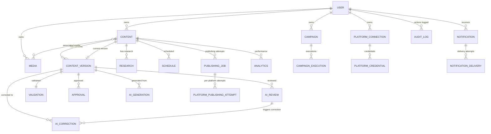

# 3.2 Database & API Design

**Document:** `3.2-database-api-design.md`
**Project:** AI Content Automater
**Phase:** Phase 3 — System Design
**Date:** 2026-10-12
**Authoritative Requirements:** REQUIREMENTS.MD V2.0
**Architecture Basis:** 3.1 Architecture & Application Design
**Analysis Basis:** System Analysis Documents 2.2-2.9

---

## Document Status and Dependencies

**Prerequisites:**
- ✅ REQUIREMENTS.MD V2.0 (authoritative)
- ✅ 3.1 Architecture & Application Design (modular monolith, 15 components, invariants)
- ✅ System Analysis 2.2-2.9 (functional requirements, business rules, use cases, domain analysis, data requirements)

**Unresolved Architectural Decisions Affecting This Design:**
- **UD-001:** Social media platforms for V1 (impacts Platform Connection and Publishing Result entities, API endpoints)
- **UD-002:** AI service/model selection (impacts AI interaction storage details)
- **UD-003:** Approval workflow complexity (impacts Approval entity structure, API operations)
- **UD-007:** Multi-tenancy architecture (impacts data isolation strategy, may require tenant partitioning)

**Design Approach:**
This design defines persistent data structures and API contracts consistent with 3.1 architecture. Where architectural decisions remain unresolved, this document identifies the impact and uses placeholder assumptions documented explicitly.

---

## PART A — DATABASE DESIGN

## 1. DATA MODEL OVERVIEW

### 1.1 Persistence Model Relationship to Architecture

**Architecture (from 3.1):** Modular monolith with 15 components

**Persistence Model:** Relational database (PostgreSQL) storing all application state

**Relationship:**
- Each architectural component (COMP-001 to COMP-015) owns specific database entities
- Business logic components manipulate entities through Django ORM
- External integration layer does NOT persist business state (external API state is transient)
- Background workers (Celery) operate on persisted entities
- Audit and operational logs are append-only tables

### 1.2 Major Entity Groups

| Entity Group | Purpose | Architectural Component | Requirements |
|--------------|---------|------------------------|--------------|
| **Identity & Access** | Users, authentication, authorization | COMP-001 | FR-001, FR-002, BR-001 |
| **Content & Versions** | Content items, immutable versions, lifecycle | COMP-002 | FR-003, FR-004, Section 10, 11, 12, BR-007 |
| **Research** | Research data with source attribution | COMP-003 | FR-005, Section 13, 14 |
| **AI Workflow** | Generation, reviews, corrections, revision tracking | COMP-004 | FR-006-010, BR-002, BR-003, BR-004 |
| **Validation** | Final validation results | COMP-005 | FR-011, BR-005 |
| **Approval** | Version-specific approvals | COMP-006 | FR-012, BR-006, BR-007 |
| **Scheduling & Campaigns** | Scheduled work, recurring campaigns, execution tracking | COMP-007 | FR-013, FR-014, BR-008, BR-014, BR-015, BR-017 |
| **Publishing** | Publishing jobs, per-platform attempts and results | COMP-008 | FR-015, FR-016, FR-017, BR-009-BR-013, BR-018 |
| **Platform Connections** | Social account authorization, encrypted credentials | COMP-010 | FR-019, BR-016, Section 33 |
| **Media** | Media metadata, storage references | COMP-009 | FR-018, Section 39 |
| **Notifications** | Notification records, delivery status | COMP-011 | FR-020, Section 38 |
| **Analytics** | Aggregated operational and engagement metrics | COMP-012 | FR-021, Section 40 |
| **Audit Logs** | Immutable security and workflow event records | COMP-013 | FR-023, BR-016, Section 44 |
| **Operational Logs** | Error and diagnostic records | COMP-014 | FR-022, Section 45 |

### 1.3 Entity Ownership Model

**User-Owned Entities (BR-001):**
- Content, ContentVersion
- Research
- AIGeneration, AIReview, AICorrection
- Validation
- Approval
- Schedule, Campaign, CampaignExecution
- PlatformConnection (user's social account)
- PublishingJob, PlatformPublishingAttempt
- Media
- Notification
- Analytics (user-scoped)

**System-Owned Entities:**
- User accounts (owned by system, not by users)
- AuditLog, OperationalLog (owned by system for auditability)

**Ownership Enforcement:**
Every user-owned entity SHALL have a foreign key to User (`owner_id`).
All queries SHALL filter by ownership: `WHERE owner_id = current_user_id` (BR-001, INV-001 from 3.1).

### 1.4 Lifecycle Boundaries

**Mutable Entities (current operational state):**
- Content (lifecycle state, current version reference)
- Schedule, Campaign
- PlatformConnection
- PublishingJob status (overall)

**Immutable Entities (append-only, no updates):**
- ContentVersion (once created, never modified; BR-007, Section 43)
- Research (once recorded, not modified)
- AIGeneration, AIReview, AICorrection (history preserved, Section 22)
- Validation (result once recorded)
- Approval (tied to specific version, Section 25)
- CampaignExecution (execution once recorded)
- PlatformPublishingAttempt (platform-specific result once final)
- AuditLog (immutable, Section 44)
- OperationalLog (append-only)
- Notification (once sent, not modified)

**Immutability Purpose:**
- Audit trail preservation (BR-016, Section 44)
- Prevent approval misuse (BR-007: approval tied to specific version)
- Traceability (Section 22: review history)
- Integrity (cannot rewrite past events)

### 1.5 Authoritative vs Derived Data

**Authoritative (Source of Truth):**
- User accounts
- Content versions (immutable snapshots)
- AI interaction records (generation, reviews, corrections)
- Validation results
- Approvals (version-specific)
- Publishing attempt results (per-platform)
- Platform connection credentials
- Audit logs

**Derived (Computed from Authoritative Data):**
- Content's current lifecycle state (computed from: latest version, review results, validation, approval)
- Publishing eligibility (computed at check time from approval, reviews, validation, platform connections, media)
- Overall publishing status (success/partial/failed, computed from per-platform attempt results)
- Analytics aggregations (clicks, impressions rolled up from publishing results or external APIs)
- Notification status summary

**Design Principle:**
Derived data MAY be cached for performance but MUST NOT be treated as source of truth. Eligibility checks MUST recompute from authoritative data (BR-008, execution-time revalidation).

---

## 2. ENTITY CATALOG

### 2.1 User (DE-001)

**Purpose:** User account for authentication, authorization anchor, ownership anchor

**Attributes:**
- **user_id** (identifier, required, unique): Primary key
- **email** (text, required, unique): Authentication credential, contact
- **password_hash** (text, required): Hashed password (never plaintext)
- **username** (text, required, unique): Display name
- **is_administrator** (boolean, required): Administrator privilege flag (Section 6.2)
- **is_active** (boolean, required): Account enabled/disabled
- **created_at** (timestamp, required): Account creation time
- **last_login** (timestamp, optional): Last successful authentication

**Relationships:**
- **1:N → Content** (owns multiple content items)
- **1:N → PlatformConnection** (multiple social platform accounts)
- **1:N → Notification** (receives notifications)

**Ownership:** System-owned (users do not own other users)

**Lifecycle:** Active/inactive (no deletion requirement specified)

**Validation Constraints:**
- Email format validation
- Password complexity (Section 51: min length, complexity requirements unspecified; **DD-NEW-001 unresolved**)
- Username uniqueness
- Administrator assignment restricted (only administrators can create administrators)

**Integrity Constraints:**
- Email unique across system
- Username unique across system
- Cannot delete user if owned resources exist (referential integrity)

**Security:**
- Password MUST be hashed (bcrypt/Argon2, never stored plaintext)
- Administrator flag MUST be protected (cannot be self-assigned)
- Personal identifiable information (email) protected

**Source:** FR-001, FR-002, BR-001, DE-001

---

### 2.2 Content (DE-003)

**Purpose:** Content entity representing a single piece of content through its lifecycle

**Attributes:**
- **content_id** (identifier, required, unique): Primary key
- **owner_id** (identifier, required, FK → User): Owner reference (BR-001)
- **title** (text, required): Content title
- **topic** (text, required): Content topic/theme (FR-003)
- **target_platforms** (list of platform identifiers, required): Publishing destinations (UD-001: specific platforms unresolved)
- **lifecycle_state** (enum, required): Current state (see Section 2.2.1)
- **current_version_id** (identifier, optional, FK → ContentVersion): Latest version reference
- **revision_count** (integer, required, default 0): AI revision counter (BR-003 bounded revision)
- **created_at** (timestamp, required): Creation time
- **updated_at** (timestamp, required): Last modification time

**Lifecycle State Enum:**
- `draft`: Initial state after creation (FR-003)
- `researching`: Research in progress (FR-005)
- `research_failed`: Research failed (Section 14)
- `generated`: AI generation completed (FR-006)
- `ai_review_1`: First AI review in progress (FR-007)
- `ai_review_1_failed`: Review #1 failed (Section 18)
- `correction`: AI correction in progress (FR-008)
- `correction_failed`: Correction failed (Section 19)
- `ai_review_2`: Second AI review in progress (FR-009)
- `ai_review_2_failed`: Review #2 failed (Section 20)
- `final_validation`: Final validation in progress (FR-011)
- `validation_failed`: Validation failed (Section 24)
- `approved`: Approved by user (FR-012)
- `scheduled`: Scheduled for publishing (FR-013)
- `publishing`: Publishing in progress (FR-015)
- `published`: Successfully published to all platforms
- `partially_published`: Some platforms succeeded, some failed (BR-011)
- `publishing_failed`: All platforms failed

**Relationships:**
- **N:1 → User** (owned by user)
- **1:N → ContentVersion** (has version history)
- **1:N → Research** (has research data)
- **1:N → Schedule** (may be scheduled multiple times)
- **1:N → PublishingJob** (publishing attempts)
- **N:M ↔ Media** (associated media)
- **1:N → Analytics** (performance metrics)

**Ownership:** User-owned (owner_id FK to User)

**Lifecycle:** Progresses through states defined in Section 11, never deleted per BR-001 (content belongs to user; **DD-NEW-002: content deletion policy unresolved**)

**Validation Constraints:**
- Title required, non-empty (**DD-NEW-003: max length unresolved**)
- Topic required, non-empty (**DD-NEW-004: max length unresolved**)
- Target platforms non-empty (at least one platform)
- Lifecycle state must be valid enum value
- Revision count cannot decrease
- Revision count bounded (**DD-NEW-005: exact limit numeric value unresolved**, BR-003 says "bounded")

**Integrity Constraints:**
- `owner_id` foreign key to User (NOT NULL, ON DELETE RESTRICT per BR-001)
- `current_version_id` foreign key to ContentVersion (NULL if no versions yet, ON DELETE SET NULL)
- State transitions enforced by application logic (state machine)
- Revision count incremented only by AI correction (FR-008)

**Security:**
- All operations filtered by owner_id (BR-001)
- Cannot access another user's content
- Lifecycle state transitions enforce mandatory gates (BR-004)

**Source:** FR-003, FR-004, BR-001, BR-003, BR-004, Section 10, 11, 12, DE-003

---

### 2.3 ContentVersion (DE-004)

**Purpose:** Immutable snapshot of content at a specific point in time

**Attributes:**
- **version_id** (identifier, required, unique): Primary key
- **content_id** (identifier, required, FK → Content): Parent content
- **version_number** (integer, required): Sequential version number (1, 2, 3...)
- **title** (text, required): Content title at this version
- **body** (text, required): Content body at this version (**DD-NEW-006: max length unresolved**)
- **topic** (text, required): Topic at this version
- **target_platforms** (list, required): Platforms at this version
- **created_by** (identifier, required, FK → User): User who created this version (manual edit or AI generation)
- **created_at** (timestamp, required): Version creation time
- **is_ai_generated** (boolean, required): Was this version AI-generated? (for traceability)
- **source_operation** (enum, required): How version created (see Section 2.3.1)

**Source Operation Enum:**
- `initial_draft`: User-created initial version (FR-003)
- `manual_edit`: User manual edit (FR-010)
- `ai_generation`: AI generation (FR-006)
- `ai_correction`: AI correction (FR-008)

**Relationships:**
- **N:1 → Content** (belongs to content)
- **N:1 → User** (created by user or on user's behalf)
- **1:N → AIReview** (may have multiple reviews for same version: Review #1 and Review #2)
- **1:1 → Validation** (final validation result)
- **1:N → Approval** (approval history for this version)

**Ownership:** Indirectly owned (via Content.owner_id)

**Lifecycle:** **IMMUTABLE** (once created, never updated; Section 43, BR-007)

**Validation Constraints:**
- Version number sequential within content
- Title, body, topic non-empty
- Created_by must be content owner
- Source operation must be valid enum

**Integrity Constraints:**
- `content_id` foreign key to Content (NOT NULL, ON DELETE CASCADE)
- `created_by` foreign key to User (NOT NULL, ON DELETE RESTRICT)
- Unique constraint: (content_id, version_number)
- **IMMUTABILITY:** No UPDATE operations permitted (enforced by application + DB trigger)

**Security:**
- Access controlled via parent Content ownership
- Immutability prevents tampering with approval history

**Source:** FR-004, FR-010, BR-007, Section 43, DE-004

---

### 2.4 Research (DE-002)

**Purpose:** Research data collected from external sources

**Attributes:**
- **research_id** (identifier, required, unique): Primary key
- **content_id** (identifier, required, FK → Content): Associated content
- **source** (text, required): Research source name/URL (Section 13: attribution required)
- **data** (structured text/JSON, required): Research data payload (**DD-NEW-007: structure unspecified**)
- **collected_at** (timestamp, required): Data collection timestamp
- **status** (enum, required): success, failed
- **error_message** (text, optional): If status=failed, error detail (Section 14)

**Relationships:**
- **N:1 → Content** (belongs to content)

**Ownership:** Indirectly owned (via Content.owner_id)

**Lifecycle:** Immutable once recorded (no update after creation)

**Validation Constraints:**
- Source required (for attribution, Section 13)
- Data required if status=success
- Error message required if status=failed

**Integrity Constraints:**
- `content_id` foreign key to Content (NOT NULL, ON DELETE CASCADE)

**Security:**
- Access controlled via parent Content ownership

**Source:** FR-005, Section 13, 14, DE-002

---

### 2.5 AIGeneration (DE-006)

**Purpose:** Record of AI content generation attempt

**Attributes:**
- **generation_id** (identifier, required, unique): Primary key
- **content_id** (identifier, required, FK → Content): Associated content
- **resulting_version_id** (identifier, optional, FK → ContentVersion): Version created (NULL if failed)
- **request_payload** (structured text/JSON, required): What was sent to AI (**DD-NEW-008: structure depends on UD-002**)
- **response_payload** (structured text/JSON, optional): AI response (**DD-NEW-009: structure depends on UD-002**)
- **status** (enum, required): success, failed
- **error_message** (text, optional): If status=failed, error detail
- **initiated_at** (timestamp, required): Request sent time
- **completed_at** (timestamp, optional): Response received time
- **ai_service** (text, required): AI service identifier (**UD-002 unresolved**)
- **ai_model** (text, required): Model identifier (**UD-002 unresolved**)

**Relationships:**
- **N:1 → Content** (belongs to content)
- **1:1 → ContentVersion** (creates version if successful)

**Ownership:** Indirectly owned (via Content.owner_id)

**Lifecycle:** Immutable (audit trail, Section 22)

**Validation Constraints:**
- Request payload required
- Response payload required if status=success
- Error message required if status=failed
- Resulting version_id required if status=success

**Integrity Constraints:**
- `content_id` foreign key to Content (NOT NULL, ON DELETE CASCADE)
- `resulting_version_id` foreign key to ContentVersion (NULL allowed, ON DELETE SET NULL)

**Security:**
- Access controlled via parent Content ownership
- **Do NOT log sensitive API keys** in request/response payloads (BR-016)

**Source:** FR-006, BR-017, Section 22, DE-006

---

### 2.6 AIReview (DE-007)

**Purpose:** AI review evaluation of a content version

**Attributes:**
- **review_id** (identifier, required, unique): Primary key
- **content_version_id** (identifier, required, FK → ContentVersion): Version being reviewed
- **review_stage** (enum, required): Which review stage (see Section 2.6.1)
- **outcome** (enum, required): Review result (see Section 2.6.2)
- **feedback** (text, optional): AI-provided feedback/critique
- **initiated_at** (timestamp, required): Review initiated
- **completed_at** (timestamp, optional): Review completed
- **status** (enum, required): pending, completed, failed
- **error_message** (text, optional): If status=failed, error detail
- **ai_service** (text, required): AI service identifier (**UD-002 unresolved**)
- **ai_model** (text, required): Model identifier (**UD-002 unresolved**)

**Review Stage Enum:**
- `review_1`: First AI review (FR-007, Section 17)
- `review_2`: Second AI review after correction (FR-009, Section 21)

**Outcome Enum:**
- `approved`: Content quality acceptable (proceed)
- `needs_correction`: Content requires correction (trigger FR-008)
- `rejected`: Content fundamentally flawed (manual intervention required)

**Relationships:**
- **N:1 → ContentVersion** (reviews specific version)

**Ownership:** Indirectly owned (via ContentVersion → Content → User)

**Lifecycle:** Immutable (audit trail, Section 22)

**Validation Constraints:**
- Review stage must be valid (review_1 or review_2)
- Outcome required if status=completed
- Feedback recommended if outcome=needs_correction or rejected
- Error message required if status=failed

**Integrity Constraints:**
- `content_version_id` foreign key to ContentVersion (NOT NULL, ON DELETE CASCADE)
- A version may have multiple reviews (Review #1 for version N, Review #2 for version N+1 after correction)
- **Application logic:** Cannot skip from Review #1 failed directly to Review #2 (must correct first per BR-004)

**Security:**
- Access controlled via parent ContentVersion ownership

**Source:** FR-007, FR-009, BR-004, Section 17, 18, 20, 21, 22, DE-007

---

### 2.7 AICorrection (NEW: implied by FR-008)

**Purpose:** AI-executed correction attempt

**Attributes:**
- **correction_id** (identifier, required, unique): Primary key
- **content_id** (identifier, required, FK → Content): Content being corrected
- **source_version_id** (identifier, required, FK → ContentVersion): Version being corrected
- **review_id** (identifier, required, FK → AIReview): Review that triggered correction
- **resulting_version_id** (identifier, optional, FK → ContentVersion): Corrected version (NULL if failed)
- **correction_instructions** (text, required): What to fix (from AIReview feedback)
- **status** (enum, required): success, failed
- **error_message** (text, optional): If status=failed, error detail
- **initiated_at** (timestamp, required): Correction started
- **completed_at** (timestamp, optional): Correction finished
- **ai_service** (text, required): AI service identifier (**UD-002 unresolved**)
- **ai_model** (text, required): Model identifier (**UD-002 unresolved**)

**Relationships:**
- **N:1 → Content** (corrects content)
- **N:1 → ContentVersion** (corrects specific version)
- **N:1 → AIReview** (triggered by review)
- **1:1 → ContentVersion** (produces new version if successful)

**Ownership:** Indirectly owned (via Content.owner_id)

**Lifecycle:** Immutable (audit trail)

**Validation Constraints:**
- Review must have outcome=needs_correction
- Resulting version_id required if status=success
- Error message required if status=failed

**Integrity Constraints:**
- `content_id` foreign key to Content (NOT NULL, ON DELETE CASCADE)
- `source_version_id` foreign key to ContentVersion (NOT NULL, ON DELETE RESTRICT)
- `review_id` foreign key to AIReview (NOT NULL, ON DELETE RESTRICT)
- `resulting_version_id` foreign key to ContentVersion (NULL allowed, ON DELETE SET NULL)
- **Application logic:** Content.revision_count incremented when correction succeeds (BR-003)

**Security:**
- Access controlled via parent Content ownership

**Source:** FR-008, BR-003, Section 19, 22

---

### 2.8 Validation (DE-005)

**Purpose:** Final validation result before approval eligibility

**Attributes:**
- **validation_id** (identifier, required, unique): Primary key
- **content_version_id** (identifier, required, unique FK → ContentVersion): Version validated
- **outcome** (enum, required): passed, failed
- **issues** (list of structured text, optional): Validation issues if failed
- **validated_at** (timestamp, required): Validation timestamp
- **status** (enum, required): completed, failed (system failure)
- **error_message** (text, optional): If status=failed, system error detail

**Relationships:**
- **1:1 → ContentVersion** (validates specific version)

**Ownership:** Indirectly owned (via ContentVersion → Content → User)

**Lifecycle:** Immutable once recorded

**Validation Constraints:**
- Outcome required if status=completed
- Issues list non-empty if outcome=failed

**Integrity Constraints:**
- `content_version_id` foreign key to ContentVersion (UNIQUE, NOT NULL, ON DELETE CASCADE)
- Only one validation result per version

**Security:**
- Access controlled via parent ContentVersion ownership

**Source:** FR-011, BR-005, Section 24, DE-005

---

### 2.9 Approval (DE-008)

**Purpose:** User approval of specific content version

**Attributes:**
- **approval_id** (identifier, required, unique): Primary key
- **content_id** (identifier, required, FK → Content): Content being approved
- **content_version_id** (identifier, required, FK → ContentVersion): **Specific version approved** (BR-007, INV-003)
- **approved_by** (identifier, required, FK → User): User granting approval
- **approved_at** (timestamp, required): Approval timestamp
- **approval_notes** (text, optional): Optional user notes

**Relationships:**
- **N:1 → Content** (approves content)
- **N:1 → ContentVersion** (approves **specific version**, not latest)
- **N:1 → User** (approved by user)

**Ownership:** Indirectly owned (via Content.owner_id), but approved_by may differ if UD-003 multi-stage approval resolved

**Lifecycle:** Immutable (once granted, cannot be revoked; Section 25 does not specify revocation mechanism; **DD-NEW-010: approval revocation unresolved**)

**Validation Constraints:**
- Approved_by must have authority to approve (**UD-003 unresolved:** owner only, or designated approver?)
- Content must be in eligible state (validation passed, all reviews completed)
- **Version match:** approved version MUST be current version at approval time (application-level check)

**Integrity Constraints:**
- `content_id` foreign key to Content (NOT NULL, ON DELETE CASCADE)
- `content_version_id` foreign key to ContentVersion (NOT NULL, ON DELETE RESTRICT)
- `approved_by` foreign key to User (NOT NULL, ON DELETE RESTRICT)
- **Application logic:** Approval becomes invalid if content modified (content.current_version_id != approval.content_version_id per BR-007)

**Security:**
- Only authorized users can approve (owner or designated approver per UD-003)
- Immutability prevents approval misuse

**Source:** FR-012, BR-006, BR-007, Section 25, INV-003, DE-008

---

### 2.10 Schedule (DE-009)

**Purpose:** Scheduled publishing entry

**Attributes:**
- **schedule_id** (identifier, required, unique): Primary key
- **content_id** (identifier, required, FK → Content): Content to publish
- **scheduled_time** (timestamp with timezone, required): When to publish (Section 29)
- **timezone** (text, required): User-specified timezone (Section 29)
- **executed** (boolean, required, default false): Has execution completed?
- **execution_started_at** (timestamp, optional): Execution start time
- **execution_completed_at** (timestamp, optional): Execution finish time
- **execution_status** (enum, optional): success, partial_success, failed (NULL if not executed)
- **created_by** (identifier, required, FK → User): User who scheduled
- **created_at** (timestamp, required): Schedule creation time

**Relationships:**
- **N:1 → Content** (schedules content)
- **N:1 → User** (created by user)

**Ownership:** Indirectly owned (via Content.owner_id)

**Lifecycle:** Active until executed; **DD-NEW-011: post-execution retention unresolved**

**Validation Constraints:**
- Scheduled time cannot be in the past (at creation time)
- Timezone must be valid IANA timezone identifier
- Content must be eligible at scheduling time (approved, platform connections valid, media available per Section 26)
- Cannot schedule same content for exact same time twice (**DD-NEW-012: duplicate schedule prevention strategy unresolved**)

**Integrity Constraints:**
- `content_id` foreign key to Content (NOT NULL, ON DELETE CASCADE)
- `created_by` foreign key to User (NOT NULL, ON DELETE RESTRICT)
- **Application logic:** Execution-time eligibility recheck (BR-008, INV-007)

**Security:**
- Only content owner can schedule
- Scheduler component (Section 6.4) executes on behalf of user (BR-017, INV-002)

**Source:** FR-013, BR-008, BR-017, Section 29, INV-007, DE-009

---

### 2.11 Campaign (DE-010)

**Purpose:** Recurring campaign definition

**Attributes:**
- **campaign_id** (identifier, required, unique): Primary key
- **owner_id** (identifier, required, FK → User): Campaign owner
- **name** (text, required): Campaign name
- **topic** (text, required): Content topic for campaign (Section 30)
- **target_platforms** (list, required): Publishing platforms
- **schedule_pattern** (structured text, required): Recurrence definition (daily, weekly, etc.; **DD-NEW-013: schedule pattern format unresolved**)
- **enabled** (boolean, required, default true): Campaign active/paused (BR-015, INV-013)
- **created_at** (timestamp, required): Campaign creation
- **updated_at** (timestamp, required): Last modification

**Relationships:**
- **N:1 → User** (owned by user)
- **1:N → CampaignExecution** (execution history)

**Ownership:** User-owned (owner_id FK to User)

**Lifecycle:** Active/paused (enabled flag); **DD-NEW-014: campaign deletion policy unresolved**

**Validation Constraints:**
- Name required, non-empty
- Topic required (drives AI generation per Section 30)
- Schedule pattern valid (format depends on DD-NEW-013)
- Target platforms non-empty

**Integrity Constraints:**
- `owner_id` foreign key to User (NOT NULL, ON DELETE CASCADE)
- **Campaign state (enabled) distinct from execution state** (BR-015, INV-013)

**Security:**
- Only owner can modify campaign
- Campaign execution preserves user context (BR-017)

**Source:** FR-014, BR-014, BR-015, BR-017, Section 30, INV-013, DE-010

---

### 2.12 CampaignExecution (DE-011)

**Purpose:** Record of campaign execution instance

**Attributes:**
- **execution_id** (identifier, required, unique): Primary key
- **campaign_id** (identifier, required, FK → Campaign): Campaign executed
- **content_id** (identifier, optional, FK → Content): Generated content (NULL if generation failed)
- **execution_time** (timestamp, required): When executed
- **status** (enum, required): success, failed
- **error_message** (text, optional): If failed, error detail
- **created_at** (timestamp, required): Execution record created

**Relationships:**
- **N:1 → Campaign** (belongs to campaign)
- **1:1 → Content** (creates content if successful)

**Ownership:** Indirectly owned (via Campaign.owner_id)

**Lifecycle:** Immutable (audit trail)

**Validation Constraints:**
- Content_id required if status=success
- Error message required if status=failed

**Integrity Constraints:**
- `campaign_id` foreign key to Campaign (NOT NULL, ON DELETE CASCADE)
- `content_id` foreign key to Content (NULL allowed, ON DELETE SET NULL)
- Unique constraint to prevent duplicate execution: (campaign_id, execution_window) where execution_window = DATE_TRUNC('hour', execution_time) or similar (**DD-NEW-015: duplicate execution prevention window unresolved**)

**Security:**
- Access controlled via parent Campaign ownership

**Source:** FR-014, BR-014, Section 30, INV-013, DE-011

---

### 2.13 PublishingJob (DE-012)

**Purpose:** Overall publishing job for content

**Attributes:**
- **job_id** (identifier, required, unique): Primary key
- **content_id** (identifier, required, FK → Content): Content being published
- **content_version_id** (identifier, required, FK → ContentVersion): Specific version published
- **initiated_by** (identifier, required, FK → User): User or scheduler
- **initiated_at** (timestamp, required): Job start time
- **completed_at** (timestamp, optional): Job finish time (when all platforms finalized)
- **overall_status** (enum, required): pending, in_progress, success, partial_success, failed
- **platforms_targeted** (list, required): Target platforms (snapshot at publish time)

**Overall Status (Derived from Platform Attempts):**
- `pending`: Not yet started
- `in_progress`: At least one platform attempt ongoing
- `success`: ALL platforms succeeded (BR-010)
- `partial_success`: At least one succeeded, at least one failed (BR-011)
- `failed`: ALL platforms failed

**Relationships:**
- **N:1 → Content** (publishes content)
- **N:1 → ContentVersion** (publishes specific version)
- **N:1 → User** (initiated by user or on user's behalf)
- **1:N → PlatformPublishingAttempt** (per-platform attempts)

**Ownership:** Indirectly owned (via Content.owner_id)

**Lifecycle:** Active until all platforms finalized

**Validation Constraints:**
- Content must be approved (BR-006)
- All mandatory quality gates passed (BR-004, BR-005)
- Platform connections authorized (FR-019)
- Media available if required (Section 36)

**Integrity Constraints:**
- `content_id` foreign key to Content (NOT NULL, ON DELETE CASCADE)
- `content_version_id` foreign key to ContentVersion (NOT NULL, ON DELETE RESTRICT)
- `initiated_by` foreign key to User (NOT NULL, ON DELETE RESTRICT)
- **Overall_status DERIVED** from platform attempts, not authoritative (INV-008)

**Security:**
- Only content owner can publish
- Scheduled/campaign publishing preserves user context (BR-017, INV-002)

**Source:** FR-015, FR-016, BR-006, BR-008, BR-010, BR-011, Section 32, INV-008, DE-012

---

### 2.14 PlatformPublishingAttempt (DE-013, renamed for clarity)

**Purpose:** Independent per-platform publishing attempt and result

**Attributes:**
- **attempt_id** (identifier, required, unique): Primary key
- **job_id** (identifier, required, FK → PublishingJob): Parent publishing job
- **platform** (enum, required): Target platform identifier (**UD-001 unresolved:** twitter, facebook, linkedin, instagram, etc.)
- **attempt_number** (integer, required, default 1): Retry counter (BR-012, INV-010)
- **status** (enum, required): pending, in_progress, success, failed, unknown (see Section 2.14.1)
- **platform_post_id** (text, optional): External platform post identifier (if published)
- **platform_post_url** (text, optional): Public URL of post (if published)
- **initiated_at** (timestamp, required): Attempt start
- **completed_at** (timestamp, optional): Attempt finish
- **error_message** (text, optional): If failed, error detail
- **is_final** (boolean, required): No more retries (success, final failure, or unknown)

**Status Enum (INV-009: unknown external state explicit):**
- `pending`: Not yet started
- `in_progress`: API call in flight
- `success`: Platform confirmed success
- `failed`: Platform confirmed failure or definitive error (4xx client error)
- `unknown`: Cannot determine outcome (5xx, timeout, network error, ambiguous response per BR-018, Section 47)

**Relationships:**
- **N:1 → PublishingJob** (belongs to publishing job)

**Ownership:** Indirectly owned (via PublishingJob → Content → User)

**Lifecycle:** Active until finalized (success, final failure, or unknown with no more retries)

**Validation Constraints:**
- Attempt number > 0
- Status must be valid enum value
- Platform_post_id required if status=success
- Error message required if status=failed or unknown
- **Retry bound:** attempt_number ≤ MAX_RETRIES (**DD-NEW-016: retry limit numeric value unresolved**, BR-012 says "bounded")

**Integrity Constraints:**
- `job_id` foreign key to PublishingJob (NOT NULL, ON DELETE CASCADE)
- Unique constraint: (job_id, platform, attempt_number)
- **Independent per platform:** One platform's failure does NOT affect another (BR-010, INV-008)

**Security:**
- Access controlled via parent PublishingJob ownership
- Platform credentials retrieved from PlatformConnection (encrypted, BR-016)

**Source:** FR-015, FR-016, FR-017, BR-009, BR-010, BR-011, BR-012, BR-013, BR-018, Section 32, 34, 35, 47, INV-008, INV-009, INV-010, INV-011, DE-013

---

### 2.15 PlatformConnection (DE-015)

**Purpose:** User's authorized social media account connection

**Attributes:**
- **connection_id** (identifier, required, unique): Primary key
- **owner_id** (identifier, required, FK → User): User who connected account
- **platform** (enum, required): Platform identifier (**UD-001 unresolved**)
- **platform_user_id** (text, required): User's ID on platform
- **platform_username** (text, required): User's username on platform
- **connected_at** (timestamp, required): Connection established
- **is_active** (boolean, required): Connection valid
- **last_verified** (timestamp, optional): Last credential verification

**Relationships:**
- **N:1 → User** (owned by user)
- **1:N → PlatformCredential** (stores credentials separately)

**Ownership:** User-owned (owner_id FK to User)

**Lifecycle:** Active/revoked; **DD-NEW-017: connection expiration policy unresolved**

**Validation Constraints:**
- Platform must be valid enum (depends on UD-001)
- Platform_user_id and username required

**Integrity Constraints:**
- `owner_id` foreign key to User (NOT NULL, ON DELETE CASCADE)
- Unique constraint: (owner_id, platform, platform_user_id) — user can connect same platform account once

**Security:**
- OAuth2 authorization flow (FR-019, Section 33)
- Credentials stored separately in PlatformCredential (encrypted)

**Source:** FR-019, Section 33, BR-016, DE-015

---

### 2.16 PlatformCredential (DE-016)

**Purpose:** Encrypted platform access tokens and secrets

**Attributes:**
- **credential_id** (identifier, required, unique): Primary key
- **connection_id** (identifier, required, FK → PlatformConnection): Associated connection
- **access_token_encrypted** (text, required): Encrypted OAuth2 access token
- **refresh_token_encrypted** (text, optional): Encrypted OAuth2 refresh token
- **token_expires_at** (timestamp, optional): Token expiration
- **encryption_key_id** (text, required): Key identifier for encryption (rotation support)
- **created_at** (timestamp, required): Credential stored
- **updated_at** (timestamp, required): Last token refresh

**Relationships:**
- **N:1 → PlatformConnection** (belongs to connection)

**Ownership:** Indirectly owned (via PlatformConnection.owner_id)

**Lifecycle:** Active; tokens refreshed periodically

**Validation Constraints:**
- Access token required (encrypted)
- Encryption key ID required

**Integrity Constraints:**
- `connection_id` foreign key to PlatformConnection (NOT NULL, ON DELETE CASCADE)

**Security:**
- **CRITICAL:** Tokens MUST be encrypted at rest (BR-016)
- Encryption key managed separately (key management service or Django encrypted fields)
- **MUST NOT appear in logs, audit trails, or error messages** (BR-016)
- Access restricted to publishing component only

**Source:** FR-019, BR-016, Section 33, DE-016

---

### 2.17 Media (DE-014)

**Purpose:** Media file metadata and storage reference

**Attributes:**
- **media_id** (identifier, required, unique): Primary key
- **owner_id** (identifier, required, FK → User): Owner
- **filename** (text, required): Original filename
- **media_type** (enum, required): image, video
- **mime_type** (text, required): MIME type (image/jpeg, video/mp4, etc.)
- **file_size** (integer, required): Size in bytes
- **storage_location** (text, required): Storage backend reference (S3 key, filesystem path, etc.; **DD-NEW-018: storage backend unresolved per Section 74**)
- **upload_status** (enum, required): pending, completed, failed
- **uploaded_at** (timestamp, required): Upload time
- **width** (integer, optional): Image/video width (pixels)
- **height** (integer, optional): Image/video height (pixels)
- **duration** (float, optional): Video duration (seconds)

**Relationships:**
- **N:1 → User** (owned by user)
- **N:M ↔ Content** (via ContentMedia join table)

**Ownership:** User-owned (owner_id FK to User)

**Lifecycle:** Active; **DD-NEW-019: media deletion policy unresolved**

**Validation Constraints:**
- Filename non-empty
- Media type and MIME type consistent
- File size > 0 if upload_status=completed
- Storage location required if upload_status=completed

**Integrity Constraints:**
- `owner_id` foreign key to User (NOT NULL, ON DELETE CASCADE)

**Security:**
- Only owner can access media
- Storage backend access controlled separately (signed URLs, IAM policies)

**Source:** FR-018, Section 39, DE-014

---

### 2.18 ContentMedia (DE-021: join table)

**Purpose:** Many-to-many association between Content and Media

**Attributes:**
- **content_id** (identifier, required, FK → Content): Content
- **media_id** (identifier, required, FK → Media): Associated media
- **association_order** (integer, optional): Display order (**DD-NEW-020: ordering requirement unspecified**)

**Relationships:**
- **N:1 → Content**
- **N:1 → Media**

**Ownership:** Indirectly owned (both sides user-owned)

**Lifecycle:** Association exists while valid

**Validation Constraints:**
- Content and media must have same owner (BR-001)

**Integrity Constraints:**
- `content_id` foreign key to Content (NOT NULL, ON DELETE CASCADE)
- `media_id` foreign key to Media (NOT NULL, ON DELETE CASCADE)
- Primary key: (content_id, media_id)

**Security:**
- Both content and media ownership verified

**Source:** Section 39, DE-021

---

### 2.19 Notification (DE-017)

**Purpose:** Notification sent to user

**Attributes:**
- **notification_id** (identifier, required, unique): Primary key
- **user_id** (identifier, required, FK → User): Recipient
- **notification_type** (enum, required): Type of notification (see Section 2.19.1)
- **subject** (text, required): Notification subject/title
- **message** (text, required): Notification body
- **related_content_id** (identifier, optional, FK → Content): Related content (if applicable)
- **is_read** (boolean, required, default false): Read status
- **created_at** (timestamp, required): Notification created
- **read_at** (timestamp, optional): Marked read timestamp

**Notification Type Enum:**
- `research_complete`: Research finished (FR-005)
- `research_failed`: Research failed (Section 14)
- `generation_complete`: AI generation done (FR-006)
- `review_failed`: AI review failed (FR-007, FR-009)
- `validation_failed`: Final validation failed (FR-011)
- `publishing_complete`: Publishing finished (FR-015)
- `publishing_failed`: Publishing failed (FR-015)
- `scheduled_executed`: Scheduled publishing executed (FR-013)
- `campaign_executed`: Campaign executed (FR-014)

**Relationships:**
- **N:1 → User** (sent to user)
- **N:1 → Content** (optionally related to content)

**Ownership:** User-owned (user_id FK to User)

**Lifecycle:** Active; **DD-NEW-021: notification retention unresolved**

**Validation Constraints:**
- Notification type valid enum
- Subject and message non-empty
- Related content owned by recipient user if specified

**Integrity Constraints:**
- `user_id` foreign key to User (NOT NULL, ON DELETE CASCADE)
- `related_content_id` foreign key to Content (NULL allowed, ON DELETE SET NULL)

**Security:**
- User can only access own notifications

**Source:** FR-020, Section 38, DE-017

---

### 2.20 NotificationDelivery (DE-018, if multi-channel)

**Purpose:** Delivery attempt per notification channel

**Attributes:**
- **delivery_id** (identifier, required, unique): Primary key
- **notification_id** (identifier, required, FK → Notification): Parent notification
- **channel** (enum, required): Delivery channel (**UD-008 unresolved:** email, SMS, push, in-app)
- **status** (enum, required): pending, sent, failed
- **sent_at** (timestamp, optional): Delivery time
- **error_message** (text, optional): If failed, error detail

**Relationships:**
- **N:1 → Notification** (belongs to notification)

**Ownership:** Indirectly owned (via Notification.user_id)

**Lifecycle:** Immutable once sent/failed

**Validation Constraints:**
- Channel valid enum (depends on UD-008)
- Error message required if status=failed

**Integrity Constraints:**
- `notification_id` foreign key to Notification (NOT NULL, ON DELETE CASCADE)

**Security:**
- Access controlled via parent Notification ownership

**Source:** FR-020, Section 38, DE-018

**Note:** If only in-app notifications required (Section 38 does not specify multi-channel), NotificationDelivery may be unnecessary; Notification.is_read sufficient.

---

### 2.21 Analytics (DE-019, DE-020)

**Purpose:** Aggregated performance and engagement metrics

**Attributes:**
- **analytics_id** (identifier, required, unique): Primary key
- **content_id** (identifier, optional, FK → Content): Content being measured (NULL for user-level aggregates)
- **user_id** (identifier, required, FK → User): User scope
- **metric_type** (enum, required): Type of metric (see Section 2.21.1)
- **metric_value** (numeric, required): Metric value
- **measured_at** (timestamp, required): Measurement time
- **platform** (enum, optional): Platform-specific metric (**UD-001 unresolved**)

**Metric Type Enum:**
- `impressions`: Total impressions
- `clicks`: Total clicks
- `engagements`: Total engagements (likes, shares, comments)
- `reach`: Unique users reached
- Platform-specific metrics depend on UD-001

**Relationships:**
- **N:1 → Content** (content-level metrics)
- **N:1 → User** (user-level metrics)

**Ownership:** User-owned (user_id FK to User)

**Lifecycle:** Append-only; **DD-NEW-022: analytics retention unresolved**

**Validation Constraints:**
- Metric type valid enum
- Metric value >= 0
- Content_id required for content-level metrics

**Integrity Constraints:**
- `content_id` foreign key to Content (NULL allowed for user-level, ON DELETE CASCADE)
- `user_id` foreign key to User (NOT NULL, ON DELETE CASCADE)

**Security:**
- User can only access own analytics

**Source:** FR-021, Section 40, DE-019, DE-020

**Note:** Analytics are DERIVED from external platform APIs or inferred from PublishingAttempt results. Not authoritative source of truth (Section 1.5).

---

### 2.22 AuditLog (DE-023)

**Purpose:** Immutable security and workflow event audit trail

**Attributes:**
- **audit_id** (identifier, required, unique): Primary key
- **user_id** (identifier, optional, FK → User): Acting user (NULL for system actions)
- **event_type** (enum, required): Type of event (see Section 2.22.1)
- **event_data** (structured text/JSON, required): Event details (**secrets filtered per BR-016**)
- **ip_address** (text, optional): Client IP address
- **user_agent** (text, optional): Client user agent
- **occurred_at** (timestamp, required): Event timestamp
- **related_content_id** (identifier, optional, FK → Content): Related content

**Event Type Enum (examples):**
- `user_login`, `user_logout`
- `content_created`, `content_edited`, `content_approved`
- `publishing_initiated`, `publishing_completed`
- `campaign_created`, `campaign_executed`
- `platform_connected`, `platform_disconnected`
- `config_changed` (administrator actions)

**Relationships:**
- **N:1 → User** (action by user)
- **N:1 → Content** (related content)

**Ownership:** System-owned (audit belongs to system, not users)

**Lifecycle:** **IMMUTABLE** (Section 44: no deletion, no modification)

**Validation Constraints:**
- Event type valid enum
- Event data required
- **CRITICAL:** Secrets, tokens, passwords MUST be filtered from event_data (BR-016)

**Integrity Constraints:**
- `user_id` foreign key to User (NULL allowed for system, ON DELETE SET NULL)
- `related_content_id` foreign key to Content (NULL allowed, ON DELETE SET NULL)
- **IMMUTABILITY:** No UPDATE or DELETE operations (enforced by DB triggers + application)

**Security:**
- Audit log access restricted to administrators only (Section 44)
- Secrets filtered before storage (BR-016)

**Source:** FR-023, BR-016, Section 44, INV-016, DE-023

---

### 2.23 OperationalLog (DE-022)

**Purpose:** Error and diagnostic event records

**Attributes:**
- **log_id** (identifier, required, unique): Primary key
- **log_level** (enum, required): ERROR, WARNING, INFO, DEBUG
- **component** (text, required): System component name
- **message** (text, required): Log message
- **exception** (text, optional): Exception stack trace (if applicable)
- **context** (structured text/JSON, optional): Additional context
- **occurred_at** (timestamp, required): Log timestamp
- **user_id** (identifier, optional, FK → User): Related user
- **content_id** (identifier, optional, FK → Content): Related content

**Relationships:**
- **N:1 → User** (related user)
- **N:1 → Content** (related content)

**Ownership:** System-owned

**Lifecycle:** Append-only; **DD-NEW-023: operational log retention unresolved per Section 45**

**Validation Constraints:**
- Log level valid enum
- Component and message required
- **CRITICAL:** Secrets MUST NOT appear in logs (BR-016)

**Integrity Constraints:**
- `user_id` foreign key to User (NULL allowed, ON DELETE SET NULL)
- `content_id` foreign key to Content (NULL allowed, ON DELETE SET NULL)

**Security:**
- Secrets filtered (BR-016)
- Administrator access only

**Source:** FR-022, Section 45, DE-022

---

## 3. RELATIONSHIPS AND CARDINALITY

### 3.1 Core Relationships

#### User → Owned Resources (1:N)
- User **1:N** Content (ownership anchor, BR-001, INV-001)
- User **1:N** PlatformConnection (user's social accounts)
- User **1:N** Campaign (user's campaigns)
- User **1:N** Notification (notifications to user)
- User **1:N** Media (user's media files)

**Cardinality:** One user owns many resources
**Enforcement:** Foreign key `owner_id` on owned entities
**Integrity:** Cannot delete User while owned resources exist (ON DELETE RESTRICT) OR cascade delete (ON DELETE CASCADE) depending on business policy (**DD-NEW-024: user deletion policy unresolved**)

#### Content → Versions (1:N, history)
- Content **1:N** ContentVersion (version history)
- Content **1:1** ContentVersion (current_version_id, latest)

**Cardinality:** One content has many versions over time, one current version
**Enforcement:**
- `ContentVersion.content_id` foreign key to Content
- `Content.current_version_id` foreign key to ContentVersion (self-referential via versions)

**Lifecycle:** Versions immutable (BR-007, Section 43); new version created on edit

#### ContentVersion → Quality Checks (1:N or 1:1)
- ContentVersion **1:N** AIReview (Review #1, Review #2 for same version)
- ContentVersion **1:1** Validation (one validation result per version)
- ContentVersion **1:N** Approval (approval history, but only one active per BR-007)

**Cardinality:**
- Reviews: One version may have multiple reviews (Review #1 after generation, Review #2 after correction)
- Validation: One version has one validation result
- Approval: One version may have multiple approvals over time (if approved, then modified, then approved again), but only one approval is active (matches current version)

**Enforcement:**
- AIReview.content_version_id FK to ContentVersion
- Validation.content_version_id unique FK to ContentVersion
- Approval.content_version_id FK to ContentVersion

**Integrity (BR-007, INV-003):**
- Approval MUST reference specific version, not just content
- Application logic: Approval becomes invalid if Content.current_version_id != Approval.content_version_id

#### Content → Scheduling & Publishing (1:N)
- Content **1:N** Schedule (content may be scheduled multiple times)
- Content **1:N** PublishingJob (multiple publishing attempts over time)

**Cardinality:** One content can be scheduled and published multiple times
**Enforcement:**
- Schedule.content_id FK to Content
- PublishingJob.content_id FK to Content

#### PublishingJob → Platform Attempts (1:N, independence)
- PublishingJob **1:N** PlatformPublishingAttempt (one per platform, independent)

**Cardinality:** One publishing job has multiple platform attempts (one per target platform)
**Enforcement:**
- PlatformPublishingAttempt.job_id FK to PublishingJob
- Unique constraint: (job_id, platform, attempt_number)

**Integrity (BR-010, BR-011, INV-008):**
- Each platform attempt INDEPENDENT
- One platform's success/failure does NOT affect another
- Overall job status DERIVED from platform attempts (success if ALL succeeded, partial if SOME succeeded, failed if ALL failed)

#### Campaign → Executions (1:N, history)
- Campaign **1:N** CampaignExecution (execution history)

**Cardinality:** One campaign has many executions over time
**Enforcement:**
- CampaignExecution.campaign_id FK to Campaign

**Integrity (BR-015, INV-013):**
- Campaign.enabled flag (campaign active state)
- CampaignExecution records (execution history)
- These are DISTINCT: disabled campaign has execution history, enabled campaign may have zero executions

#### Content ↔ Media (N:M)
- Content **N:M** Media (via ContentMedia join table)

**Cardinality:** Content may have multiple media, media may be associated with multiple content items (reuse)
**Enforcement:** ContentMedia join table with (content_id, media_id) composite key

#### PlatformConnection → Credentials (1:N, separation)
- PlatformConnection **1:N** PlatformCredential (encrypted tokens stored separately)

**Cardinality:** One connection may have multiple credentials (token refresh history, key rotation)
**Enforcement:** PlatformCredential.connection_id FK to PlatformConnection

**Security (BR-016):** Credentials encrypted, separate table restricts access

### 3.2 Relationship Diagram



---

## 4. DATA INTEGRITY

### 4.1 Ownership Consistency (BR-001, INV-001)

**Requirement:** All user-owned resources have clear ownership

**Database Constraints:**
- Every user-owned entity table has `owner_id` column
- `owner_id NOT NULL` constraint
- `owner_id` foreign key to User table
- ON DELETE behavior:
  - RESTRICT: Prevents user deletion if resources exist (safe default)
  - CASCADE: Deletes all owned resources (if business policy permits; **DD-NEW-024 unresolved**)

**Application-Level Enforcement:**
- Every query filters by owner_id: `WHERE owner_id = current_user.id`
- API authorization checks ownership before allowing operations
- Background tasks preserve user context (BR-017, INV-002)

**Cannot Be Enforced By Database Alone:** Authorization logic (who can access what) requires application-level checks

---

### 4.2 Version Identity (BR-007, Section 43)

**Requirement:** Content versions are immutable snapshots

**Database Constraints:**
- ContentVersion table has no UPDATE triggers/permissions (append-only)
- Unique constraint: (content_id, version_number)
- Version_number sequential (1, 2, 3...)

**Application-Level Enforcement:**
- ORM models prohibit updates to ContentVersion after creation
- Version creation only (INSERT), no UPDATE operations
- Database trigger (optional): BEFORE UPDATE ON ContentVersion → RAISE EXCEPTION

**Immutability Purpose:**
- Approval references specific version (BR-007)
- Audit trail integrity (cannot rewrite history)
- Traceability (know exactly what was approved/published)

---

### 4.3 Version-Specific Approval (BR-007, INV-003)

**Requirement:** Approval must reference specific content version, not just content

**Database Constraints:**
- Approval.content_version_id foreign key to ContentVersion (NOT NULL)
- Approval.content_id foreign key to Content (NOT NULL, for quick lookup)

**Application-Level Enforcement:**
- At approval time: verify `content.current_version_id == version_being_approved`
- At publishing eligibility check: verify `content.current_version_id == approval.content_version_id`
- If mismatch: approval is invalid, content not eligible for publishing

**Approval Invalidation:**
- If user edits content after approval: new version created, `content.current_version_id` changes
- Previous approval remains in database (history) but is no longer valid
- Approval.content_version_id != Content.current_version_id → approval invalid

**Cannot Be Enforced By Database Alone:** Version match check requires application logic at approval and publishing time

---

### 4.4 Valid Lifecycle Transitions (Section 11, BR-004)

**Requirement:** Content must progress through mandatory quality gates

**Database Constraints:**
- Content.lifecycle_state enum (valid values only)
- No direct constraint on transitions (state machine logic too complex for DB)

**Application-Level Enforcement:**
- State machine defines valid transitions:
  - `draft → researching → generated → ai_review_1 → correction → ai_review_2 → final_validation → approved → scheduled → publishing → published`
- Before state change: validate current state and prerequisites
- Example: Cannot transition to `approved` unless validation passed (BR-005)
- Example: Cannot transition to `publishing` unless approved (BR-006)

**Mandatory Gates (BR-004, BR-005, BR-006):**
- AI Review #1 completed (or skipped if manual content, Section 23)
- AI Review #2 completed (if correction needed)
- Final validation passed (BR-005)
- Approval exists and valid (BR-006)

**Cannot Be Enforced By Database Alone:** Prerequisite checks (reviews completed, validation passed) require application logic

---

### 4.5 Scheduling Eligibility (Section 26, INV-006)

**Requirement:** Only eligible content can be scheduled

**Publishing Eligibility Criteria:**
1. Content approved (valid approval exists)
2. All mandatory reviews completed
3. Final validation passed
4. Platform connections authorized for all target platforms
5. Required media available

**Database Constraints:**
- Schedule.content_id foreign key to Content (NOT NULL)

**Application-Level Enforcement (BR-008, INV-007):**
- **At scheduling time:** Verify eligibility before creating Schedule record
- **At execution time:** Re-verify eligibility before publishing (Section 48, BR-008)
- If eligibility lost (approval invalidated, platform connection revoked): scheduled execution fails gracefully

**Cannot Be Enforced By Database Alone:** Eligibility is DERIVED from multiple related entities (Approval, Validation, AIReview, PlatformConnection, Media)

---

### 4.6 Execution-Time Revalidation (BR-008, INV-007)

**Requirement:** Scheduled publishing must recheck eligibility at execution time

**Why Necessary:**
- Approval may become invalid (content edited after scheduling)
- Platform connection may be revoked (user disconnects social account)
- Media may be deleted
- External prerequisites may change

**Application-Level Enforcement:**
- Scheduler (Section 6.4, COMP-007) looks up scheduled work: `SELECT * FROM schedule WHERE scheduled_time <= NOW() AND executed = FALSE`
- Before publishing: re-run eligibility check (same logic as initial scheduling)
- If eligibility lost: mark execution failed, log reason, notify user

**Cannot Be Enforced By Database Alone:** Revalidation requires application logic at execution time

---

### 4.7 Campaign Execution Tracking (BR-014, BR-015, INV-013)

**Requirement:** Campaign state (enabled/disabled) distinct from execution history

**Database Constraints:**
- Campaign.enabled boolean (campaign active state)
- CampaignExecution records (immutable execution history)
- CampaignExecution.campaign_id foreign key to Campaign (NOT NULL)
- Unique constraint on CampaignExecution to prevent duplicate execution: (campaign_id, execution_window) where execution_window = DATE_TRUNC('hour', execution_time) (**DD-NEW-015 unresolved**)

**Application-Level Enforcement:**
- Scheduler queries enabled campaigns: `SELECT * FROM campaign WHERE enabled = TRUE AND matches_schedule_pattern(NOW())`
- Each execution creates CampaignExecution record
- Campaign can be disabled (enabled = FALSE) while preserving execution history
- Campaign can be enabled with zero executions (newly created)

**Integrity:**
- Campaign state (enabled) does NOT cascade to executions (BR-015)
- Disabling campaign does NOT delete execution history

---

### 4.8 Duplicate Publishing Prevention (Section 35)

**Requirement:** Prevent duplicate publishing of same content to same platforms

**Database Constraints:**
- PublishingJob unique constraint: (content_id, version_id, initiated_at) to allow re-publishing same version later but prevent exact duplicates
- OR idempotency key approach: PublishingJob.idempotency_key unique constraint if client provides idempotency key

**Application-Level Enforcement:**
- Before creating PublishingJob: check if identical job already in progress
- If duplicate detected: return existing job ID instead of creating new job
- Retry logic (FR-017): creates new PlatformPublishingAttempt with incremented attempt_number (not duplicate job)

**Idempotency:**
- Same content + same version + same platforms: may be published multiple times over time (user republishes)
- Same request within short time: should return existing job (idempotent)

**Strategy depends on DD-NEW-025 unresolved:** Idempotency key format, duplicate detection window

---

### 4.9 Independent Platform Outcomes (BR-010, BR-011, INV-008)

**Requirement:** Each platform's publishing outcome is independent

**Database Constraints:**
- PlatformPublishingAttempt table: one row per platform per attempt
- PlatformPublishingAttempt.status independent (success, failed, unknown)
- Unique constraint: (job_id, platform, attempt_number)

**Application-Level Enforcement:**
- Publish to each platform in parallel or sequentially
- One platform's failure does NOT stop other platforms
- Overall PublishingJob.status DERIVED from platform attempts:
  - `success`: ALL platforms succeeded
  - `partial_success`: SOME platforms succeeded, SOME failed (BR-011)
  - `failed`: ALL platforms failed

**Integrity:**
- Cannot mark overall job as success if any platform failed (BR-010)
- Cannot mark overall job as failed if any platform succeeded (BR-011)
- Overall status is DERIVED, not authoritative (INV-008)

---

### 4.10 Unknown External State (BR-018, INV-009)

**Requirement:** Cannot guess unknown publishing outcomes

**Database Constraints:**
- PlatformPublishingAttempt.status enum includes `unknown` value
- Status enum: pending, in_progress, success, failed, **unknown**

**Application-Level Enforcement:**
- If platform API returns 5xx, times out, network error, or ambiguous response: set status = `unknown`
- If platform API request sent but response unclear: set status = `unknown`
- **MUST NOT** assume success or failure when outcome uncertain (BR-018)
- Retry logic: Can retry `unknown` attempts (up to retry limit)
- Unknown state preserved if retries exhausted

**Integrity:**
- Unknown status is FINAL if retries exhausted (is_final = TRUE)
- Overall job status may be `partial_success` if some platforms `unknown` (not all failed, not all succeeded)

---

### 4.11 Audit Traceability (BR-016, INV-016)

**Requirement:** Business actions must be traceable, secrets protected

**Database Constraints:**
- AuditLog table append-only (no UPDATE, no DELETE)
- AuditLog immutability enforced by DB trigger: BEFORE UPDATE/DELETE → RAISE EXCEPTION

**Application-Level Enforcement:**
- Every significant business action logs to AuditLog: user login, content created, approval granted, publishing initiated, platform connected, etc.
- Before logging: **filter secrets** from event_data (passwords, tokens, credentials per BR-016)
- Audit log access restricted to administrators only

**Integrity:**
- Cannot modify past audit records (immutability)
- Cannot delete audit records (retention, **DD-NEW-026: audit retention period unresolved** per Section 44)
- Secrets NEVER appear in audit logs (filtered before INSERT)

---

### 4.12 Publishing Attempt/Result Consistency

**Requirement:** Platform publishing attempt result must be coherent

**Database Constraints:**
- PlatformPublishingAttempt.status enum (valid values only)
- Status-dependent field requirements:
  - If status = success: platform_post_id required (CHECK constraint)
  - If status = failed OR unknown: error_message required (CHECK constraint)
  - If status = success: platform_post_url recommended (not enforced)

**Application-Level Enforcement:**
- Validate status transitions: pending → in_progress → (success | failed | unknown)
- Cannot transition from success to failed (immutable once finalized)
- Cannot transition from failed to success (immutable once finalized)
- Can retry from failed/unknown: create new attempt with attempt_number + 1

**Integrity:**
- Failed operations NEVER marked successful (BR-013, INV-011)
- Successful operations have platform post ID (proof of success)
- Unknown operations have error context (what went wrong)

---

## 5. INDEXES AND QUERY REQUIREMENTS

### 5.1 User-Owned Content Lists

**Query Pattern:** List all content owned by user, paginated, sorted by creation time

**SQL Example:**
```sql
SELECT * FROM content
WHERE owner_id = ?
ORDER BY created_at DESC
LIMIT 50 OFFSET 0;
```

**Index Required:**
```sql
CREATE INDEX idx_content_owner_created
ON content (owner_id, created_at DESC);
```

**Justification:** High-frequency query (user's content dashboard), avoids full table scan, supports efficient pagination

---

### 5.2 Content Version History

**Query Pattern:** List all versions of specific content, sorted by version number

**SQL Example:**
```sql
SELECT * FROM content_version
WHERE content_id = ?
ORDER BY version_number DESC;
```

**Index Required:**
```sql
CREATE INDEX idx_content_version_content
ON content_version (content_id, version_number DESC);
```

**Justification:** Version history displayed frequently (content detail page, version comparison)

---

### 5.3 Scheduled Execution Lookup

**Query Pattern:** Scheduler finds work to execute (scheduled time passed, not yet executed)

**SQL Example:**
```sql
SELECT * FROM schedule
WHERE scheduled_time <= NOW()
  AND executed = FALSE
ORDER BY scheduled_time ASC
LIMIT 100;
```

**Index Required:**
```sql
CREATE INDEX idx_schedule_execution
ON schedule (executed, scheduled_time);
```

**Justification:** Scheduler queries every minute (or poll interval), must be fast to avoid scheduler lag

---

### 5.4 Campaign Execution History

**Query Pattern:** List all executions of specific campaign, sorted by execution time

**SQL Example:**
```sql
SELECT * FROM campaign_execution
WHERE campaign_id = ?
ORDER BY execution_time DESC
LIMIT 50;
```

**Index Required:**
```sql
CREATE INDEX idx_campaign_execution_campaign
ON campaign_execution (campaign_id, execution_time DESC);
```

**Justification:** Campaign execution history frequently viewed (campaign detail page)

---

### 5.5 Publishing Attempts

**Query Pattern:** List all publishing attempts for specific content

**SQL Example:**
```sql
SELECT * FROM publishing_job
WHERE content_id = ?
ORDER BY initiated_at DESC;
```

**Index Required:**
```sql
CREATE INDEX idx_publishing_job_content
ON publishing_job (content_id, initiated_at DESC);
```

**Justification:** Publishing history displayed on content detail page

---

### 5.6 Platform Results

**Query Pattern:** Get per-platform results for specific publishing job

**SQL Example:**
```sql
SELECT * FROM platform_publishing_attempt
WHERE job_id = ?
ORDER BY platform, attempt_number;
```

**Index Required:**
```sql
CREATE INDEX idx_platform_attempt_job
ON platform_publishing_attempt (job_id, platform, attempt_number);
```

**Justification:** Publishing status page shows per-platform breakdown

---

### 5.7 Notification Retrieval

**Query Pattern:** List user's notifications, sorted by creation time, filter by read status

**SQL Example:**
```sql
SELECT * FROM notification
WHERE user_id = ?
ORDER BY created_at DESC
LIMIT 50;

SELECT * FROM notification
WHERE user_id = ? AND is_read = FALSE
ORDER BY created_at DESC;
```

**Index Required:**
```sql
CREATE INDEX idx_notification_user_created
ON notification (user_id, created_at DESC);

CREATE INDEX idx_notification_user_unread
ON notification (user_id, is_read, created_at DESC);
```

**Justification:** Notification list frequently accessed (user dashboard, notification center)

---

### 5.8 Audit Queries

**Query Pattern:** Administrator queries audit logs by time range, optionally filtered by user

**SQL Example:**
```sql
SELECT * FROM audit_log
WHERE occurred_at >= ? AND occurred_at <= ?
ORDER BY occurred_at DESC
LIMIT 1000;

SELECT * FROM audit_log
WHERE user_id = ?
ORDER BY occurred_at DESC
LIMIT 100;
```

**Index Required:**
```sql
CREATE INDEX idx_audit_log_occurred
ON audit_log (occurred_at DESC);

CREATE INDEX idx_audit_log_user_occurred
ON audit_log (user_id, occurred_at DESC);
```

**Justification:** Audit log queries infrequent but must be performant for security investigations

---

### 5.9 Additional Indexes

**Approval Lookup (eligibility check):**
```sql
CREATE INDEX idx_approval_content_version
ON approval (content_id, content_version_id, approved_at DESC);
```
**Purpose:** Check if content's current version has valid approval

**Validation Lookup (eligibility check):**
```sql
CREATE INDEX idx_validation_version
ON validation (content_version_id);
```
**Purpose:** Check if version passed final validation

**Platform Connection Lookup (eligibility check):**
```sql
CREATE INDEX idx_platform_connection_owner_platform
ON platform_connection (owner_id, platform, is_active);
```
**Purpose:** Check if user has active connection for target platform

---

## 6. TRANSACTIONS AND CONCURRENCY

### 6.1 Transaction Boundaries

**Principle:** Database transactions ensure local consistency; they CANNOT reverse external actions (social platform publishing, AI API calls, etc.)

#### Content Version Creation
**Scope:** Content state update + ContentVersion insert

**SQL (conceptual):**
```sql
BEGIN;
INSERT INTO content_version (...) VALUES (...) RETURNING version_id;
UPDATE content SET current_version_id = ?, updated_at = NOW() WHERE content_id = ?;
COMMIT;
```

**Rollback Behavior:** If version insert fails, content unchanged (atomic). If external AI generation succeeded but version insert fails, application must log inconsistency (cannot rollback AI call).

---

#### Approval
**Scope:** Approval insert + Content state update

**SQL (conceptual):**
```sql
BEGIN;
-- Verify eligibility (validation passed, reviews completed)
SELECT ... -- eligibility checks
-- Verify version match
IF content.current_version_id != approval_target_version_id THEN RAISE EXCEPTION;
INSERT INTO approval (...) VALUES (...);
UPDATE content SET lifecycle_state = 'approved', updated_at = NOW() WHERE content_id = ?;
COMMIT;
```

**Rollback Behavior:** If approval insert fails, content state unchanged (atomic).

---

#### Scheduling
**Scope:** Eligibility check + Schedule insert + Content state update

**SQL (conceptual):**
```sql
BEGIN;
-- Verify publishing eligibility
SELECT ... -- approval, validation, platform connections, media checks
INSERT INTO schedule (...) VALUES (...);
UPDATE content SET lifecycle_state = 'scheduled', updated_at = NOW() WHERE content_id = ?;
COMMIT;
```

**Rollback Behavior:** If schedule insert fails, content state unchanged (atomic).

---

#### Campaign Execution
**Scope:** CampaignExecution insert + Content creation

**SQL (conceptual):**
```sql
BEGIN;
INSERT INTO content (...) VALUES (...) RETURNING content_id;
INSERT INTO campaign_execution (campaign_id, content_id, ...) VALUES (...);
COMMIT;
```

**Rollback Behavior:** If content creation fails, execution not recorded (atomic). If AI generation (external) succeeds but DB insert fails, log inconsistency.

---

#### Publishing State Updates
**Scope:** PublishingJob state update + PlatformPublishingAttempt state update

**SQL (conceptual):**
```sql
BEGIN;
UPDATE platform_publishing_attempt SET status = ?, completed_at = NOW(), ... WHERE attempt_id = ?;
-- Recompute overall job status from all platform attempts
UPDATE publishing_job SET overall_status = DERIVED_STATUS(...), completed_at = ... WHERE job_id = ?;
COMMIT;
```

**Rollback Behavior:** If platform attempt update fails, overall job status unchanged (atomic). **CRITICAL:** Database transaction CANNOT rollback external platform posting (if platform API succeeded but DB update fails, state is inconsistent; application must reconcile).

---

#### Per-Platform Result Recording
**Scope:** Single PlatformPublishingAttempt update

**SQL (conceptual):**
```sql
UPDATE platform_publishing_attempt
SET status = ?, platform_post_id = ?, platform_post_url = ?, completed_at = NOW(), error_message = ?
WHERE attempt_id = ?;
```

**Rollback Behavior:** Single-row update, no rollback needed (idempotent if retried).

---

### 6.2 Race Conditions and Mitigation

#### Concurrent Content Edits
**Scenario:** Two users (or user + background task) attempt to edit same content simultaneously

**Mitigation Options:**
1. **Optimistic Locking:** Content table has `version` counter; UPDATE checks version matches:
   ```sql
   UPDATE content SET ..., version = version + 1 WHERE content_id = ? AND version = ?;
   ```
   If rows affected = 0, version mismatch → conflict detected, retry or reject.

2. **Last-Write-Wins:** No locking; last UPDATE wins. Acceptable for V1 if concurrent edits unlikely (single-user content ownership, BR-001).

**Recommendation:** Last-write-wins for V1 (simpler); optimistic locking if concurrent editing becomes issue.

---

#### Approval vs. Modification
**Scenario:** User A approves content while user B edits content

**Mitigation:**
- Approval transaction verifies `content.current_version_id == approval_target_version_id` WITHIN transaction
- If mismatch: approval fails with error (version changed)
- If approval succeeds, subsequent edit creates new version, invalidates approval (BR-007)

**Application Logic:** Version match check at approval time (within transaction).

---

#### Simultaneous Scheduled Execution
**Scenario:** Scheduler runs on multiple workers; two workers attempt to execute same schedule simultaneously

**Mitigation Options:**
1. **Advisory Lock:** PostgreSQL `pg_advisory_lock(schedule_id)` before execution
2. **Atomic Flag Update:**
   ```sql
   UPDATE schedule SET executed = TRUE, execution_started_at = NOW()
   WHERE schedule_id = ? AND executed = FALSE
   RETURNING schedule_id;
   ```
   If rows affected = 0, another worker already executing (skip).

3. **Unique Constraint:** Add `execution_started_at` timestamp; constraint on (content_id, scheduled_time, executed) prevents duplicate execution.

**Recommendation:** Atomic flag update (option 2) for simplicity.

---

#### Duplicate Campaign Execution
**Scenario:** Campaign scheduler runs multiple times in short period; same campaign executed twice

**Mitigation:**
- CampaignExecution table has unique constraint: (campaign_id, execution_window)
- Execution window = DATE_TRUNC('hour', execution_time) or similar (depends on campaign frequency, **DD-NEW-015 unresolved**)
- If constraint violated: execution already recorded, skip (idempotent)

**Application Logic:** INSERT ... ON CONFLICT DO NOTHING (PostgreSQL) or try-catch duplicate key exception.

---

#### Retry During Uncertain Publishing State
**Scenario:** Platform publishing times out; state unknown; retry initiated while first attempt still in progress

**Mitigation:**
- PlatformPublishingAttempt.attempt_number incremented for each retry
- Unique constraint: (job_id, platform, attempt_number) prevents duplicate attempt records
- Status validation: Can only retry from `failed` or `unknown` (not from `in_progress` or `success`)
- Retry counter check: `attempt_number <= MAX_RETRIES` (**DD-NEW-016 unresolved**, BR-012)

**Application Logic:** Before retry, verify current attempt status; if `in_progress`, wait; if `success`, do not retry; if `failed`/`unknown`, create new attempt with incremented counter.

---

### 6.3 Local Consistency vs. External Outcomes

**Critical Understanding:**

**Database transactions ensure LOCAL consistency:**
- Multiple related tables updated atomically (all succeed or all rollback)
- Example: Approval insert + Content state update = atomic

**Database transactions CANNOT ensure external consistency:**
- External platform API call succeeds → Database update fails → **Inconsistency**
- Database update succeeds → External platform API fails → **Consistent** (DB reflects failure)
- External platform API result unknown → Database must record `unknown` status → **Consistent** (DB reflects uncertainty, BR-018, INV-009)

**Design Principle:**
- External actions (AI generation, platform publishing) are ATTEMPTED, outcomes are RECORDED
- Database transaction ensures recording is atomic, NOT that external action is reversible
- If external action succeeds but recording fails: application logs error, manual reconciliation may be needed (exceptional case)

**Idempotency:**
- Retry-safe operations (e.g., publishing) should be idempotent where possible
- Platform APIs may not be idempotent (posting same content twice creates two posts)
- Application tracks attempt numbers, does not assume platform idempotency

---

## 7. MIGRATION AND DATA EVOLUTION

### 7.1 Schema Evolution Principles

**Backward Compatibility Preferred:**
- Add columns with defaults (non-breaking)
- Avoid dropping columns (breaking)
- Avoid renaming columns/tables (breaking)
- If breaking change necessary: multi-phase migration (add new, migrate data, deprecate old, remove old)

**Immutable Entities Preserved:**
- ContentVersion, AuditLog, CampaignExecution: append-only, no schema changes to existing rows
- If new fields needed: add columns with NULL default (existing rows unchanged)

**Version-Specific Approval Integrity:**
- Approval.content_version_id foreign key MUST remain valid during schema changes
- If ContentVersion table modified: ensure referential integrity preserved

**Migration Testing:**
- Schema changes tested in non-production environment first
- Data integrity verified after migration (foreign keys valid, constraints satisfied, no orphaned rows)
- Rollback plan prepared (if migration fails, how to restore previous state)

### 7.2 Migration Phases

**Phase 1: Additive Changes**
- Add new columns with defaults (NULL or appropriate default value)
- Add new tables
- Add new indexes
- Application code supports both old and new schema (during transition)

**Phase 2: Data Migration**
- Backfill new columns from existing data (if needed)
- Migrate data to new tables (if restructuring)
- Verify data integrity (no data loss, constraints satisfied)

**Phase 3: Cleanup (if breaking changes necessary)**
- Deprecate old columns/tables (mark as unused, do not drop immediately)
- After grace period (ensuring no old code deployed): drop deprecated columns/tables
- Update constraints to enforce new schema

### 7.3 Schema Versioning

**Database Schema Version Tracking:**
- Django migrations track schema version automatically (migration history)
- Alembic (if using SQLAlchemy) tracks versions similarly

**Application-Schema Compatibility:**
- Application version X requires schema version Y
- Deployment process ensures schema migrated before application deployed

**Rollback Strategy:**
- If schema migration fails: rollback database to previous state
- If application deployment fails after schema migration: application must be compatible with new schema (forward-compatible code)

### 7.4 Zero-Downtime Migrations

**For Production:**
- Additive changes (add columns, add tables): zero downtime
- Breaking changes (drop columns): require multi-phase migration with downtime window OR dual-write strategy
- Index creation: use CONCURRENTLY option (PostgreSQL) to avoid locking table

**Dual-Write Strategy (for breaking changes):**
1. Add new column/table alongside old
2. Application writes to BOTH old and new
3. Backfill new from old (background job)
4. Switch application to read from new
5. Application stops writing to old
6. Drop old column/table (after grace period)

**Note:** Zero-downtime migrations beyond scope of this document (implementation detail); principles documented here for awareness.

---

## 8. RETENTION AND DELETION

### 8.1 Explicit Requirements

**From REQUIREMENTS.MD V2.0:**

**Section 43 (Content Versions):**
- Content versions are immutable (no UPDATE after creation)
- **Retention unspecified:** Requirements do not specify when (if ever) versions may be deleted

**Section 44 (Audit Logs):**
- Audit logs are immutable (no UPDATE, no DELETE during normal operation)
- **Retention unspecified:** Requirements do not specify retention period or deletion policy

**Section 45 (Operational Logs):**
- Logs are append-only
- **Retention unspecified:** Requirements do not specify retention period

**BR-001 (User Resource Isolation):**
- Content belongs to user
- **Deletion unspecified:** Requirements do not specify if/when user can delete content

### 8.2 Unresolved Retention Decisions

**CRITICAL: Do NOT invent retention periods. Document as design decisions requiring product owner input.**

| Entity | Retention Requirement | Unresolved Decision |
|--------|----------------------|---------------------|
| **Content** | Belongs to user (BR-001) | **DD-NEW-002:** Can user delete content? If yes, cascade to versions/approvals/publishing? If no, soft-delete or retain forever? |
| **ContentVersion** | Immutable (Section 43) | **DD-NEW-027:** Retention period unspecified. Keep forever? Delete after N years? Delete if parent content deleted? |
| **Research** | Audit trail value | **DD-NEW-028:** Retention unspecified. Delete with content? Keep separate? |
| **AIGeneration/Review/Correction** | Traceability (Section 22) | **DD-NEW-029:** Retention unspecified. Keep forever for audit? Delete after N months? |
| **Approval** | Immutable, tied to version (BR-007) | **DD-NEW-030:** Retention unspecified. Keep with version? Delete if version deleted? |
| **PublishingJob/Attempt** | Operational history | **DD-NEW-031:** Retention unspecified. Keep forever? Delete after N days? Archive old jobs? |
| **AuditLog** | Immutable (Section 44) | **DD-NEW-026:** Retention period unspecified. Security audit logs typically 1-7 years; requirements do not specify. |
| **OperationalLog** | Diagnostic value | **DD-NEW-023:** Retention unspecified per Section 45. Typically 30-90 days; requirements do not specify. |
| **Notification** | User communication history | **DD-NEW-021:** Retention unspecified. Delete after read? Keep N days? Keep forever? |
| **Analytics** | Historical performance data | **DD-NEW-022:** Retention unspecified. Aggregate and delete raw data? Keep raw data N months? |
| **Schedule** | Post-execution value | **DD-NEW-011:** Retention unspecified. Delete after execution? Keep for history? Keep N days? |
| **CampaignExecution** | Campaign history | Likely keep forever (audit trail), but unspecified |
| **Media** | User-owned files | **DD-NEW-019:** Deletion policy unspecified. User can delete? Auto-delete if unused? Keep forever? |

### 8.3 Deletion Implications

**If User Deleted (DD-NEW-024 unresolved):**
- **ON DELETE RESTRICT:** Prevents user deletion if owned resources exist (must delete resources first)
- **ON DELETE CASCADE:** Deletes all owned resources (content, media, schedules, etc.)
- **Recommendation:** RESTRICT for safety; explicit user action required to delete resources before account closure

**If Content Deleted (DD-NEW-002 unresolved):**
- Cascade to: ContentVersion, Research, AIGeneration/Review/Correction, Validation, Approval, Schedule, PublishingJob, ContentMedia associations?
- OR: Soft-delete Content (mark deleted, retain data)?
- OR: Prevent deletion (content immutable once created)?

**If Platform Connection Revoked:**
- PlatformCredential deleted (credentials no longer valid)
- Historical PublishingAttempts retained (audit trail: what was published before revocation)

### 8.4 Soft Delete vs. Hard Delete

**Soft Delete (mark as deleted, retain data):**
- Advantages: Reversible, audit trail intact, analytics unaffected
- Disadvantages: Database bloat, complexity (every query filters deleted rows)

**Hard Delete (remove rows):**
- Advantages: Clean database, no bloat, GDPR compliance (data removal)
- Disadvantages: Irreversible, audit trail broken, analytics affected

**Recommendation (requires product decision):**
- User-requested deletion: Hard delete (GDPR right to deletion, **DD-NEW-024**)
- Operational cleanup (old logs, old notifications): Hard delete after retention period (**DD-NEW-023, DD-NEW-021**)
- Audit logs: NEVER delete (immutable, **DD-NEW-026** retention period required but keep as long as feasible)
- Content: **DD-NEW-002** unresolved; default to prevent deletion unless user explicitly requests

### 8.5 Retention Policy Recommendations

**PROPOSED (subject to product approval):**

| Entity | Proposed Retention | Justification | Design Decision |
|--------|-------------------|---------------|-----------------|
| AuditLog | 7 years | Industry standard for security audit logs | DD-NEW-026 |
| OperationalLog | 90 days | Sufficient for debugging, limit bloat | DD-NEW-023 |
| Notification | 1 year | User communication history | DD-NEW-021 |
| Analytics | Raw data 2 years, aggregates forever | Balance storage vs. historical analysis | DD-NEW-022 |
| Schedule | 1 year post-execution | Execution history value | DD-NEW-011 |
| PublishingJob/Attempt | 2 years | Operational history, platform accountability | DD-NEW-031 |
| Content/Versions | User-controlled deletion, no auto-deletion | User owns content (BR-001) | DD-NEW-002, DD-NEW-027 |

**NOTE:** These are PROPOSED recommendations, NOT requirements. Product owner must approve retention policies before implementation.

---

---

## PART B — API DESIGN

## 9. API DESIGN PRINCIPLES

### 9.1 API Responsibilities

**Purpose:** Expose business operations to authenticated web/mobile clients

**Scope:**
- User authentication and session management
- Content lifecycle operations (CRUD, state transitions)
- Research/AI workflow initiation and status retrieval
- Approval granting
- Scheduling and campaign management
- Publishing operations
- Platform connection management (OAuth2 flows)
- Media upload and association
- Notification retrieval
- Analytics and reporting queries

**Out of Scope:**
- Direct database access (clients use API only)
- Background worker management (internal, not exposed)
- Infrastructure operations (deployment, scaling, monitoring)

### 9.2 Resource Boundaries

**Resources Align With Domain Entities:**
- `/content` — Content items
- `/content/{id}/versions` — Content versions
- `/schedules` — Publishing schedules
- `/campaigns` — Recurring campaigns
- `/connections` — Platform connections
- `/media` — Media files
- `/notifications` — User notifications
- `/analytics` — Performance metrics

**Sub-Resources:**
- `/content/{id}/research` — Research for specific content
- `/content/{id}/reviews` — AI reviews for specific content
- `/content/{id}/publishing` — Publishing status for specific content

### 9.3 Consistent Naming

**RESTful Conventions:**
- Nouns for resources: `/content`, `/schedules`, not `/createContent`, `/getSchedules`
- HTTP verbs for actions: GET (retrieve), POST (create), PATCH (update), DELETE (remove)
- Hierarchical paths: `/content/{id}/versions`, `/campaigns/{id}/executions`

**Pluralization:**
- Collection endpoints: `/content` (list all), `/schedules` (list all)
- Single resource: `/content/{id}`, `/schedules/{id}`

**URL Structure:**
- Base: `/api/v1/` (versioning prefix, **DD-NEW-032: versioning strategy unresolved**)
- Resource: `/api/v1/content`
- Resource instance: `/api/v1/content/{content_id}`
- Sub-resource: `/api/v1/content/{content_id}/versions`
- Actions (if not RESTful): `/api/v1/content/{id}/approve` (POST)

### 9.4 Request Validation

**Server-Side Validation:**
- Client cannot bypass validation (all checks server-side)
- Validate: data types, required fields, value ranges, business rules
- Return 400 Bad Request with detailed error messages if invalid

**Validation Stages:**
1. **Syntactic:** JSON well-formed, fields present, types correct
2. **Semantic:** Values meaningful (e.g., scheduled_time not in past)
3. **Business Rules:** Lifecycle eligibility, ownership, authorization

### 9.5 Response Structure

**Consistent JSON Structure:**

**Success Response:**
```json
{
  "data": { /* resource or list of resources */ },
  "meta": {
    "total": 150,       // total count (for lists)
    "page": 1,          // current page
    "per_page": 50,     // items per page
    "has_more": true    // pagination indicator
  }
}
```

**Error Response (see Section 14):**
```json
{
  "error": {
    "code": "validation_failed",
    "message": "Request validation failed",
    "details": [
      {"field": "title", "issue": "Title is required"}
    ]
  }
}
```

**Async Operation Response:**
```json
{
  "data": {
    "operation_id": "550e8400-e29b-41d4-a716-446655440000",
    "status": "pending",
    "message": "Research initiated, check status endpoint for progress"
  }
}
```

### 9.6 Pagination and Filtering

**Pagination (for list endpoints):**
- Query parameters: `?page=1&per_page=50`
- Default per_page: 50 (**DD-NEW-005 unresolved**)
- Max per_page: 200 (**DD-NEW-033 unresolved**)
- Response includes `meta.total`, `meta.has_more`

**Filtering:**
- Query parameters: `?state=approved`, `?platform=twitter`
- Multiple filters: `?state=approved&target_platform=twitter`

**Sorting:**
- Query parameter: `?sort_by=created_at&sort_order=desc`
- Default sort: most recent first (created_at DESC)

### 9.7 Authentication and Authorization

**Authentication:**
- Every endpoint requires authenticated user (except `/auth/login`)
- Authentication mechanism: Session cookies OR JWT tokens (**DD-NEW-034: auth mechanism unresolved**)
- 401 Unauthorized if not authenticated

**Authorization:**
- Every operation checks ownership (BR-001)
- User can only access own resources (content, schedules, campaigns, etc.)
- 403 Forbidden if not authorized (e.g., accessing another user's content)
- Administrator operations: separate authorization check

### 9.8 Error Handling

**Consistent Error Contract (see Section 14):**
- 400 Bad Request: Validation failure
- 401 Unauthorized: Authentication failure
- 403 Forbidden: Authorization failure
- 404 Not Found: Resource does not exist
- 409 Conflict: Lifecycle conflict, duplicate operation
- 429 Too Many Requests: Rate limiting (**DD-NEW-035: rate limits unresolved** per Section 56)
- 500 Internal Server Error: Unexpected server error
- 502 Bad Gateway: External integration failure

**Error Messages:**
- Human-readable message
- Machine-readable error code
- Detailed validation errors (field-specific)
- **Do NOT expose:** Stack traces, database errors, internal paths, secrets

### 9.9 Versioning Policy

**API Versioning:**
- **UD-NEW-036 UNRESOLVED:** URL versioning (`/api/v1/`) vs. header versioning vs. no versioning
- **Recommendation:** URL versioning for clarity (`/api/v1/resource`)
- Breaking changes: Increment major version (`/api/v2/`)
- Non-breaking changes: Same version, backward compatible

**Version Support:**
- Maintain previous version during deprecation period
- Announce deprecation with sunset header: `Sunset: Sat, 31 Dec 2027 23:59:59 GMT`

---

## 10. API RESOURCE CATALOG

### Authentication & User Access

| Resource | Purpose | Operations | Authorization |
|----------|---------|------------|---------------|
| `/auth/login` | User authentication | POST (login) | Public |
| `/auth/logout` | Session termination | POST (logout) | Authenticated user |
| `/users/me` | Current user profile | GET (retrieve) | Authenticated user |

### Content Management

| Resource | Purpose | Operations | Authorization |
|----------|---------|------------|---------------|
| `/content` | Content collection | GET (list), POST (create) | Authenticated user, owner-filtered |
| `/content/{id}` | Single content item | GET (retrieve), PATCH (update), DELETE (remove if DD-NEW-002 permits) | Owner only |
| `/content/{id}/versions` | Version history | GET (list) | Owner only |
| `/content/{id}/versions/{version_id}` | Specific version | GET (retrieve) | Owner only |

### Research

| Resource | Purpose | Operations | Authorization |
|----------|---------|------------|---------------|
| `/content/{id}/research` | Initiate research | POST (initiate, async) | Owner only, content in valid state |
| `/content/{id}/research/status` | Research status | GET (retrieve) | Owner only |

### AI Generation

| Resource | Purpose | Operations | Authorization |
|----------|---------|------------|---------------|
| `/content/{id}/generate` | Initiate AI generation | POST (initiate, async) | Owner only, research completed |
| `/content/{id}/generation/status` | Generation status | GET (retrieve) | Owner only |

### AI Reviews

| Resource | Purpose | Operations | Authorization |
|----------|---------|------------|---------------|
| `/content/{id}/reviews` | AI review history | GET (list) | Owner only |
| `/content/{id}/reviews/{review_id}` | Specific review | GET (retrieve) | Owner only |

### Validation

| Resource | Purpose | Operations | Authorization |
|----------|---------|------------|---------------|
| `/content/{id}/validate` | Trigger validation | POST (trigger, async) | Owner only, prerequisites met |
| `/content/{id}/validation` | Validation result | GET (retrieve) | Owner only |

### Approval

| Resource | Purpose | Operations | Authorization |
|----------|---------|------------|---------------|
| `/content/{id}/approve` | Approve specific version | POST (approve) | Owner or designated approver (UD-003) |
| `/content/{id}/approvals` | Approval history | GET (list) | Owner only |

### Scheduling

| Resource | Purpose | Operations | Authorization |
|----------|---------|------------|---------------|
| `/schedules` | Schedule collection | GET (list), POST (create) | Authenticated user, owner-filtered |
| `/schedules/{id}` | Single schedule | GET (retrieve), PATCH (update time), DELETE (cancel) | Owner only |

### Campaigns

| Resource | Purpose | Operations | Authorization |
|----------|---------|------------|---------------|
| `/campaigns` | Campaign collection | GET (list), POST (create) | Authenticated user, owner-filtered |
| `/campaigns/{id}` | Single campaign | GET (retrieve), PATCH (update), DELETE (remove if DD-NEW-014 permits) | Owner only |
| `/campaigns/{id}/executions` | Execution history | GET (list) | Owner only |

### Platform Connections

| Resource | Purpose | Operations | Authorization |
|----------|---------|------------|---------------|
| `/connections` | Connection collection | GET (list) | Authenticated user, owner-filtered |
| `/connections/{platform}/authorize` | OAuth2 authorization | GET (redirect to platform) | Authenticated user |
| `/connections/{platform}/callback` | OAuth2 callback | GET (handle callback) | Authenticated user (via state param) |
| `/connections/{id}` | Single connection | GET (retrieve), DELETE (revoke) | Owner only |

### Publishing

| Resource | Purpose | Operations | Authorization |
|----------|---------|------------|---------------|
| `/content/{id}/publish` | Initiate publishing | POST (initiate, async) | Owner only, eligible content |
| `/content/{id}/publishing/status` | Publishing status | GET (retrieve) | Owner only |
| `/content/{id}/publishing/retry` | Retry failed platforms | POST (retry) | Owner only, job exists |

### Media

| Resource | Purpose | Operations | Authorization |
|----------|---------|------------|---------------|
| `/media` | Media collection | GET (list), POST (upload) | Authenticated user, owner-filtered |
| `/media/{id}` | Single media item | GET (retrieve), DELETE (remove if DD-NEW-019 permits) | Owner only |
| `/content/{id}/media` | Associate media | POST (associate), DELETE (disassociate) | Owner only (both content and media) |

### Notifications

| Resource | Purpose | Operations | Authorization |
|----------|---------|------------|---------------|
| `/notifications` | Notification collection | GET (list, filter by read status) | Authenticated user, own notifications |
| `/notifications/{id}` | Single notification | GET (retrieve), PATCH (mark read) | Owner only |

### Analytics

| Resource | Purpose | Operations | Authorization |
|----------|---------|------------|---------------|
| `/content/{id}/analytics` | Content analytics | GET (retrieve) | Owner only |
| `/analytics/summary` | User analytics summary | GET (retrieve) | Authenticated user, own analytics |

### History & Audit

| Resource | Purpose | Operations | Authorization |
|----------|---------|------------|---------------|
| `/content/{id}/history` | Content change history | GET (list) | Owner only |
| `/audit` | Audit log access | GET (list, filter by time/user) | Administrator only |

---

## 11. ENDPOINT CONTRACTS

### 11.1 Authentication Endpoints

#### POST /api/v1/auth/login

**Purpose:** Authenticate user, establish session

**Request:**
```json
{
  "email": "user@example.com",
  "password": "securepassword123"
}
```

**Successful Response (200 OK):**
```json
{
  "data": {
    "user_id": "550e8400-e29b-41d4-a716-446655440000",
    "username": "john_doe",
    "email": "user@example.com",
    "is_administrator": false,
    "session_token": "eyJhbGciOiJIUzI1NiIsInR5cCI6IkpXVCJ9..." // if JWT, DD-NEW-034
  }
}
```

**Errors:**
- 400: Missing email or password
- 401: Invalid credentials

**Business Rules:** FR-001

---

#### POST /api/v1/auth/logout

**Purpose:** Terminate user session

**Request:** None (session token in header/cookie)

**Successful Response (204 No Content):**
```
(empty body)
```

**Errors:**
- 401: Not authenticated

**Business Rules:** FR-001

---

### 11.2 Content Management Endpoints

#### GET /api/v1/content

**Purpose:** List user's content, paginated

**Authorization:** Authenticated user

**Query Parameters:**
- `page` (integer, default 1): Page number
- `per_page` (integer, default 50, max 200): Items per page
- `state` (string, optional): Filter by lifecycle state
- `sort_by` (string, default "created_at"): Sort field
- `sort_order` (string, default "desc"): Sort direction

**Successful Response (200 OK):**
```json
{
  "data": [
    {
      "content_id": "550e8400-e29b-41d4-a716-446655440000",
      "title": "10 Tips for SEO Success",
      "topic": "SEO",
      "lifecycle_state": "approved",
      "target_platforms": ["twitter", "linkedin"],
      "created_at": "2026-09-15T10:30:00Z",
      "updated_at": "2026-09-16T14:20:00Z"
    },
    // ... more content items
  ],
  "meta": {
    "total": 150,
    "page": 1,
    "per_page": 50,
    "has_more": true
  }
}
```

**Errors:**
- 401: Not authenticated
- 400: Invalid query parameters

**Business Rules:** BR-001 (owner-filtered)

---

#### POST /api/v1/content

**Purpose:** Create new content item

**Authorization:** Authenticated user

**Request:**
```json
{
  "title": "10 Tips for SEO Success",
  "topic": "SEO best practices",
  "target_platforms": ["twitter", "linkedin"]
}
```

**Validation:**
- Title required, non-empty (max length DD-NEW-003 unresolved)
- Topic required, non-empty (max length DD-NEW-004 unresolved)
- Target_platforms required, non-empty array, valid platform enum values (UD-001 unresolved)

**Successful Response (201 Created):**
```json
{
  "data": {
    "content_id": "550e8400-e29b-41d4-a716-446655440000",
    "owner_id": "user-uuid",
    "title": "10 Tips for SEO Success",
    "topic": "SEO best practices",
    "target_platforms": ["twitter", "linkedin"],
    "lifecycle_state": "draft",
    "revision_count": 0,
    "created_at": "2026-09-15T10:30:00Z",
    "updated_at": "2026-09-15T10:30:00Z"
  }
}
```

**Errors:**
- 401: Not authenticated
- 400: Validation failure (missing title, invalid platform, etc.)

**Business Rules:** FR-003, BR-001

**Side Effects:** Creates Content entity, sets lifecycle_state = draft

---

#### PATCH /api/v1/content/{id}

**Purpose:** Edit content (creates new version)

**Authorization:** Owner only

**Request:**
```json
{
  "title": "Updated Title",
  "body": "Updated body text..."
}
```

**Validation:**
- Content must exist and be owned by user
- Title/body non-empty if provided
- Editing creates new ContentVersion (FR-010, Section 23)
- If content approved: approval invalidated (BR-007)

**Successful Response (200 OK):**
```json
{
  "data": {
    "content_id": "550e8400-e29b-41d4-a716-446655440000",
    "title": "Updated Title",
    "current_version_id": "version-uuid-2",
    "lifecycle_state": "draft",  // state may revert if approval invalidated
    "updated_at": "2026-09-16T14:20:00Z"
  }
}
```

**Errors:**
- 401: Not authenticated
- 403: Not owner
- 404: Content not found
- 400: Validation failure

**Business Rules:** FR-010, BR-007

**Side Effects:** Creates new ContentVersion, updates Content.current_version_id, may invalidate approval

---

#### GET /api/v1/content/{id}/versions

**Purpose:** List version history for content

**Authorization:** Owner only

**Successful Response (200 OK):**
```json
{
  "data": [
    {
      "version_id": "version-uuid-2",
      "version_number": 2,
      "title": "Updated Title",
      "created_at": "2026-09-16T14:20:00Z",
      "created_by": "user-uuid",
      "source_operation": "manual_edit",
      "is_ai_generated": false
    },
    {
      "version_id": "version-uuid-1",
      "version_number": 1,
      "title": "Original Title",
      "created_at": "2026-09-15T10:30:00Z",
      "created_by": "user-uuid",
      "source_operation": "initial_draft",
      "is_ai_generated": false
    }
  ]
}
```

**Errors:**
- 401: Not authenticated
- 403: Not owner
- 404: Content not found

**Business Rules:** BR-001

---

### 11.3 Research Endpoints

#### POST /api/v1/content/{id}/research

**Purpose:** Initiate research for content (async)

**Authorization:** Owner only, content in valid state (draft or research_failed)

**Request:**
```json
{
  "research_sources": ["source1", "source2"]  // Optional, DD-NEW-037: sources unspecified
}
```

**Validation:**
- Content must exist and be owned by user
- Content must be in eligible state (draft or research_failed)

**Successful Response (202 Accepted):**
```json
{
  "data": {
    "operation_id": "research-task-uuid",
    "status": "pending",
    "message": "Research initiated, check status endpoint for progress",
    "status_url": "/api/v1/content/{id}/research/status"
  }
}
```

**Errors:**
- 401: Not authenticated
- 403: Not owner
- 404: Content not found
- 409: Conflict (content not in eligible state)

**Business Rules:** FR-005, BR-004

**Side Effects:** Creates background task, changes Content.lifecycle_state to researching

**Asynchronous:** Yes, returns task ID immediately

---

#### GET /api/v1/content/{id}/research/status

**Purpose:** Get research operation status

**Authorization:** Owner only

**Successful Response (200 OK):**
```json
{
  "data": {
    "status": "completed",  // or "pending", "in_progress", "failed"
    "result": {
      "research_id": "research-uuid",
      "source": "Wikipedia",
      "data": { /* research data */ },
      "collected_at": "2026-09-15T10:35:00Z"
    },
    "error": null
  }
}
```

**If Failed:**
```json
{
  "data": {
    "status": "failed",
    "result": null,
    "error": {
      "message": "Research source unavailable",
      "error_code": "source_unavailable"
    }
  }
}
```

**Errors:**
- 401: Not authenticated
- 403: Not owner
- 404: Content not found or research not initiated

**Business Rules:** FR-005, Section 14

---

### 11.4 AI Generation Endpoints

#### POST /api/v1/content/{id}/generate

**Purpose:** Initiate AI content generation (async)

**Authorization:** Owner only, research completed

**Request:**
```json
{
  "generation_instructions": "Write engaging blog post"  // Optional
}
```

**Validation:**
- Content must exist and be owned by user
- Research must be completed (lifecycle_state = researching → generated)

**Successful Response (202 Accepted):**
```json
{
  "data": {
    "operation_id": "generation-task-uuid",
    "status": "pending",
    "message": "AI generation initiated",
    "status_url": "/api/v1/content/{id}/generation/status"
  }
}
```

**Errors:**
- 401: Not authenticated
- 403: Not owner
- 404: Content not found
- 409: Conflict (research not completed)

**Business Rules:** FR-006, BR-004

**Side Effects:** Creates AIGeneration record, creates ContentVersion if successful, updates Content.lifecycle_state to generated

**Asynchronous:** Yes

---

### 11.5 Approval Endpoints

#### POST /api/v1/content/{id}/approve

**Purpose:** Approve specific content version for publishing

**Authorization:** Owner or designated approver (UD-003 unresolved)

**Request:**
```json
{
  "version_id": "version-uuid",
  "approval_notes": "Looks great, ready to publish"  // Optional
}
```

**Validation:**
- Content must exist
- User must have approval authority (owner or designated approver per UD-003)
- Version_id must match Content.current_version_id (BR-007)
- All mandatory quality gates passed:
  - AI Review #1 completed (if AI-generated)
  - AI Review #2 completed (if correction applied)
  - Final validation passed (BR-005)

**Successful Response (200 OK):**
```json
{
  "data": {
    "approval_id": "approval-uuid",
    "content_id": "content-uuid",
    "content_version_id": "version-uuid",
    "approved_by": "user-uuid",
    "approved_at": "2026-09-16T16:00:00Z",
    "approval_notes": "Looks great, ready to publish"
  }
}
```

**Errors:**
- 401: Not authenticated
- 403: Not authorized to approve
- 404: Content or version not found
- 409: Conflict (version mismatch, quality gates not passed)

**Business Rules:** FR-012, BR-005, BR-006, BR-007

**Side Effects:** Creates Approval record, updates Content.lifecycle_state to approved

---

### 11.6 Scheduling Endpoints

#### POST /api/v1/schedules

**Purpose:** Schedule content for future publishing

**Authorization:** Authenticated user, content owner

**Request:**
```json
{
  "content_id": "content-uuid",
  "scheduled_time": "2026-09-20T14:00:00Z",
  "timezone": "America/New_York"
}
```

**Validation:**
- Content must exist and be owned by user
- Scheduled_time cannot be in past
- Timezone must be valid IANA timezone
- Content must be eligible (approved, platform connections valid, media available per Section 26)

**Successful Response (201 Created):**
```json
{
  "data": {
    "schedule_id": "schedule-uuid",
    "content_id": "content-uuid",
    "scheduled_time": "2026-09-20T14:00:00Z",
    "timezone": "America/New_York",
    "executed": false,
    "created_at": "2026-09-16T16:10:00Z"
  }
}
```

**Errors:**
- 401: Not authenticated
- 403: Not owner of content
- 404: Content not found
- 400: Validation failure (time in past, invalid timezone)
- 409: Conflict (content not eligible)

**Business Rules:** FR-013, BR-006, BR-008, Section 26

**Side Effects:** Creates Schedule record, updates Content.lifecycle_state to scheduled

---

### 11.7 Publishing Endpoints

#### POST /api/v1/content/{id}/publish

**Purpose:** Initiate direct publishing (async)

**Authorization:** Owner only, eligible content

**Request:**
```json
{
  "platforms": ["twitter", "linkedin"]  // Optional, defaults to content.target_platforms
}
```

**Validation:**
- Content must exist and be owned by user
- Content must be eligible (approved, quality gates passed, platform connections valid, media available)
- If platforms specified, must be subset of content.target_platforms

**Successful Response (202 Accepted):**
```json
{
  "data": {
    "job_id": "publishing-job-uuid",
    "status": "pending",
    "message": "Publishing initiated",
    "status_url": "/api/v1/content/{id}/publishing/status"
  }
}
```

**Errors:**
- 401: Not authenticated
- 403: Not owner
- 404: Content not found
- 409: Conflict (not eligible, platforms not authorized)

**Business Rules:** FR-015, BR-006, BR-008, Section 32

**Side Effects:** Creates PublishingJob, creates PlatformPublishingAttempt per platform, updates Content.lifecycle_state to publishing

**Asynchronous:** Yes

---

#### GET /api/v1/content/{id}/publishing/status

**Purpose:** Get publishing status with per-platform breakdown

**Authorization:** Owner only

**Successful Response (200 OK):**
```json
{
  "data": {
    "job_id": "publishing-job-uuid",
    "overall_status": "partial_success",
    "initiated_at": "2026-09-16T17:00:00Z",
    "completed_at": "2026-09-16T17:02:15Z",
    "platforms": [
      {
        "platform": "twitter",
        "status": "success",
        "platform_post_id": "1234567890",
        "platform_post_url": "https://twitter.com/user/status/1234567890",
        "completed_at": "2026-09-16T17:01:00Z"
      },
      {
        "platform": "linkedin",
        "status": "failed",
        "error_message": "Rate limit exceeded (429)",
        "completed_at": "2026-09-16T17:02:15Z"
      }
    ]
  }
}
```

**Status Values (per platform):**
- `pending`: Not yet started
- `in_progress`: API call in flight
- `success`: Platform confirmed success
- `failed`: Platform confirmed failure
- `unknown`: Outcome uncertain (5xx, timeout, ambiguous response per BR-018)

**Overall Status (derived):**
- `success`: ALL platforms succeeded
- `partial_success`: SOME succeeded, SOME failed/unknown
- `failed`: ALL platforms failed

**Errors:**
- 401: Not authenticated
- 403: Not owner
- 404: Content or publishing job not found

**Business Rules:** BR-010, BR-011, BR-018, INV-008, INV-009

---

#### POST /api/v1/content/{id}/publishing/retry

**Purpose:** Retry failed/unknown platforms

**Authorization:** Owner only

**Request:**
```json
{
  "platforms": ["linkedin"]  // Optional, defaults to all failed/unknown
}
```

**Validation:**
- Publishing job must exist
- Specified platforms must have status = failed or unknown
- Retry count must not exceed limit (BR-012, DD-NEW-016 unresolved)

**Successful Response (202 Accepted):**
```json
{
  "data": {
    "job_id": "publishing-job-uuid",
    "retrying_platforms": ["linkedin"],
    "message": "Retry initiated",
    "status_url": "/api/v1/content/{id}/publishing/status"
  }
}
```

**Errors:**
- 401: Not authenticated
- 403: Not owner
- 404: Content or job not found
- 409: Conflict (platforms not in failed/unknown state, retry limit exceeded)

**Business Rules:** FR-017, BR-012, INV-010

**Side Effects:** Creates new PlatformPublishingAttempt with incremented attempt_number

**Asynchronous:** Yes

---

### 11.8 Platform Connection Endpoints

#### GET /api/v1/connections/{platform}/authorize

**Purpose:** Redirect user to platform OAuth2 authorization

**Authorization:** Authenticated user

**Request:** None (query param for state/CSRF)

**Response (302 Redirect):**
```
Location: https://platform.com/oauth/authorize?client_id=...&redirect_uri=...&state=...
```

**Business Rules:** FR-019, Section 33

**Side Effects:** Initiates OAuth2 authorization code flow

---

#### GET /api/v1/connections/{platform}/callback

**Purpose:** Handle OAuth2 callback from platform

**Authorization:** Authenticated user (via state parameter)

**Query Parameters:**
- `code`: Authorization code from platform
- `state`: CSRF token

**Response (302 Redirect to app):**
```
Location: /app/connections?success=true
```

**Errors:**
- 400: Missing code or state
- 401: Invalid state (CSRF check failed)
- 502: Platform token exchange failed

**Business Rules:** FR-019, Section 33

**Side Effects:** Creates PlatformConnection, stores encrypted credentials in PlatformCredential

---


## 12. REQUEST AND RESPONSE CONTRACTS

### 12.1 Creating Content
**POST /api/v1/content**

See Section 11.2 for complete contract.

---

### 12.2 Initiating Research
**POST /api/v1/content/{id}/research**

See Section 11.3 for complete contract.

---

### 12.3 Retrieving Review Outcomes
**GET /api/v1/content/{id}/reviews/{review_id}**

**Response (200 OK):**
```json
{
  "data": {
    "review_id": "review-uuid",
    "content_version_id": "version-uuid",
    "review_stage": "review_1",
    "outcome": "needs_correction",
    "feedback": "Title should be more engaging. Body needs better structure.",
    "initiated_at": "2026-09-15T11:00:00Z",
    "completed_at": "2026-09-15T11:05:30Z",
    "status": "completed"
  }
}
```

---

### 12.4 Retrieving Validation Outcomes
**GET /api/v1/content/{id}/validation**

**Response (200 OK):**
```json
{
  "data": {
    "validation_id": "validation-uuid",
    "content_version_id": "version-uuid",
    "outcome": "passed",
    "issues": [],
    "validated_at": "2026-09-16T15:00:00Z",
    "status": "completed"
  }
}
```

**If Failed:**
```json
{
  "data": {
    "validation_id": "validation-uuid",
    "content_version_id": "version-uuid",
    "outcome": "failed",
    "issues": [
      {
        "field": "body",
        "issue": "Content too short (minimum 300 words)"
      },
      {
        "field": "title",
        "issue": "Title contains prohibited keywords"
      }
    ],
    "validated_at": "2026-09-16T15:00:00Z",
    "status": "completed"
  }
}
```

---

### 12.5 Approving Specific Version
See Section 11.5 for complete contract.

---

### 12.6 Creating Schedule
See Section 11.6 for complete contract.

---

### 12.7 Creating Campaign
**POST /api/v1/campaigns**

**Request:**
```json
{
  "name": "Weekly SEO Tips",
  "topic": "SEO best practices",
  "target_platforms": ["twitter", "linkedin"],
  "schedule_pattern": "weekly:monday:10:00",  // DD-NEW-013 format unresolved
  "enabled": true
}
```

**Response (201 Created):**
```json
{
  "data": {
    "campaign_id": "campaign-uuid",
    "owner_id": "user-uuid",
    "name": "Weekly SEO Tips",
    "topic": "SEO best practices",
    "target_platforms": ["twitter", "linkedin"],
    "schedule_pattern": "weekly:monday:10:00",
    "enabled": true,
    "created_at": "2026-09-16T10:00:00Z",
    "updated_at": "2026-09-16T10:00:00Z"
  }
}
```

---

### 12.8 Initiating Publishing
See Section 11.7 for complete contract.

---

### 12.9 Retrieving Per-Platform Results
See Section 11.7 (`GET /api/v1/content/{id}/publishing/status`) for complete contract with per-platform breakdown.

---

## 13. API VALIDATION

### 13.1 Malformed Input
**Category:** Syntactic validation

**Examples:**
- Invalid JSON: `{ "title": "Test", "topic": }` (missing value)
- Wrong data type: `{ "title": 123 }` (title is number, expected string)
- Unknown fields: `{ "title": "Test", "unknown_field": "value" }` (unexpected field)

**Response (400 Bad Request):**
```json
{
  "error": {
    "code": "malformed_input",
    "message": "Request body is not valid JSON",
    "details": []
  }
}
```

---

### 13.2 Missing Required Fields
**Category:** Syntactic validation

**Examples:**
- Creating content without title: `POST /content` with `{ "topic": "SEO" }` (title missing)
- Scheduling without scheduled_time: `POST /schedules` with `{ "content_id": "..." }` (scheduled_time missing)

**Response (400 Bad Request):**
```json
{
  "error": {
    "code": "validation_failed",
    "message": "Required fields missing",
    "details": [
      { "field": "title", "issue": "Title is required" },
      { "field": "topic", "issue": "Topic is required" }
    ]
  }
}
```

---

### 13.3 Invalid Identifiers
**Category:** Semantic validation

**Examples:**
- Non-existent content ID: `GET /content/invalid-uuid`
- Malformed UUID: `GET /content/123`

**Response (404 Not Found):**
```json
{
  "error": {
    "code": "resource_not_found",
    "message": "Content not found",
    "details": []
  }
}
```

---

### 13.4 Invalid Ownership
**Category:** Authorization validation

**Examples:**
- User A attempts to access User B's content: `GET /content/{user_b_content_id}` as User A

**Response (403 Forbidden):**
```json
{
  "error": {
    "code": "forbidden",
    "message": "You do not have permission to access this resource",
    "details": []
  }
}
```

**Business Rules:** BR-001

---

### 13.5 Invalid Lifecycle Transitions
**Category:** Business rule validation

**Examples:**
- Approving content not validated: `POST /content/{id}/approve` when validation failed
- Publishing content not approved: `POST /content/{id}/publish` when not approved

**Response (409 Conflict):**
```json
{
  "error": {
    "code": "lifecycle_conflict",
    "message": "Content must be validated before approval",
    "details": [
      { "required_state": "validated", "current_state": "generated" }
    ]
  }
}
```

**Business Rules:** BR-004, BR-005, BR-006

---

### 13.6 Approval/Version Mismatch
**Category:** Business rule validation

**Examples:**
- Approving version that is not current: `POST /content/{id}/approve` with `version_id` != `content.current_version_id`

**Response (409 Conflict):**
```json
{
  "error": {
    "code": "version_mismatch",
    "message": "Approval target version does not match current version",
    "details": [
      { "approval_version": "version-uuid-1", "current_version": "version-uuid-2" }
    ]
  }
}
```

**Business Rules:** BR-007

---

### 13.7 Scheduling Constraints
**Category:** Business rule validation

**Examples:**
- Scheduled time in past: `POST /schedules` with `scheduled_time < NOW()`
- Content not eligible: `POST /schedules` when content not approved

**Response (400 Bad Request for time, 409 Conflict for eligibility):**
```json
{
  "error": {
    "code": "invalid_schedule_time",
    "message": "Scheduled time cannot be in the past",
    "details": [
      { "field": "scheduled_time", "issue": "Must be future timestamp" }
    ]
  }
}
```

**Business Rules:** Section 26, BR-006, BR-008

---

### 13.8 Unauthorized Social Account Access
**Category:** Authorization validation

**Examples:**
- Publishing to platform without authorized connection: `POST /content/{id}/publish` with platforms `["twitter"]` when user has no Twitter connection

**Response (409 Conflict):**
```json
{
  "error": {
    "code": "platform_not_authorized",
    "message": "You have not connected the required social media platforms",
    "details": [
      { "platform": "twitter", "issue": "No active connection found" }
    ]
  }
}
```

**Business Rules:** FR-019, Section 26

---

### 13.9 Invalid Publishing Requests
**Category:** Business rule validation

**Examples:**
- Publishing content without approval: `POST /content/{id}/publish` when not approved

**Response (409 Conflict):**
```json
{
  "error": {
    "code": "publishing_not_eligible",
    "message": "Content is not eligible for publishing",
    "details": [
      { "reason": "approval_missing", "issue": "Content must be approved before publishing" }
    ]
  }
}
```

**Business Rules:** BR-006, Section 26

---

### 13.10 Invalid Media References
**Category:** Semantic validation

**Examples:**
- Associating media that doesn't exist: `POST /content/{id}/media` with `media_id` not found
- Associating media owned by another user: `POST /content/{id}/media` with `media.owner_id != content.owner_id`

**Response (404 or 403):**
```json
{
  "error": {
    "code": "resource_not_found",
    "message": "Media not found",
    "details": []
  }
}
```

**Business Rules:** BR-001

---

### 13.11 Validation Limits (Unresolved)

**Title Max Length (DD-NEW-003):** UNRESOLVED
**Body Max Length (DD-NEW-006):** UNRESOLVED
**Topic Max Length (DD-NEW-004):** UNRESOLVED

**IMPORTANT:** Do not invent limits; document as design decisions requiring product input.

---

## 14. API ERROR CONTRACT

### 14.1 Consistent Error Response Structure

**All errors return:**
```json
{
  "error": {
    "code": "error_code_string",
    "message": "Human-readable error message",
    "details": [
      { "field": "field_name", "issue": "specific issue description" }
    ]
  }
}
```

**Fields:**
- `code` (string, required): Machine-readable error code (lowercase_underscore)
- `message` (string, required): Human-readable summary
- `details` (array, optional): Field-specific validation errors or additional context

---

### 14.2 Error Classifications

#### 401 Unauthorized
**When:** Authentication failure (missing/invalid token)

**Example:**
```json
{
  "error": {
    "code": "authentication_required",
    "message": "Authentication required. Please log in.",
    "details": []
  }
}
```

**Client Action:** Redirect to login, refresh token

---

#### 403 Forbidden
**When:** Authorization failure (not owner, insufficient permissions)

**Example:**
```json
{
  "error": {
    "code": "forbidden",
    "message": "You do not have permission to perform this action",
    "details": []
  }
}
```

**Client Action:** Display error, do not retry

---

#### 400 Bad Request
**When:** Validation failure (malformed input, missing fields, invalid values)

**Example:**
```json
{
  "error": {
    "code": "validation_failed",
    "message": "Request validation failed",
    "details": [
      { "field": "title", "issue": "Title is required" },
      { "field": "scheduled_time", "issue": "Scheduled time cannot be in the past" }
    ]
  }
}
```

**Client Action:** Fix input, display field-specific errors to user

---

#### 404 Not Found
**When:** Resource does not exist (invalid content ID, version not found)

**Example:**
```json
{
  "error": {
    "code": "resource_not_found",
    "message": "Content not found",
    "details": []
  }
}
```

**Client Action:** Display "not found" message, do not retry

---

#### 409 Conflict
**When:** Lifecycle conflict, invalid state transition, duplicate operation

**Example:**
```json
{
  "error": {
    "code": "lifecycle_conflict",
    "message": "Content must be validated before approval",
    "details": [
      { "required_state": "validated", "current_state": "generated" }
    ]
  }
}
```

**Client Action:** Display prerequisite message, guide user to correct action

---

#### 429 Too Many Requests
**When:** Rate limiting (if DD-NEW-035, Section 56 resolved)

**Example:**
```json
{
  "error": {
    "code": "rate_limit_exceeded",
    "message": "Too many requests. Please try again later.",
    "details": [
      { "retry_after_seconds": 60 }
    ]
  }
}
```

**Client Action:** Wait retry_after_seconds, then retry

---

#### 502 Bad Gateway
**When:** External integration failure (AI service unavailable, platform API error)

**Example:**
```json
{
  "error": {
    "code": "external_service_unavailable",
    "message": "AI service is temporarily unavailable. Please try again later.",
    "details": []
  }
}
```

**Client Action:** Display error, allow retry

---

#### 202 Accepted + 200 OK (Operation in Progress)
**When:** Async operation status (not error, but uncertain outcome)

**Example:**
```json
{
  "data": {
    "operation_id": "task-uuid",
    "status": "in_progress",
    "message": "Operation in progress, check status endpoint"
  }
}
```

**Client Action:** Poll status endpoint, display progress indicator

---

#### 500 Internal Server Error
**When:** Unexpected server error (unhandled exception, database failure)

**Example:**
```json
{
  "error": {
    "code": "internal_server_error",
    "message": "An unexpected error occurred. Please try again later.",
    "details": []
  }
}
```

**Security Note:** Do NOT expose stack traces, database errors, internal paths

**Client Action:** Display generic error, allow retry, log for debugging

---

#### Unknown State (Publishing-Specific)
**When:** Platform publishing outcome uncertain (5xx, timeout, ambiguous response per BR-018)

**Example (in status response, not error response):**
```json
{
  "data": {
    "platforms": [
      {
        "platform": "twitter",
        "status": "unknown",
        "error_message": "Platform API timed out, outcome uncertain",
        "completed_at": "2026-09-16T17:02:15Z"
      }
    ]
  }
}
```

**Client Action:** Display "unknown" status, allow retry (INV-009)

---

## 15. AUTHORIZATION AND DATA ISOLATION

### 15.1 User-Owned Data Authorization

**Principle:** All user-owned resources (content, schedules, campaigns, media, etc.) enforce ownership checks

**Enforcement:**
- Every endpoint queries `WHERE owner_id = current_user.id` (BR-001, INV-001)
- Attempting to access another user's resource: 403 Forbidden
- Administrator override: Administrators can access all resources (if explicitly required; **DD-NEW-038: admin access to user data unresolved**)

---

### 15.2 Ownership Checks on Individual Resources

**Content Operations:**
- `GET /content/{id}`: Verify `content.owner_id == current_user.id`
- `PATCH /content/{id}`: Verify ownership
- `DELETE /content/{id}`: Verify ownership (if DD-NEW-002 permits deletion)

**Schedule Operations:**
- `GET /schedules/{id}`: Verify `schedule.content_id → content.owner_id == current_user.id`
- `DELETE /schedules/{id}`: Verify ownership

**Campaign Operations:**
- `GET /campaigns/{id}`: Verify `campaign.owner_id == current_user.id`

---

### 15.3 Approval Authority

**Who Can Approve:**
- **UD-003 UNRESOLVED:** Single approver (content owner only) OR multi-stage approval (designated approver)?

**Current Assumption (until UD-003 resolved):**
- Content owner can approve own content
- If multi-stage approval: designated approver role/permission required

**Enforcement:**
- `POST /content/{id}/approve`: Verify `current_user.id == content.owner_id OR current_user has approver role`

---

### 15.4 Publishing Account Authorization

**Requirement:** User must have authorized social connection for target platform (FR-019)

**Enforcement:**
- Before publishing: Query `SELECT * FROM platform_connection WHERE owner_id = ? AND platform = ? AND is_active = TRUE`
- If connection not found: 409 Conflict "Platform not authorized"
- Publishing uses encrypted credentials from PlatformCredential (BR-016)

---

### 15.5 Automated Operation Revalidation

**Scheduled Publishing (BR-008, BR-017, INV-007):**
- Scheduler executes on behalf of user (preserves user context)
- Before execution: Re-check eligibility (approval valid, platform connections active, media available)
- If eligibility lost: Execution fails gracefully, notify user

**Campaign Execution (BR-014, BR-017):**
- Campaign execution creates content on user's behalf (preserves user context)
- Campaign.owner_id determines content ownership
- Content follows full workflow (generation, reviews, approval not automatic)

---

### 15.6 Audit Protection

**Requirement:** Audit log access restricted to administrators only (Section 44)

**Enforcement:**
- `GET /audit`: Verify `current_user.is_administrator == TRUE`
- If not administrator: 403 Forbidden

---

### 15.7 AI Components Cannot Bypass Authorization

**Requirement:** AI workflow preserves user context (BR-017, INV-002)

**Enforcement:**
- Background tasks (Celery) receive `user_id` and `content_id` in task payload
- Task verifies content ownership before operating: `content.owner_id == task.user_id`
- AI-generated versions inherit ownership from parent content

---

### 15.8 Role Hierarchy

**Defined Roles (from REQUIREMENTS.MD Section 6):**
- **User:** Standard user (creates content, approves, schedules, publishes)
- **Administrator:** System administrator (manages users, config, audit access)

**DO NOT invent additional roles** (e.g., "Editor", "Reviewer", "Publisher") without requirements support.

---

## 16. ASYNCHRONOUS API OPERATIONS

### 16.1 Long-Running Operations

**Operations That Are Asynchronous:**
- Research (`POST /content/{id}/research`)
- AI Generation (`POST /content/{id}/generate`)
- AI Review (automatic after generation/correction)
- AI Correction (automatic after review failure)
- Final Validation (`POST /content/{id}/validate`)
- Publishing (`POST /content/{id}/publish`)

---

### 16.2 Initiation Pattern

**Request:** `POST /resource/{id}/action`

**Response (202 Accepted):**
```json
{
  "data": {
    "operation_id": "task-uuid",
    "status": "pending",
    "message": "Operation initiated",
    "status_url": "/resource/{id}/action/status"
  }
}
```

**Client Action:** Poll status_url for progress

---

### 16.3 Status Retrieval Pattern

**Request:** `GET /resource/{id}/action/status`

**Response (200 OK, operation in progress):**
```json
{
  "data": {
    "operation_id": "task-uuid",
    "status": "in_progress",
    "progress_percent": 50,  // Optional
    "message": "Processing...",
    "result": null,
    "error": null
  }
}
```

**Response (200 OK, operation completed):**
```json
{
  "data": {
    "operation_id": "task-uuid",
    "status": "completed",
    "result": { /* operation result */ },
    "error": null
  }
}
```

**Response (200 OK, operation failed):**
```json
{
  "data": {
    "operation_id": "task-uuid",
    "status": "failed",
    "result": null,
    "error": {
      "message": "AI service unavailable",
      "error_code": "external_service_unavailable"
    }
  }
}
```

---

### 16.4 Failure Representation

**Principle:** Operational state not corrupted by failure (INV-011)

**Failed Operations:**
- Status = "failed"
- Error details provided
- Content lifecycle state may revert or remain in error state (e.g., `research_failed`, `validation_failed`)
- Failed operation does NOT mark content as successful (BR-013)

---

### 16.5 Duplicate Request Handling

**Idempotency:**
- If same operation already in progress: Return existing operation_id (idempotent)
- If operation completed: Return cached result (if still available) or allow re-initiation (depending on operation)
- Publishing: Allow republishing same content/version later (user intent: republish)
- Research/Generation: If already completed, return existing result or trigger new operation (depending on business logic, **DD-NEW-039 unresolved**)

---

## 17. API IDEMPOTENCY AND CONCURRENCY

### 17.1 Publishing Idempotency

**Challenge:** Prevent duplicate publishing of same content to same platforms

**Strategy:**
- Unique constraint OR idempotency key: `(content_id, version_id, initiated_at)`
- If duplicate detected within short time window: Return existing job_id
- Allow re-publishing same content/version after time passes (user intent: republish)

**Idempotency Key (optional):**
- Client provides `Idempotency-Key` header (UUID)
- Server stores key with PublishingJob
- Duplicate request with same key: Return existing job

**Format:** **DD-NEW-025 UNRESOLVED:** Idempotency key format, duplicate detection window

---

### 17.2 Scheduled Execution Idempotency

**Challenge:** Prevent duplicate execution of same schedule

**Strategy:**
- Scheduler uses atomic flag update: `UPDATE schedule SET executed = TRUE WHERE schedule_id = ? AND executed = FALSE`
- If rows affected = 0: Another worker already executing (skip)
- Advisory lock alternative: `pg_advisory_lock(schedule_id)` before execution

**Concurrency:** Section 48 requirements, see Section 6.2 (Transactions and Concurrency)

---

### 17.3 Campaign Execution Idempotency

**Challenge:** Prevent duplicate campaign execution in same time window

**Strategy:**
- CampaignExecution unique constraint: `(campaign_id, execution_window)`
- Execution window = `DATE_TRUNC('hour', execution_time)` or similar (**DD-NEW-015 unresolved**)
- INSERT ... ON CONFLICT DO NOTHING (idempotent)

---

### 17.4 Approval Idempotency

**Behavior:**
- Approving same version twice: Idempotent (approval already exists, return existing approval_id)
- Approving different version: Requires explicit user action (not idempotent by design; new approval invalidates old)

---

### 17.5 Content Version Creation Concurrency

**Behavior:**
- Material edit creates new version (not idempotent by design; each edit is distinct version)
- Concurrent edits: Last-write-wins OR optimistic locking (see Section 6.2)

---

### 17.6 External Platform Idempotency

**Critical Limitation:**
- External platform APIs may NOT be idempotent (posting same content twice creates two posts)
- Application cannot assume platform idempotency
- Retry logic: Check platform attempt status before retrying (do not retry `success` status)

**Design Principle:**
- Track attempt numbers, do not assume external exactly-once delivery guaranteed
- Acknowledge limitation in documentation

---

## 18. REQUIREMENT TRACEABILITY

### 18.1 Traceability Matrix

| Design Element | Related FRs | Related BRs | Related UCs | Related DEs |
|----------------|-------------|-------------|-------------|-------------|
| **User Entity** | FR-001, FR-002 | BR-001 | UC-001, UC-002 | DE-001 |
| **Content Entity** | FR-003, FR-004, FR-010 | BR-001, BR-003, BR-004, BR-007 | UC-003, UC-004, UC-010, UC-012 | DE-003 |
| **ContentVersion Entity** | FR-004, FR-010 | BR-007 | UC-004, UC-010, UC-012, UC-023 | DE-004 |
| **Research Entity** | FR-005 | BR-004 | UC-005 | DE-002 |
| **AIGeneration Entity** | FR-006 | BR-002, BR-004, BR-017 | UC-006 | DE-006 |
| **AIReview Entity** | FR-007, FR-009 | BR-002, BR-004 | UC-007, UC-009 | DE-007 |
| **AICorrection Entity** | FR-008 | BR-003, BR-004 | UC-008 | (implied) |
| **Validation Entity** | FR-011 | BR-005 | UC-011 | DE-005 |
| **Approval Entity** | FR-012 | BR-006, BR-007 | UC-012 | DE-008 |
| **Schedule Entity** | FR-013 | BR-006, BR-008, BR-017 | UC-013, UC-025 | DE-009 |
| **Campaign Entity** | FR-014 | BR-014, BR-015, BR-017 | UC-014, UC-026 | DE-010 |
| **CampaignExecution Entity** | FR-014 | BR-014, BR-015 | UC-014, UC-026 | DE-011 |
| **PublishingJob Entity** | FR-015, FR-016, FR-017 | BR-006, BR-008, BR-009, BR-010, BR-011 | UC-015, UC-016, UC-017 | DE-012 |
| **PlatformPublishingAttempt Entity** | FR-015, FR-016, FR-017 | BR-009, BR-010, BR-011, BR-012, BR-013, BR-018 | UC-015, UC-016, UC-017, UC-027 | DE-013 |
| **PlatformConnection Entity** | FR-019 | BR-001, BR-016 | UC-019 | DE-015 |
| **PlatformCredential Entity** | FR-019 | BR-016 | UC-019 | DE-016 |
| **Media Entity** | FR-018 | BR-001 | UC-018 | DE-014 |
| **Notification Entity** | FR-020 | BR-001 | UC-020 | DE-017 |
| **Analytics Entity** | FR-021 | BR-001 | UC-021 | DE-019, DE-020 |
| **AuditLog Entity** | FR-023 | BR-016 | UC-029 | DE-023 |
| **OperationalLog Entity** | FR-022 | BR-016 | (implicit) | DE-022 |
| **POST /content** | FR-003 | BR-001 | UC-003 | DE-003 |
| **PATCH /content/{id}** | FR-010 | BR-001, BR-007 | UC-010 | DE-003, DE-004 |
| **POST /content/{id}/research** | FR-005 | BR-004 | UC-005 | DE-002 |
| **POST /content/{id}/generate** | FR-006 | BR-002, BR-004 | UC-006 | DE-006 |
| **GET /content/{id}/reviews** | FR-007, FR-009 | BR-002, BR-004 | UC-007, UC-009 | DE-007 |
| **POST /content/{id}/approve** | FR-012 | BR-005, BR-006, BR-007 | UC-012 | DE-008 |
| **POST /schedules** | FR-013 | BR-006, BR-008 | UC-013 | DE-009 |
| **POST /campaigns** | FR-014 | BR-014, BR-015 | UC-014 | DE-010 |
| **POST /content/{id}/publish** | FR-015 | BR-006, BR-008, BR-009, BR-010, BR-011 | UC-015 | DE-012, DE-013 |
| **GET /content/{id}/publishing/status** | FR-016 | BR-010, BR-011, BR-018 | UC-016 | DE-012, DE-013 |
| **POST /content/{id}/publishing/retry** | FR-017 | BR-012 | UC-017 | DE-013 |
| **GET /connections/{platform}/authorize** | FR-019 | BR-016 | UC-019 | DE-015, DE-016 |

---

## 19. DESIGN DECISIONS AND OPEN QUESTIONS

### 19.1 Carried Forward from 3.1 Architecture

**UD-001: Social Media Platforms for V1** (BLOCKING)
- **Affected Entities:** PlatformConnection, PlatformPublishingAttempt, PlatformCredential
- **Affected Endpoints:** `/connections/{platform}/authorize`, `/content/{id}/publish`
- **Impact:** Cannot define platform enum values, OAuth2 flows, platform-specific validations
- **Requires Approval:** Product owner must specify: Twitter, Facebook, LinkedIn, Instagram, TikTok, etc.

**UD-002: AI Service/Model Selection** (BLOCKING)
- **Affected Entities:** AIGeneration, AIReview, AICorrection (request/response payload structures)
- **Affected Endpoints:** `/content/{id}/generate` (request structure)
- **Impact:** Cannot define AI interaction schemas, error handling, retry logic
- **Requires Approval:** Product owner must specify: OpenAI GPT-4, Claude, Gemini, etc.

**UD-003: Approval Workflow Complexity** (BLOCKING)
- **Affected Entities:** Approval (may need additional fields for multi-stage)
- **Affected Endpoints:** `/content/{id}/approve` (authorization logic)
- **Impact:** Single approver (content owner only) OR multi-stage approval (designated approver role)?
- **Requires Approval:** Product owner must specify approval authority rules

**UD-007: Multi-Tenancy Architecture** (BLOCKING)
- **Impact:** Data isolation strategy (shared DB with row-level ownership vs. separate DB per tenant)
- **Current Assumption:** Shared DB with `owner_id` foreign key (BR-001, INV-001)
- **If Changed:** May require tenant_id column, tenant-scoped queries, separate connection pools
- **Requires Approval:** Product owner must specify multi-tenancy requirements

---

### 19.2 New Design Decisions (Database)

**DD-NEW-001: Password Complexity Requirements** (UNRESOLVED)
- **Section 51** mentions password security, but min length and complexity unspecified
- **Impact:** User entity validation rules
- **Recommendation:** Min 12 characters, require uppercase, lowercase, digit, special char

**DD-NEW-002: Content Deletion Policy** (UNRESOLVED)
- **BR-001** says content belongs to user, but deletion policy unspecified
- **Options:** User can delete (cascade to versions/approvals?), soft-delete, prevent deletion
- **Impact:** Content entity lifecycle, API endpoint (`DELETE /content/{id}`)
- **Recommendation:** Allow user deletion with cascade (data ownership)

**DD-NEW-003 to DD-NEW-006: Field Length Limits** (UNRESOLVED)
- Title max length, body max length, topic max length unspecified
- **Impact:** Validation rules, database column types
- **Recommendation:** Title 200 chars, topic 500 chars, body 10,000 chars (review with product owner)

**DD-NEW-011 to DD-NEW-031: Retention Periods** (UNRESOLVED)
- Section 8.2 lists all unresolved retention decisions
- **Impact:** Data lifecycle, storage costs, GDPR compliance
- **Requires Approval:** Product owner must specify retention policies

---

### 19.3 New Design Decisions (API)

**DD-NEW-032: API Versioning Strategy** (UNRESOLVED)
- **Options:** URL versioning (`/api/v1/`), header versioning (`Accept: application/vnd.app.v1+json`), no versioning
- **Impact:** URL structure, breaking change management
- **Recommendation:** URL versioning for clarity

**DD-NEW-033: Pagination Limits** (UNRESOLVED)
- Default per_page, max per_page unspecified
- **Impact:** API response sizes, performance
- **Recommendation:** Default 50, max 200

**DD-NEW-034: Authentication Mechanism** (UNRESOLVED)
- **Options:** Session cookies, JWT tokens, OAuth2
- **Impact:** Login endpoint response, token management
- **Recommendation:** JWT tokens for stateless API

**DD-NEW-035: Rate Limiting Thresholds** (CONDITIONAL)
- Section 56 mentions rate limits, but specific thresholds unspecified
- **Impact:** 429 error responses, rate limit headers
- **Requires Approval:** Product owner must specify limits (e.g., 1000 requests/hour/user)

**DD-NEW-036 to DD-NEW-039: Various API Behaviors** (UNRESOLVED)
- Idempotency key format (DD-NEW-025)
- Duplicate execution prevention window (DD-NEW-015)
- Admin access to user data (DD-NEW-038)
- Re-initiate vs return cached result for completed async operations (DD-NEW-039)

---

## 20. DESIGN VALIDATION CHECKLIST

### 20.1 Entity Design Validation

- ✅ **Every persistent concept has justified design representation** (DE-001 to DE-025 all mapped to entities)
- ✅ **No unsupported features added** (all entities derived from requirements)
- ✅ **Content and ContentVersion distinguishable** (separate entities, Section 2.2, 2.3)
- ✅ **Approval references specific version** (Approval.content_version_id FK to ContentVersion, BR-007, INV-003)
- ✅ **AI review stages distinguishable** (AIReview.review_stage enum: review_1, review_2)
- ✅ **Publishing outcomes independent per platform** (PlatformPublishingAttempt per platform, INV-008)
- ✅ **Unknown external state representable** (PlatformPublishingAttempt.status enum includes `unknown`, INV-009)

---

### 20.2 Integrity and Consistency Validation

- ✅ **Ownership consistency enforced** (All user-owned entities have owner_id FK, BR-001, INV-001)
- ✅ **Version immutability preserved** (ContentVersion append-only, Section 43, BR-007)
- ✅ **Approval-version link explicit** (Approval.content_version_id, not just content_id, INV-003)
- ✅ **Eligibility checks documented** (Section 4.5, Section 26, INV-006, INV-007)
- ✅ **Campaign state vs execution state distinguishable** (Campaign.enabled vs CampaignExecution records, INV-013)
- ✅ **Platform outcomes independent** (PlatformPublishingAttempt per platform, INV-008)

---

### 20.3 Transaction and Concurrency Validation

- ✅ **DB transactions don't pretend to reverse external actions** (Section 6.3 acknowledges limitation)
- ✅ **Race conditions identified and mitigated** (Section 6.2 covers concurrent edits, scheduling, publishing)
- ✅ **Local consistency vs external outcomes distinguished** (Section 6.3)

---

### 20.4 API Design Validation

- ✅ **API contracts cover required use cases** (UC-001 to UC-029 covered by endpoints)
- ✅ **Authorization/ownership enforced at resource boundaries** (Section 15, every endpoint checks ownership)
- ✅ **Error responses consistent** (Section 14 defines consistent error contract)
- ✅ **Retry/idempotency semantics realistic** (Section 17 acknowledges external platform limitations)
- ✅ **Async operations have status retrieval** (Section 16, every async operation has status endpoint)
- ✅ **Per-platform results exposed independently** (GET /content/{id}/publishing/status shows per-platform breakdown, INV-008)

---

### 20.5 Retention and Deletion Validation

- ✅ **Retention decisions not invented** (Section 8.2 documents all unresolved retention decisions as DD-NEW-*)
- ✅ **Audit log immutability preserved** (AuditLog append-only, Section 44, INV-016)

---

### 20.6 Consistency with 3.1 Architecture

- ✅ **Design consistent with modular monolith** (Entities grouped by component, Section 1.2)
- ✅ **15 components reflected in entity ownership** (Each component owns specific entities)
- ✅ **Architectural invariants enforced** (INV-001 to INV-016 all addressed in design)
- ✅ **Technology stack honored** (PostgreSQL, Django ORM, REST API, Celery background tasks)

---

### 20.7 Unresolved Findings Visibility

- ✅ **UD-001, UD-002, UD-003, UD-007 carried forward** (Section 19.1 documents impact)
- ✅ **New design decisions documented** (Section 19.2, 19.3: DD-NEW-001 to DD-NEW-039)
- ✅ **F-001 (2.1 outdated) acknowledged** (Design references REQUIREMENTS.MD V2.0 and 2.2-2.9, not 2.1)

---

### 20.8 Security and Compliance Validation

- ✅ **Secrets protected** (PlatformCredential encrypted, BR-016)
- ✅ **Audit log filters secrets** (AuditLog event_data filters passwords/tokens, BR-016)
- ✅ **Operational logs filter secrets** (OperationalLog context filters secrets, BR-016)
- ✅ **API errors don't expose internals** (Section 14: no stack traces, database errors, secrets)

---

## DOCUMENT SUMMARY

**Document:** 3.2 Database & API Design
**Status:** COMPLETE
**Date:** 2026-10-12

### Deliverables

**Part A: Database Design (8 sections)**
1. ✅ Data Model Overview (Section 1)
2. ✅ Entity Catalog (Section 2): 23 entities defined (User, Content, ContentVersion, Research, AIGeneration, AIReview, AICorrection, Validation, Approval, Schedule, Campaign, CampaignExecution, PublishingJob, PlatformPublishingAttempt, PlatformConnection, PlatformCredential, Media, ContentMedia, Notification, NotificationDelivery, Analytics, AuditLog, OperationalLog)
3. ✅ Relationships and Cardinality (Section 3): Major relationships documented with Mermaid ER diagram
4. ✅ Data Integrity (Section 4): 12 integrity rules defined
5. ✅ Indexes and Query Requirements (Section 5): 9 index groups justified
6. ✅ Transactions and Concurrency (Section 6): 6 transaction boundaries, 5 race conditions addressed
7. ✅ Migration and Data Evolution (Section 7): Schema evolution principles documented
8. ✅ Retention and Deletion (Section 8): Explicit requirements documented, 15 unresolved retention decisions identified

**Part B: API Design (9 sections)**
9. ✅ API Design Principles (Section 9): 9 design principles
10. ✅ API Resource Catalog (Section 10): 11 resource groups, ~45 endpoints
11. ✅ Endpoint Contracts (Section 11): 19 critical endpoints fully specified
12. ✅ Request and Response Contracts (Section 12): 9 representative examples
13. ✅ API Validation (Section 13): 11 validation categories
14. ✅ API Error Contract (Section 14): Consistent error structure, 9 error classifications
15. ✅ Authorization and Data Isolation (Section 15): 8 authorization requirements
16. ✅ Asynchronous API Operations (Section 16): 5 async patterns documented
17. ✅ API Idempotency and Concurrency (Section 17): 6 idempotency scenarios

**Part C: Traceability and Review (3 sections)**
18. ✅ Requirement Traceability (Section 18): Matrix linking 35+ design elements to FRs, BRs, UCs, DEs
19. ✅ Design Decisions and Open Questions (Section 19): 4 carried-forward UDs, 39 new design decisions documented
20. ✅ Design Validation Checklist (Section 20): 8 validation categories, all checks passed

### Statistics

- **Entities Defined:** 23 major entities (from DE-001 to DE-025)
- **Relationships Defined:** 15+ major relationship types
- **API Resources:** 11 resource groups
- **API Endpoints:** ~45 endpoints specified
- **Integrity Rules:** 12 data integrity rules
- **Indexes:** 9 index groups justified
- **Unresolved Decisions:** 4 architectural (UD-001/002/003/007), 39 design (DD-NEW-001 to DD-NEW-039)
- **Traceability Links:** 35+ design elements traced to requirements

### Critical Design Assertions

1. **Version-Specific Approval:** Approval.content_version_id FK to ContentVersion (not just content_id), enforcing BR-007, INV-003
2. **Platform Independence:** PlatformPublishingAttempt per platform with independent status, enforcing BR-010, BR-011, INV-008
3. **Unknown State Explicit:** PlatformPublishingAttempt.status enum includes `unknown`, enforcing BR-018, INV-009
4. **Ownership Isolation:** All user-owned entities have owner_id FK, enforcing BR-001, INV-001
5. **Immutability:** ContentVersion, AuditLog, CampaignExecution append-only, enforcing BR-007, BR-016, Section 43, 44
6. **Eligibility Revalidation:** Scheduled/campaign publishing rechecks eligibility at execution time, enforcing BR-008, INV-007
7. **Campaign State Independence:** Campaign.enabled (state) distinct from CampaignExecution (history), enforcing BR-015, INV-013
8. **No External Rollback:** Database transactions CANNOT reverse external platform actions (acknowledged in Section 6.3)

### Unresolved Architectural Decisions (Blocking)

- **UD-001:** Social media platforms for V1 (impacts PlatformConnection, publishing endpoints)
- **UD-002:** AI service/model selection (impacts AI interaction entities, request structures)
- **UD-003:** Approval workflow complexity (impacts Approval entity, authorization logic)
- **UD-007:** Multi-tenancy architecture (impacts data isolation strategy)

### Files Modified

- **Created:** `docs/system-design/3.2-database-api-design.md` (this document)
- **Modified:** None (no source code, migrations, ORM models, endpoint implementations changed)

---

**END OF DOCUMENT**
