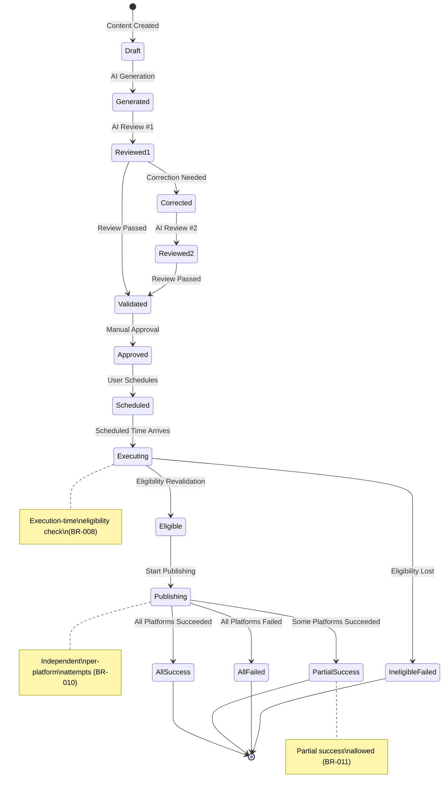
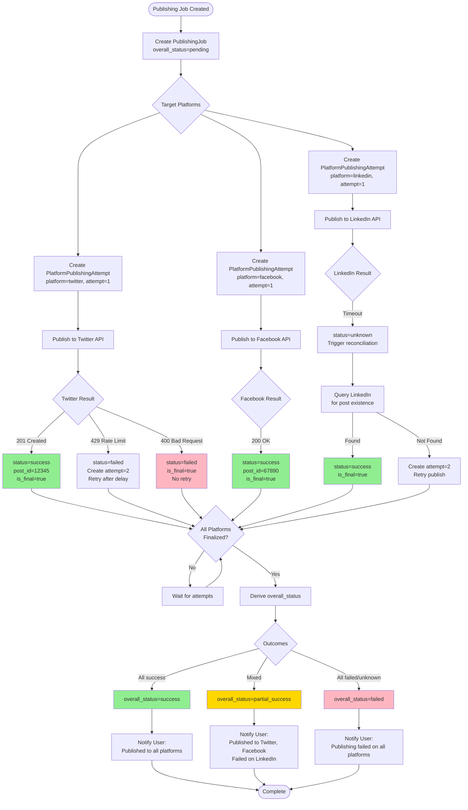
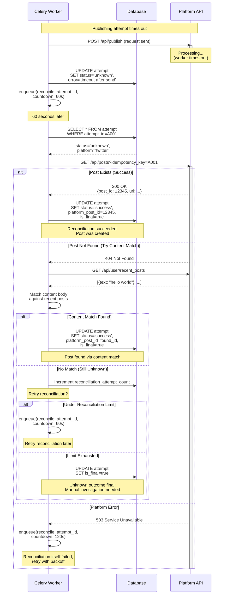

# 3.4 Automation & Publishing Design

**Document:** `3.4-automation-publishing-design.md`
**Project:** AI Content Automater
**Phase:** Phase 3 — System Design
**Date:** 2026-10-12
**Authoritative Requirements:** REQUIREMENTS.MD V2.0
**Architecture Basis:** 3.1 Architecture & Application Design
**Database Basis:** 3.2 Database & API Design
**AI Workflow Basis:** 3.3 AI & Content Workflow Design (if exists)

---

## Document Status and Dependencies

**Prerequisites:**
- ✅ REQUIREMENTS.MD V2.0 (authoritative requirements)
- ✅ 3.1 Architecture & Application Design (modular monolith, 15 components, invariants)
- ✅ 3.2 Database & API Design (Schedule, Campaign, PublishingJob entities)
- ⚠️ 3.3 AI & Content Workflow Design (file not found; using requirements directly)

**Unresolved Architectural Decisions Affecting This Design:**
- **UD-001:** Social media platforms for V1 (BLOCKING: affects platform-specific publishing contracts)
- **UD-002:** AI service/model selection (non-blocking for scheduling/publishing)
- **UD-007:** Multi-tenancy architecture (affects background task isolation)

**New Unresolved Decisions (from 3.2):**
- **DD-NEW-010:** Publishing retry limit (numeric value unresolved; requirements say "bounded" per BR-012)
- **DD-NEW-013:** Campaign schedule pattern format (daily/weekly/monthly, cron-like, etc.)
- **DD-NEW-015:** Campaign duplicate execution prevention window
- **DD-NEW-016:** Publishing attempt retry limit (numeric value)

**Design Approach:**
This design specifies scheduling, background processing, recurring campaigns, direct social platform publishing, result tracking, retry logic, and reconciliation consistent with requirements and existing Phase 3.1-3.2 designs. Unresolved numeric limits and platform-specific details are marked explicitly.

---

## 1. SCOPE, RESPONSIBILITIES, AND ARCHITECTURE

### 1.1 Subsystem Responsibilities

**The Automation & Publishing Subsystem is responsible for:**

1. **Scheduling approved content** for future publication at specified times (FR-013, Section 27)
2. **Managing recurring campaigns** that generate and publish content on a schedule (FR-014, Section 30)
3. **Background execution** of scheduled work when due (Section 29, FR-023)
4. **Publishing eligibility revalidation** before every execution attempt (BR-008, Section 26)
5. **Direct social platform publishing** without Buffer intermediary (BR-009, FR-015, Section 32)
6. **Independent per-platform attempts** with separate outcomes (BR-010, BR-011, Section 34)
7. **Publishing result tracking** including success, failure, partial success, and unknown states (FR-016, BR-018)
8. **Bounded retry handling** for transient failures (FR-017, BR-012)
9. **Unknown external state reconciliation** when platform outcome is uncertain (BR-018, Section 47)
10. **Duplicate publication prevention** through idempotency controls (Section 35)
11. **Failure recording and notification** without falsely reporting success (BR-013, FR-020)

### 1.2 Boundaries with Other Subsystems

**IN SCOPE (Automation & Publishing):**
- Schedule creation and validation
- Campaign definition and recurrence calculation
- Work identification when execution time arrives
- Background task orchestration (Celery workers)
- Execution-time eligibility revalidation
- Platform-specific content translation and API calls
- Per-platform publishing attempt execution
- Publishing result capture and persistence
- Retry logic and bounded retry enforcement
- Unknown outcome reconciliation attempts
- Publishing notifications

**OUT OF SCOPE (Delegated to Other Subsystems):**
- **Content creation and editing** (COMP-002 Content Management)
- **Research execution** (COMP-003 Research, per 3.1)
- **AI generation, review, correction** (COMP-004 AI Workflow, per 3.1)
- **Final content validation** (COMP-005 Validation, per 3.1)
- **Human approval workflow** (COMP-006 Approval, per 3.1)
- **Media storage and retrieval** (COMP-009 Media Management, per 3.1)
- **Platform OAuth2 authorization flow** (COMP-010 Platform Connections, per 3.1)
- **Credential encryption and management** (COMP-010, per 3.2 Section 2.16)
- **Analytics aggregation** (COMP-012 Analytics, per 3.1)

**BOUNDARY CONTRACTS (Inputs from Other Subsystems):**
- **From COMP-002 (Content):** Content entity, current version, lifecycle state
- **From COMP-004 (AI Workflow):** Review results (both reviews completed)
- **From COMP-005 (Validation):** Validation result (passed/failed)
- **From COMP-006 (Approval):** Approval record (version-specific, valid/invalid)
- **From COMP-009 (Media):** Media availability and platform compatibility
- **From COMP-010 (Platform Connections):** Active platform connections, credentials
- **From COMP-011 (Notifications):** Notification delivery for publishing outcomes

**BOUNDARY CONTRACTS (Outputs to Other Subsystems):**
- **To COMP-002 (Content):** Lifecycle state updates (scheduled → publishing → published/failed)
- **To COMP-011 (Notifications):** Publishing events (started, completed, failed, partial)
- **To COMP-012 (Analytics):** Publishing outcome data
- **To COMP-013 (Audit):** Publishing attempt records, user actions
- **To COMP-014 (Operational Logs):** Errors, diagnostics, retry attempts

### 1.3 Synchronous vs Asynchronous Operations

**Synchronous (User-Facing Web Request):**
- **Schedule creation:** User schedules approved content (lightweight: DB insert)
- **Schedule cancellation:** User cancels pending schedule (DB update)
- **Campaign creation/modification:** User defines recurring campaign (DB write)
- **Campaign enable/disable:** User activates or pauses campaign (flag update)
- **Publishing status check:** User views publishing job status (DB read)

**Asynchronous (Background Processing via Celery):**
- **Scheduled publishing execution:** Time arrives → trigger background task
- **Campaign execution:** Schedule matches → generate content → full AI workflow → publish
- **Direct platform publishing:** Approved content → call platform APIs → record results
- **Publishing retry:** Failed transient error → retry after delay
- **Outcome reconciliation:** Unknown platform state → query platform → determine actual result

**Why Asynchronous Processing is Required:**

1. **External API latency:** Social platform APIs may take seconds or minutes (Section 49)
2. **Multiple platforms:** Publishing to 3 platforms × 30 seconds each = 90 seconds (cannot block web request)
3. **AI workflow in campaigns:** Campaign execution runs full research → generation → reviews → correction → validation workflow (minutes)
4. **Retry delays:** Transient failures require exponential backoff (seconds to minutes between attempts)
5. **Reconciliation queries:** Unknown outcomes require follow-up platform API calls
6. **Failure isolation:** Background task failure must not crash web application

**Technology:** Celery with Redis/RabbitMQ broker (per requirements Section 49: "expects Celery-based background processing")

### 1.4 Architecture Integration

**From 3.1 Architecture:**
- **Style:** Modular monolith (scheduling/publishing are modules, not separate services)
- **COMP-007 (Scheduling & Campaigns):** Owns Schedule, Campaign, CampaignExecution entities
- **COMP-008 (Publishing):** Owns PublishingJob, PlatformPublishingAttempt entities
- **Background Workers (Celery):** Execute async tasks, preserve user context (BR-017, INV-002)
- **Scheduler (Celery Beat):** Periodic task that identifies due work

**From 3.2 Database:**
- **Schedule entity (DE-009):** content_id, scheduled_time, timezone, executed flag
- **Campaign entity (DE-010):** owner_id, topic, schedule_pattern, enabled flag
- **CampaignExecution entity (DE-011):** campaign_id, content_id, execution_time, status
- **PublishingJob entity (DE-012):** content_id, version_id, overall_status
- **PlatformPublishingAttempt entity (DE-013):** job_id, platform, attempt_number, status (success/failed/unknown)

**Architectural Invariants (from 3.1 Section 5):**
- **INV-002:** AI workflow preserves user context (scheduling/campaigns run on behalf of user)
- **INV-006:** Publishing eligibility DERIVED (recomputed at execution time)
- **INV-007:** Execution-time revalidation (cannot trust stale approval/validation)
- **INV-008:** Platform-specific outcomes independent (one platform's failure doesn't affect another)
- **INV-009:** Unknown external state explicit (cannot guess success/failure)
- **INV-010:** Retry bounded (numeric limit from requirements or configuration)
- **INV-011:** Failure state integrity (failed operation never marked successful)
- **INV-013:** Campaign state vs execution (enabled flag distinct from execution history)

### 1.5 Request and Processing Flows

**Flow 1: User Schedules Approved Content**
```
User → API: POST /schedules {content_id, scheduled_time, timezone}
API → Validation: Check publishing eligibility (Section 26)
Validation → Database: Insert Schedule record
Database → User: 201 Created {schedule_id}
---
Later: Celery Beat → Scheduler: Check for due schedules
Scheduler → Celery Queue: publish_content_task(content_id, version_id)
Worker → Publishing: Execute (see Flow 3)
```

**Flow 2: Campaign Executes on Schedule**
```
Celery Beat → Scheduler: Check enabled campaigns matching current time
Scheduler → Celery Queue: execute_campaign_task(campaign_id)
Worker → AI Workflow: Generate content for topic (COMP-004)
AI Workflow → Worker: Content approved (after reviews, validation, approval)
Worker → Publishing: Publish content (see Flow 3)
Worker → Database: Insert CampaignExecution record (success/failed)
```

**Flow 3: Direct Platform Publishing (Multi-Platform)**
```
Publishing → Eligibility Check: Revalidate (approval, reviews, validation, connections, media)
If ineligible → Fail job, notify user, STOP
If eligible → Database: Insert PublishingJob (overall_status=pending)
Publishing → For each target platform:
  Database: Insert PlatformPublishingAttempt (status=pending)
  Platform Integration → Platform API: POST content
  Platform API → Integration: Response (200 OK / 4xx / 5xx / timeout)
  Integration → Database: Update PlatformPublishingAttempt (success/failed/unknown)
Publishing → Database: Update PublishingJob.overall_status (success/partial/failed)
Publishing → Notifications: Notify user of outcome
```

**Flow 4: Publishing Retry (Transient Failure)**
```
PlatformPublishingAttempt → status=failed, error=rate_limit
Publishing → Retry Logic: Check retry limit (attempt_number < MAX_RETRIES)
If limit exceeded → Mark is_final=true, STOP
If retryable → Celery Queue: retry_platform_publish_task(attempt_id) [delay=exponential_backoff]
Worker → Database: Insert new PlatformPublishingAttempt (attempt_number + 1)
Worker → Platform API: Retry submission
Worker → Database: Update attempt status (success/failed/unknown)
```

---

## 2. BACKGROUND PROCESSING AND TASK LIFECYCLE

### 2.1 Background Processing Technology

**Selected Technology:** Celery with Redis or RabbitMQ message broker

**Rationale:**
- Requirements Section 49: "The project expects Celery-based background processing"
- Celery is mature, well-documented, widely used in Django ecosystem
- Supports task priorities, retries, scheduled tasks (Celery Beat), task routing
- Redis: Simple, low-latency (suitable for V1); RabbitMQ: More robust (if needed later)

**Deployment Components:**
1. **Web Application (Django):** Enqueues tasks (schedule.delay(), publish.delay())
2. **Celery Workers:** Execute tasks from queue (multiple processes/containers)
3. **Celery Beat:** Periodic scheduler (single instance, identifies due work)
4. **Message Broker (Redis/RabbitMQ):** Task queue, result backend
5. **PostgreSQL Database:** Authoritative business state (Schedule, PublishingJob, etc.)

**Important Distinction:**
- **Message Broker State:** Transient (task queue, task status "pending"/"started"/"success")
- **Database State:** Authoritative (Schedule.executed, PublishingJob.overall_status, PlatformPublishingAttempt.status)
- **Consistency Rule:** Business outcome persisted to database BEFORE task marked complete (Section 47, INV-011)

### 2.2 Task Types and Responsibilities

| Task Type | Trigger | Responsibility | Idempotent? | Retryable? |
|-----------|---------|----------------|-------------|------------|
| **check_due_schedules** | Celery Beat (every minute) | Identify Schedule records where scheduled_time ≤ NOW() AND executed=false | Yes | Yes |
| **publish_scheduled_content** | check_due_schedules | Revalidate eligibility, execute direct publishing | No (protected by executed flag) | Yes (with duplicate prevention) |
| **execute_campaign** | Celery Beat (checks recurrence) | Generate content, run AI workflow, publish if approved | No (protected by CampaignExecution unique constraint) | Partially (generation retryable, publishing separate) |
| **publish_content_direct** | API or campaign execution | Multi-platform publishing orchestration | Yes (PublishingJob.job_id idempotency) | Yes |
| **publish_to_platform** | publish_content_direct | Single platform API call | Yes (platform idempotency key if supported) | Yes (bounded by attempt_number) |
| **retry_platform_publish** | Failed attempt with retryable error | Retry single platform | Yes | Yes |
| **reconcile_unknown_outcome** | Unknown platform status | Query platform for actual result | Yes | Yes |

### 2.3 Task Lifecycle and State Management

**Task States (Celery Internal):**
- `PENDING`: Task queued, not yet picked up by worker
- `STARTED`: Worker executing task
- `SUCCESS`: Task completed successfully
- `FAILURE`: Task raised exception
- `RETRY`: Task failed, will retry

**Business States (Database Authoritative):**
- **Schedule.executed (boolean):** false → true (irreversible, duplicate prevention)
- **PublishingJob.overall_status (enum):** pending → in_progress → success/partial_success/failed
- **PlatformPublishingAttempt.status (enum):** pending → in_progress → success/failed/unknown

**Critical Invariant:** Celery task state SUCCESS does NOT automatically mean business operation succeeded.

**Example:**
```python
@celery_app.task
def publish_to_platform(attempt_id):
    attempt = PlatformPublishingAttempt.objects.get(pk=attempt_id)
    try:
        result = platform_client.publish(attempt.content, attempt.platform)
        attempt.status = 'success'
        attempt.platform_post_id = result.post_id
    except PlatformRateLimitError as e:
        attempt.status = 'failed'
        attempt.error_message = str(e)
        # Celery task returns success (task executed), but platform publishing failed
    finally:
        attempt.save()  # Persist business outcome
    return {'status': attempt.status}  # Task return value
```

**Key Principles:**
1. **Persist outcome FIRST, then return:** Database update before task completes
2. **Task success ≠ business success:** Task may succeed at executing logic while operation fails
3. **Database is source of truth:** Always query database for current state, not Celery result backend
4. **Idempotency via database:** Use unique constraints, executed flags, attempt_number to prevent duplicates

### 2.4 Task Correlation and Traceability

**Every Background Task SHALL Include:**
- **task_id (Celery UUID):** Auto-generated by Celery
- **user_id:** Owner of content/campaign (preserved context per BR-017, INV-002)
- **content_id:** Content being processed
- **correlation_id:** Optional trace ID linking related tasks (e.g., campaign execution → content generation → publishing)

**Logging and Audit:**
```python
logger.info(
    "Publishing task started",
    extra={
        'task_id': self.request.id,
        'user_id': user_id,
        'content_id': content_id,
        'job_id': job_id,
        'correlation_id': correlation_id
    }
)
```

**Audit Trail (COMP-013):**
- Every task initiation: AuditLog record (event_type=task_started, user_id, content_id, task_name)
- Every publishing attempt: AuditLog record (event_type=publishing_attempted, job_id, platform, status)
- Secrets filtered (BR-016): No API keys, access tokens, credentials in logs

**Operational Diagnostics (COMP-014):**
- Task failures: OperationalLog with exception details, retry count, last error
- Platform errors: Safe error message (no secrets), HTTP status, retry eligibility

### 2.5 Worker Failure and Recovery

**Failure Scenarios:**

| Scenario | Detection | Recovery | Data Impact |
|----------|-----------|----------|-------------|
| **Worker crashes mid-task** | Celery monitors worker heartbeat; task timeout | Task redelivered to another worker (if acks_late=True) | Database state may be incomplete (depends on where crash occurred) |
| **Network failure before API call** | Exception in task | Task retries | No external side effect |
| **Network failure after API call** | Timeout waiting for response | Status=unknown, attempt reconciliation | Platform may have succeeded (unknown) |
| **Database unavailable** | Connection error | Task retries (database should recover) | No state persisted |
| **Message broker unavailable** | Enqueue fails | API returns error to user | Schedule not created |
| **Duplicate task delivery** | Same task_id or business key (content_id, job_id) | Idempotency check (Schedule.executed, PublishingJob unique constraint) | Safe (duplicate ignored) |

**Celery Configuration for Reliability:**
```python
# Task acknowledgment AFTER task completes (not immediately on receipt)
task_acks_late = True

# If worker crashes, task re-queued to another worker
task_reject_on_worker_lost = True

# Task execution time limit (prevents hung tasks)
task_time_limit = 600  # 10 minutes hard limit
task_soft_time_limit = 540  # 9 minutes soft limit (raises exception)

# Result backend expiry
result_expires = 3600  # 1 hour (results not needed long-term; database is source of truth)
```

**Idempotency Enforcement:**
- **Schedule execution:** Check `Schedule.executed` flag before publishing; set true atomically
- **Campaign execution:** Unique constraint on `(campaign_id, execution_window)` prevents duplicate
- **Publishing job:** Job_id stable, existing job reused if duplicate request detected
- **Platform attempt:** Attempt incremented only by retry logic; initial attempt=1 per job+platform pair

### 2.6 Task Timeouts and Cancellation

**Timeout Policies:**
- **Scheduled publishing task:** 10 minutes (covers eligibility check + multi-platform publish + retries)
- **Campaign execution task:** 30 minutes (covers content generation + AI reviews + publishing)
- **Single platform publish:** 60 seconds (platform API call + response)
- **Reconciliation query:** 30 seconds (platform status lookup)

**Soft Timeout (SoftTimeLimitExceeded):**
- Worker raises exception after soft limit
- Task can catch exception, persist partial state, and exit gracefully
- Example: Multi-platform publish completes 2/3 platforms, times out before third → persist partial success

**Hard Timeout (SIGKILL):**
- Worker killed after hard limit
- No graceful shutdown
- Task redelivered (acks_late) or lost (default acknowledgment)
- **Mitigation:** Soft limit < hard limit; persist state incrementally

**User-Initiated Cancellation:**
- **Schedule cancellation:** User DELETEs Schedule record or sets cancelled flag
- **Campaign disable:** User sets Campaign.enabled=false
- **In-flight task cancellation:** Limited Celery support (task must poll for cancellation signal)
- **V1 Scope:** Schedule deletion before execution; Campaign disable prevents NEW executions (existing tasks complete)

**Cancellation Behavior:**
- Scheduled task checks `Schedule.executed==false` before publishing; if deleted, silently exits
- Campaign task checks `Campaign.enabled==true` before generating content; if disabled, exits
- Platform publishing already started: Cannot cancel external API call (let complete, record outcome)

---

## 3. SCHEDULING AND TIMEZONE SEMANTICS

### 3.1 Schedule Creation and Validation

**User Intent:** "Publish my approved blog post tomorrow at 9 AM Pacific Time"

**Schedule Entity (from 3.2 Section 2.10):**
```python
Schedule:
  content_id: FK to Content
  scheduled_time: timestamptz  # UTC in database
  timezone: text  # IANA timezone (America/Los_Angeles, Europe/London, etc.)
  executed: boolean (default false)
  cancelled: boolean (default false)
```

**Schedule Creation Process:**
1. User provides: `scheduled_time_local="2026-10-13T09:00:00"`, `timezone="America/Los_Angeles"`
2. API validates:
   - Content exists and user is owner (BR-001)
   - Content publishing-eligible (Section 26: approved, validated, reviews passed, platforms connected, media available)
   - Scheduled time is future (not past)
   - Timezone valid (IANA database: pytz.timezone(timezone) does not raise exception)
3. API converts local time to UTC: `scheduled_time_utc = localize_and_convert_to_utc(scheduled_time_local, timezone)`
4. Database stores: `scheduled_time=scheduled_time_utc`, `timezone=timezone` (original timezone preserved for display)

**Validation Rules:**
- **Past scheduling:** Reject with 400 Bad Request "Cannot schedule in the past" (**DD-NEW-027:** Allow near-past with immediate execution?)
- **Ambiguous local time (DST fall-back):** Use `is_dst=False` (standard time) or reject as ambiguous (**DD-NEW-028 unresolved**)
- **Non-existent local time (DST spring-forward):** Shift forward to valid time or reject (**DD-NEW-029 unresolved**)
- **Far-future scheduling:** No explicit limit in requirements (**DD-NEW-030:** Max scheduling horizon unresolved)

**Publishing Eligibility Check at Scheduling Time (Section 26):**
```python
def check_publishing_eligibility(content_id):
    content = Content.objects.get(pk=content_id)

    # Must be approved (BR-006)
    approval = Approval.objects.filter(
        content_id=content_id,
        content_version_id=content.current_version_id
    ).first()
    if not approval:
        return False, "No valid approval for current version"

    # Must have passed validation (BR-005)
    validation = Validation.objects.filter(
        content_version_id=content.current_version_id,
        outcome='passed'
    ).first()
    if not validation:
        return False, "Validation not passed for current version"

    # Must have passed both AI reviews (BR-002, BR-004)
    reviews = AIReview.objects.filter(
        content_version_id=content.current_version_id
    )
    review_1 = reviews.filter(review_stage='review_1', outcome='approved').exists()
    review_2 = reviews.filter(review_stage='review_2', outcome='approved').exists()
    if not (review_1 and review_2):
        return False, "AI reviews not completed or not passed"

    # Must have active platform connections for all target platforms (FR-019)
    for platform in content.target_platforms:
        connection = PlatformConnection.objects.filter(
            owner_id=content.owner_id,
            platform=platform,
            is_active=True
        ).exists()
        if not connection:
            return False, f"Platform {platform} not connected"

    # Must have required media (if content references media) (Section 39)
    required_media = ContentMedia.objects.filter(content_id=content_id)
    for cm in required_media:
        media = Media.objects.get(pk=cm.media_id)
        if media.upload_status != 'completed':
            return False, f"Media {media.filename} not available"

    return True, "Eligible"
```

**Important:** This eligibility check is performed AGAIN at execution time (BR-008, INV-007, Section 4.2).

### 3.2 Timezone Storage and Interpretation

**Database Storage (PostgreSQL timestamptz):**
- `scheduled_time` stored as UTC with timezone offset: `2026-10-13 16:00:00+00` (9 AM Pacific = 4 PM UTC, accounting for PDT offset)
- `timezone` stored as text: `America/Los_Angeles`

**User Display:**
- API returns schedule to user in their original timezone:
  ```json
  {
    "schedule_id": "uuid",
    "scheduled_time": "2026-10-13T09:00:00-07:00",  // ISO 8601 with offset
    "timezone": "America/Los_Angeles"
  }
  ```

**Worker Execution:**
- Celery Beat queries: `SELECT * FROM schedule WHERE scheduled_time <= NOW() AND executed=false`
- Database NOW() is UTC-aware, comparison works correctly
- Worker does NOT need to understand timezone (UTC comparison sufficient)

**Daylight Saving Time (DST) Handling:**

**Scenario 1: Schedule created before DST change, executes after DST change**
- User schedules: "2026-11-03 09:00 America/Los_Angeles" (before DST ends, PDT = UTC-7)
- Stored as UTC: `2026-11-03 16:00:00+00`
- DST ends: 2026-11-01 02:00 PDT → 01:00 PST (fall back 1 hour, PST = UTC-8)
- Execution: 2026-11-03 16:00 UTC = 08:00 PST (not 09:00!)
- **Issue:** User expects 9 AM wall-clock time, but UTC conversion locked in PDT offset

**Mitigation Options:**
1. **Accept behavior:** Scheduled time is UTC (deterministic); user must account for DST (document limitation)
2. **Store local time:** Store `scheduled_local_time` + `timezone`, convert to UTC at execution (re-calculate offset)
3. **DST-aware scheduling:** Warn user at scheduling time if DST change occurs between now and scheduled time

**V1 Decision:** **DD-NEW-031 unresolved** (Accept UTC storage, document DST caveat OR implement local-time recalculation)

### 3.3 Schedule Modification and Cancellation

**Rescheduling:**
- User can DELETE existing Schedule and CREATE new one with different time
- OR: PATCH /schedules/{schedule_id} with new scheduled_time (if not yet executed)
- Application revalidates eligibility at modification time

**Cancellation:**
- User DELETEs Schedule record: `DELETE /schedules/{schedule_id}`
- OR: PATCH with `cancelled=true` flag (preserve history)
- Scheduled task checks `executed==false AND cancelled==false` before publishing

**Concurrency:** What if user cancels schedule while Celery task already claimed it?
- Task queries: `schedule = Schedule.objects.select_for_update().get(pk=schedule_id)`
- If schedule.cancelled or schedule.executed: task exits without publishing (idempotent)
- If schedule not found (deleted): task exits (safe)

**Execution Atomicity:**
```python
with transaction.atomic():
    schedule = Schedule.objects.select_for_update().get(pk=schedule_id)
    if schedule.executed or schedule.cancelled:
        return  # Already processed or cancelled, exit
    schedule.executed = True
    schedule.executed_at = timezone.now()
    schedule.save()
    # Now publish (outcome recorded separately in PublishingJob)
```

### 3.4 Due Work Identification

**Scheduler Task (Celery Beat, runs every 1 minute):**
```python
@celery_app.task
def check_due_schedules():
    now = timezone.now()  # UTC-aware
    due_schedules = Schedule.objects.filter(
        scheduled_time__lte=now,
        executed=False,
        cancelled=False
    ).select_for_update(skip_locked=True)  # Prevents duplicate claiming

    for schedule in due_schedules:
        publish_scheduled_content.delay(schedule.id)
```

**Key Mechanisms:**
- **select_for_update(skip_locked=True):** PostgreSQL row-level lock, skips rows locked by other transactions (prevents duplicate claiming if multiple Celery Beat instances running accidentally)
- **executed flag:** Once set true, schedule never re-processed
- **Polling interval:** 1 minute (trade-off: precision vs database load; requirements do not specify exact precision; **DD-NEW-032: scheduling precision unresolved**)

**Missed Schedules (Worker Downtime):**
- If workers offline, scheduled_time passes, schedules accumulate
- When workers restart: check_due_schedules finds all overdue schedules, enqueues tasks
- Schedules execute late (acceptable per requirements Section 29: "at or after scheduled time")

**Clock Skew:**
- Database NOW() is source of truth (not worker system clock)
- All workers query `scheduled_time__lte=now()` using database clock
- Consistent even if worker clocks slightly off

---

## 4. RECURRING CAMPAIGNS

### 4.1 Campaign Definition and Recurrence Model

**Campaign Entity (from 3.2 Section 2.11):**
```python
Campaign:
  owner_id: FK to User
  name: text
  topic: text  # Drives AI content generation
  target_platforms: list
  schedule_pattern: text  # Recurrence rule
  enabled: boolean (default true)
```

**Recurrence Rule Format (DD-NEW-013 unresolved):**

**Option A: Cron-like Expression**
```
schedule_pattern: "0 9 * * MON"  # Every Monday at 9 AM
schedule_pattern: "0 12 * * *"   # Every day at noon
schedule_pattern: "0 0 1 * *"    # First day of month at midnight
```

**Option B: Structured JSON**
```json
{
  "frequency": "weekly",
  "interval": 1,
  "days_of_week": ["MON", "WED", "FRI"],
  "time": "09:00",
  "timezone": "America/New_York"
}
```

**Option C: iCalendar RRULE (RFC 5545)**
```
FREQ=WEEKLY;BYDAY=MO,WE,FR;BYHOUR=9;BYMINUTE=0
```

**V1 Design Assumption (pending DD-NEW-013 resolution):**
- Use **structured JSON** (Option B): More user-friendly, easier to validate, allows timezone per campaign
- Store in `schedule_pattern` JSONB column
- Parse at execution time to determine if campaign should run

**Occurrence Calculation:**
```python
def should_campaign_execute_now(campaign, current_time):
    pattern = json.loads(campaign.schedule_pattern)
    tz = pytz.timezone(pattern['timezone'])
    local_time = current_time.astimezone(tz)

    if pattern['frequency'] == 'daily':
        if local_time.time() == pattern['time']:
            return True
    elif pattern['frequency'] == 'weekly':
        if local_time.strftime('%a').upper() in pattern['days_of_week']:
            if local_time.time() == pattern['time']:
                return True
    # ... monthly, custom intervals
    return False
```

### 4.2 Campaign Execution Tracking

**CampaignExecution Entity (from 3.2 Section 2.12):**
```python
CampaignExecution:
  campaign_id: FK to Campaign
  content_id: FK to Content (nullable if generation failed)
  execution_time: timestamptz
  status: enum (success, failed)
  error_message: text (if failed)
```

**Unique Constraint (DD-NEW-015):**
- Prevents duplicate execution for same time window
- Example: `UNIQUE(campaign_id, DATE_TRUNC('hour', execution_time))`
- OR: `UNIQUE(campaign_id, execution_date)` if campaigns execute once per day

**Campaign Execution Flow:**
```
1. Celery Beat: Check enabled campaigns matching current time
2. For each matching campaign:
   a. Check unique constraint: Has execution already occurred for this window?
   b. If duplicate: Skip (idempotent)
   c. If new: Insert CampaignExecution (status=pending)
3. Enqueue task: execute_campaign.delay(campaign_id, execution_id)
4. Worker: Generate content (COMP-004 AI workflow)
   - Research → AI Generation → Review #1 → Correction → Review #2 → Validation
5. If generation succeeds AND passes all gates:
   - Seek approval (if manual approval required per UD-003)
   - OR auto-approve (if campaign execution includes approval delegation)
6. If approved: Publish content (COMP-008)
7. Update CampaignExecution:
   - status=success, content_id=generated_content_id (if published)
   - status=failed, error_message=reason (if any stage failed)
```

**Important:** Campaign execution follows FULL content lifecycle (Section 11, BR-014):
- Research (if enabled)
- AI Generation (FR-006)
- AI Review #1 (FR-007, mandatory per BR-002)
- AI Correction (FR-008, if review failed)
- AI Review #2 (FR-009, mandatory per BR-002)
- Final Validation (FR-011, mandatory per BR-005)
- Approval (FR-012, mandatory per BR-006)
- Publishing (FR-015)

**Campaigns do NOT bypass quality gates** (BR-014).

### 4.3 Campaign State Management

**Campaign States:**
- **enabled=true:** Campaign active, will execute on schedule
- **enabled=false:** Campaign paused, will NOT execute (BR-015)
- **deleted:** Campaign no longer exists (execution history preserved; **DD-NEW-014** unresolved)

**Execution State (Independent):**
- **CampaignExecution records:** Immutable history of past executions
- **enabled flag change does NOT affect past executions** (BR-015, INV-013)

**Example Timeline:**
```
2026-10-01: Campaign created (enabled=true)
2026-10-02 09:00: Execution #1 (status=success, content_id=123)
2026-10-03 09:00: Execution #2 (status=failed, error="AI generation timeout")
2026-10-04: User disables campaign (enabled=false)
2026-10-05 09:00: NO execution (campaign disabled)
2026-10-06: User re-enables campaign (enabled=true)
2026-10-07 09:00: Execution #3 (status=success, content_id=456)
```

**Disable Semantics (BR-015):**
- Scheduler checks `WHERE enabled=true` before enqueueing execution task
- Already-enqueued tasks (in Celery queue) will complete (V1 behavior)
- To prevent in-flight execution: Worker checks `campaign.enabled` before generating content (fail-fast)

### 4.4 Campaign Failure Handling

**Failure Scenarios:**

| Stage | Failure Reason | Recovery | CampaignExecution Status |
|-------|----------------|----------|--------------------------|
| **Research** | Research API unavailable | Retry research (bounded) | failed if exhausted |
| **AI Generation** | AI service timeout | Retry generation (bounded) | failed if exhausted |
| **AI Review #1** | Review service error | Retry review (bounded) | failed if exhausted |
| **AI Correction** | Correction limit exceeded | Stop (BR-003) | failed |
| **AI Review #2** | Review rejected | Stop (cannot auto-fix rejection) | failed |
| **Validation** | Business rule violation | Stop (requires manual fix) | failed |
| **Approval** | Manual approval required but not granted | Stop (wait for approval) | pending_approval (**DD-NEW-033:** campaign approval workflow unresolved) |
| **Publishing** | Platform API unavailable | Retry publishing (bounded) | failed if exhausted |

**Failed Execution Behavior:**
- **Do NOT retry failed campaign execution automatically** (risk of infinite loop, content duplication)
- **Notify user** of campaign failure (FR-020)
- **Continue with next scheduled occurrence** (one failure does not disable campaign)
- **User can manually investigate and retry** (re-run campaign ad-hoc OR fix issue and wait for next occurrence)

**Campaign Failure Notifications:**
- Notification.notification_type = `campaign_executed`
- Notification.message = "Campaign 'Daily Blog' execution failed: AI generation timeout"

### 4.5 Campaign Content Approval

**Unresolved Decision: UD-003 (Approval Workflow Complexity)**

**Option 1: Manual Approval Required**
- Campaign generates content → stops at "awaiting approval" state
- User reviews and approves → content published
- **Issue:** Defeats automation purpose (user must intervene daily)

**Option 2: Approval Delegated to Campaign**
- Campaign creation includes "auto-approve generated content" flag
- Campaign execution generates → validates → auto-approves → publishes
- **Issue:** Bypasses explicit approval gate (BR-006), requires careful authorization

**Option 3: Hybrid (Campaign-Level Approval)**
- User approves campaign definition once (approves topic, platforms, recurrence)
- Each generated content auto-approved IF passes all quality gates
- **Issue:** Approval not tied to specific content version (BR-007 concern)

**V1 Design Assumption (pending UD-003 resolution):**
- **Option 2 (Auto-Approve)** with strict gates:
  - Campaign.auto_approve_content boolean flag (default false)
  - If true AND all quality gates passed: create Approval record (approved_by=campaign_owner_id, approval_notes="Auto-approved by campaign")
  - If false OR any gate failed: stop at awaiting_approval state, notify user
- **Audit trail:** Approval.approval_notes indicates auto-approval by campaign

**Authorization:**
- Only campaign owner can set auto_approve_content=true
- Campaign owner explicitly accepts risk of automated publishing

---

## 5. PUBLISHING ELIGIBILITY REVALIDATION

### 5.1 Eligibility Criteria (Section 26, INV-006)

**Publishing Eligibility is DERIVED (INV-006) from multiple authoritative sources:**

1. **Content is valid:** Content record exists, not deleted
2. **Required AI reviews completed:** Both Review #1 and Review #2 passed for current version (BR-002, BR-004)
3. **Required corrections completed:** If corrections needed, correction limit not exceeded (BR-003)
4. **Final validation passed:** Validation.outcome='passed' for current version (BR-005)
5. **Required approval exists:** Approval record exists for current version (BR-006)
6. **Target platforms authorized:** PlatformConnection exists and is_active=true for all target platforms (FR-019)
7. **Required content/media available:** Content body non-empty, media upload_status='completed' (Section 39)
8. **Scheduled execution valid:** Schedule not cancelled, not already executed (for scheduled content)

**Eligibility is NOT a stored flag** (anti-pattern):
- ❌ `Content.is_eligible_for_publishing` boolean (would become stale)
- ✅ Compute eligibility at check time from authoritative entities

### 5.2 Execution-Time Revalidation (BR-008, INV-007)

**Why Revalidation is Mandatory:**

**Scenario:** Content scheduled at 9 AM, but...
- 8:45 AM: User edits content → new version created → approval invalidated (BR-007)
- 9:00 AM: Scheduled task executes → MUST NOT publish stale approved version

**Revalidation Logic:**
```python
def revalidate_publishing_eligibility_at_execution(content_id):
    """
    Execution-time eligibility check (BR-008, INV-007).
    MUST be called immediately before publishing, even if eligibility
    was checked at scheduling time.
    """
    content = Content.objects.get(pk=content_id)
    current_version_id = content.current_version_id

    # 1. Approval valid for current version?
    approval = Approval.objects.filter(
        content_id=content_id,
        content_version_id=current_version_id
    ).first()
    if not approval:
        return False, "Approval invalid or missing for current version"

    # 2. Validation passed for current version?
    validation = Validation.objects.filter(
        content_version_id=current_version_id,
        outcome='passed'
    ).first()
    if not validation:
        return False, "Validation not passed for current version"

    # 3. Both AI reviews passed for current version?
    reviews = AIReview.objects.filter(content_version_id=current_version_id)
    if not reviews.filter(review_stage='review_1', outcome='approved').exists():
        return False, "AI Review #1 not passed"
    if not reviews.filter(review_stage='review_2', outcome='approved').exists():
        return False, "AI Review #2 not passed"

    # 4. Platform connections still active?
    for platform in content.target_platforms:
        conn = PlatformConnection.objects.filter(
            owner_id=content.owner_id,
            platform=platform,
            is_active=True
        ).first()
        if not conn:
            return False, f"Platform {platform} connection revoked"
        # Check token expiry
        cred = PlatformCredential.objects.filter(connection_id=conn.connection_id).first()
        if cred and cred.token_expires_at and cred.token_expires_at < timezone.now():
            return False, f"Platform {platform} credentials expired"

    # 5. Required media available?
    media_assocs = ContentMedia.objects.filter(content_id=content_id)
    for assoc in media_assocs:
        media = Media.objects.get(pk=assoc.media_id)
        if media.upload_status != 'completed':
            return False, f"Media {media.filename} not available"

    return True, "Eligible"
```

**Revalidation Timing:**
- **Scheduling time:** Check eligibility, ALLOW schedule creation if eligible
- **Execution time:** RE-CHECK eligibility, BLOCK publishing if no longer eligible
- **Result:** Schedule may exist for ineligible content (eligibility lost after scheduling) → execution fails gracefully

**Execution Failure (Ineligibility Detected):**
```python
@celery_app.task
def publish_scheduled_content(schedule_id):
    with transaction.atomic():
        schedule = Schedule.objects.select_for_update().get(pk=schedule_id)
        if schedule.executed or schedule.cancelled:
            return

        eligible, reason = revalidate_publishing_eligibility_at_execution(schedule.content_id)
        if not eligible:
            schedule.executed = True  # Mark executed to prevent retry
            schedule.execution_status = 'eligibility_failed'
            schedule.execution_error = reason
            schedule.save()
            notify_user(schedule.content.owner_id, f"Scheduled publishing failed: {reason}")
            return

        # Eligibility confirmed, proceed to publish
        publish_content_direct(schedule.content_id)
        schedule.executed = True
        schedule.execution_status = 'published'
        schedule.save()
```

### 5.3 Concurrent Edit During Execution

**Race Condition:** User edits content while publishing task in progress

**Timeline:**
```
09:00:00 - Scheduled task starts, checks eligibility (passes)
09:00:05 - User PATCH /content/{id} (new version created)
09:00:10 - Publishing task calls platform APIs (using old version_id)
09:00:15 - Platform APIs succeed
```

**Mitigation:**
1. **Version-Specific Publishing:** PublishingJob.content_version_id locks the version being published
2. **Post-Publish Validation:** After publishing, verify Content.current_version_id still matches published version
3. **If mismatch:** Log warning, but DO NOT roll back external publish (cannot un-publish from platform)
4. **Audit trail:** PublishingJob.content_version_id shows which version was actually published

**Acceptable Outcome:**
- Old version published successfully (recorded in PublishingJob)
- New version NOT published (user must schedule/publish separately)
- User notified: "Content version X published; current version Y is different"

**Unavoidable Risk:**
- Cannot prevent external platform publish once submitted
- User editing during execution is user error (UI should warn if publishing in progress)

---

## 6. DIRECT SOCIAL-PLATFORM PUBLISHING

### 6.1 Direct Publishing Requirement (BR-009)

**Requirements Section 32:**
> "The application connects directly to social media platform APIs (Twitter, Facebook, LinkedIn, Instagram, etc.) for publishing. Buffer is NOT a mandatory intermediary."

**BR-009:**
> "Direct publishing to social platforms is required; Buffer SHALL NOT be an architectural dependency."

**V1 Publishing Architecture:**
- Application → Platform API (direct HTTP/REST)
- NO Buffer integration in critical path
- Platform-specific client adapters (TwitterClient, FacebookClient, LinkedInClient)
- Credentials managed by COMP-010 (Platform Connections)

**Supported Platforms (UD-001 unresolved):**
- Assumed V1 scope: Twitter/X, Facebook, LinkedIn (common business platforms)
- Instagram, TikTok: Deferred to V2 (more complex media workflows)

### 6.2 Platform Integration Architecture

**Platform Client Abstraction:**
```python
class PlatformPublishingClient(ABC):
    """Abstract base class for platform-specific publishing clients."""

    @abstractmethod
    def publish(self, content: Content, credentials: PlatformCredential) -> PublishResult:
        """
        Publish content to platform.

        Returns:
            PublishResult with status (success/failed/unknown), post_id, post_url, error

        Raises:
            PlatformAuthenticationError: Credentials invalid/expired (401)
            PlatformRateLimitError: Rate limit exceeded (429)
            PlatformValidationError: Content violates platform rules (400/403)
            PlatformServerError: Platform unavailable (5xx)
            PlatformTimeoutError: Request timed out (no response)
        """
        pass

    @abstractmethod
    def get_post_status(self, post_id: str, credentials: PlatformCredential) -> PostStatus:
        """Query platform for post existence/status (reconciliation)."""
        pass

    @abstractmethod
    def refresh_credentials(self, refresh_token: str) -> RefreshedCredential:
        """Refresh OAuth2 access token using refresh token."""
        pass
```

**Platform-Specific Implementations:**

**TwitterClient (Twitter API v2):**
```python
class TwitterClient(PlatformPublishingClient):
    def publish(self, content: Content, credentials: PlatformCredential):
        access_token = decrypt_token(credentials.access_token_encrypted)
        headers = {
            'Authorization': f'Bearer {access_token}',
            'Content-Type': 'application/json'
        }

        # Twitter-specific content mapping
        tweet_text = self._format_tweet(content)
        if len(tweet_text) > 280:
            raise PlatformValidationError("Tweet exceeds 280 characters")

        payload = {'text': tweet_text}

        # Add media if present
        if content.media:
            media_ids = self._upload_media(content.media, credentials)
            payload['media'] = {'media_ids': media_ids}

        response = requests.post(
            'https://api.twitter.com/2/tweets',
            headers=headers,
            json=payload,
            timeout=30
        )

        if response.status_code == 201:
            data = response.json()
            return PublishResult(
                status='success',
                post_id=data['data']['id'],
                post_url=f"https://twitter.com/user/status/{data['data']['id']}"
            )
        elif response.status_code == 429:
            raise PlatformRateLimitError(response.headers.get('x-rate-limit-reset'))
        elif response.status_code == 401:
            raise PlatformAuthenticationError("Token expired")
        else:
            raise PlatformServerError(f"Twitter API error: {response.status_code}")
```

**FacebookClient (Graph API):**
```python
class FacebookClient(PlatformPublishingClient):
    def publish(self, content: Content, credentials: PlatformCredential):
        access_token = decrypt_token(credentials.access_token_encrypted)
        page_id = credentials.platform_account_id  # Facebook page ID

        payload = {
            'message': content.body,
            'access_token': access_token
        }

        # Add media if present
        if content.media:
            photo_url = content.media[0].url  # Facebook can attach media by URL
            payload['link'] = photo_url

        response = requests.post(
            f'https://graph.facebook.com/v18.0/{page_id}/feed',
            data=payload,
            timeout=30
        )

        if response.status_code == 200:
            data = response.json()
            return PublishResult(
                status='success',
                post_id=data['id'],
                post_url=f"https://facebook.com/{data['id']}"
            )
        # ... error handling similar to Twitter
```

**LinkedInClient (LinkedIn v2 API):**
```python
class LinkedInClient(PlatformPublishingClient):
    def publish(self, content: Content, credentials: PlatformCredential):
        access_token = decrypt_token(credentials.access_token_encrypted)
        person_urn = credentials.platform_account_id  # LinkedIn person URN

        headers = {
            'Authorization': f'Bearer {access_token}',
            'Content-Type': 'application/json',
            'X-Restli-Protocol-Version': '2.0.0'
        }

        payload = {
            'author': person_urn,
            'lifecycleState': 'PUBLISHED',
            'specificContent': {
                'com.linkedin.ugc.ShareContent': {
                    'shareCommentary': {'text': content.body},
                    'shareMediaCategory': 'NONE'  # or IMAGE/VIDEO/ARTICLE
                }
            },
            'visibility': {
                'com.linkedin.ugc.MemberNetworkVisibility': 'PUBLIC'
            }
        }

        response = requests.post(
            'https://api.linkedin.com/v2/ugcPosts',
            headers=headers,
            json=payload,
            timeout=30
        )

        if response.status_code == 201:
            post_id = response.headers['X-RestLi-Id']
            return PublishResult(
                status='success',
                post_id=post_id,
                post_url=f"https://www.linkedin.com/feed/update/{post_id}"
            )
        # ... error handling
```

### 6.3 Content Translation to Platform Format

**Content Entity Fields (from 3.2):**
- `body` (text): Primary content text
- `title` (optional): Content title
- `target_platforms` (list): Where to publish
- `media` (references): Associated media

**Platform-Specific Mapping:**

| Platform | Character Limit | Media Support | Hashtag Style | URL Handling |
|----------|-----------------|---------------|---------------|--------------|
| **Twitter** | 280 chars | 4 images, 1 video | #hashtags inline | Auto-shortened (t.co) |
| **Facebook** | 63,206 chars | Multiple images, video | #hashtags optional | Preview generated |
| **LinkedIn** | 3,000 chars (post), 1,300 (comment) | Image, video, article | #hashtags | Preview generated |

**Content Adaptation Logic:**
```python
def adapt_content_for_platform(content: Content, platform: str) -> dict:
    """Translate generic Content to platform-specific payload."""

    if platform == 'twitter':
        text = content.body[:280]  # Truncate if needed (or reject)
        if content.title:
            text = f"{content.title}\n\n{text}"[:280]
        return {'text': text}

    elif platform == 'facebook':
        return {'message': content.body}  # No length limit

    elif platform == 'linkedin':
        text = content.body[:3000]  # LinkedIn post limit
        return {'commentary': text}

    else:
        raise ValueError(f"Unsupported platform: {platform}")
```

**Content Validation Before Publishing:**
- Character limit check (platform-specific)
- Media format validation (image dimensions, file size, video duration)
- URL count validation (Twitter allows 1 URL, counts against character limit)
- Hashtag validation (platform-specific rules)

**Validation Failure Handling:**
- If content exceeds platform limits: Mark PlatformPublishingAttempt.status='failed', error_message="Content exceeds Twitter 280 character limit"
- Do NOT retry (permanent validation failure)
- Notify user with actionable message

### 6.4 Credential Management and Token Refresh

**PlatformCredential Entity (from 3.2 Section 2.16):**
```python
PlatformCredential:
  connection_id: FK to PlatformConnection
  access_token_encrypted: bytea  # Encrypted OAuth2 access token
  refresh_token_encrypted: bytea  # Encrypted OAuth2 refresh token (if available)
  token_expires_at: timestamptz  # Access token expiry
  scope: text  # OAuth2 scopes granted
```

**Credential Retrieval:**
```python
def get_platform_credentials(user_id: int, platform: str) -> PlatformCredential:
    """Retrieve and decrypt platform credentials for user."""
    connection = PlatformConnection.objects.get(
        owner_id=user_id,
        platform=platform,
        is_active=True
    )
    credential = PlatformCredential.objects.get(connection_id=connection.connection_id)

    # Check token expiry
    if credential.token_expires_at and credential.token_expires_at < timezone.now():
        # Attempt refresh
        credential = refresh_access_token(credential)

    return credential
```

**Token Refresh Flow:**
```python
def refresh_access_token(credential: PlatformCredential) -> PlatformCredential:
    """Refresh expired OAuth2 access token using refresh token."""
    if not credential.refresh_token_encrypted:
        raise PlatformAuthenticationError("No refresh token available; user must re-authorize")

    refresh_token = decrypt_token(credential.refresh_token_encrypted)

    # Platform-specific token refresh
    client = get_platform_client(credential.connection.platform)
    new_tokens = client.refresh_credentials(refresh_token)

    # Update credential
    credential.access_token_encrypted = encrypt_token(new_tokens.access_token)
    credential.token_expires_at = new_tokens.expires_at
    if new_tokens.refresh_token:  # Some platforms issue new refresh token
        credential.refresh_token_encrypted = encrypt_token(new_tokens.refresh_token)
    credential.save()

    return credential
```

**Authentication Error Handling:**
- **401 Unauthorized:** Access token expired → attempt refresh → if refresh succeeds, retry publish
- **Refresh fails:** Mark PlatformConnection.is_active=false, notify user "Platform connection expired, please re-authorize"
- **403 Forbidden:** Insufficient permissions → permanent failure, notify user "Insufficient platform permissions"

**Security (BR-016):**
- Tokens NEVER logged in plaintext
- Tokens encrypted at rest (AES-256 or Django Fernet encryption)
- Tokens decrypted only in publishing worker memory (short-lived)
- Audit logs: "Platform credentials refreshed for user X, platform Y" (no token values)

### 6.5 Rate Limiting and Provider Quotas

**Platform Rate Limits (Typical):**

| Platform | Rate Limit (per user) | Rate Limit (per app) | Retry-After Header | Notes |
|----------|----------------------|----------------------|-------------------|-------|
| **Twitter** | 300 tweets / 3 hours | N/A (user-level) | Yes | 429 response includes reset time |
| **Facebook** | 200 calls / hour (Graph API) | 4800 calls / hour | Sometimes | Platform may throttle silently |
| **LinkedIn** | 100 posts / day | 500 calls / day (UGC API) | No | No explicit header; infer from 429 |

**Rate Limit Detection:**
```python
def publish_to_platform_with_rate_limit_handling(attempt_id):
    attempt = PlatformPublishingAttempt.objects.get(pk=attempt_id)
    client = get_platform_client(attempt.platform)
    credentials = get_platform_credentials(attempt.job.content.owner_id, attempt.platform)

    try:
        result = client.publish(attempt.job.content, credentials)
        attempt.status = 'success'
        attempt.platform_post_id = result.post_id
        attempt.platform_post_url = result.post_url
        attempt.completed_at = timezone.now()
        attempt.is_final = True
    except PlatformRateLimitError as e:
        # 429 Too Many Requests
        retry_after_seconds = e.retry_after or 60  # Default 1 minute if not specified
        attempt.status = 'failed'
        attempt.error_message = f"Rate limited; retry after {retry_after_seconds}s"
        attempt.completed_at = timezone.now()

        # Schedule retry if not exceeded retry limit
        if attempt.attempt_number < MAX_RETRIES:
            publish_to_platform_with_rate_limit_handling.apply_async(
                args=[attempt_id],
                countdown=retry_after_seconds
            )
        else:
            attempt.is_final = True  # Retry limit exceeded
    except PlatformAuthenticationError:
        # Token refresh already attempted in get_platform_credentials
        attempt.status = 'failed'
        attempt.error_message = "Authentication failed; user must re-authorize"
        attempt.is_final = True  # Cannot retry without valid credentials
    except PlatformValidationError as e:
        # Content validation failed (permanent)
        attempt.status = 'failed'
        attempt.error_message = str(e)
        attempt.is_final = True  # Cannot retry (content invalid)
    except PlatformServerError as e:
        # 5xx error (transient)
        attempt.status = 'failed'
        attempt.error_message = str(e)
        # Retry with exponential backoff
        if attempt.attempt_number < MAX_RETRIES:
            backoff_seconds = min(2 ** attempt.attempt_number, 300)  # Max 5 minutes
            publish_to_platform_with_rate_limit_handling.apply_async(
                args=[attempt_id],
                countdown=backoff_seconds
            )
        else:
            attempt.is_final = True
    finally:
        attempt.save()
```

**Per-Platform Rate Limit State:**
- **Local tracking (optional):** Cache last publish time per (user_id, platform) to avoid 429 errors
- **React to 429:** Respect Retry-After header from platform
- **Exponential backoff:** 1s, 2s, 4s, 8s, ... up to 5 minutes

---

## 7. INDEPENDENT PER-PLATFORM OUTCOMES

### 7.1 Multi-Platform Publishing Orchestration (BR-010, BR-011, INV-008)

**Requirements:**
- **BR-010:** Each platform attempt tracked independently
- **BR-011:** Partial success allowed (some platforms succeed, others fail)
- **Section 34:** "Independent per-platform publishing results. A failure on one platform does not overwrite another platform's successful result."
- **INV-008:** Platform-specific outcomes independent

**PublishingJob Entity (from 3.2 Section 2.13):**
```python
PublishingJob:
  job_id: PK
  content_id, content_version_id: What to publish
  overall_status: pending | in_progress | success | partial_success | failed
  platforms_targeted: ['twitter', 'facebook', 'linkedin']  # Snapshot at job creation
```

**PlatformPublishingAttempt Entity (from 3.2 Section 2.14):**
```python
PlatformPublishingAttempt:
  attempt_id: PK
  job_id: FK to PublishingJob
  platform: enum (twitter, facebook, linkedin, ...)
  attempt_number: integer (1, 2, 3, ...)
  status: pending | in_progress | success | failed | unknown
  platform_post_id, platform_post_url: External identifiers (if success)
  is_final: boolean (true = no more retries)

  UNIQUE(job_id, platform, attempt_number)
```

**Publishing Flow (Multi-Platform):**
```python
def publish_content_to_multiple_platforms(job_id):
    """
    Orchestrate publishing to all target platforms.
    Each platform attempt is independent (BR-010, INV-008).
    """
    job = PublishingJob.objects.get(pk=job_id)
    job.overall_status = 'in_progress'
    job.save()

    # Create initial attempt for each platform
    for platform in job.platforms_targeted:
        attempt = PlatformPublishingAttempt.objects.create(
            job_id=job_id,
            platform=platform,
            attempt_number=1,
            status='pending'
        )
        # Enqueue platform-specific task (parallel execution)
        publish_to_single_platform.delay(attempt.attempt_id)

    # Overall status will be updated when all platform attempts complete
```

**Per-Platform Task:**
```python
@celery_app.task
def publish_to_single_platform(attempt_id):
    """
    Publish to one platform (independent of other platforms).
    This task handles retries for this platform only.
    """
    attempt = PlatformPublishingAttempt.objects.get(pk=attempt_id)
    attempt.status = 'in_progress'
    attempt.initiated_at = timezone.now()
    attempt.save()

    try:
        # Platform-specific publishing logic (Section 6)
        client = get_platform_client(attempt.platform)
        credentials = get_platform_credentials(attempt.job.content.owner_id, attempt.platform)
        result = client.publish(attempt.job.content, credentials)

        # Success
        attempt.status = 'success'
        attempt.platform_post_id = result.post_id
        attempt.platform_post_url = result.post_url
        attempt.completed_at = timezone.now()
        attempt.is_final = True
        attempt.save()

        # Update job overall status
        update_job_overall_status(attempt.job_id)

    except (PlatformRateLimitError, PlatformServerError) as e:
        # Transient failure: retry if under limit
        attempt.status = 'failed'
        attempt.error_message = str(e)
        attempt.completed_at = timezone.now()
        attempt.save()

        if attempt.attempt_number < MAX_RETRIES:
            # Create new attempt for retry
            new_attempt = PlatformPublishingAttempt.objects.create(
                job_id=attempt.job_id,
                platform=attempt.platform,
                attempt_number=attempt.attempt_number + 1,
                status='pending'
            )
            # Schedule retry with backoff
            backoff = min(2 ** attempt.attempt_number, 300)
            publish_to_single_platform.apply_async(args=[new_attempt.attempt_id], countdown=backoff)
        else:
            # Retry limit exceeded
            attempt.is_final = True
            attempt.save()
            update_job_overall_status(attempt.job_id)

    except (PlatformAuthenticationError, PlatformValidationError) as e:
        # Permanent failure: no retry
        attempt.status = 'failed'
        attempt.error_message = str(e)
        attempt.completed_at = timezone.now()
        attempt.is_final = True
        attempt.save()
        update_job_overall_status(attempt.job_id)

    except Exception as e:
        # Unknown error (possibly timeout): mark as unknown
        attempt.status = 'unknown'
        attempt.error_message = f"Unknown error: {str(e)}"
        attempt.completed_at = timezone.now()
        attempt.save()
        # Attempt reconciliation (Section 10)
        reconcile_unknown_outcome.apply_async(args=[attempt_id], countdown=60)
```

### 7.2 Aggregate Status Derivation

**Overall Job Status (Derived from Platform Attempts):**
```python
def update_job_overall_status(job_id):
    """
    Compute PublishingJob.overall_status from platform attempts (INV-008).
    MUST NOT be set manually; MUST be derived.
    """
    job = PublishingJob.objects.get(pk=job_id)

    # Get final attempts for each platform (highest attempt_number with is_final=true)
    final_attempts = []
    for platform in job.platforms_targeted:
        attempt = PlatformPublishingAttempt.objects.filter(
            job_id=job_id,
            platform=platform,
            is_final=True
        ).order_by('-attempt_number').first()
        if attempt:
            final_attempts.append(attempt)

    # If not all platforms have final attempts yet, status remains in_progress
    if len(final_attempts) < len(job.platforms_targeted):
        job.overall_status = 'in_progress'
        job.save()
        return

    # All platforms have final attempts: derive overall status
    statuses = [a.status for a in final_attempts]
    success_count = statuses.count('success')
    failed_count = statuses.count('failed')
    unknown_count = statuses.count('unknown')

    if success_count == len(statuses):
        # All platforms succeeded
        job.overall_status = 'success'
    elif success_count > 0 and (failed_count > 0 or unknown_count > 0):
        # Some succeeded, some failed/unknown (BR-011)
        job.overall_status = 'partial_success'
    else:
        # All failed or unknown
        job.overall_status = 'failed'

    job.completed_at = timezone.now()
    job.save()
```

**Status Transition Rules:**
- **pending:** Job created, no platforms started
- **in_progress:** At least one platform attempt in progress OR not all platforms finalized
- **success:** ALL platforms status='success'
- **partial_success:** SOME platforms success, OTHERS failed/unknown (BR-011)
- **failed:** ALL platforms failed or unknown
- **Irreversibility:** Once overall_status set to success/partial_success/failed, it does NOT change (even if late platform responses arrive)

### 7.3 Partial Success Semantics (BR-011)

**Example Scenario:**
```
Job targets: ['twitter', 'facebook', 'linkedin']
Twitter attempt: success (post_id=12345)
Facebook attempt: failed (rate limited, retry exhausted)
LinkedIn attempt: success (post_id=67890)

Result:
- PublishingJob.overall_status = 'partial_success'
- User sees: "Published to Twitter, LinkedIn. Failed on Facebook (rate limited)."
```

**Partial Success Notification:**
```python
def notify_publishing_outcome(job_id):
    job = PublishingJob.objects.get(pk=job_id)

    if job.overall_status == 'success':
        message = f"Content published successfully to all platforms: {', '.join(job.platforms_targeted)}"
        notification_type = 'publishing_complete'

    elif job.overall_status == 'partial_success':
        # List successful and failed platforms
        attempts = PlatformPublishingAttempt.objects.filter(job_id=job_id, is_final=True)
        succeeded = [a.platform for a in attempts if a.status == 'success']
        failed = [a.platform for a in attempts if a.status in ('failed', 'unknown')]
        message = f"Content published to {', '.join(succeeded)}. Failed on {', '.join(failed)}."
        notification_type = 'publishing_partial'

    else:  # failed
        message = f"Content publishing failed on all platforms: {', '.join(job.platforms_targeted)}"
        notification_type = 'publishing_failed'

    Notification.objects.create(
        user_id=job.content.owner_id,
        notification_type=notification_type,
        message=message,
        related_entity_type='publishing_job',
        related_entity_id=job_id
    )
```

**User Actions After Partial Success:**
- User can RETRY failed platforms manually (create new PublishingJob targeting only failed platforms)
- OR accept partial success (content visible on successful platforms)

### 7.4 Platform Failure Isolation (INV-008)

**Critical Invariant:** Platform A failure MUST NOT affect Platform B outcome.

**Anti-Patterns (PROHIBITED):**
- ❌ Transaction rollback affecting all platforms if one fails
- ❌ Short-circuit: stop all platforms if first fails
- ❌ Overwrite successful platform result with subsequent failure

**Correct Pattern:**
```python
# Each platform attempt is independent database transaction
for platform in platforms:
    with transaction.atomic():
        attempt = PlatformPublishingAttempt(...)
        result = publish_to_platform(attempt)
        attempt.status = result.status
        attempt.save()
        # If this fails, OTHER platforms unaffected
```

**Concurrent Platform Publishing:**
- **Option 1 (Parallel):** All platforms published simultaneously (Celery tasks in parallel)
  - Pro: Faster (total time = max(platform_times), not sum)
  - Con: More complex error handling
- **Option 2 (Sequential):** One platform after another
  - Pro: Simpler, easier to debug
  - Con: Slower (total time = sum(platform_times))

**V1 Choice:** Parallel (Option 1) — Speed matters for user experience, complexity manageable with task-per-platform design.

---

## 8. IDEMPOTENCY, RETRIES, AND DUPLICATE PREVENTION

### 8.1 Duplicate Publication Prevention (Section 35)

**Requirement:** Prevent publishing same content multiple times to same platform due to:
- Duplicate Celery task delivery (acks_late mode)
- User clicking "Publish" button multiple times
- Worker crash/restart causing task redelivery
- Concurrent requests

**Idempotency Mechanisms:**

**1. PublishingJob Deduplication:**
```python
def create_publishing_job_idempotent(content_id, content_version_id, platforms):
    """
    Check if identical publishing job already exists (recent, same content/version/platforms).
    If yes: return existing job_id (idempotent).
    If no: create new job.
    """
    recent_cutoff = timezone.now() - timedelta(minutes=5)  # DD-NEW-034: deduplication window unresolved

    existing_job = PublishingJob.objects.filter(
        content_id=content_id,
        content_version_id=content_version_id,
        platforms_targeted=platforms,  # Exact match
        initiated_at__gte=recent_cutoff
    ).first()

    if existing_job:
        logger.info(f"Duplicate publish request for content {content_id}; reusing job {existing_job.job_id}")
        return existing_job.job_id

    # Create new job
    job = PublishingJob.objects.create(
        content_id=content_id,
        content_version_id=content_version_id,
        platforms_targeted=platforms,
        overall_status='pending'
    )
    return job.job_id
```

**2. PlatformPublishingAttempt Uniqueness:**
- Unique constraint: `(job_id, platform, attempt_number)`
- Cannot create duplicate attempt=1 for same job+platform
- Retries increment attempt_number (attempt=2, 3, ...)

**3. Platform-Level Idempotency Keys (Where Supported):**
```python
def publish_to_twitter_with_idempotency(content, credentials, attempt_id):
    """
    Twitter API v2 supports idempotency via Idempotency-Key header.
    Use attempt_id as stable idempotency key.
    """
    headers = {
        'Authorization': f'Bearer {credentials.access_token}',
        'Idempotency-Key': str(attempt_id)  # UUID, stable across retries
    }

    response = requests.post(
        'https://api.twitter.com/2/tweets',
        headers=headers,
        json={'text': content.body}
    )

    # If duplicate idempotency key: Twitter returns existing tweet (200 OK, not 201 Created)
    # Treat as success (already published)
```

**4. Schedule Execution Flag:**
```python
def execute_schedule_idempotent(schedule_id):
    with transaction.atomic():
        schedule = Schedule.objects.select_for_update().get(pk=schedule_id)
        if schedule.executed:
            logger.info(f"Schedule {schedule_id} already executed; skipping")
            return  # Idempotent
        schedule.executed = True
        schedule.save()
        # Proceed to publish
```

### 8.2 Retry Classification and Policy

**Error Classification:**

| Error Type | Retry? | Bounded? | Backoff | Examples |
|------------|--------|----------|---------|----------|
| **Transient** | Yes | Yes | Exponential | Network timeout, 5xx server error, rate limit (429) |
| **Permanent** | No | N/A | N/A | 400 Bad Request (invalid content), 403 Forbidden (permissions), content validation failure |
| **Authentication** | Yes (after token refresh) | Yes | None | 401 Unauthorized (expired token) |
| **Unknown** | Cautiously | Yes | Linear | Timeout after send, ambiguous response |

**Retry Limit (DD-NEW-016 unresolved):**
- Requirements: "bounded retry" (BR-012), "finite retry limits" (INV-010)
- Proposed V1 value: **MAX_RETRIES = 3** (attempt 1 + 3 retries = 4 total attempts)
- Rationale: Balances persistence with resource usage; most transient errors resolve within 3 retries

**Exponential Backoff:**
```python
def calculate_retry_delay(attempt_number):
    """
    Exponential backoff with jitter.
    Attempt 1: 2^1 = 2s
    Attempt 2: 2^2 = 4s
    Attempt 3: 2^3 = 8s
    Max: 300s (5 minutes)
    """
    base_delay = 2 ** attempt_number
    max_delay = 300
    delay = min(base_delay, max_delay)
    jitter = random.uniform(0, delay * 0.1)  # +/- 10% jitter to prevent thundering herd
    return delay + jitter
```

**Retry Logic:**
```python
def retry_platform_publish_if_eligible(attempt_id):
    attempt = PlatformPublishingAttempt.objects.get(pk=attempt_id)

    # Check retry limit
    if attempt.attempt_number >= MAX_RETRIES:
        attempt.is_final = True
        attempt.save()
        logger.warning(f"Retry limit exceeded for attempt {attempt_id}")
        return

    # Check error type
    if attempt.error_type in ('permanent', 'validation'):
        attempt.is_final = True
        attempt.save()
        logger.info(f"Permanent failure for attempt {attempt_id}; not retrying")
        return

    # Create new attempt
    new_attempt = PlatformPublishingAttempt.objects.create(
        job_id=attempt.job_id,
        platform=attempt.platform,
        attempt_number=attempt.attempt_number + 1,
        status='pending'
    )

    # Schedule retry with backoff
    delay = calculate_retry_delay(new_attempt.attempt_number)
    publish_to_single_platform.apply_async(args=[new_attempt.attempt_id], countdown=delay)
```

### 8.3 Avoiding Blind Retry of Successful Platforms

**Scenario:** Multi-platform job, Platform A succeeds, Platform B fails, retry triggered.

**WRONG Behavior (violates BR-010):**
```python
# ❌ BAD: Retry entire job (re-publishes to Platform A)
def retry_job(job_id):
    job = PublishingJob.objects.get(pk=job_id)
    for platform in job.platforms_targeted:
        publish_to_platform(platform)  # Blindly retries ALL platforms
```

**CORRECT Behavior:**
```python
# ✅ GOOD: Retry only failed platforms
def retry_failed_platforms(job_id):
    job = PublishingJob.objects.get(pk=job_id)
    failed_attempts = PlatformPublishingAttempt.objects.filter(
        job_id=job_id,
        status='failed',
        is_final=False
    )
    for attempt in failed_attempts:
        retry_platform_publish_if_eligible(attempt.attempt_id)
```

**Platform Attempt Finality:**
- `is_final=True` means: No more retries for this platform (success OR retry limit exceeded OR permanent failure)
- `is_final=False` means: Retry eligible (transient failure, under retry limit)

### 8.4 Unknown Outcome Handling (BR-018, INV-009)

**Scenario:** Platform API call times out AFTER request sent but BEFORE response received.

**Timeline:**
```
10:00:00 - Worker: POST /tweets (request sent)
10:00:25 - Worker: HTTP client timeout (no response)
10:00:26 - Worker: Mark attempt status='unknown'
10:??:?? - Twitter: Request actually succeeded, tweet created (worker doesn't know)
```

**Critical Rule (BR-018, INV-009):** Unknown ≠ Failed

**WRONG Behavior (violates BR-018):**
```python
# ❌ BAD: Assume failure
if response_timeout:
    attempt.status = 'failed'  # WRONG: may have succeeded
```

**CORRECT Behavior:**
```python
# ✅ GOOD: Represent uncertainty explicitly
if response_timeout:
    attempt.status = 'unknown'  # Honest representation
    attempt.error_message = "Response timeout; outcome uncertain"
    attempt.save()
    # Trigger reconciliation (Section 10)
    reconcile_unknown_outcome.apply_async(args=[attempt.attempt_id], countdown=60)
```

**Unknown Outcome Actions:**
1. Mark status='unknown' (not failed, not success)
2. Attempt reconciliation (query platform for actual outcome)
3. If reconciliation confirms success: Update to status='success'
4. If reconciliation confirms absence: Update to status='failed' (confirmed absence is different from unknown)
5. If reconciliation itself fails/times out: Remain unknown, retry reconciliation
6. If reconciliation exhausted: Remain unknown permanently (manual investigation)

---

## 9. PUBLICATION STATE MODEL AND TRANSITIONS

### 9.1 Schedule Entity States

**States:**
- **pending:** Schedule created, execution time not yet reached
- **executed:** Schedule execution completed (successfully or not; see execution_status for outcome)
- **cancelled:** User cancelled before execution

**Transitions:**
```
[created] → pending
pending → executed (scheduled_time reached, execution attempted)
pending → cancelled (user action)
cancelled → (terminal, no further transitions)
executed → (terminal, no further transitions)
```

**State Fields:**
- `executed` (boolean): False until execution attempted, then True
- `cancelled` (boolean): False unless user cancels
- `execution_status` (text): 'published' | 'eligibility_failed' | 'platform_error' (detailed outcome)

**Concurrency:**
- SELECT FOR UPDATE prevents duplicate execution
- Once executed=True, schedule never re-processed

### 9.2 PublishingJob Entity States

**States (overall_status):**
- **pending:** Job created, not yet started
- **in_progress:** At least one platform attempt started, not all finalized
- **success:** All platforms published successfully
- **partial_success:** Some platforms succeeded, others failed/unknown (BR-011)
- **failed:** All platforms failed or unknown

**Transitions:**
```
[created] → pending
pending → in_progress (first platform attempt starts)
in_progress → success (all platforms status='success')
in_progress → partial_success (mixed outcomes)
in_progress → failed (all platforms failed/unknown)
```

**Important:** overall_status DERIVED from PlatformPublishingAttempt outcomes (INV-008).

**State Update Trigger:**
- After each platform attempt finalized (is_final=True): recompute overall_status
- Overall status NEVER set manually; always derived via update_job_overall_status()

### 9.3 PlatformPublishingAttempt Entity States

**States (status):**
- **pending:** Attempt created, not yet started
- **in_progress:** Platform API call in flight
- **success:** Platform confirmed publication (post_id received)
- **failed:** Platform returned definitive error OR retry limit exceeded
- **unknown:** Outcome uncertain (timeout, ambiguous response)

**Transitions:**
```
[created] → pending
pending → in_progress (task starts)
in_progress → success (platform 2xx response with post_id)
in_progress → failed (platform 4xx/5xx OR timeout BEFORE send)
in_progress → unknown (timeout AFTER send OR ambiguous response)
failed → pending (new attempt created for retry, if eligible)
unknown → success (reconciliation confirms publication)
unknown → failed (reconciliation confirms absence)
unknown → unknown (reconciliation inconclusive, retry reconciliation)
```

**Finality (is_final):**
- `is_final=True` means: No more state changes expected (terminal state for this attempt)
- Status='success' → is_final=True (success is final)
- Status='failed' + attempt_number >= MAX_RETRIES → is_final=True (retry exhausted)
- Status='failed' + permanent error → is_final=True (no retry eligible)
- Status='unknown' + reconciliation exhausted → is_final=True (cannot determine)

**Attempt Retry:**
- Failed/unknown attempt with is_final=False → new attempt created (attempt_number + 1)
- New attempt is separate row (unique constraint allows it)
- Old attempt remains in database (audit trail)

### 9.4 CampaignExecution Entity States

**States (status):**
- **success:** Campaign execution completed, content generated and published
- **failed:** Campaign execution failed (generation, review, validation, or publishing failed)
- **pending_approval:** Content generated but awaiting manual approval (if UD-003 resolved as manual approval required)

**Transitions:**
```
[created] → (implicitly pending during execution)
→ success (content published successfully)
→ failed (any gate failed: generation, review, validation, publishing)
→ pending_approval (if manual approval gate exists)
```

**One-Time Execution:**
- Each CampaignExecution represents ONE occurrence of campaign
- Unique constraint (campaign_id, execution_window) prevents duplicate execution for same time slot
- Failed execution does NOT retry automatically (user must manually retry OR wait for next occurrence)

### 9.5 State Consistency Rules

**Rule 1: Executed Flag Irreversibility**
- Schedule.executed: false → true (NEVER true → false)
- Once executed, schedule never re-executed (duplicate prevention)

**Rule 2: Job Status Derivation**
- PublishingJob.overall_status COMPUTED from platform attempts
- NEVER set manually without checking platform attempt states

**Rule 3: Platform Outcome Independence**
- PlatformPublishingAttempt.status set ONLY by that platform's result
- Platform A success does NOT affect Platform B status

**Rule 4: Unknown ≠ Failed**
- Unknown outcome NEVER automatically converted to failed
- Unknown remains unknown until reconciliation provides evidence

**Rule 5: Success Finality**
- Once platform attempt status='success', it NEVER changes to failed/unknown
- Even if later reconciliation fails, previous success stands (platform already published)

---

## 10. EXTERNAL OUTCOME RECONCILIATION

### 10.1 Unknown Outcome Scenarios

**When Does Unknown Occur?**

| Scenario | Cause | Evidence Available? |
|----------|-------|---------------------|
| **Timeout after send** | HTTP request sent, no response within timeout | Unknown (may have succeeded) |
| **Network error after send** | Connection dropped after request sent | Unknown |
| **Ambiguous response** | 2xx OK but no post_id in response | Possible success (malformed response) |
| **Worker crash after send** | Worker process killed after API call | Unknown (database not updated) |

**Example Timeline (Twitter Timeout):**
```
10:00:00 - publish_to_twitter() starts
10:00:01 - HTTP POST /tweets sent to Twitter
10:00:31 - requests.post() raises Timeout (30s limit)
10:00:32 - Catch exception, mark attempt.status='unknown'
10:00:33 - Enqueue reconcile_unknown_outcome(attempt_id)
10:01:00 - Reconciliation task: GET /tweets/:id → 200 OK (tweet exists!)
10:01:01 - Update attempt.status='success', platform_post_id=result
```

### 10.2 Platform-Specific Reconciliation Capabilities

**Reconciliation Requires:**
1. **Stable request identifier:** Idempotency key, content hash, or timestamp
2. **Platform API support:** GET /post/:id OR search recent posts
3. **Unique content matching:** Ability to identify "our" post among user's posts

**Platform Capabilities:**

| Platform | Idempotency Support | Status Lookup API | Recent Posts Search | Reconciliation Feasibility |
|----------|---------------------|-------------------|---------------------|---------------------------|
| **Twitter** | Yes (Idempotency-Key header) | Yes (GET /tweets/:id) | Yes (GET /users/:id/tweets) | ✅ High (idempotency key preferred) |
| **Facebook** | Limited (duplicate detection heuristic) | Yes (GET /:post_id) | Yes (GET /me/posts) | ⚠️ Medium (search recent posts by content) |
| **LinkedIn** | No | Yes (GET /ugcPosts/:id) | Limited | ⚠️ Medium (requires post ID from earlier attempt) |

### 10.3 Reconciliation Process

**Reconciliation Task:**
```python
@celery_app.task(bind=True, max_retries=5)
def reconcile_unknown_outcome(self, attempt_id):
    """
    Query platform to determine actual outcome of unknown attempt.
    Retries up to 5 times (once per minute) before giving up.
    """
    attempt = PlatformPublishingAttempt.objects.get(pk=attempt_id)

    if attempt.status != 'unknown':
        logger.info(f"Attempt {attempt_id} no longer unknown; skipping reconciliation")
        return

    client = get_platform_client(attempt.platform)
    credentials = get_platform_credentials(attempt.job.content.owner_id, attempt.platform)

    try:
        # Strategy 1: Query by idempotency key (if supported)
        if hasattr(client, 'get_post_by_idempotency_key'):
            post = client.get_post_by_idempotency_key(str(attempt.attempt_id), credentials)
            if post:
                # Post exists! Update to success
                attempt.status = 'success'
                attempt.platform_post_id = post.id
                attempt.platform_post_url = post.url
                attempt.completed_at = timezone.now()
                attempt.is_final = True
                attempt.save()
                update_job_overall_status(attempt.job_id)
                logger.info(f"Reconciliation: Attempt {attempt_id} succeeded (idempotency key)")
                return

        # Strategy 2: Search recent posts by content
        recent_posts = client.get_recent_posts(credentials, limit=10)
        for post in recent_posts:
            if content_matches(post.text, attempt.job.content.body):
                # Found matching post
                attempt.status = 'success'
                attempt.platform_post_id = post.id
                attempt.platform_post_url = post.url
                attempt.completed_at = timezone.now()
                attempt.is_final = True
                attempt.save()
                update_job_overall_status(attempt.job_id)
                logger.info(f"Reconciliation: Attempt {attempt_id} succeeded (content match)")
                return

        # No matching post found
        # Cannot confirm success OR failure (absence of evidence ≠ evidence of absence)
        logger.warning(f"Reconciliation: No evidence for attempt {attempt_id} (retry {self.request.retries})")

        # Retry reconciliation (up to max_retries)
        if self.request.retries < self.max_retries:
            raise self.retry(countdown=60)  # Retry in 1 minute
        else:
            # Reconciliation exhausted: remain unknown (permanent)
            attempt.is_final = True
            attempt.error_message = "Outcome could not be determined after reconciliation attempts"
            attempt.save()
            update_job_overall_status(attempt.job_id)
            logger.error(f"Reconciliation exhausted for attempt {attempt_id}; outcome remains unknown")

    except PlatformAuthenticationError:
        # Cannot reconcile without valid credentials
        attempt.is_final = True
        attempt.error_message = "Reconciliation failed: authentication error"
        attempt.save()

    except Exception as e:
        # Reconciliation itself failed (network error, etc.)
        logger.exception(f"Reconciliation error for attempt {attempt_id}: {e}")
        if self.request.retries < self.max_retries:
            raise self.retry(countdown=60)
        else:
            attempt.is_final = True
            attempt.save()
```

**Content Matching Heuristic:**
```python
def content_matches(post_text, expected_text):
    """
    Fuzzy match to identify if a post is "our" post.
    Handles truncation, hashtag reordering, URL shortening.
    """
    # Normalize: lowercase, strip whitespace, remove URLs
    def normalize(text):
        text = text.lower().strip()
        text = re.sub(r'https?://\S+', '', text)  # Remove URLs
        text = re.sub(r'#\w+', '', text)  # Remove hashtags (may be reordered)
        text = re.sub(r'\s+', ' ', text)  # Normalize whitespace
        return text

    norm_post = normalize(post_text)
    norm_expected = normalize(expected_text)

    # Check if expected text is substring of post (handles truncation)
    return norm_expected in norm_post or norm_post in norm_expected
```

### 10.4 Manual Investigation and Resolution

**When Automated Reconciliation Fails:**
- Attempt remains status='unknown', is_final=True
- User notified: "Publishing outcome uncertain for [platform]; please check manually"

**Manual Resolution (Admin Action):**
1. User views PublishingJob details in UI
2. User manually checks platform account (e.g., visits twitter.com)
3. User confirms post exists (or doesn't exist)
4. User clicks "Mark as Published" OR "Mark as Failed" button
5. Admin action updates attempt.status, platform_post_id/url (if published)

**Admin Action Authorization:**
- Only content owner can manually resolve unknown outcome
- Audit log: "User X manually marked attempt Y as 'success' with post_id Z"

---

## 11. TRANSACTIONAL INTEGRITY AND CONCURRENCY

### 11.1 Database Transactions and Boundaries

**Transaction Scope (Django):**

**Schedule Execution:**
```python
with transaction.atomic():
    schedule = Schedule.objects.select_for_update().get(pk=schedule_id)
    if schedule.executed or schedule.cancelled:
        return  # Already processed
    schedule.executed = True
    schedule.save()
    # Publishing happens OUTSIDE this transaction (external API call)
```

**Platform Attempt Update:**
```python
with transaction.atomic():
    attempt = PlatformPublishingAttempt.objects.select_for_update().get(pk=attempt_id)
    attempt.status = 'success'
    attempt.platform_post_id = post_id
    attempt.completed_at = timezone.now()
    attempt.save()
    # Job status update in SAME transaction
    update_job_overall_status(attempt.job_id)
```

**Critical Rule:** External API calls (platform publish) NEVER inside database transaction.
- ❌ BAD: `with transaction.atomic(): response = requests.post(...); attempt.save()`
- ✅ GOOD: `response = requests.post(...); with transaction.atomic(): attempt.save()`

**Why?**
- API call may take seconds/minutes (holds transaction lock)
- API failure would roll back database state (lose attempt record)
- Cannot roll back external side effect (platform already received request)

### 11.2 Concurrency Control Patterns

**Pessimistic Locking (SELECT FOR UPDATE):**
```sql
-- PostgreSQL row-level lock
SELECT * FROM schedule WHERE schedule_id = X FOR UPDATE;
-- Blocks other transactions until this transaction commits/rolls back
```

**Use Cases:**
- Schedule execution claiming (prevent duplicate execution)
- Job status update (prevent concurrent status changes)

**SKIP LOCKED (Non-Blocking):**
```sql
-- Skip rows locked by other transactions (don't wait)
SELECT * FROM schedule WHERE scheduled_time <= NOW() AND executed = false
FOR UPDATE SKIP LOCKED;
```

**Use Cases:**
- Multiple Celery Beat instances (accidental duplicate schedulers)
- Worker pool claiming due schedules (distribute work without contention)

**Optimistic Locking (Version Field):**
```python
class PublishingJob(models.Model):
    version = models.IntegerField(default=0)

    def save(self, *args, **kwargs):
        # Increment version on every save
        self.version = F('version') + 1
        super().save(*args, **kwargs)

# Update with concurrency check
job = PublishingJob.objects.get(pk=job_id)
old_version = job.version
job.overall_status = 'success'
updated_count = PublishingJob.objects.filter(
    pk=job_id,
    version=old_version
).update(overall_status='success', version=F('version') + 1)

if updated_count == 0:
    raise ConcurrencyError("Job was modified by another process")
```

**Use Case:** Prevent lost updates when multiple workers update same job (rare in V1, but possible if retry logic complex)

### 11.3 Handling Distributed System Failures

**Scenario 1: Database Commit Succeeds, Celery Enqueue Fails**
```python
# Publishing job created in database
job = PublishingJob.objects.create(...)
# Network error: cannot enqueue task to Redis/RabbitMQ
publish_content.delay(job.job_id)  # Raises exception

# Result: Job stuck in pending status
```

**Mitigation:**
- Monitoring task: Periodically check for jobs in pending status > X minutes → re-enqueue task
- Celery task idempotency: Re-enqueueing same job_id safe (job already exists, proceed to publish)

**Scenario 2: Celery Task Succeeds, Database Update Fails**
```python
# Platform API call succeeds (post created on Twitter)
response = twitter_client.publish(content)
# Database connection lost: cannot save attempt.status='success'
attempt.save()  # Raises exception

# Result: Post published on Twitter, but database shows status='in_progress' or 'unknown'
```

**Mitigation:**
- Reconciliation detects success (query Twitter, find post, update database retroactively)
- Acceptable delay: Database eventually consistent (within reconciliation interval)

**Scenario 3: Worker Crash After Platform Publish**
```python
# Worker sends POST to platform API
response = platform_api.post(...)
# Worker process killed (SIGKILL, OOM, host crash)
# No database update occurs

# Result: Platform has post, database shows status='pending' or 'in_progress'
```

**Mitigation:**
- Task redelivered (acks_late mode) → worker retries → idempotency check (platform already has post) → reconciliation updates status='success'
- OR: Reconciliation task (independent) queries platform, discovers success, updates database

### 11.4 Two-Phase Approach (Non-Distributed-Transaction)

**Pattern:**
1. **Phase 1 (Prepared):** Database record created, status='pending' (reversible)
2. **Phase 2 (Committed):** External API call made (irreversible)
3. **Phase 3 (Acknowledged):** Database updated with outcome (best-effort)

**Not a True 2PC:**
- Cannot roll back external platform publish (no "abort" API)
- Database and platform are separate, inconsistency possible
- Reconciliation provides eventual consistency

**Acceptable Trade-Off (Requirements Section 47):**
- Unknown external state represented explicitly (status='unknown')
- Reconciliation attempts to resolve
- Manual investigation as last resort

**NOT Acceptable:**
- Silent data loss (scheduled work disappears)
- False success (failed publish marked successful)

---

## 12. NOTIFICATIONS, MONITORING, AND AUDIT

### 12.1 User-Facing Notifications

**Notification Events (from FR-020, Section 38):**

| Event | Trigger | Content | Priority |
|-------|---------|---------|----------|
| **schedule_executed** | Schedule execution completed | Content ID, platforms, success/failure | Medium |
| **campaign_executed** | Campaign occurrence completed | Campaign name, content ID, status | Medium |
| **publishing_complete** | All platforms succeeded | Content ID, platforms list | High |
| **publishing_partial** | Mixed platform outcomes | Succeeded platforms, failed platforms | High |
| **publishing_failed** | All platforms failed | Content ID, failure reasons | High |
| **publishing_unknown** | Unresolved external outcome | Content ID, platform, reconciliation status | Medium |
| **platform_auth_expired** | Platform token expired/revoked | Platform name, reauthorization link | High |
| **campaign_failure** | Campaign execution failed | Campaign name, failure reason | Medium |
| **eligibility_lost** | Scheduled content no longer eligible | Content ID, ineligibility reason | High |

**Notification Delivery:**
```python
def notify_publishing_outcome(job_id):
    """
    Create notification for publishing job outcome.
    Does NOT block publishing execution (async notification creation).
    """
    job = PublishingJob.objects.get(pk=job_id)
    attempts = PlatformPublishingAttempt.objects.filter(job_id=job_id, is_final=True)

    succeeded = [a for a in attempts if a.status == 'success']
    failed = [a for a in attempts if a.status in ('failed', 'unknown')]

    if len(succeeded) == len(attempts):
        # All succeeded
        notification_type = 'publishing_complete'
        message = f"Content published successfully to all platforms: {', '.join([a.platform for a in succeeded])}"
    elif len(failed) == len(attempts):
        # All failed
        notification_type = 'publishing_failed'
        message = f"Content publishing failed on all platforms: {', '.join([a.platform for a in failed])}"
    else:
        # Partial success
        notification_type = 'publishing_partial'
        message = f"Content published to {', '.join([a.platform for a in succeeded])}. Failed on {', '.join([a.platform for a in failed])}."

    Notification.objects.create(
        user_id=job.content.owner_id,
        notification_type=notification_type,
        message=message,
        related_entity_type='publishing_job',
        related_entity_id=job_id,
        is_read=False
    )
```

**Important:** Notification creation failure SHALL NOT fail publishing operation (best-effort delivery).

### 12.2 Operational Logging

**Operational Log Categories (COMP-014 from 3.1):**

**Publishing Operations:**
```python
logger.info("Publishing job initiated", extra={
    'job_id': job_id,
    'content_id': content_id,
    'content_version_id': version_id,
    'user_id': user_id,
    'platforms': platforms_targeted,
    'correlation_id': correlation_id
})

logger.info("Platform publishing attempt started", extra={
    'attempt_id': attempt_id,
    'job_id': job_id,
    'platform': platform,
    'attempt_number': attempt_number
})

logger.info("Platform publishing succeeded", extra={
    'attempt_id': attempt_id,
    'platform': platform,
    'post_id': platform_post_id,
    'post_url': platform_post_url
})

logger.error("Platform publishing failed", extra={
    'attempt_id': attempt_id,
    'platform': platform,
    'error_type': error_type,
    'error_message': safe_error_message,  # Secrets filtered
    'retry_eligible': retry_eligible
})
```

**Scheduling Operations:**
```python
logger.info("Schedule created", extra={
    'schedule_id': schedule_id,
    'content_id': content_id,
    'scheduled_time_utc': scheduled_time,
    'timezone': timezone,
    'user_id': user_id
})

logger.info("Schedule execution started", extra={
    'schedule_id': schedule_id,
    'content_id': content_id,
    'eligibility_check': 'passed' # or 'failed'
})
```

**Campaign Operations:**
```python
logger.info("Campaign execution started", extra={
    'campaign_id': campaign_id,
    'execution_id': execution_id,
    'execution_time': execution_time
})

logger.error("Campaign execution failed", extra={
    'campaign_id': campaign_id,
    'execution_id': execution_id,
    'stage': 'generation', # or 'review', 'publishing'
    'error_message': safe_error_message
})
```

**Reconciliation Operations:**
```python
logger.info("Reconciliation attempt started", extra={
    'attempt_id': attempt_id,
    'platform': platform,
    'retry_count': retry_count
})

logger.info("Reconciliation succeeded", extra={
    'attempt_id': attempt_id,
    'platform': platform,
    'resolved_status': 'success', # or 'failed'
    'platform_post_id': post_id  # if found
})
```

**Secret Filtering:**
```python
def safe_log_platform_response(response):
    """
    Filter secrets from platform API responses before logging.
    NEVER log: access_token, refresh_token, client_secret, API keys
    """
    safe_response = {
        'status_code': response.status_code,
        'headers': {k: v for k, v in response.headers.items()
                   if k.lower() not in ('authorization', 'x-api-key')},
        'body_length': len(response.text)
    }
    return safe_response
```

### 12.3 Audit Records

**Audit Events (COMP-013 from 3.1, Section 44):**

| Event | Fields | Immutable |
|-------|--------|-----------|
| **publishing_initiated** | user_id, content_id, version_id, job_id, platforms, timestamp | Yes |
| **platform_attempt** | job_id, attempt_id, platform, status, timestamp | Yes |
| **schedule_created** | user_id, content_id, schedule_id, scheduled_time, timezone | Yes |
| **schedule_cancelled** | user_id, schedule_id, timestamp | Yes |
| **campaign_created** | user_id, campaign_id, name, schedule_pattern | Yes |
| **campaign_disabled** | user_id, campaign_id, timestamp | Yes |
| **platform_connected** | user_id, platform, connection_id, timestamp | Yes |
| **platform_disconnected** | user_id, platform, connection_id, timestamp | Yes |
| **approval_granted** | user_id, content_id, version_id, approval_id, timestamp | Yes |

**Audit Record Structure:**
```python
class AuditLog(models.Model):
    audit_id = models.UUIDField(primary_key=True, default=uuid.uuid4)
    user_id = models.ForeignKey('User', on_delete=models.PROTECT)
    event_type = models.CharField(max_length=50)  # Event enum
    event_data = models.JSONField()  # Event-specific details (secrets filtered)
    timestamp = models.DateTimeField(auto_now_add=True)
    ip_address = models.GenericIPAddressField(null=True)
    user_agent = models.TextField(null=True)

    class Meta:
        # Immutable: no UPDATE, no DELETE (enforced by DB trigger per 3.2 Section 4.11)
        permissions = [('view_audit', 'Can view audit logs')]  # Admin only
```

**Audit Creation (with secret filtering):**
```python
def audit_publishing_initiated(user_id, content_id, version_id, job_id, platforms):
    """
    Create audit record for publishing initiation.
    NO SECRETS in event_data (BR-016).
    """
    AuditLog.objects.create(
        user_id=user_id,
        event_type='publishing_initiated',
        event_data={
            'content_id': str(content_id),
            'content_version_id': str(version_id),
            'job_id': str(job_id),
            'platforms': platforms,
            # NO credentials, NO tokens, NO access keys
        }
    )
```

### 12.4 Metrics and Observability

**Key Metrics:**

**Publishing Success Rate (Per Platform):**
```
success_rate = (
    COUNT(PlatformPublishingAttempt WHERE status='success' AND is_final=true)
    /
    COUNT(PlatformPublishingAttempt WHERE is_final=true)
) * 100
```

**Partial Success Rate:**
```
partial_rate = (
    COUNT(PublishingJob WHERE overall_status='partial_success')
    /
    COUNT(PublishingJob WHERE overall_status IN ('success', 'partial_success', 'failed'))
) * 100
```

**Unknown Outcome Rate (Per Platform):**
```
unknown_rate = (
    COUNT(PlatformPublishingAttempt WHERE status='unknown' AND is_final=true)
    /
    COUNT(PlatformPublishingAttempt WHERE is_final=true)
) * 100
```

**Publishing Latency (P50, P95, P99):**
- Measure: `PublishingJob.completed_at - PublishingJob.initiated_at`
- Buckets: Per platform, per content type

**Retry Counts:**
```
avg_retries_per_job = AVG(
    COUNT(PlatformPublishingAttempt per job_id+platform)
)
```

**Campaign Success Rate:**
```
campaign_success_rate = (
    COUNT(CampaignExecution WHERE status='success')
    /
    COUNT(CampaignExecution)
) * 100
```

**Monitoring Alerts:**
- Publishing success rate < 80% (per platform, last 1 hour)
- Unknown outcome rate > 10% (per platform, last 1 hour)
- Platform authentication failures (any platform, immediate)
- Campaign execution failures > 3 in 24 hours (per campaign)
- Celery worker down (heartbeat missing > 5 minutes)
- Scheduler not executing (no schedules executed in last 10 minutes during expected traffic)

### 12.5 Correlation and Traceability

**Correlation ID Propagation:**
```python
@celery_app.task(bind=True)
def publish_scheduled_content(self, schedule_id, correlation_id=None):
    """
    Every async task accepts optional correlation_id.
    If not provided, generate from task_id.
    """
    correlation_id = correlation_id or f"sched-{schedule_id}-{self.request.id}"

    logger.info("Schedule execution", extra={
        'correlation_id': correlation_id,
        'schedule_id': schedule_id,
        'task_id': self.request.id
    })

    # Pass correlation_id to publishing
    job_id = create_publishing_job(...)
    publish_content_direct.delay(job_id, correlation_id=correlation_id)
```

**Trace Path Example:**
```
User Request → Schedule Created (schedule_id=S123)
  ↓
Celery Beat → check_due_schedules (correlation_id=beat-2026-10-12-09:00)
  ↓
Task → publish_scheduled_content (schedule_id=S123, correlation_id=sched-S123-task789)
  ↓
Task → create_publishing_job (job_id=J456, correlation_id=sched-S123-task789)
  ↓
Task → publish_to_platform (attempt_id=A001, platform=twitter, correlation_id=sched-S123-task789)
  ↓
Platform API → POST /tweets (idempotency_key=A001)
  ↓
Database → PlatformPublishingAttempt (attempt_id=A001, status=success, platform_post_id=T789)
  ↓
Notification → "Content published to Twitter" (job_id=J456)
```

**Query by Correlation ID:**
```sql
-- Find all logs for a publishing flow
SELECT * FROM operational_log
WHERE correlation_id = 'sched-S123-task789'
ORDER BY timestamp;

-- Find all audit events for a user's publishing activity
SELECT * FROM audit_log
WHERE user_id = :user_id
  AND event_type LIKE 'publish%'
  AND timestamp >= NOW() - INTERVAL '24 hours'
ORDER BY timestamp DESC;
```

---

## 13. SECURITY AND OPERATIONAL CONTROLS

### 13.1 Authorization in Background Workers

**Critical Requirement:** Background tasks MUST enforce same authorization as web requests (BR-017, Section 8).

**User Context Preservation:**
```python
@celery_app.task
def publish_scheduled_content(schedule_id):
    """
    Worker must verify ownership before publishing.
    Task cannot bypass authorization just because it's async.
    """
    schedule = Schedule.objects.get(pk=schedule_id)
    content = Content.objects.get(pk=schedule.content_id)

    # Verify ownership (task runs on behalf of content owner)
    # Authorization context: user_id = content.owner_id

    # Publishing eligibility check includes ownership validation
    eligible, reason = check_publishing_eligibility(
        content_id=content.id,
        requesting_user_id=content.owner_id  # Preserved context
    )

    if not eligible:
        logger.warning(f"Publishing blocked: {reason}", extra={
            'schedule_id': schedule_id,
            'content_id': content.id,
            'user_id': content.owner_id
        })
        return

    # Proceed to publish (on behalf of owner)
    publish_content_direct(content.id, user_id=content.owner_id)
```

**Tenant Isolation (UD-007 unresolved):**
- Current assumption: Shared database, row-level ownership (owner_id foreign key)
- Background tasks MUST filter by owner_id: `WHERE owner_id = ?`
- NEVER query all users' data in single task
- Future multi-tenancy: Add tenant_id, enforce at database+application layers

### 13.2 Platform Credential Protection

**Credential Storage (from 3.2 Section 2.16, BR-016):**

**Encryption at Rest:**
```python
from cryptography.fernet import Fernet
from django.conf import settings

class PlatformCredential(models.Model):
    connection_id = models.ForeignKey('PlatformConnection', ...)
    access_token_encrypted = models.BinaryField()  # Encrypted
    refresh_token_encrypted = models.BinaryField(null=True)  # Encrypted
    token_expires_at = models.DateTimeField(null=True)

    def set_access_token(self, plaintext_token):
        """Encrypt before storing."""
        cipher = Fernet(settings.CREDENTIAL_ENCRYPTION_KEY)
        self.access_token_encrypted = cipher.encrypt(plaintext_token.encode())

    def get_access_token(self):
        """Decrypt only when needed."""
        cipher = Fernet(settings.CREDENTIAL_ENCRYPTION_KEY)
        return cipher.decrypt(self.access_token_encrypted).decode()
```

**Encryption Key Management:**
- `CREDENTIAL_ENCRYPTION_KEY` stored in secure environment variable (Section 51)
- NOT in source control
- Rotated periodically (**DD-NEW-036:** Key rotation policy unresolved)
- Separate key per environment (dev/staging/production)

**Access Control:**
- Only COMP-008 (Publishing) accesses credentials
- Credentials decrypted in worker memory (short-lived)
- NEVER logged (Section 45, BR-016)
- NEVER returned in API responses (Section 54)
- NEVER displayed in UI (except masked: `****1234`)

**Token Refresh:**
```python
def refresh_platform_credentials(credential_id):
    """
    Refresh expired OAuth2 access token.
    New tokens encrypted before storage.
    """
    credential = PlatformCredential.objects.get(pk=credential_id)
    connection = credential.connection

    # Decrypt refresh token
    refresh_token = credential.get_refresh_token()

    # Call platform OAuth2 token endpoint
    platform_client = get_platform_client(connection.platform)
    try:
        new_tokens = platform_client.refresh_token(
            refresh_token=refresh_token,
            client_id=settings.PLATFORM_CLIENT_IDS[connection.platform],
            client_secret=settings.PLATFORM_CLIENT_SECRETS[connection.platform]
        )

        # Encrypt and store new tokens
        credential.set_access_token(new_tokens.access_token)
        if new_tokens.refresh_token:  # Some platforms issue new refresh token
            credential.set_refresh_token(new_tokens.refresh_token)
        credential.token_expires_at = new_tokens.expires_at
        credential.save()

        logger.info("Platform credentials refreshed", extra={
            'user_id': connection.owner_id,
            'platform': connection.platform,
            # NO tokens logged
        })

        return credential

    except PlatformAuthenticationError as e:
        # Refresh failed: mark connection invalid
        connection.is_active = False
        connection.save()

        notify_user(
            connection.owner_id,
            'platform_auth_expired',
            f"Platform {connection.platform} authorization expired. Please reconnect."
        )

        raise
```

### 13.3 Input Validation and Sanitization

**Scheduling Input Validation:**
```python
def validate_schedule_request(content_id, scheduled_time, timezone, platforms):
    """
    Validate scheduling request before creating Schedule record.
    Prevents: past scheduling, invalid timezone, unauthorized platforms, ineligible content.
    """
    # 1. Content exists and owned by user
    content = Content.objects.get(pk=content_id)
    if content.owner_id != request.user.id:
        raise PermissionDenied("Not your content")

    # 2. Timezone valid (IANA database)
    try:
        tz = pytz.timezone(timezone)
    except pytz.UnknownTimeZoneError:
        raise ValidationError(f"Invalid timezone: {timezone}")

    # 3. Scheduled time is future (in specified timezone)
    local_time = tz.localize(scheduled_time)
    utc_time = local_time.astimezone(pytz.UTC)
    if utc_time <= timezone.now():
        raise ValidationError("Cannot schedule in the past")

    # 4. Platforms valid and connected
    for platform in platforms:
        if platform not in SUPPORTED_PLATFORMS:
            raise ValidationError(f"Unsupported platform: {platform}")
        connection = PlatformConnection.objects.filter(
            owner_id=request.user.id,
            platform=platform,
            is_active=True
        ).exists()
        if not connection:
            raise ValidationError(f"Platform {platform} not connected")

    # 5. Content eligible for publishing
    eligible, reason = check_publishing_eligibility(content_id)
    if not eligible:
        raise ValidationError(f"Content not eligible: {reason}")

    return True
```

**Platform Response Validation:**
```python
def validate_twitter_publish_response(response):
    """
    Validate external platform response before trusting it.
    Prevents: malicious responses, malformed data, unexpected structures.
    """
    if response.status_code == 201:
        # Expected success
        try:
            data = response.json()
            if 'data' not in data or 'id' not in data['data']:
                raise ValueError("Twitter response missing expected fields")

            post_id = data['data']['id']
            if not isinstance(post_id, str) or not post_id:
                raise ValueError("Invalid Twitter post ID")

            return PublishResult(
                status='success',
                post_id=post_id,
                post_url=f"https://twitter.com/user/status/{post_id}"
            )
        except (ValueError, KeyError, json.JSONDecodeError) as e:
            logger.error("Invalid Twitter response", extra={
                'response_status': response.status_code,
                'response_length': len(response.text),
                'error': str(e)
            })
            raise PlatformValidationError("Twitter response malformed")
    else:
        # Error response
        return handle_twitter_error(response)
```

### 13.4 Rate Limiting and Resource Protection

**Per-User Publishing Rate Limit (Optional V1 Enhancement):**
```python
from django_ratelimit.decorators import ratelimit

@ratelimit(key='user', rate='10/h', method='POST')
def create_schedule_view(request):
    """
    User can schedule at most 10 items per hour.
    Prevents: abuse, accidental duplicate submissions, API flooding.
    """
    # Scheduling logic
    pass
```

**Platform Rate Limit Handling (from Section 6.5):**
- Respect `Retry-After` header (429 Too Many Requests)
- Exponential backoff: 1s, 2s, 4s, 8s, ... max 300s
- Per-platform retry state (don't let one platform's rate limit block others)
- Bounded retries (MAX_RETRIES)

**Celery Worker Resource Limits:**
```python
# celeryconfig.py
task_time_limit = 600  # 10 minutes hard timeout
task_soft_time_limit = 540  # 9 minutes soft timeout

worker_max_tasks_per_child = 100  # Restart worker after 100 tasks (memory leak protection)
worker_max_memory_per_child = 500000  # 500 MB max (restart if exceeded)
```

### 13.5 Least-Privilege Worker Access

**Worker Database Access:**
- Workers query ONLY data needed for current task
- WHERE owner_id = ? (filter by task's user context)
- NO `SELECT * FROM user` (bulk user data query)
- NO `SELECT * FROM content WHERE owner_id != ?` (other users' content)

**Worker Permissions:**
- Workers CAN: Read content, schedules, campaigns, platform credentials (for owned tasks)
- Workers CAN: Write publishing attempts, execution results, operational logs
- Workers CANNOT: Modify user accounts, delete audit logs, access admin configuration
- Workers CANNOT: Bypass approval gates, override eligibility checks

**Service Account (if needed for V2):**
- Background tasks run as dedicated service account (not user account)
- Service account has EXECUTE permission on business operations
- Service account CANNOT: Login to web UI, access admin panel

### 13.6 Separation of User Input and System Instructions

**Task Enqueue Pattern:**
```python
# ✅ GOOD: Stable task signature, user data passed as arguments
@celery_app.task
def publish_content_direct(content_id, user_id):
    """
    Task signature is fixed by code.
    User-provided data (content body) retrieved from database inside task.
    User cannot inject arbitrary task parameters.
    """
    content = Content.objects.get(pk=content_id)
    # content.body is user input (sanitized when stored)
    # Task logic is system-controlled
    ...

# ❌ BAD: User input directly in task call (injection risk)
# celery_task.delay(user_supplied_code)  # NEVER DO THIS
```

**Content Body Handling:**
- User-provided content body stored in database (sanitized on input)
- Publishing worker retrieves body from database (source of truth)
- Platform payload constructed by worker (system-controlled translation)
- User cannot inject platform API parameters directly

---

## 14. TRACEABILITY AND DESIGN REVIEW

### 14.1 Requirements Traceability

| Requirement ID | Section | Design Coverage | Notes |
|----------------|---------|-----------------|-------|
| **FR-013** | Scheduling | Sections 3.1-3.4 | Schedule creation, timezone handling, execution |
| **FR-014** | Recurring Campaigns | Section 4 | Campaign definition, occurrence tracking, execution |
| **FR-015** | Direct Publishing | Section 6 | Platform-specific clients, direct API integration |
| **FR-016** | Per-Platform Tracking | Section 7 | Independent PlatformPublishingAttempt records |
| **FR-017** | Bounded Retry | Section 8.2 | MAX_RETRIES, retry classification |
| **FR-020** | Notifications | Section 12.1 | User notifications for publishing outcomes |
| **FR-023** | Background Processing | Section 2 | Celery-based async execution |
| **BR-008** | Execution-Time Revalidation | Section 5 | Publishing eligibility rechecked before execution |
| **BR-009** | Direct Publishing | Section 6.1 | No Buffer dependency |
| **BR-010** | Independent Attempts | Section 7.1 | Separate PlatformPublishingAttempt per platform |
| **BR-011** | Independent Results | Section 7.2 | Partial success allowed |
| **BR-012** | Bounded Retry | Section 8.2 | Retry limit enforced |
| **BR-013** | Failure Integrity | Sections 8.4, 9.5 | Failed never marked successful |
| **BR-014** | Campaign Quality Gates | Section 4.2 | Full AI workflow per occurrence |
| **BR-015** | Campaign Disable | Section 4.3 | Enabled flag distinct from execution history |
| **BR-016** | Secret Protection | Sections 12.2, 13.2 | Credentials encrypted, filtered from logs |
| **BR-017** | User Context in Tasks | Section 13.1 | owner_id preserved in background tasks |
| **BR-018** | Unknown State Explicit | Sections 8.4, 9.3, 10 | Unknown ≠ failed, reconciliation |
| **Section 27** | Schedule Definition | Section 3.1 | Content, platforms, time, timezone, status |
| **Section 28** | Timezone Semantics | Section 3.2 | UTC storage, IANA timezone, DST handling |
| **Section 29** | Scheduler Execution | Sections 2.6, 3.4 | Due work identification, safe claiming, eligibility recheck |
| **Section 30** | Campaign Definition | Section 4.1 | Name, topic, instructions, platforms, schedule, owner |
| **Section 31** | Campaign Safety | Sections 4.3, 4.4 | Disable prevents new work, failures recorded |
| **Section 32** | Direct Publishing Required | Section 6.1 | No Buffer intermediary |
| **Section 33** | Social Connections | Section 6.4 | OAuth2, secure credentials, expiry handling |
| **Section 34** | Platform Independence | Section 7 | Independent per-platform results |
| **Section 35** | Idempotency | Section 8.1 | Duplicate prevention, stable job IDs |
| **Section 36** | Publishing Failure | Sections 8.2, 9.3 | Failure recorded, never marked successful |
| **Section 37** | Retry Bounded | Section 8.2 | Finite retry limit, failure-type classification |
| **Section 38** | Notifications | Section 12.1 | Configured important events |
| **Section 39** | Media Availability | Section 5.1 | Media checked in eligibility validation |
| **Section 44** | Audit Logging | Section 12.3 | Immutable audit trail, secrets filtered |
| **Section 45** | Application Logging | Section 12.2 | Operational logs, no secrets |
| **Section 47** | Transactional Integrity | Section 11 | Unknown state explicit, consistency rules |
| **Section 48** | Concurrency | Sections 2.5, 3.4, 11.2 | Safe concurrent workers, locking |
| **Section 49** | Background Processing | Section 2 | Celery expected, async execution |
| **Section 50** | Task Reliability | Sections 2.3-2.6 | Stable IDs, bounded retries, idempotency |
| **Section 53** | Security | Section 13 | Authorization, validation, credential protection |
| **Section 55** | Input Validation | Section 13.3 | All external data validated |
| **Section 56** | Rate Limits | Sections 6.5, 13.4 | Provider rate limits respected |
| **INV-002** (3.1) | User Context | Section 13.1 | owner_id preserved in tasks |
| **INV-006** (3.1) | Eligibility Derived | Section 5.1 | Recomputed, not stored flag |
| **INV-007** (3.1) | Execution-Time Revalidation | Section 5.2 | Cannot trust stale approval |
| **INV-008** (3.1) | Platform Independence | Section 7.4 | Outcome isolation |
| **INV-009** (3.1) | Unknown Explicit | Sections 8.4, 10 | Unknown ≠ failed/success |
| **INV-010** (3.1) | Retry Bounded | Section 8.2 | Numeric limit enforced |
| **INV-011** (3.1) | Failure Integrity | Section 9.5 | Failed not marked successful |
| **INV-013** (3.1) | Campaign State | Section 4.3 | Enabled flag vs execution history |
| **DE-009** (3.2) | Schedule Entity | Section 3.1 | schedule_id, content_id, scheduled_time, timezone |
| **DE-010** (3.2) | Campaign Entity | Section 4.1 | campaign_id, name, schedule_pattern, enabled |
| **DE-011** (3.2) | CampaignExecution | Section 4.2 | execution_id, campaign_id, content_id, status |
| **DE-012** (3.2) | PublishingJob | Section 7.1 | job_id, content_id, version_id, overall_status |
| **DE-013** (3.2) | PlatformPublishingAttempt | Section 7.1 | attempt_id, platform, attempt_number, status |

### 14.2 Design Review Checklist

**Core Requirements:**
- ✅ **Scheduling respects timezone semantics:** Section 3.2 (UTC storage, IANA timezone, DST handling)
- ✅ **Recurring occurrences uniquely identifiable:** Section 4.2 (CampaignExecution.execution_id, unique constraint)
- ✅ **Eligibility revalidated before publication:** Section 5.2 (execution-time check, BR-008)
- ✅ **Direct publishing follows required integrations:** Section 6 (platform-specific clients, BR-009)
- ✅ **Platform outcomes independent:** Section 7 (separate PlatformPublishingAttempt, BR-010)
- ✅ **Successful platforms not blindly retried:** Section 7.3 (retry only failed, Section 8.3)
- ✅ **Retries bounded:** Section 8.2 (MAX_RETRIES, attempt_number limit, BR-012)
- ✅ **Unknown outcomes distinct from failures:** Sections 8.4, 9.3, 10 (status='unknown', BR-018)

**State and Concurrency:**
- ✅ **Queue/DB failures cannot silently lose work:** Sections 2.4, 11.1 (persistent state, monitoring)
- ✅ **Concurrency and duplicate dispatch handled:** Sections 2.5, 3.4, 11.2 (SELECT FOR UPDATE SKIP LOCKED, idempotency)
- ✅ **Approval and version requirements preserved:** Section 5.1 (approval.content_version_id == content.current_version_id)
- ✅ **Sensitive credentials protected:** Sections 12.2, 13.2 (encryption, filtered logging, BR-016)
- ✅ **State models agree with data design:** Section 9 (states match 3.2 entities)
- ✅ **No conflicts with previous phases:** Verified against 3.1 components, 3.2 entities, 3.3 eligibility contract

**Integration and Operations:**
- ✅ **Background processing architecture defined:** Section 2 (Celery workers, Beat scheduler, task lifecycle)
- ✅ **Platform integration contracts specified:** Section 6 (publish, reconcile, refresh methods)
- ✅ **Retry classification and policies defined:** Section 8.2 (transient/permanent/auth/unknown)
- ✅ **Reconciliation strategy specified:** Section 10 (evidence-based, platform-specific, bounded)
- ✅ **Notification events enumerated:** Section 12.1 (user-facing events)
- ✅ **Security controls documented:** Section 13 (authorization, credential protection, validation)
- ✅ **Audit and traceability specified:** Sections 12.3, 12.5 (immutable audit, correlation IDs)

### 14.3 Unresolved Decisions

**From Phase 3.1-3.2 (Carried Forward):**

| ID | Decision | Impact | Required Clarification |
|----|----------|--------|------------------------|
| **UD-001** | Social platforms for V1 | **BLOCKING:** Cannot implement platform clients without knowing which platforms | Product owner must select: Twitter, Facebook, LinkedIn, Instagram? |
| **UD-002** | AI service/model | Non-blocking for publishing (affects campaign content generation via 3.3) | Required for campaign execution implementation |
| **UD-007** | Multi-tenancy architecture | Affects background task isolation strategy | Determines tenant_id enforcement in workers |

**New Decisions (Phase 3.4):**

| ID | Decision | Impact | Required Clarification | Default/Proposal |
|----|----------|--------|------------------------|------------------|
| **DD-NEW-013** | Campaign schedule pattern format | Determines recurrence rule parsing | Cron? RRULE? Structured JSON? | **Proposed:** Structured JSON (Section 4.1) |
| **DD-NEW-015** | Campaign execution duplicate window | Determines unique constraint granularity | Hourly? Daily? Custom? | **Proposed:** Hourly (DATE_TRUNC('hour', execution_time)) |
| **DD-NEW-016** | Publishing retry limit (numeric) | Determines max retry attempts | How many retries before final failure? | **Proposed:** MAX_RETRIES=3 (Section 8.2) |
| **DD-NEW-027** | Near-past scheduling behavior | Should "5 minutes ago" be rejected or executed immediately? | Reject vs execute now | **Proposed:** Reject as validation error |
| **DD-NEW-028** | DST fall-back ambiguous time | How to handle 1:30 AM during fall-back (exists twice)? | Use standard time vs reject vs clarify with user | **Proposed:** Use standard time (is_dst=False) |
| **DD-NEW-029** | DST spring-forward non-existent time | How to handle 2:30 AM during spring-forward (doesn't exist)? | Shift forward vs reject | **Proposed:** Shift forward to next valid time |
| **DD-NEW-030** | Max scheduling horizon | Can user schedule 1 year in advance? 10 years? | Practical limit | **Proposed:** No explicit limit (DB accepts any future timestamp) |
| **DD-NEW-031** | DST transition handling in stored schedules | Scheduled time drifts during DST change? | Accept UTC lock-in vs recalculate local time | **Proposed:** Accept UTC (document limitation) |
| **DD-NEW-032** | Scheduling precision | Scheduler runs every 1 minute? Every 30 seconds? | Precision vs load | **Proposed:** 1 minute (Celery Beat interval) |
| **DD-NEW-033** | Campaign approval workflow | Auto-approve vs manual per occurrence? | Depends on UD-003 resolution | **Proposed:** Auto-approve if campaign.auto_approve_content=true |
| **DD-NEW-034** | PublishingJob deduplication window | How long is "same request"? | 5 minutes? 1 hour? | **Proposed:** 5 minutes (Section 8.1) |
| **DD-NEW-036** | Credential encryption key rotation | How often rotate? What's migration path? | Operational policy | **Unresolved:** Periodic rotation required, policy TBD |

**Platform-Specific Unknowns (Cannot Be Designed Without External Information):**

| Unknown | Reason | Needed For |
|---------|--------|------------|
| **Platform API endpoints/methods** | UD-001 unresolved (which platforms) | Platform client implementation (Section 6.2) |
| **Platform rate limits (numeric)** | Provider-specific, not in requirements | Rate limit handling (Section 6.5) |
| **Platform idempotency support** | Provider-specific capability | Idempotency strategy (Section 8.1) |
| **Platform status lookup APIs** | Provider-specific capability | Reconciliation feasibility (Section 10.2) |
| **Platform token expiry behavior** | Provider-specific OAuth2 implementation | Token refresh strategy (Section 6.4) |

### 14.4 Conflicts and Resolutions

**No conflicts found** between Phase 3.4 and:
- REQUIREMENTS.MD V2.0 (authoritative)
- Phase 3.1 Architecture (component boundaries respected)
- Phase 3.2 Database Design (entities used as designed)
- Phase 3.3 AI Workflow (publishing eligibility contract honored)

**Clarifications Made:**
1. **Schedule.executed flag vs PublishingJob.overall_status:** Distinct; executed=true means "attempted", overall_status=success means "all platforms succeeded" (Section 9)
2. **Campaign.enabled vs CampaignExecution records:** Independent; campaign can be disabled with execution history intact (Section 4.3, INV-013)
3. **Unknown outcome handling:** Explicit status='unknown', distinct from failed, requires reconciliation (Section 10, BR-018)
4. **Partial success semantics:** PublishingJob.overall_status='partial_success' when mixed platform outcomes (Section 7.2, BR-011)
5. **Retry target:** Retry failed platforms only, NOT entire job (Section 7.3, Section 8.3)

### 14.5 Phase 3.4 Completion Summary

**Document Created:**
- `docs/system-design/3.4-automation-publishing-design.md` (this document)

**Scope Covered (14 Required Sections):**
1. ✅ Scope, Responsibilities, and Architecture
2. ✅ Background Processing and Task Lifecycle
3. ✅ Scheduling and Timezone Semantics
4. ✅ Recurring Campaigns
5. ✅ Publishing Eligibility Revalidation
6. ✅ Direct Social-Platform Publishing
7. ✅ Independent Per-Platform Outcomes
8. ✅ Idempotency, Retries, and Duplicate Prevention
9. ✅ Publication State Model and Transitions
10. ✅ External Outcome Reconciliation
11. ✅ Transactional Integrity and Concurrency
12. ✅ Notifications, Monitoring, and Audit
13. ✅ Security and Operational Controls
14. ✅ Traceability and Design Review

**Major Design Decisions:**
1. **Background Processing:** Celery workers + Celery Beat scheduler (per requirements Section 49)
2. **Scheduling Storage:** UTC timestamptz + IANA timezone (Section 3.2)
3. **Campaign Recurrence:** Structured JSON schedule_pattern (DD-NEW-013 proposed)
4. **Platform Independence:** Separate PlatformPublishingAttempt per platform, parallel execution (Section 7)
5. **Retry Policy:** MAX_RETRIES=3, exponential backoff, transient/permanent classification (Section 8.2)
6. **Unknown Outcome:** Explicit status='unknown', reconciliation with bounded retries (Section 10)
7. **Partial Success:** PublishingJob.overall_status DERIVED from platform attempts (Section 7.2)
8. **Credential Security:** Fernet encryption, filtered logging, least-privilege access (Section 13.2)
9. **Concurrency Control:** SELECT FOR UPDATE SKIP LOCKED for schedule claiming (Section 3.4)
10. **Audit Immutability:** Database trigger prevents UPDATE/DELETE on AuditLog (Section 12.3)

**Consistency Checks Performed:**
- ✅ All BR-* business rules from requirements addressed
- ✅ All INV-* architectural invariants from 3.1 preserved
- ✅ All DE-* data entities from 3.2 used correctly
- ✅ Publishing eligibility contract from 3.3 honored (Section 5)
- ✅ State transitions consistent with 3.2 data model (Section 9)
- ✅ No contradictions between sections within this document

**Unresolved Requirements:**
- **UD-001:** Social platforms for V1 (blocks platform client implementation)
- **UD-002:** AI service selection (affects campaign content generation)
- **UD-007:** Multi-tenancy (affects worker isolation strategy)
- **DD-NEW-013 to DD-NEW-036:** Numeric limits, DST policies, deduplication windows (proposals documented, awaiting confirmation)
- **Platform-specific capabilities:** Rate limits, idempotency support, reconciliation APIs (requires external provider documentation)

**Implementation Readiness:**
- ✅ **High:** Scheduling creation/execution, background task lifecycle, state management, notifications, audit
- ⚠️ **Medium:** Campaign recurrence (pending DD-NEW-013 resolution), timezone DST edge cases (pending DD-NEW-028/029)
- ❌ **Blocked:** Platform client implementation (pending UD-001), campaign content generation (pending UD-002)

**Next Phases:**
- **Phase 3.5:** UI/UX Design (dashboard, scheduling interface, campaign management)
- **Phase 3.6:** Integration Specifications (AI service, social platforms, media storage)
- **Phase 4:** Backlog & Release Planning (prioritize features, define sprints)

---

## APPENDIX A: DIAGRAMS

### A.1 Scheduling-to-Publication Lifecycle



### A.2 Background Job Execution and Recovery

```mermaid
sequenceDiagram
    participant Beat as Celery Beat<br/>(Scheduler)
    participant DB as PostgreSQL<br/>(Database)
    participant Queue as Redis/RabbitMQ<br/>(Message Broker)
    participant Worker as Celery Worker
    participant Platform as Social Platform API

    Note over Beat: Every 1 minute
    Beat->>DB: SELECT * FROM schedule<br/>WHERE scheduled_time <= NOW()<br/>AND executed = FALSE<br/>FOR UPDATE SKIP LOCKED
    DB-->>Beat: Due schedules (S123, S124)

    loop For each due schedule
        Beat->>Queue: enqueue(publish_scheduled_content, schedule_id=S123)
    end

    Worker->>Queue: Claim task
    Queue-->>Worker: Task(schedule_id=S123)

    Worker->>DB: BEGIN TRANSACTION;<br/>UPDATE schedule SET executed=TRUE<br/>WHERE schedule_id=S123;
    Worker->>DB: Check eligibility<br/>(approval, validation, connections)

    alt Eligible
        Worker->>DB: COMMIT;<br/>INSERT PublishingJob
        Worker->>Platform: POST /tweets

        alt Platform Success
            Platform-->>Worker: 201 Created {post_id}
            Worker->>DB: UPDATE attempt<br/>SET status='success',<br/>post_id=...
        else Platform Failure
            Platform-->>Worker: 5xx Server Error
            Worker->>DB: UPDATE attempt<br/>SET status='failed'
            Worker->>Queue: enqueue(retry_publish, attempt_id, countdown=2s)
        else Platform Timeout
            Platform-->>Worker: Timeout (no response)
            Worker->>DB: UPDATE attempt<br/>SET status='unknown'
            Worker->>Queue: enqueue(reconcile_outcome, attempt_id, countdown=60s)
        end
    else Not Eligible
        Worker->>DB: COMMIT;<br/>UPDATE schedule<br/>SET execution_status='eligibility_failed'
        Worker->>DB: INSERT Notification<br/>(publishing_blocked)
    end

    Note over Worker: Worker crash recovery:<br/>Task redelivered (acks_late),<br/>Schedule.executed prevents duplicate
```

### A.3 Multi-Platform Publishing with Independent Outcomes



### A.4 Unknown Outcome Reconciliation



---

## APPENDIX B: GLOSSARY

| Term | Definition |
|------|------------|
| **Schedule** | A database record representing a single future publication execution for approved content |
| **Campaign** | A recurring automation definition that generates and publishes content on a schedule |
| **CampaignExecution** | A database record representing one occurrence of a campaign (content generated for that occurrence) |
| **PublishingJob** | A database record representing one multi-platform publishing operation for specific content version |
| **PlatformPublishingAttempt** | A database record representing one platform's publishing attempt (may retry with incremented attempt_number) |
| **Eligibility** | Derived boolean: content satisfies all mandatory publication conditions (approval, validation, reviews, connections, media) |
| **Execution-Time Revalidation** | Mandatory eligibility check performed immediately before publishing, even if eligible at scheduling time (BR-008) |
| **Partial Success** | Publishing outcome where some target platforms succeeded and others failed (BR-011) |
| **Unknown Outcome** | Publishing attempt where external platform result cannot be determined (timeout, ambiguous response) (BR-018) |
| **Reconciliation** | Process of querying platform to determine actual outcome of unknown publishing attempt |
| **Idempotency** | Property ensuring repeated execution of same operation produces same result without duplicate side effects |
| **Bounded Retry** | Retry policy with finite maximum attempts (prevents infinite loops) (BR-012) |
| **Transient Failure** | Temporary error that may succeed on retry (network timeout, 5xx server error, rate limit) |
| **Permanent Failure** | Definitive error that will not succeed on retry (4xx client error, validation failure, missing permissions) |
| **Correlation ID** | Stable identifier propagated across related async tasks for tracing and debugging |
| **Celery Beat** | Periodic task scheduler that identifies due work (schedules, campaigns) |
| **Celery Worker** | Background process that executes queued async tasks |
| **Message Broker** | Infrastructure (Redis/RabbitMQ) providing task queue for Celery |
| **SELECT FOR UPDATE SKIP LOCKED** | PostgreSQL locking mechanism that prevents duplicate work claiming by concurrent workers |

---

**END OF DOCUMENT**

**Document Status:** ✅ COMPLETE
**Phase 3.4:** Automation & Publishing Design
**Next Phase:** 3.5 UI/UX Design (NOT STARTED)
**Implementation Readiness:** High (pending UD-001, UD-002 resolution for platform/AI clients)
