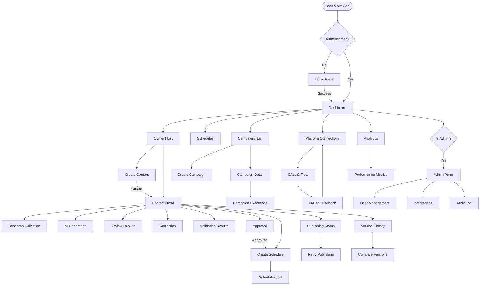
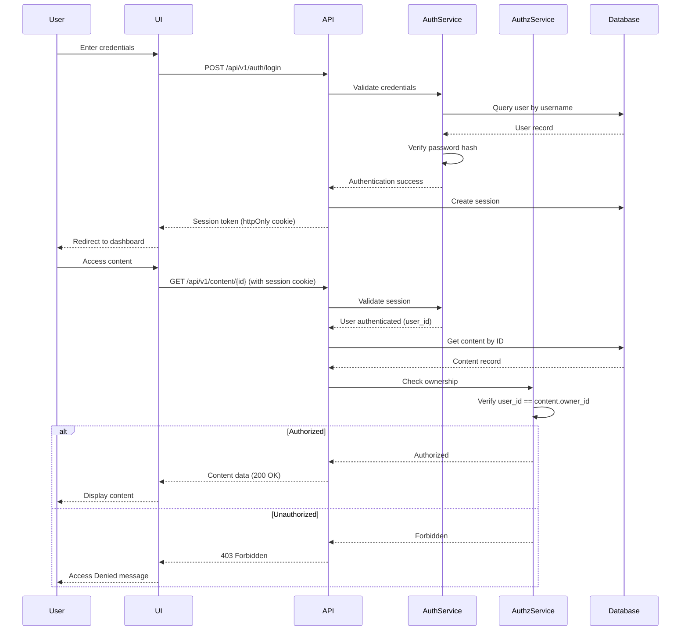
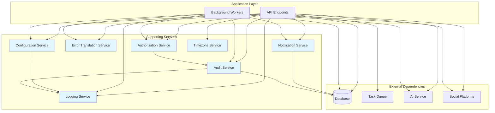
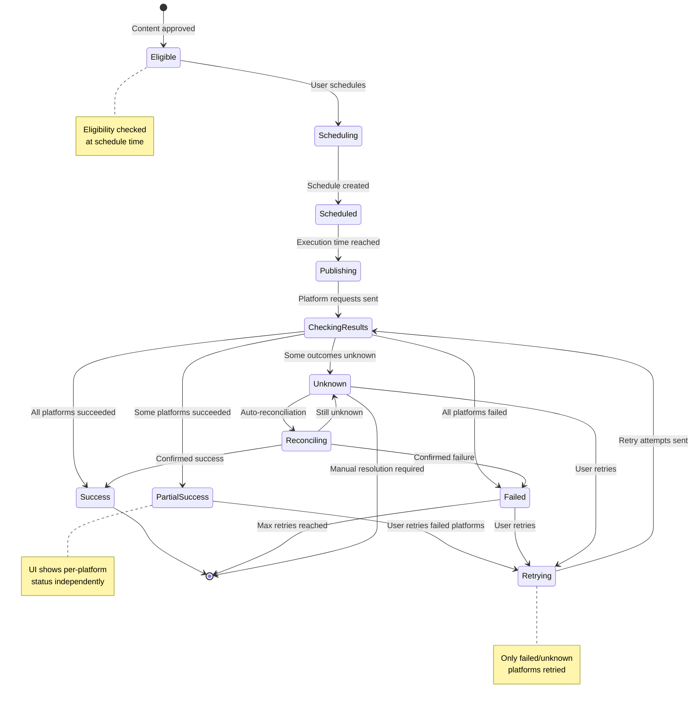

# Phase 3.5 — UI, Security & Supporting Services Design

**Document:** `3.5-ui-security-supporting-services-design.md`
**Project:** AI Content Automater
**Phase:** Phase 3 — System Design
**Date:** 2026-10-12
**Authoritative Requirements:** REQUIREMENTS.MD V2.0
**Design Basis:** System Analysis 2.1-2.10, Phase 3.1-3.4

---

## Document Status and Dependencies

**Design Readiness:** ✅ READY (Phases 3.1-3.4 complete)

**Unresolved Decisions Affecting This Design:**
- **UD-001:** Social media platforms for V1 (affects platform connection UI)
- **UD-002:** AI service/model selection (affects AI provider configuration UI)
- **UD-003:** Approval workflow (single vs multi-stage) (affects approval UI)
- **UD-007:** Multi-tenancy architecture (affects user isolation and admin controls)
- **UD-008:** Notification channels (email/SMS/push) (affects notification delivery UI)

**Phase 3.5 Coverage:**
This document specifies:
1. User interface structure and navigation
2. User workflows and interaction patterns
3. Content editing with version awareness
4. Scheduling and publishing interfaces
5. UI-to-API integration contracts
6. Authentication and session security
7. Authorization and data isolation enforcement
8. Application and integration security controls
9. Supporting services and shared capabilities
10. Notifications and user feedback
11. Error handling and recovery UX
12. Accessibility and usability standards
13. Audit visibility and data protection
14. Requirements traceability

**What This Document Is NOT:**
- NOT frontend implementation code
- NOT backend implementation code
- NOT visual design mockups or pixel-perfect layouts
- NOT CSS/styling specifications
- NOT JavaScript framework selection

---

## 1. UI ARCHITECTURE AND NAVIGATION

### 1.1 UI Architecture Overview

**Architectural Style:** Single-Page Application (SPA) with Server-Side Backend

**Rationale:**
- Modern user expectations for responsive interactions
- Supports async background operations (AI, publishing)
- Enables real-time status updates without page refresh
- Simplifies content versioning and state management in UI
- Aligns with RESTful API design from Phase 3.2

**Technology Constraints:**
- Backend: Django (established by Phase 3.1)
- API: RESTful JSON (established by Phase 3.2)
- Frontend: Modern JavaScript framework (React/Vue/Svelte - to be selected)
- Browser Support: Modern evergreen browsers (Chrome, Firefox, Safari, Edge)

**UI Boundaries:**
```
┌────────────────────────────────────────────────────────┐
│                  Browser (Untrusted)                   │
│  ┌──────────────────────────────────────────────────┐ │
│  │         Frontend Application (SPA)                │ │
│  │  - Authentication UI                              │ │
│  │  - Content Management                             │ │
│  │  - Scheduling & Campaigns                         │ │
│  │  - Publishing Status                              │ │
│  │  - Platform Connections                           │ │
│  │  - Analytics & History                            │ │
│  └──────────────────────────────────────────────────┘ │
└────────────────────────────────────────────────────────┘
                         ↕ HTTPS/JSON
┌────────────────────────────────────────────────────────┐
│              Backend Application (Trusted)             │
│  ┌──────────────────────────────────────────────────┐ │
│  │         Django REST API (Phase 3.2)               │ │
│  │  - Authentication & Authorization                 │ │
│  │  - Business Logic (Phase 3.3, 3.4)               │ │
│  │  - Database Access (Phase 3.2)                   │ │
│  │  - Background Task Dispatch (Phase 3.4)          │ │
│  └──────────────────────────────────────────────────┘ │
└────────────────────────────────────────────────────────┘
```

**Security Boundary:**
- **All authorization enforced server-side** (BR-001, Section 8)
- UI client-side validation is UX enhancement only
- UI route protection supplementary to backend enforcement
- Sensitive operations require server validation regardless of UI state

### 1.2 Main Application Areas

Based on use cases (2.3) and functional requirements (FR-001 through FR-028):

#### Area 1: Authentication & Account
**Pages:**
- `/login` - User login (UC-001)
- `/logout` - User logout
- `/account` - Account settings (password, profile)

**Authorization:** Public (login), Authenticated (account)

#### Area 2: Content Dashboard
**Pages:**
- `/` or `/dashboard` - Content overview, recent items
- `/content` - Content list (all states)
- `/content/new` - Create new content (UC-004)
- `/content/{id}` - Content detail/edit (UC-005)
- `/content/{id}/history` - Version history

**Authorization:** Authenticated user, owner only (BR-001)

#### Area 3: Content Workflow
**Pages:**
- `/content/{id}/research` - Research collection (UC-006)
- `/content/{id}/generation` - AI generation status (UC-007)
- `/content/{id}/reviews` - AI review results (UC-008, UC-010)
- `/content/{id}/correction` - Correction interface (UC-009)
- `/content/{id}/validation` - Final validation results (UC-012)
- `/content/{id}/approval` - Approval interface (UC-013)

**Authorization:** Authenticated user, owner only

#### Area 4: Scheduling & Campaigns
**Pages:**
- `/schedules` - Scheduled content list
- `/schedules/new` - Create schedule (UC-014)
- `/schedules/{id}` - Schedule detail/edit
- `/campaigns` - Campaign list
- `/campaigns/new` - Create campaign (UC-015)
- `/campaigns/{id}` - Campaign detail/edit
- `/campaigns/{id}/executions` - Campaign execution history

**Authorization:** Authenticated user, owner only

#### Area 5: Publishing
**Pages:**
- `/content/{id}/publishing` - Publishing status and per-platform results (UC-019, UC-020)
- `/publishing/history` - Publishing history across all content (UC-027)

**Authorization:** Authenticated user, owner only

#### Area 6: Platform Connections
**Pages:**
- `/connections` - Connected social accounts (UC-017, UC-018)
- `/connections/{platform}/authorize` - OAuth2 initiation
- `/connections/{platform}/callback` - OAuth2 callback handler

**Authorization:** Authenticated user

#### Area 7: Analytics & History
**Pages:**
- `/analytics` - Content performance analytics (UC-026)
- `/history` - Audit log (user's own actions) (UC-027)

**Authorization:** Authenticated user, owner only

#### Area 8: Administration
**Pages:**
- `/admin` - Admin dashboard
- `/admin/users` - User management
- `/admin/integrations` - System integration configuration (UC-029)
- `/admin/audit` - Security audit log (UC-028)

**Authorization:** Administrator only

### 1.3 Navigation Structure

**Primary Navigation (Authenticated Users):**
```
┌─────────────────────────────────────────────────────┐
│  Logo  [Content] [Schedules] [Campaigns]           │
│        [Connections] [Analytics]  [Account ▼]      │
└─────────────────────────────────────────────────────┘
         └─ Dropdown: Account Settings, Admin (if applicable), Logout
```

**Content Detail Navigation (Tabs):**
```
Content Detail Page:
[Overview] [Research] [Reviews] [Validation] [Approval]
[Scheduling] [Publishing] [History]
```

**Navigation Rules:**
- Unauthenticated: Only `/login` accessible, all other routes redirect to login
- Authenticated: All user areas accessible
- Administrator: Additional `/admin` area visible
- Owner-only: Content/schedule/campaign detail pages check ownership server-side

**Breadcrumbs (Where Applicable):**
```
Dashboard > Content > "Blog Post Title" > Reviews > Review #1
```

### 1.4 UI State Management Principles

**Server as Source of Truth:**
- Backend database is authoritative for all business state
- UI state is derived from API responses
- UI does NOT maintain parallel business logic
- Publishing status fetched from backend, not inferred from button clicks

**Version Awareness:**
- UI always displays current content version ID
- Review/validation/approval results show associated version ID
- Stale results clearly marked if content version changed
- User warned before material edits that invalidate approval

**Async Operation Handling:**
- Long-running operations (AI, publishing) return 202 Accepted
- UI polls status endpoint or uses websocket/SSE for updates
- User can navigate away during async operations
- Status visible in notifications or dedicated status views

**Error State Preservation:**
- Validation errors preserved until user corrects input
- Network errors allow retry without losing form data
- Partial form completion saved to browser storage (optional enhancement)

---

## 2. USER WORKFLOWS AND INTERACTION STATES

### 2.1 Authentication Flow (UC-001)

**Workflow: User Login**

**Starting Conditions:**
- User not authenticated
- User has valid account credentials

**Steps:**
1. User navigates to `/login`
2. User enters username/email and password
3. User clicks "Login"
4. **Client-side:** Basic validation (fields not empty)
5. **API Call:** `POST /api/v1/auth/login`
6. **Success:** Backend returns session token
7. **Client-side:** Store token securely (httpOnly cookie preferred)
8. **Redirect:** Navigate to `/dashboard`
9. **Display:** User's content dashboard

**API Request:**
```json
POST /api/v1/auth/login
{
  "username": "user@example.com",
  "password": "••••••••"
}
```

**API Success Response (200 OK):**
```json
{
  "data": {
    "user_id": "user-uuid",
    "username": "user@example.com",
    "is_admin": false,
    "session_expires_at": "2026-10-13T18:00:00Z"
  }
}
```

**API Failure Response (401 Unauthorized):**
```json
{
  "error": {
    "code": "authentication_failed",
    "message": "Invalid credentials",
    "details": []
  }
}
```

**UI States:**
- **Idle:** Login form displayed, submit button enabled
- **Submitting:** Submit button disabled, loading indicator shown
- **Error:** Error message displayed, form remains filled, user can retry
- **Success:** Brief success message, redirect to dashboard

**Validation Failures:**
- Empty username: "Username is required" (client-side)
- Empty password: "Password is required" (client-side)
- Invalid credentials: "Invalid username or password" (server response)
- Account locked: "Account is locked. Contact support." (server response)

**Recovery:**
- User can correct credentials and retry
- No password reset flow specified in requirements (out of scope for V1)

### 2.2 Content Creation Flow (UC-004)

**Workflow: Create New Content**

**Starting Conditions:**
- User authenticated
- User navigates to `/content/new`

**Steps:**
1. User clicks "New Content" from dashboard
2. **Display:** Content creation form (title, topic, optional body)
3. User fills title and topic (required)
4. User optionally fills initial body text
5. User clicks "Create"
6. **Client-side:** Validate required fields
7. **API Call:** `POST /api/v1/content`
8. **Success:** Backend creates Content record (state=draft)
9. **Redirect:** Navigate to `/content/{id}` (content detail page)
10. **Display:** Content detail with state=draft, research/generation options visible

**API Request:**
```json
POST /api/v1/content
{
  "title": "10 SEO Tips for 2026",
  "topic": "SEO best practices",
  "body": ""  // Optional initial content
}
```

**API Success Response (201 Created):**
```json
{
  "data": {
    "content_id": "content-uuid",
    "owner_id": "user-uuid",
    "title": "10 SEO Tips for 2026",
    "topic": "SEO best practices",
    "body": "",
    "state": "draft",
    "current_version_id": "version-uuid",
    "created_at": "2026-10-12T10:00:00Z",
    "updated_at": "2026-10-12T10:00:00Z"
  }
}
```

**UI States:**
- **Idle:** Form displayed, submit enabled
- **Submitting:** Submit disabled, loading indicator
- **Error:** Validation errors displayed inline, form editable
- **Success:** Brief success message, redirect to content detail

**Validation:**
- Title required, max 200 chars (client + server)
- Topic required, max 500 chars (client + server)
- Body optional, max 5000 chars (server validates if provided)

### 2.3 AI Workflow (Generation → Review → Correction)

**Workflow: Complete AI Content Pipeline**

**Starting Conditions:**
- Content in draft state
- User is content owner
- User on content detail page `/content/{id}`

**Steps:**

**Phase 1: Research (Optional, UC-006)**
1. User clicks "Collect Research"
2. **API Call:** `POST /api/v1/content/{id}/research`
3. **Response:** 202 Accepted, research initiated
4. **UI:** Shows "Research in progress..." status
5. **Poll:** `GET /api/v1/content/{id}/research/{research_id}`
6. **Complete:** Research results displayed, state → researched

**Phase 2: Generation (UC-007)**
7. User clicks "Generate Content"
8. **API Call:** `POST /api/v1/content/{id}/generate`
9. **Response:** 202 Accepted, generation initiated
10. **UI:** Shows "Generating content..." status
11. **Poll:** `GET /api/v1/content/{id}`
12. **Complete:** Content body populated, state → generated

**Phase 3: Review #1 (UC-008)**
13. **Auto-triggered:** Backend automatically initiates Review #1
14. **Poll:** `GET /api/v1/content/{id}/reviews/{review_id}`
15. **Complete:** Review results displayed
    - **If passed:** State → validated, skip to Phase 5
    - **If needs_correction:** Display feedback, proceed to Phase 4

**Phase 4: Correction (UC-009)**
16. User views AI feedback on `/content/{id}/reviews` page
17. User clicks "Correct Content" or edits manually
18. **If AI correction:** `POST /api/v1/content/{id}/correct`
19. **If manual edit:** User edits body directly, `PUT /api/v1/content/{id}`
20. **Result:** New content version created, state → corrected

**Phase 5: Review #2 (UC-010)**
21. **Auto-triggered:** Backend initiates Review #2 after correction
22. **Poll:** `GET /api/v1/content/{id}/reviews/{review_id}`
23. **Complete:** Review results displayed
    - **If passed:** State → validated
    - **If needs_correction AND revision_count < MAX:** Return to Phase 4
    - **If revision_count >= MAX:** State → revision_limit_reached, manual intervention required

**UI Components Per Phase:**

**Research Status Card:**
```
┌────────────────────────────────────┐
│ Research Collection                │
│                                    │
│ Status: In Progress                │
│ Started: 10:00 AM                  │
│ [View Research Data]   [Cancel]    │
└────────────────────────────────────┘
```

**Generation Status Card:**
```
┌────────────────────────────────────┐
│ AI Content Generation              │
│                                    │
│ Status: Generating...              │
│ Started: 10:05 AM                  │
│ [View Content]                     │
└────────────────────────────────────┘
```

**Review Results Card:**
```
┌────────────────────────────────────┐
│ AI Review #1 Results               │
│                                    │
│ Outcome: Needs Correction          │
│ Version: v2                        │
│ Completed: 10:10 AM                │
│                                    │
│ Feedback:                          │
│ "Title should be more engaging.    │
│  Body needs better structure."     │
│                                    │
│ [Correct with AI] [Edit Manually]  │
└────────────────────────────────────┘
```

**Version Warning (After Material Edit):**
```
┌────────────────────────────────────┐
│ ⚠️  Approval No Longer Valid        │
│                                    │
│ This content was edited after      │
│ approval. You must re-submit for   │
│ validation and approval.           │
│                                    │
│ Approved Version: v3               │
│ Current Version: v4                │
└────────────────────────────────────┘
```

### 2.4 Approval Flow (UC-013)

**Workflow: Approve Content for Publishing**

**Starting Conditions:**
- Content state = validated (passed final validation)
- User is content owner
- User on content detail page

**Steps:**
1. **Display:** "Approve for Publishing" button visible
2. **Version Check:** UI displays current version ID (e.g., "v3")
3. User clicks "Approve for Publishing"
4. **Confirmation Dialog:** "Approve v3 for publishing?"
5. User confirms
6. **API Call:** `POST /api/v1/content/{id}/approve`
7. **Response:** Approval record created
8. **UI Update:** State → approved, approval badge displayed
9. **Enable:** Publishing options now available (Schedule, Publish Now)

**API Request:**
```json
POST /api/v1/content/{content_id}/approve
{
  "content_version_id": "version-uuid"
}
```

**API Success (201 Created):**
```json
{
  "data": {
    "approval_id": "approval-uuid",
    "content_id": "content-uuid",
    "content_version_id": "version-uuid",
    "approved_by": "user-uuid",
    "approved_at": "2026-10-12T11:00:00Z"
  }
}
```

**UI States After Approval:**
- Green "Approved" badge visible
- Publishing options enabled
- Warning if user attempts material edit: "This will invalidate approval"

**Stale Approval Detection:**
- If `content.current_version_id != approval.content_version_id`:
  - Display "⚠️ Approval out of date" warning
  - Publishing blocked
  - Require new validation + approval

---

## 3. CONTENT EDITOR AND VERSION-AWARE UI

### 3.1 Version Display and Tracking

**Version Identification:**
- Every content detail page displays current version: "Version 3"
- Version ID (UUID) shown in metadata section
- Version history link: "View 5 previous versions"

**Version Indicator Component:**
```
┌────────────────────────────────────────────┐
│ Content: "10 SEO Tips for 2026"            │
│ State: Approved ✓  Version: 3  ID: abc123 │
│ Last Updated: Oct 12, 2026 10:30 AM       │
└────────────────────────────────────────────┘
```

### 3.2 Review Findings Display

**Review Results Associated with Correct Version:**

Each review result card MUST show:
- Review stage (Review #1, Review #2)
- Associated content version ID
- Review outcome (passed, needs_correction, failed)
- Feedback text
- Timestamp

**Example:**
```
┌──────────────────────────────────────────────┐
│ AI Review #1                                 │
│ Version: v2  Outcome: Needs Correction       │
│ Completed: Oct 12, 10:15 AM                  │
│                                              │
│ Feedback:                                    │
│ • Title lacks engagement hook                │
│ • Introduction too abrupt                    │
│ • Missing clear call-to-action              │
│                                              │
│ Revision Count: 1 of 3                       │
│ [Apply AI Correction] [Edit Manually]        │
└──────────────────────────────────────────────┘
```

**Stale Review Warning:**
If current content version != review version:
```
┌──────────────────────────────────────────────┐
│ ℹ️  Review for Previous Version              │
│                                              │
│ This review was for version v2.              │
│ Current version is v3.                       │
│ Review results may no longer apply.          │
└──────────────────────────────────────────────┘
```

### 3.3 Correction and Revision History

**Correction Interface:**

**Option 1: AI Correction**
- Button: "Correct with AI"
- Action: `POST /api/v1/content/{id}/correct`
- Result: New version created automatically
- UI: Shows "Correction in progress..."

**Option 2: Manual Edit**
- User edits body field directly
- Button: "Save Changes"
- Action: `PUT /api/v1/content/{id}`
- Result: New version created
- **Warning:** "This will create version 4. Previous approval will be invalidated."

**Revision Counter Display:**
```
Revision Progress: ●●○ (2 of 3 corrections used)
```

**Revision Limit Reached:**
```
┌──────────────────────────────────────────────┐
│ ⚠️  Revision Limit Reached                   │
│                                              │
│ This content has reached the maximum         │
│ allowed AI corrections (3).                  │
│                                              │
│ You must manually edit and resubmit for      │
│ validation and approval.                     │
└──────────────────────────────────────────────┘
```

### 3.4 Validation Results Display

**Validation Status Card:**
```
┌──────────────────────────────────────────────┐
│ Final Validation                             │
│ Version: v3  Status: Passed ✓                │
│ Validated: Oct 12, 10:45 AM                  │
│                                              │
│ All checks passed:                           │
│ ✓ Content length (450 words)                 │
│ ✓ No prohibited keywords                     │
│ ✓ Required media attached                    │
│ ✓ Platform-specific requirements met         │
└──────────────────────────────────────────────┘
```

**Validation Failure:**
```
┌──────────────────────────────────────────────┐
│ Final Validation                             │
│ Version: v3  Status: Failed ✗                │
│ Validated: Oct 12, 10:45 AM                  │
│                                              │
│ Issues found:                                │
│ ✗ Content too short (250 words, min 300)    │
│ ✗ Missing required media                     │
│                                              │
│ Publishing blocked until issues resolved.    │
│ [Edit Content] [Add Media]                   │
└──────────────────────────────────────────────┘
```

### 3.5 Material Edit Warning

**Before Material Edit:**
When user clicks in body text area AND content is approved:
```
┌──────────────────────────────────────────────┐
│ ⚠️  Warning: Editing Will Invalidate Approval│
│                                              │
│ This content is currently approved (v3).     │
│ Material edits will:                         │
│ • Create a new version (v4)                  │
│ • Invalidate current approval                │
│ • Require re-validation and re-approval      │
│                                              │
│ Continue editing?                            │
│ [Cancel] [Continue]                          │
└──────────────────────────────────────────────┘
```

**After Edit (Approval Invalidated):**
- State changes from "approved" to appropriate workflow state
- Approval badge removed
- Publishing options disabled
- Message: "Approval invalidated. Re-submit for validation."

### 3.6 Concurrent Modification Detection

**Optimistic Locking Strategy:**
- Each `PUT /api/v1/content/{id}` includes `current_version_id` in request
- Server checks if `current_version_id` matches database
- If mismatch: 409 Conflict response

**Conflict Dialog:**
```
┌──────────────────────────────────────────────┐
│ ⚠️  Content Was Modified                     │
│                                              │
│ This content was changed while you were      │
│ editing.                                     │
│                                              │
│ Your changes:                                │
│ [Show diff]                                  │
│                                              │
│ [Discard My Changes] [Reload] [Force Save]  │
└──────────────────────────────────────────────┘
```

**Recommendation:** Reload and re-apply changes (safest)

### 3.7 State Visualization

**Content State Badge:**
- **draft** → Grey badge
- **researched** → Blue badge
- **generated** → Blue badge
- **reviewed_1** → Yellow badge "In Review"
- **corrected** → Yellow badge "Corrected"
- **reviewed_2** → Yellow badge "In Review"
- **validated** → Orange badge "Ready for Approval"
- **approved** → Green badge "Approved ✓"
- **scheduled** → Purple badge "Scheduled"
- **publishing** → Purple badge "Publishing..."
- **published** → Green badge "Published ✓"
- **revision_limit_reached** → Red badge "Needs Manual Review"

**State Progress Indicator:**
```
Draft → Research → Generate → Review #1 → Correct → Review #2 → Validate → Approve → Publish
  ●       ●          ●           ●          ●         ●           ●         ○        ○
```

*Current step highlighted, completed steps filled, future steps empty.*

---

## 4. SCHEDULING AND PUBLISHING UI

### 4.1 Schedule Creation Interface (UC-014)

**Page:** `/schedules/new` or `/content/{id}/schedule`

**Form Fields:**
```
┌────────────────────────────────────────────────┐
│ Schedule Content for Publishing                │
│                                                │
│ Content: [10 SEO Tips for 2026]  (read-only) │
│                                                │
│ Date: [Oct 15, 2026] 📅                       │
│ Time: [10:00] [AM] ⏰                          │
│ Timezone: [America/New_York ▼]                │
│                                                │
│ Publishing Timezone:                           │
│ • User Local: 10:00 AM EDT (UTC-4)            │
│ • Server UTC: 14:00 UTC                       │
│                                                │
│ Target Platforms:                              │
│ ☑ Twitter    ☑ LinkedIn    ☐ Facebook        │
│                                                │
│ [Cancel] [Schedule Publishing]                 │
└────────────────────────────────────────────────┘
```

**Validation Rules:**
- Date must be future (client + server)
- Time must be valid (00:00-23:59)
- Timezone must be valid IANA timezone
- At least one platform selected
- Content must be approved (server validates)

**Eligibility Check:**
Before schedule creation, UI calls:
```
GET /api/v1/content/{id}/publishing/eligibility
```

**Response:**
```json
{
  "data": {
    "eligible": true,
    "approved": true,
    "approval_version_matches": true,
    "platforms_connected": ["twitter", "linkedin"],
    "issues": []
  }
}
```

**If Ineligible:**
```
┌────────────────────────────────────────────────┐
│ ⚠️  Cannot Schedule                            │
│                                                │
│ This content cannot be scheduled:              │
│ • Not approved for publishing                  │
│ • Twitter connection expired                   │
│                                                │
│ [Fix Issues]                                   │
└────────────────────────────────────────────────┘
```

**API Call on Submit:**
```json
POST /api/v1/schedules
{
  "content_id": "content-uuid",
  "scheduled_time": "2026-10-15T14:00:00Z",
  "timezone": "America/New_York",
  "target_platforms": ["twitter", "linkedin"]
}
```

**Success Response (201 Created):**
```json
{
  "data": {
    "schedule_id": "schedule-uuid",
    "content_id": "content-uuid",
    "scheduled_time": "2026-10-15T14:00:00Z",
    "timezone": "America/New_York",
    "target_platforms": ["twitter", "linkedin"],
    "status": "pending",
    "created_at": "2026-10-12T18:00:00Z"
  }
}
```

**Post-Creation:**
- Redirect to `/schedules` or `/content/{id}/publishing`
- Show success notification: "Publishing scheduled for Oct 15, 10:00 AM EDT"
- Calendar/list view shows scheduled item

### 4.2 Timezone Display and Conversion

**Critical Requirement (Section 28):**
> Scheduled times shall be stored in UTC with associated timezone for display

**Display Pattern:**
```
Scheduled: Oct 15, 2026 at 10:00 AM EDT (14:00 UTC)
```

**Components:**
1. **Local Time:** User's selected timezone (EDT)
2. **UTC Time:** Server storage format
3. **Both Displayed:** Transparency for user verification

**Timezone Selector:**
- Dropdown with common timezones grouped by region
- Search/filter capability
- Display format: "America/New_York (Eastern Daylight Time, UTC-4)"
- Default to user's browser timezone

**Conversion Display:**
```
┌────────────────────────────────────────────────┐
│ Publishing Time Conversion                     │
│                                                │
│ Your Time:    Oct 15, 10:00 AM EDT           │
│ Server (UTC): Oct 15, 14:00 UTC              │
│ Tokyo:        Oct 15, 11:00 PM JST           │
│ London:       Oct 15, 3:00 PM BST            │
└────────────────────────────────────────────────┘
```

### 4.3 Publishing Status Dashboard (UC-019, UC-020)

**Page:** `/content/{id}/publishing` or `/publishing/history`

**Multi-Platform Status Display:**
```
┌────────────────────────────────────────────────────────────┐
│ Publishing Status: "10 SEO Tips for 2026"                  │
│ Job ID: pub-job-123  Initiated: Oct 15, 10:00 AM          │
│                                                            │
│ Overall Status: Partial Success (2/3 succeeded)           │
│                                                            │
│ ┌──────────────────────────────────────────────────────┐ │
│ │ ✓ Twitter         Success                            │ │
│ │   Post ID: tw-123456                                 │ │
│ │   URL: https://twitter.com/user/status/123456       │ │
│ │   Published: Oct 15, 10:00:15 AM                    │ │
│ │   [View Post ↗]                                      │ │
│ └──────────────────────────────────────────────────────┘ │
│                                                            │
│ ┌──────────────────────────────────────────────────────┐ │
│ │ ✓ LinkedIn        Success                            │ │
│ │   Post ID: li-789012                                 │ │
│ │   URL: https://linkedin.com/feed/update/789012      │ │
│ │   Published: Oct 15, 10:00:22 AM                    │ │
│ │   [View Post ↗]                                      │ │
│ └──────────────────────────────────────────────────────┘ │
│                                                            │
│ ┌──────────────────────────────────────────────────────┐ │
│ │ ✗ Facebook        Failed                             │ │
│ │   Error: Rate limit exceeded (API error code 613)    │ │
│ │   Attempted: Oct 15, 10:00:18 AM                    │ │
│ │   Retries: 2 of 3                                   │ │
│ │   [Retry Publishing]                                 │ │
│ └──────────────────────────────────────────────────────┘ │
│                                                            │
│ [Close]                                                    │
└────────────────────────────────────────────────────────────┘
```

**Status Indicators:**
- ✓ **Success:** Green, post ID and URL shown
- ✗ **Failed:** Red, error message and retry button shown
- ⏳ **Publishing:** Yellow, spinner animation
- ❓ **Unknown:** Grey, reconciliation status shown

**Unknown Status Display:**
```
┌──────────────────────────────────────────────────────┐
│ ❓ Instagram      Unknown                            │
│   Platform did not confirm success or failure        │
│   Last Attempt: Oct 15, 10:00:30 AM                 │
│   Reconciliation: Scheduled (next check in 5 min)   │
│   [Check Manually]                                   │
└──────────────────────────────────────────────────────┘
```

**API Polling Pattern:**
```javascript
// Poll publishing status every 5 seconds while status = 'publishing'
GET /api/v1/publishing/jobs/{job_id}
```

**Partial Success Messaging:**
```
⚠️ Publishing completed with issues
Published to 2 of 3 platforms. Facebook publishing failed.
```

### 4.4 Publishing Retry Interface (UC-021)

**Retry Button Availability:**
- Only shown for platforms with status = `failed` or `unknown`
- Disabled for platforms with status = `success` (immutable)
- Shows retry count: "Retry (2 of 3 used)"
- Disabled if max retries reached

**Retry Confirmation Dialog:**
```
┌────────────────────────────────────────────────┐
│ Retry Failed Publishing?                       │
│                                                │
│ Retry publishing to:                           │
│ • Facebook                                     │
│                                                │
│ Previous error:                                │
│ "Rate limit exceeded"                          │
│                                                │
│ Retries used: 2 of 3                           │
│                                                │
│ [Cancel] [Retry Now]                           │
└────────────────────────────────────────────────┘
```

**API Call:**
```json
POST /api/v1/publishing/jobs/{job_id}/retry
{
  "platforms": ["facebook"]
}
```

**Response (202 Accepted):**
```json
{
  "data": {
    "job_id": "pub-job-123",
    "retrying_platforms": ["facebook"],
    "new_attempt_ids": ["attempt-uuid-4"],
    "message": "Retry initiated"
  }
}
```

**Post-Retry:**
- Status changes to "Publishing..."
- UI polls for updated status
- Retry count increments
- New attempt visible in history

### 4.5 Campaign Management UI (UC-015, UC-016)

**Campaign List Page:** `/campaigns`

**Campaign Card:**
```
┌────────────────────────────────────────────────┐
│ Weekly SEO Tips                      [Enabled] │
│                                                │
│ Topic: SEO best practices                      │
│ Schedule: Every Monday at 10:00 AM EST        │
│ Platforms: Twitter, LinkedIn                   │
│                                                │
│ Last Execution: Oct 8, 2026                    │
│ Next Execution: Oct 15, 2026                   │
│ Total Posts: 12                                │
│                                                │
│ [Edit] [View History] [Disable]                │
└────────────────────────────────────────────────┘
```

**Campaign Creation Form:** `/campaigns/new`

```
┌────────────────────────────────────────────────┐
│ Create Recurring Campaign                      │
│                                                │
│ Name: [___________________________]           │
│                                                │
│ Topic/Theme: [_______________________]        │
│                                                │
│ Schedule Pattern:                              │
│ Frequency: [Weekly ▼]                         │
│ Day: [Monday ▼]                               │
│ Time: [10:00] [AM]                            │
│ Timezone: [America/New_York ▼]                │
│                                                │
│ Target Platforms:                              │
│ ☑ Twitter    ☑ LinkedIn    ☐ Facebook        │
│                                                │
│ ☐ Auto-approve generated content (DD-NEW-033) │
│   (if unchecked, manual approval required)     │
│                                                │
│ [Cancel] [Create Campaign]                     │
└────────────────────────────────────────────────┘
```

**Schedule Pattern Format (DD-NEW-013 - Unresolved):**
Current proposal: `"weekly:monday:10:00"` or JSON structure

**Campaign Execution History:**
```
┌────────────────────────────────────────────────┐
│ Campaign: Weekly SEO Tips - Execution History  │
│                                                │
│ Oct 8, 2026  ✓ Success  "5 Local SEO Tips"   │
│ Oct 1, 2026  ✓ Success  "Technical SEO Guide" │
│ Sep 24, 2026 ⚠️ Partial  "Link Building Tips" │
│ Sep 17, 2026 ✓ Success  "On-Page SEO"        │
│                                                │
│ [Load More]                                    │
└────────────────────────────────────────────────┘
```

**Enable/Disable Toggle:**
- Prominent toggle switch on campaign detail
- Confirmation required to disable active campaign
- Disabled campaigns show "Paused" badge

---

## 5. UI-TO-API INTEGRATION

### 5.1 API Communication Patterns

**Base Configuration:**
```javascript
const API_BASE_URL = process.env.REACT_APP_API_URL || '/api/v1';
const API_TIMEOUT = 30000; // 30 seconds

const apiClient = axios.create({
  baseURL: API_BASE_URL,
  timeout: API_TIMEOUT,
  headers: {
    'Content-Type': 'application/json',
  },
  withCredentials: true, // Include session cookies
});
```

**Request Authentication:**
- **Session-based:** HttpOnly cookies sent automatically
- **Token-based (if used):** Authorization header with Bearer token
- CSRF token included in state-changing requests (POST/PUT/DELETE)

**CSRF Protection:**
```javascript
// Django CSRF token from cookie
const csrfToken = document.cookie
  .split('; ')
  .find(row => row.startsWith('csrftoken='))
  ?.split('=')[1];

apiClient.defaults.headers.common['X-CSRFToken'] = csrfToken;
```

### 5.2 Loading States and Duplicate Prevention

**Loading State Management:**
```javascript
// Component state
const [isLoading, setIsLoading] = useState(false);
const [error, setError] = useState(null);

const handleSubmit = async () => {
  if (isLoading) return; // Prevent duplicate submission

  setIsLoading(true);
  setError(null);

  try {
    const response = await apiClient.post('/content', data);
    // Handle success
  } catch (err) {
    setError(err.response?.data?.error || 'Operation failed');
  } finally {
    setIsLoading(false);
  }
};
```

**UI During Loading:**
- Submit button disabled
- Loading spinner visible
- Form fields optionally disabled
- User cannot navigate away without warning

**Idempotency:**
- Backend ensures POST operations are idempotent where possible
- Client includes idempotency key for critical operations (optional enhancement)
- Retry uses same idempotency key

### 5.3 Error Response Handling

**Error Response Format (from Phase 3.2):**
```json
{
  "error": {
    "code": "validation_failed",
    "message": "Validation errors occurred",
    "details": [
      {
        "field": "title",
        "issue": "Title is required"
      }
    ]
  }
}
```

**Client-Side Error Handler:**
```javascript
const handleApiError = (error) => {
  if (!error.response) {
    // Network error
    return {
      title: 'Network Error',
      message: 'Unable to connect. Please check your connection.',
      type: 'network'
    };
  }

  const status = error.response.status;
  const errorData = error.response.data?.error;

  switch (status) {
    case 400:
      return {
        title: 'Invalid Request',
        message: errorData?.message || 'Request validation failed',
        details: errorData?.details,
        type: 'validation'
      };

    case 401:
      return {
        title: 'Authentication Required',
        message: 'Please log in to continue',
        type: 'auth',
        action: 'redirect_login'
      };

    case 403:
      return {
        title: 'Access Denied',
        message: 'You do not have permission for this action',
        type: 'authorization'
      };

    case 404:
      return {
        title: 'Not Found',
        message: errorData?.message || 'Resource not found',
        type: 'not_found'
      };

    case 409:
      return {
        title: 'Conflict',
        message: errorData?.message || 'Resource was modified',
        type: 'conflict',
        action: 'reload'
      };

    case 422:
      return {
        title: 'Validation Failed',
        message: errorData?.message,
        details: errorData?.details,
        type: 'validation'
      };

    case 500:
    case 502:
    case 503:
      return {
        title: 'Server Error',
        message: 'An error occurred. Please try again.',
        type: 'server'
      };

    default:
      return {
        title: 'Error',
        message: errorData?.message || 'An unexpected error occurred',
        type: 'unknown'
      };
  }
};
```

**Error Display Component:**
```jsx
<ErrorAlert error={error}>
  <strong>{error.title}</strong>
  <p>{error.message}</p>
  {error.details && (
    <ul>
      {error.details.map(d => (
        <li key={d.field}>{d.field}: {d.issue}</li>
      ))}
    </ul>
  )}
  {error.action === 'reload' && (
    <button onClick={handleReload}>Reload Page</button>
  )}
</ErrorAlert>
```

### 5.4 Version Conflict Handling (409 Conflict)

**Scenario:** User A and User B both edit content simultaneously

**Detection:**
```javascript
PUT /api/v1/content/{id}
{
  "current_version_id": "version-uuid-old",
  "body": "Updated content..."
}
```

**Response (409 Conflict):**
```json
{
  "error": {
    "code": "version_conflict",
    "message": "Content was modified by another user",
    "details": {
      "expected_version": "version-uuid-old",
      "current_version": "version-uuid-new",
      "modified_by": "user-b-uuid",
      "modified_at": "2026-10-12T18:30:00Z"
    }
  }
}
```

**UI Response:**
```
┌────────────────────────────────────────────────┐
│ ⚠️  Content Was Modified                       │
│                                                │
│ This content was changed by another user       │
│ while you were editing.                        │
│                                                │
│ Modified by: User B                            │
│ Modified at: 6:30 PM                           │
│                                                │
│ Your changes:                                  │
│ [Show My Changes]                              │
│                                                │
│ Current content:                               │
│ [Show Current Version]                         │
│                                                │
│ [Discard My Changes] [Reload] [Merge]         │
└────────────────────────────────────────────────┘
```

**Recommended Action:** Reload and manually re-apply changes

### 5.5 Long-Running Operation Polling

**Pattern for Async Operations (202 Accepted):**

**Initial Request:**
```javascript
POST /api/v1/content/{id}/generate
→ 202 Accepted
{
  "data": {
    "operation_id": "op-uuid",
    "status": "in_progress",
    "status_url": "/api/v1/content/{id}/operations/op-uuid"
  }
}
```

**Polling Loop:**
```javascript
const pollOperationStatus = async (statusUrl, maxAttempts = 120) => {
  let attempts = 0;

  const poll = async () => {
    if (attempts >= maxAttempts) {
      throw new Error('Operation timeout');
    }

    const response = await apiClient.get(statusUrl);
    const { status } = response.data.data;

    if (status === 'completed') {
      return response.data.data;
    }

    if (status === 'failed') {
      throw new Error(response.data.data.error || 'Operation failed');
    }

    // Still in progress, wait and poll again
    attempts++;
    await new Promise(resolve => setTimeout(resolve, 5000)); // 5 second interval
    return poll();
  };

  return poll();
};
```

**User Experience:**
- Show progress indicator
- Display status messages: "Generating content... (30 seconds elapsed)"
- Allow user to navigate away (operation continues in background)
- Notification when complete

**Background Completion Notification:**
If user navigates away, notify when operation completes via:
- Browser notification (if permission granted)
- In-app notification badge
- Status visible on return to page

### 5.6 Pagination Handling

**List API Response Format:**
```json
{
  "data": [...],
  "pagination": {
    "total": 127,
    "page": 1,
    "per_page": 20,
    "total_pages": 7,
    "has_next": true,
    "has_prev": false,
    "next_url": "/api/v1/content?page=2&per_page=20",
    "prev_url": null
  }
}
```

**UI Pagination Controls:**
```
┌────────────────────────────────────────────────┐
│ Showing 1-20 of 127 items                      │
│                                                │
│ [← Previous] [1] [2] [3] ... [7] [Next →]    │
└────────────────────────────────────────────────┘
```

**Infinite Scroll (Alternative):**
```javascript
const handleScroll = () => {
  if (hasMore && !isLoading && nearBottom()) {
    loadMore();
  }
};
```

---

## 6. AUTHENTICATION AND SESSION SECURITY

### 6.1 Authentication Flow

**Login Process (UC-001):**

1. **User visits protected route:** `/content`
2. **Auth check:** Client checks for valid session
3. **Not authenticated:** Redirect to `/login`
4. **User enters credentials**
5. **Client submits:** `POST /api/v1/auth/login`
6. **Server validates:** Username/password against database
7. **Success:** Server creates session, returns session identifier
8. **Client stores:** Session token in httpOnly cookie (preferred) or localStorage
9. **Redirect:** To originally requested route or `/dashboard`

**Session Storage Options:**

**Option 1: HttpOnly Cookie (Recommended):**
```
Set-Cookie: sessionid=abc123; HttpOnly; Secure; SameSite=Strict; Path=/; Max-Age=86400
```

**Advantages:**
- Not accessible via JavaScript (XSS protection)
- Automatically included in requests
- SameSite protection against CSRF

**Option 2: Token in localStorage:**
```javascript
localStorage.setItem('authToken', token);
// Include in Authorization header
headers: { 'Authorization': `Bearer ${token}` }
```

**Disadvantages:**
- Accessible via JavaScript (XSS vulnerable)
- Must manually include in requests
- Additional CSRF protection required

**Recommendation:** Use httpOnly cookies for session management

### 6.2 Session Validation and Renewal

**Per-Request Session Check:**
```javascript
// API interceptor
apiClient.interceptors.response.use(
  response => response,
  error => {
    if (error.response?.status === 401) {
      // Session expired or invalid
      store.dispatch(logout());
      router.push('/login');
    }
    return Promise.reject(error);
  }
);
```

**Session Expiry Handling:**
```
┌────────────────────────────────────────────────┐
│ ⏱️  Session Expiring Soon                      │
│                                                │
│ Your session will expire in 5 minutes.         │
│                                                │
│ [Stay Logged In] [Logout]                      │
└────────────────────────────────────────────────┘
```

**Auto-renewal (Optional):**
- Periodic ping to `/api/v1/auth/refresh` extends session
- Triggered by user activity
- Silent renewal before expiry

### 6.3 Logout Process

**User-Initiated Logout:**
1. User clicks "Logout"
2. **API Call:** `POST /api/v1/auth/logout`
3. **Server:** Invalidates session in database
4. **Client:** Clears stored session token/cookie
5. **Client:** Clears any cached user data
6. **Redirect:** To `/login`

**Logout API:**
```javascript
POST /api/v1/auth/logout
→ 204 No Content

// Clear client-side state
localStorage.clear();
sessionStorage.clear();
// Cookie cleared by server Set-Cookie with Max-Age=0
```

### 6.4 Password Security

**Password Input:**
- Type="password" (masked)
- No autocomplete for login password (optional)
- Paste allowed (don't block legitimate use)

**Client-Side Validation:**
- Minimum length check (display only, not security)
- Real validation on server

**Transmission Security:**
- ALWAYS over HTTPS
- Never logged or displayed
- Never sent in URL parameters

**Server-Side Requirements (from Section 7):**
- Django's secure password storage (PBKDF2/Argon2)
- No plaintext storage
- Password reset requires email verification (if implemented)

### 6.5 CSRF Protection

**Django CSRF Token:**
```html
<form method="post">
  
  <input type="text" name="username">
  <input type="password" name="password">
  <button type="submit">Login</button>
</form>
```

**AJAX/SPA CSRF Protection:**
```javascript
// Get CSRF token from cookie
const getCsrfToken = () => {
  const name = 'csrftoken';
  const cookies = document.cookie.split(';');
  for (let cookie of cookies) {
    const [key, value] = cookie.trim().split('=');
    if (key === name) return value;
  }
  return null;
};

// Include in request headers
apiClient.defaults.headers.common['X-CSRFToken'] = getCsrfToken();
```

**CSRF Token Refresh:**
- Token rotated on login
- Token validated on state-changing operations (POST/PUT/DELETE)
- GET requests do NOT require CSRF token

### 6.6 Brute Force Protection

**Not Specified in Requirements:**
Brute force protection mechanisms (rate limiting, account lockout) are NOT explicitly required by REQUIREMENTS.MD.

**Recommendation for Design Decision:**
- **Rate limiting:** Limit login attempts per IP (e.g., 5 attempts per 5 minutes)
- **Account lockout:** Temporary lock after N failed attempts
- **CAPTCHA:** After multiple failures (optional)

**UI Experience:**
```
┌────────────────────────────────────────────────┐
│ ⚠️  Too Many Failed Attempts                   │
│                                                │
│ Please wait 5 minutes before trying again.     │
│                                                │
│ [Back to Login]                                │
└────────────────────────────────────────────────┘
```

**Decision Required:** Rate limiting threshold and lockout duration

### 6.7 Multi-Factor Authentication (MFA)

**Status:** NOT required by REQUIREMENTS.MD V2.0

**Future Consideration:**
- TOTP (Time-based One-Time Password)
- SMS codes
- Authenticator apps

**Out of Scope for V1**

---

## 7. AUTHORIZATION, OWNERSHIP, AND DATA ISOLATION

### 7.1 Authorization Enforcement Architecture

**Critical Principle (Section 8, BR-001, INV-002):**
> Authorization MUST be enforced server-side. Hiding UI controls is NOT authorization.

**Enforcement Points:**
```
┌─────────────────────────────────────────────────┐
│              Client (Untrusted)                 │
│  ┌───────────────────────────────────────────┐ │
│  │  UI Authorization (UX Enhancement Only)   │ │
│  │  - Hide inaccessible buttons/menus        │ │
│  │  - Disable unauthorized actions            │ │
│  │  - Display appropriate error messages      │ │
│  └───────────────────────────────────────────┘ │
└─────────────────────────────────────────────────┘
                     ↓ API Request
┌─────────────────────────────────────────────────┐
│              Server (Trusted)                   │
│  ┌───────────────────────────────────────────┐ │
│  │  Authorization Check (MANDATORY)          │ │
│  │  1. Authenticate request                  │ │
│  │  2. Identify resource owner               │ │
│  │  3. Check user authorization              │ │
│  │  4. Permit or deny access                 │ │
│  │  5. Audit authorization decision          │ │
│  └───────────────────────────────────────────┘ │
└─────────────────────────────────────────────────┘
```

**Example - Content Access:**
```javascript
// ❌ WRONG: UI-only check
if (currentUser.id === content.owner_id) {
  showEditButton();
}

// ✅ CORRECT: UI check + server enforcement
if (currentUser.id === content.owner_id) {
  showEditButton(); // UX enhancement
}

// Server ALWAYS checks on API request:
PUT /api/v1/content/{id}
→ Server validates: request.user.id === content.owner_id
→ 403 Forbidden if unauthorized
```

### 7.2 Ownership Model (BR-001, Section 9)

**Owner-Based Resources:**
Every user-owned resource has explicit `owner_id`:

- Content → `owner_id`
- Schedule → `owner_id`
- Campaign → `owner_id`
- PlatformConnection → `owner_id`
- PublishingJob → `content.owner_id` (transitive)
- Notification → `user_id`

**Ownership Check Pattern:**
```python
# Pseudocode - Server-side authorization
def authorize_content_access(request, content_id):
    content = Content.get(content_id)

    if not content:
        raise NotFound()

    if content.owner_id != request.user.id:
        raise Forbidden("You do not own this content")

    return content
```

**UI Ownership Indicators:**
```
┌────────────────────────────────────────────────┐
│ Content: "10 SEO Tips"                         │
│ Owner: You        Created: Oct 12, 2026       │
│                                                │
│ [Edit] [Delete] [Schedule]                     │
└────────────────────────────────────────────────┘
```

### 7.3 Insecure Direct Object Reference (IDOR) Prevention

**Threat (Section 9):**
> Changing identifier/URL/parameter shall not allow access to another user's resources

**Example Attack:**
```
User A views their content:
GET /api/v1/content/content-a-uuid → 200 OK

User A changes UUID to User B's content:
GET /api/v1/content/content-b-uuid → 403 Forbidden (CORRECT)
```

**Server-Side Prevention:**
```python
# EVERY resource access checks ownership
def get_content(request, content_id):
    content = Content.get(content_id)

    # MANDATORY ownership check
    if content.owner_id != request.user.id and not request.user.is_admin:
        raise Forbidden()

    return content
```

**UI Protection:**
- Content list only shows user's own content
- Direct URL access checked server-side
- 403 error if unauthorized access attempted

### 7.4 Role-Based Access Control (RBAC)

**User Roles (Section 6.1-6.2):**

**Regular User:**
- Create/edit/delete own content
- Create/manage own schedules and campaigns
- Connect own social accounts
- View own analytics and history
- Approve own content

**Administrator:**
- All user capabilities
- Manage users (create, deactivate)
- Configure system integrations
- View audit logs (all users)
- System configuration access

**Administrator Restrictions:**
- Administrators do NOT automatically approve others' content
- Admin access is deliberate and auditable (Section 9)
- Admin operations logged in audit trail

**UI Role Display:**
```
User Menu:
┌────────────────────────────┐
│ user@example.com           │
│ Role: User                 │
│                            │
│ [Account Settings]         │
│ [Logout]                   │
└────────────────────────────┘

Admin Menu:
┌────────────────────────────┐
│ admin@example.com          │
│ Role: Administrator        │
│                            │
│ [Account Settings]         │
│ [Admin Panel]    ← Extra   │
│ [Logout]                   │
└────────────────────────────┘
```

### 7.5 Background Task Authorization (Section 9)

**Critical Requirement:**
> Background tasks preserve ownership context

**Problem:**
Scheduled task executes outside user session. How to enforce authorization?

**Solution:**
Background tasks store and validate `owner_id`:

```python
# When scheduling task
schedule_publishing_task(
    content_id=content_id,
    owner_id=request.user.id,  # Captured at schedule time
    scheduled_time=scheduled_time
)

# When task executes
def execute_publishing_task(content_id, owner_id):
    content = Content.get(content_id)

    # Validate ownership still valid
    if content.owner_id != owner_id:
        raise AuthorizationError("Owner mismatch")

    # Proceed with publishing
    publish_to_platforms(content)
```

**UI Transparency:**
Scheduled actions show who scheduled them:
```
Schedule #123
Content: "10 SEO Tips"
Scheduled by: user@example.com
Scheduled for: Oct 15, 10:00 AM
```

### 7.6 Administrative Access Audit (UC-028)

**Requirement (Section 9):**
> Administrative access deliberate and auditable

**Admin Access to User Data:**
```python
def admin_view_user_content(admin_user, target_user_id):
    # Check admin authorization
    if not admin_user.is_admin:
        raise Forbidden()

    # Log administrative access
    audit_log(
        user=admin_user,
        event='admin_access_user_content',
        target_user=target_user_id,
        reason='Support investigation'
    )

    # Allow access
    return Content.filter(owner_id=target_user_id)
```

**UI Admin Context Indicator:**
```
┌────────────────────────────────────────────────┐
│ ⚠️  Administrator View                         │
│                                                │
│ You are viewing content owned by:              │
│ user@example.com (User ID: abc-123)           │
│                                                │
│ This access is logged.                         │
└────────────────────────────────────────────────┘
```

### 7.7 Authorization Failure Handling

**403 Forbidden Response:**
```json
{
  "error": {
    "code": "forbidden",
    "message": "You do not have permission to access this resource",
    "details": []
  }
}
```

**UI Display:**
```
┌────────────────────────────────────────────────┐
│ 🚫 Access Denied                               │
│                                                │
│ You do not have permission to view this        │
│ content.                                       │
│                                                │
│ [Back to Dashboard]                            │
└────────────────────────────────────────────────┘
```

**Security Considerations:**
- Don't reveal if resource exists (same 403 for nonexistent and unauthorized)
- Don't expose owner information
- Log unauthorized access attempts
- Rate limit authorization failures (prevent enumeration attacks)

---

## 8. APPLICATION AND INTEGRATION SECURITY

### 8.1 Cross-Site Scripting (XSS) Prevention

**Threat:** Malicious scripts injected via user input or AI-generated content

**Attack Vectors:**
- User-submitted content (title, body, topic)
- AI-generated content (untrusted output)
- Research data from external sources
- Error messages displaying user input

**Prevention Controls:**

**Output Encoding:**
```javascript
// Modern frameworks (React, Vue) auto-escape by default
<div>{content.title}</div>  // ✓ Safe - auto-escaped

// Dangerous pattern (avoid):
<div dangerouslySetInnerHTML={{__html: content.body}} />  // ✗ Unsafe
```

**Content Security Policy (CSP):**
```
Content-Security-Policy:
  default-src 'self';
  script-src 'self';
  style-src 'self' 'unsafe-inline';
  img-src 'self' https: data:;
  connect-src 'self' https://api.example.com;
  frame-ancestors 'none';
```

**Sanitization for Rich Content:**
If HTML content is required:
```javascript
import DOMPurify from 'dompurify';

const sanitizedContent = DOMPurify.sanitize(aiGeneratedContent, {
  ALLOWED_TAGS: ['p', 'br', 'strong', 'em', 'ul', 'ol', 'li'],
  ALLOWED_ATTR: []
});
```

**AI-Generated Content Handling:**
- Treat AI output as untrusted
- Sanitize before rendering
- Never execute AI-generated JavaScript
- Strip dangerous HTML tags

### 8.2 Cross-Site Request Forgery (CSRF) Protection

**Threat:** Unauthorized actions via forged requests from malicious sites

**Django CSRF Protection (Section 7):**

**Server-Side:**
- CSRF middleware enabled
- CSRF token required for POST/PUT/DELETE
- Token validated against session

**Client-Side:**
```javascript
// Get CSRF token from cookie
const csrftoken = document.cookie
  .split('; ')
  .find(row => row.startsWith('csrftoken='))
  ?.split('=')[1];

// Include in headers
fetch('/api/v1/content', {
  method: 'POST',
  headers: {
    'Content-Type': 'application/json',
    'X-CSRFToken': csrftoken
  },
  body: JSON.stringify(data)
});
```

**SameSite Cookie Attribute:**
```
Set-Cookie: sessionid=...; SameSite=Strict; HttpOnly; Secure
```

**Token Validation:**
- Server rejects requests without valid token
- Token tied to user session
- Token rotates on login

### 8.3 SQL Injection Prevention

**Threat:** Malicious SQL commands via user input

**Prevention (Parameterized Queries):**
```python
# ✓ SAFE: Parameterized query (Django ORM)
content = Content.objects.filter(owner_id=user_id, title=user_input)

# ✗ UNSAFE: String concatenation (NEVER DO THIS)
query = f"SELECT * FROM content WHERE title = '{user_input}'"
```

**Django ORM Protection:**
- All ORM queries parameterized automatically
- Raw SQL forbidden unless explicitly justified
- Input escaping handled by framework

**Input Validation:**
- Validate data types before database
- Reject unexpected characters in identifiers
- Length limits enforced

### 8.4 Input Validation and Sanitization

**Client-Side Validation (UX Only):**
```javascript
// Basic format checks
const validateTitle = (title) => {
  if (!title || title.trim().length === 0) {
    return 'Title is required';
  }
  if (title.length > 200) {
    return 'Title must be 200 characters or less';
  }
  return null;
};
```

**Server-Side Validation (Security Enforcement):**
```python
# Required fields
if not title or not title.strip():
    raise ValidationError('Title is required')

# Length limits
if len(title) > 200:
    raise ValidationError('Title too long')

# Character restrictions (if applicable)
if not re.match(r'^[a-zA-Z0-9\s\-.,!?]+$', title):
    raise ValidationError('Title contains invalid characters')

# Data type validation
if not isinstance(scheduled_time, datetime):
    raise ValidationError('Invalid datetime format')
```

**Validation Rules:**
- Title: Required, max 200 chars
- Topic: Required, max 500 chars
- Body: Optional, max 5000 chars
- Scheduled time: Future datetime, valid timezone
- Platforms: Valid platform enum values

### 8.5 Credential Protection (BR-016, Section 33, 44-45)

**Critical Requirements:**
- Tokens and secrets NOT displayed in UI (Section 33)
- Passwords NOT logged (Section 45)
- Access tokens NOT logged (Section 45)
- API secrets NOT logged (Section 45)
- Audit records NOT expose secrets (Section 44)

**Storage:**
```python
# ✓ SAFE: Encrypted credential storage
class PlatformCredential:
    access_token = EncryptedField()  # Encrypted at rest
    refresh_token = EncryptedField()

# Password hashing (Django default: PBKDF2)
user.password = make_password(plaintext_password)
```

**Transmission:**
- HTTPS only (always encrypted in transit)
- Never in URL parameters
- Never in GET requests
- Never in logs or error messages

**Display:**
```
❌ WRONG:
Access Token: abc123xyz789...

✅ CORRECT:
Access Token: ****...**xyz (last 3 chars)
or
Access Token: Connected ✓
```

**Logging:**
```python
# ✓ SAFE: Redacted logging
logger.info('Publishing to platform', extra={
    'platform': 'twitter',
    'user_id': user_id,
    # NO TOKEN
})

# ✗ UNSAFE: Token in logs
logger.info(f'Token: {access_token}')  # NEVER
```

**Error Messages:**
```
❌ WRONG:
Authentication failed: Invalid token abc123xyz789

✅ CORRECT:
Authentication failed: Invalid credentials
```

### 8.6 Safe Error Handling (Section 7)

**Requirement:** Authentication failures shall not disclose sensitive information

**Safe Error Responses:**
```
❌ WRONG:
"User john@example.com does not exist"
"Password is incorrect for john@example.com"

✅ CORRECT:
"Invalid username or password"
```

**No Stack Traces to User:**
```python
# Production error handler
def handle_error(error):
    # Log full details internally
    logger.error('Error occurred', exc_info=error)

    # Return safe message to user
    return {
        'error': {
            'code': 'internal_error',
            'message': 'An error occurred. Please try again.',
            'details': []  # No stack trace
        }
    }
```

**Development vs Production:**
- **Development:** Full stack traces visible
- **Production:** Generic error messages, details in logs only

### 8.7 Rate Limiting and Abuse Prevention

**Not Explicitly Required:** Rate limiting not mandated by REQUIREMENTS.MD

**Recommended Controls:**

**Login Rate Limiting:**
```
5 attempts per IP per 5 minutes
→ 429 Too Many Requests
Retry-After: 300 seconds
```

**API Rate Limiting:**
```
User tier 1: 100 requests/minute
User tier 2: 1000 requests/minute
Admin: Unlimited

→ 429 Too Many Requests
X-RateLimit-Limit: 100
X-RateLimit-Remaining: 0
X-RateLimit-Reset: 1697123456
```

**Publishing Rate Limiting:**
- Prevent rapid repeated publishing
- Respect platform rate limits
- Queue-based throttling

**Decision Required:** Rate limiting thresholds and policies

### 8.8 Secure External Integration

**AI Service Security:**
- API keys stored encrypted
- Requests over HTTPS
- Timeout handling (don't trust AI service availability)
- Response validation (malformed responses rejected)
- Prompt injection awareness (Section 2.8 threats T-026 to T-030)

**Social Platform Security:**
- OAuth2 with PKCE (if supported)
- State parameter for CSRF protection
- Token storage encrypted
- Token refresh before expiry
- Graceful handling of revoked credentials

**Research Source Security:**
- Validate source URLs
- Prevent SSRF (Server-Side Request Forgery)
- Sanitize fetched content
- Timeout on slow sources
- Handle malicious/malformed responses

**SSRF Prevention:**
```python
# Validate research source URL
def validate_url(url):
    parsed = urlparse(url)

    # Reject internal/private IPs
    if parsed.hostname in ['localhost', '127.0.0.1']:
        raise ValidationError('Invalid URL')

    # Reject private IP ranges
    ip = socket.gethostbyname(parsed.hostname)
    if ip.startswith('10.') or ip.startswith('192.168.'):
        raise ValidationError('Invalid URL')

    # Allow only HTTP/HTTPS
    if parsed.scheme not in ['http', 'https']:
        raise ValidationError('Invalid URL scheme')

    return url
```

---

## 9. SUPPORTING SERVICES AND SHARED APPLICATION CAPABILITIES

### 9.1 Supporting Services Architecture

**Definition:** Supporting services are internal shared capabilities used across application components.

**Service Catalog:**

```
┌─────────────────────────────────────────────────┐
│            Application Layer                    │
│  ┌───────────────────────────────────────────┐ │
│  │  API Endpoints & Business Logic           │ │
│  └───────────────────────────────────────────┘ │
│                    ↓ uses                       │
│  ┌───────────────────────────────────────────┐ │
│  │       Supporting Services                  │ │
│  │  • Configuration Service                   │ │
│  │  • Logging Service                         │ │
│  │  • Error Translation Service               │ │
│  │  • Notification Service                    │ │
│  │  • Audit Service                           │ │
│  │  • Authorization Service                   │ │
│  │  • Timezone Service                        │ │
│  └───────────────────────────────────────────┘ │
└─────────────────────────────────────────────────┘
```

### 9.2 Configuration Service

**Purpose:** Centralized access to environment variables and application configuration

**Responsibilities:**
- Load environment variables
- Validate required configuration at startup
- Provide typed access to config values
- Fail fast on missing required config

**Interface:**
```python
class ConfigService:
    def get_required(key: str) -> str
    def get_optional(key: str, default: str = None) -> str
    def get_int(key: str, default: int = None) -> int
    def get_bool(key: str, default: bool = False) -> bool
    def validate_startup_config() -> None
```

**Usage:**
```python
config = ConfigService()

# Required values (fail if missing)
database_url = config.get_required('DATABASE_URL')
secret_key = config.get_required('SECRET_KEY')

# Optional with defaults
debug_mode = config.get_bool('DEBUG', default=False)
max_retries = config.get_int('MAX_PUBLISHING_RETRIES', default=3)
```

**Startup Validation:**
```python
def validate_startup_config():
    """Validate required configuration at application startup"""
    required = [
        'DATABASE_URL',
        'SECRET_KEY',
        'AI_PROVIDER_API_KEY',
        'REDIS_URL'
    ]

    missing = [key for key in required if not os.getenv(key)]

    if missing:
        raise ConfigurationError(f'Missing required config: {", ".join(missing)}')
```

### 9.3 Logging Service

**Purpose:** Structured application logging with correlation and redaction

**Responsibilities:**
- Structured log output (JSON)
- Log level management
- Correlation ID tracking
- Secret redaction
- Context enrichment

**Log Structure:**
```json
{
  "timestamp": "2026-10-12T18:45:23.123Z",
  "level": "INFO",
  "correlation_id": "req-abc-123",
  "user_id": "user-uuid",
  "component": "content.api",
  "message": "Content created",
  "extra": {
    "content_id": "content-uuid",
    "action": "create"
  }
}
```

**Interface:**
```python
class LoggingService:
    def debug(message: str, **context)
    def info(message: str, **context)
    def warning(message: str, **context)
    def error(message: str, exc_info=None, **context)
    def with_correlation(correlation_id: str) -> Logger
```

**Correlation ID:**
```python
# Request middleware adds correlation ID
correlation_id = str(uuid.uuid4())
logger = logging_service.with_correlation(correlation_id)
logger.info('Request received', path=request.path)
```

**Secret Redaction:**
```python
# Automatically redact sensitive fields
REDACTED_FIELDS = ['password', 'token', 'secret', 'api_key']

def redact_secrets(data: dict) -> dict:
    redacted = {}
    for key, value in data.items():
        if any(field in key.lower() for field in REDACTED_FIELDS):
            redacted[key] = '***REDACTED***'
        else:
            redacted[key] = value
    return redacted
```

### 9.4 Error Translation Service

**Purpose:** Convert internal exceptions to safe user-facing error messages

**Responsibilities:**
- Translate technical errors to user messages
- Redact sensitive details
- Provide actionable guidance
- Log full details internally

**Interface:**
```python
class ErrorTranslationService:
    def translate(error: Exception) -> UserError
    def translate_validation(errors: List[ValidationError]) -> UserError
```

**Translation Examples:**
```python
# Technical error
DatabaseConnectionError('Connection refused: localhost:5432')

# Translated to user
UserError(
    code='service_unavailable',
    message='Service temporarily unavailable. Please try again.',
    # No database details exposed
)
```

```python
# Validation errors
[
    ValidationError(field='title', message='Title is required'),
    ValidationError(field='body', message='Content too short')
]

# Translated to user
UserError(
    code='validation_failed',
    message='Validation errors occurred',
    details=[
        {'field': 'title', 'issue': 'Title is required'},
        {'field': 'body', 'issue': 'Content too short'}
    ]
)
```

### 9.5 Notification Service

**Purpose:** Create and deliver user notifications

**Responsibilities:**
- Create notification records
- Deliver notifications (in-app, email if configured)
- Prevent duplicates
- Track read/unread status

**Notification Types:**
- Content workflow completion (generation, review, validation)
- Publishing success/failure/partial
- Campaign execution
- Platform connection expiry
- Schedule execution
- System alerts

**Interface:**
```python
class NotificationService:
    def notify(user_id: str, type: str, message: str, data: dict = None)
    def mark_read(notification_id: str)
    def get_unread_count(user_id: str) -> int
```

**Usage:**
```python
# Publishing completion
notification_service.notify(
    user_id=content.owner_id,
    type='publishing_complete',
    message='Publishing completed with issues',
    data={
        'content_id': content_id,
        'overall_status': 'partial_success',
        'succeeded_platforms': ['twitter', 'linkedin'],
        'failed_platforms': ['facebook']
    }
)
```

**Duplicate Prevention:**
```python
# Check for recent duplicate before creating
recent = Notification.filter(
    user_id=user_id,
    type=notification_type,
    created_at__gte=now() - timedelta(minutes=5)
).exists()

if not recent:
    create_notification(...)
```

### 9.6 Audit Service

**Purpose:** Record security-sensitive and workflow-significant events (Section 44)

**Responsibilities:**
- Create audit records
- Redact secrets from audit data
- Enforce immutability
- Provide audit query interface (admin only)

**Audited Events (Section 44):**
- Authentication events
- Permission changes
- Approval/rejection
- Integration connection changes
- Schedule changes
- Campaign enable/disable
- Publishing attempts/outcomes
- Administrative configuration changes

**Interface:**
```python
class AuditService:
    def audit(
        user_id: str,
        event_type: str,
        event_data: dict,
        resource_type: str = None,
        resource_id: str = None
    )
```

**Usage:**
```python
# Approval action
audit_service.audit(
    user_id=request.user.id,
    event_type='content_approved',
    event_data={
        'content_id': content_id,
        'content_version_id': version_id
    },
    resource_type='content',
    resource_id=content_id
)
```

**Secret Redaction:**
```python
# Redact before storing
def audit(event_data: dict):
    redacted_data = redact_secrets(event_data)
    AuditLog.create(
        event_data=redacted_data,
        # ...
    )
```

### 9.7 Authorization Service

**Purpose:** Centralized authorization checking

**Responsibilities:**
- Check resource ownership
- Verify role-based permissions
- Enforce business rules
- Provide consistent authorization logic

**Interface:**
```python
class AuthorizationService:
    def check_ownership(user_id: str, resource: Resource) -> bool
    def check_permission(user_id: str, action: str, resource_type: str) -> bool
    def require_ownership(user_id: str, resource: Resource) -> None  # Raises if unauthorized
    def require_admin(user_id: str) -> None
```

**Usage:**
```python
# Check content ownership
authorization_service.require_ownership(
    user_id=request.user.id,
    resource=content
)

# Check admin permission
authorization_service.require_admin(request.user.id)
```

**Background Task Authorization:**
```python
# Preserve user context in background task
@task
def publish_content(content_id: str, owner_id: str):
    content = Content.get(content_id)

    # Validate ownership still valid
    if content.owner_id != owner_id:
        raise AuthorizationError('Owner mismatch')

    # Proceed with publishing
```

### 9.8 Timezone Service

**Purpose:** Convert between UTC and user timezones (Section 28)

**Responsibilities:**
- Convert UTC to local time
- Convert local time to UTC
- Validate IANA timezone identifiers
- Display formatted times with timezone

**Interface:**
```python
class TimezoneService:
    def to_utc(local_time: datetime, timezone: str) -> datetime
    def to_local(utc_time: datetime, timezone: str) -> datetime
    def validate_timezone(timezone: str) -> bool
    def format_with_timezone(utc_time: datetime, timezone: str) -> str
```

**Usage:**
```python
# User schedules for 10:00 AM EDT
local_time = datetime(2026, 10, 15, 10, 0)
timezone = 'America/New_York'

# Convert to UTC for storage
utc_time = timezone_service.to_utc(local_time, timezone)
# Result: 2026-10-15T14:00:00Z (EDT is UTC-4)

# Display to user
display = timezone_service.format_with_timezone(utc_time, timezone)
# Result: "Oct 15, 2026 10:00 AM EDT"
```

---

## 10. NOTIFICATIONS AND USER FEEDBACK

### 10.1 Notification Types and Triggers

**Content Workflow Notifications:**
- Research complete
- Content generated
- Review complete (needs correction / passed)
- Validation complete (passed / failed)
- Approval granted

**Publishing Notifications:**
- Publishing started
- Publishing complete (success / partial success / failed)
- Per-platform outcomes available
- Retry initiated
- Retry complete

**Scheduling Notifications:**
- Content scheduled
- Schedule executed
- Schedule failed

**Campaign Notifications:**
- Campaign execution started
- Campaign execution complete
- Campaign disabled (after repeated failures)

**Platform Connection Notifications:**
- Platform connected
- Platform authorization expired
- Platform authorization renewed

**System Notifications:**
- Account-related changes
- Security events (if applicable)

### 10.2 Notification Delivery Channels

**In-App Notifications (Confirmed):**
- Stored in Notification table
- Displayed in UI notification center
- Real-time updates (polling or websocket)
- Persistent until marked read

**Email Notifications (UD-008 - Unresolved):**
- Email delivery NOT specified in requirements
- Decision required: Email support for critical events?
- If implemented: Transactional email service (SendGrid, SES, etc.)

**Push Notifications (UD-008 - Unresolved):**
- Browser push NOT specified
- Mobile push NOT applicable (web app)

**SMS Notifications (UD-008 - Unresolved):**
- SMS NOT specified in requirements

**Current Decision:** In-app notifications only for V1

### 10.3 Notification UI Components

**Notification Bell Icon:**
```
┌─────────────────────────────┐
│  Logo  [Content] [Schedules]│
│         🔔(3)  [Account ▼]  │
└─────────────────────────────┘
          ↓ Click
┌─────────────────────────────────────┐
│ Notifications (3 unread)            │
│                                     │
│ • Publishing completed with issues  │
│   "10 SEO Tips" - 2 min ago        │
│                                     │
│ • Campaign executed                 │
│   "Weekly SEO Tips" - 1 hour ago   │
│                                     │
│ • Content generated                 │
│   "Link Building Guide" - 2 hours  │
│                                     │
│ [Mark All Read] [View All]          │
└─────────────────────────────────────┘
```

**Notification Detail:**
```
┌─────────────────────────────────────────────┐
│ Publishing Completed with Issues            │
│ Content: "10 SEO Tips for 2026"            │
│ 2 minutes ago                               │
│                                             │
│ Published to 2 of 3 platforms:              │
│ ✓ Twitter                                   │
│ ✓ LinkedIn                                  │
│ ✗ Facebook (Rate limit exceeded)            │
│                                             │
│ [View Publishing Status] [Mark as Read]     │
└─────────────────────────────────────────────┘
```

### 10.4 Toast/Banner Notifications

**Transient Success Feedback:**
```
┌─────────────────────────────────────────┐
│ ✓ Content created successfully          │
└─────────────────────────────────────────┘
(Auto-dismiss after 3 seconds)
```

**Warning Banner:**
```
┌─────────────────────────────────────────┐
│ ⚠️  Twitter connection expires soon      │
│     Reconnect to continue publishing     │
│     [Reconnect Now] [Dismiss]           │
└─────────────────────────────────────────┘
(Persists until dismissed)
```

**Error Banner:**
```
┌─────────────────────────────────────────┐
│ ✗ Publishing failed                      │
│     Unable to connect to social platform │
│     [Retry] [View Details] [Dismiss]    │
└─────────────────────────────────────────┘
```

### 10.5 Notification Deduplication

**Problem:** Multiple events can trigger same notification

**Solution:**
```python
def should_create_notification(user_id, type, data, time_window_minutes=5):
    """Prevent duplicate notifications within time window"""
    recent = Notification.filter(
        user_id=user_id,
        type=type,
        created_at__gte=now() - timedelta(minutes=time_window_minutes)
    ).first()

    if recent:
        # Same notification type recently created
        # Compare data to see if it's truly duplicate
        if recent.data == data:
            return False  # Skip duplicate

    return True  # Create new notification
```

### 10.6 Notification Preferences (Future Enhancement)

**Not in V1 Requirements:**
- User-configurable notification settings
- Per-notification-type enable/disable
- Quiet hours
- Notification grouping

**Out of Scope for V1**

---

## 11. ERROR HANDLING AND RECOVERY UX

### 11.1 Error Categories

**Validation Errors (400, 422):**
- User-correctable input errors
- Display inline with form fields
- User can fix and resubmit

**Authentication Errors (401):**
- Session expired
- Invalid credentials
- Redirect to login
- Preserve intended destination

**Authorization Errors (403):**
- User lacks permission
- Display access denied message
- Offer navigation back
- Log unauthorized attempt

**Not Found Errors (404):**
- Resource doesn't exist
- Display friendly not-found page
- Offer navigation home

**Conflict Errors (409):**
- Version conflict
- Resource already exists
- Display conflict resolution options

**Server Errors (500, 502, 503):**
- Internal server error
- External service unavailable
- Display generic error
- Log full details
- Offer retry

**Network Errors:**
- Connection failed
- Timeout
- Display connectivity message
- Offer retry

### 11.2 Error Display Patterns

**Inline Field Errors:**
```
Title: [_____________]
       ⚠️ Title is required

Body: [____________]
      ⚠️ Content must be at least 300 words
```

**Form-Level Error:**
```
┌─────────────────────────────────────────┐
│ ⚠️  Validation Failed                   │
│                                         │
│ Please correct the following errors:    │
│ • Title is required                     │
│ • Content must be at least 300 words   │
└─────────────────────────────────────────┘
```

**Page-Level Error:**
```
┌─────────────────────────────────────────┐
│ ✗ Publishing Failed                     │
│                                         │
│ Unable to publish content due to rate   │
│ limits. Please try again in 15 minutes. │
│                                         │
│ [Back to Content] [Retry Later]         │
└─────────────────────────────────────────┘
```

**Modal Error Dialog:**
```
┌─────────────────────────────────────────┐
│ Error                                   │
│                                         │
│ An unexpected error occurred.           │
│                                         │
│ Error ID: err-abc-123                   │
│ (Reference this ID when contacting      │
│  support)                               │
│                                         │
│ [OK] [Report Issue]                     │
└─────────────────────────────────────────┘
```

### 11.3 Retry Affordances

**Automatic Retry (Backend):**
- Publishing failures (BR-012)
- Background task failures
- External API timeouts

**User-Initiated Retry (UI):**
```
┌─────────────────────────────────────────┐
│ ✗ Request Failed                        │
│                                         │
│ Network connection lost.                │
│                                         │
│ [Retry Now]                             │
└─────────────────────────────────────────┘
```

**Retry with Backoff:**
```javascript
async function retryWithBackoff(fn, maxAttempts = 3) {
  let attempt = 0;

  while (attempt < maxAttempts) {
    try {
      return await fn();
    } catch (error) {
      attempt++;
      if (attempt >= maxAttempts) throw error;

      const delay = Math.pow(2, attempt) * 1000; // Exponential backoff
      await new Promise(resolve => setTimeout(resolve, delay));
    }
  }
}
```

### 11.4 Recovery Workflows

**Session Expiry Recovery:**
1. User action triggers 401 response
2. Client detects authentication failure
3. Save current form state to sessionStorage
4. Redirect to login with return_to parameter
5. After successful login, redirect to original page
6. Restore form state from sessionStorage
7. User continues work

**Version Conflict Recovery:**
1. User submits edit
2. Server returns 409 Conflict
3. Display conflict dialog with options:
   - View current version
   - View my changes
   - Discard my changes
   - Merge (if applicable)
4. User chooses action
5. UI reloads current state or preserves user edits

**Publishing Failure Recovery:**
1. Publishing fails for one or more platforms
2. Notification sent to user
3. User views publishing status page
4. UI displays per-platform outcomes
5. Failed platforms show error and retry button
6. User clicks "Retry Publishing"
7. System retries only failed platforms
8. Success platforms NOT republished (BR-011)

**Campaign Failure Recovery:**
1. Campaign execution fails repeatedly
2. System disables campaign
3. Notification sent to user
4. User views campaign details
5. UI shows failure reason and disabled state
6. User fixes issue (e.g., reconnects platform)
7. User re-enables campaign

### 11.5 Error Logging and Diagnostics

**Client-Side Error Logging:**
```javascript
window.addEventListener('error', (event) => {
  // Log to backend error tracking service
  logError({
    message: event.message,
    stack: event.error?.stack,
    url: window.location.href,
    userAgent: navigator.userAgent,
    timestamp: new Date().toISOString()
  });
});
```

**Error Correlation:**
- Each API error includes correlation_id
- Client logs correlation_id with context
- User can reference error ID when seeking help
- Support can trace full request lifecycle

**User-Visible Error IDs:**
```
Error occurred
Error ID: err-abc-123-def
Please contact support with this error ID.
```

---

## 12. ACCESSIBILITY, RESPONSIVENESS, AND USABILITY

### 12.1 Accessibility Standards

**Target:** WCAG 2.1 Level AA compliance (industry standard for web applications)

**Not Explicitly Required:** REQUIREMENTS.MD does not mandate specific accessibility standards

**Recommended Practices:**

**Keyboard Navigation:**
- All interactive elements accessible via Tab
- Logical tab order follows visual flow
- Skip links for main content
- Focus indicators visible
- No keyboard traps

**Screen Reader Support:**
- Semantic HTML (proper heading hierarchy)
- ARIA labels for dynamic content
- ARIA live regions for status updates
- Alt text for images
- Form labels properly associated

**Color and Contrast:**
- Text contrast ratio ≥ 4.5:1 (normal text)
- Text contrast ratio ≥ 3:1 (large text)
- Color not sole indicator of state
- Status icons supplement color coding

**Content Structure:**
- H1 for page title
- H2 for major sections
- H3 for subsections
- Lists for navigation and options
- Tables for tabular data only

### 12.2 Responsive Design

**Breakpoints:**
```
Mobile:   320px - 767px
Tablet:   768px - 1023px
Desktop:  1024px+
```

**Mobile-First Approach:**
- Core functionality works on mobile
- Progressive enhancement for larger screens
- Touch-friendly targets (min 44×44 px)
- Responsive images and media

**Navigation Adaptations:**
```
Mobile:
┌──────────────────┐
│ ☰ Menu  Logo  🔔 │
└──────────────────┘

Desktop:
┌────────────────────────────────────┐
│ Logo [Content] [Schedules] 🔔 [▼] │
└────────────────────────────────────┘
```

**Form Layouts:**
- Single column on mobile
- Multi-column on desktop
- Full-width inputs on mobile
- Appropriately sized inputs on desktop

### 12.3 Usability Principles

**Consistency:**
- Consistent navigation across pages
- Consistent button placement
- Consistent terminology
- Consistent error messaging

**Clarity:**
- Clear action labels ("Schedule Publishing" not just "Schedule")
- Clear status indicators
- Clear error messages with guidance
- Clear success feedback

**Efficiency:**
- Minimize required clicks
- Smart defaults (timezone, platforms)
- Bulk actions where appropriate
- Keyboard shortcuts for power users

**Feedback:**
- Immediate validation feedback
- Loading indicators for async operations
- Progress indicators for multi-step processes
- Confirmation for destructive actions

**Forgiveness:**
- Undo for destructive actions
- Confirmation dialogs
- Auto-save drafts (future enhancement)
- Recoverable errors

### 12.4 Loading States and Performance UX

**Skeleton Screens:**
```
Loading content list...
┌─────────────────────────────┐
│ ▢▢▢▢▢▢▢▢▢▢▢▢▢▢▢▢▢          │
│ ▢▢▢▢▢▢▢▢ ▢▢▢▢▢              │
│                             │
│ ▢▢▢▢▢▢▢▢▢▢▢▢▢▢▢▢▢          │
│ ▢▢▢▢▢▢▢▢ ▢▢▢▢▢              │
└─────────────────────────────┘
```

**Progress Indicators:**
```
Generating content...
[████████████░░░░░░░░] 60%
Estimated time remaining: 30 seconds
```

**Optimistic UI Updates:**
- Immediately reflect user actions
- Show loading state
- Revert on error
- Example: Marking notification as read feels instant

**Perceived Performance:**
- Lazy load images
- Code splitting
- Defer non-critical resources
- Prioritize visible content

### 12.5 Empty States

**No Content Yet:**
```
┌─────────────────────────────────────┐
│          📝                         │
│    No content yet                   │
│                                     │
│    Create your first piece of       │
│    content to get started.          │
│                                     │
│    [Create Content]                 │
└─────────────────────────────────────┘
```

**No Notifications:**
```
┌─────────────────────────────────────┐
│          🔔                         │
│    No notifications                 │
│                                     │
│    You're all caught up!            │
└─────────────────────────────────────┘
```

**No Connected Platforms:**
```
┌─────────────────────────────────────┐
│          🔗                         │
│    No platforms connected           │
│                                     │
│    Connect social accounts to       │
│    publish your content.            │
│                                     │
│    [Connect Twitter]                │
│    [Connect LinkedIn]               │
└─────────────────────────────────────┘
```

---

## 13. AUDIT VISIBILITY, PRIVACY, AND DATA PROTECTION

### 13.1 Audit Log Visibility (UC-028)

**Requirement (Section 44):**
> Audit trail for security-sensitive and workflow-significant events

**Admin Audit Log View:**
```
Page: /admin/audit

┌──────────────────────────────────────────────────────────────┐
│ Audit Log                                    [Export] [🔍]   │
│                                                              │
│ Filters: [All Users ▼] [All Events ▼] [Last 7 Days ▼]      │
│                                                              │
│ Timestamp           User            Event                    │
│ ───────────────────────────────────────────────────────────│
│ Oct 12, 18:30      user@example    content_approved        │
│ Oct 12, 18:15      admin@example   user_created            │
│ Oct 12, 17:45      user2@example   platform_connected       │
│ Oct 12, 17:30      user@example    schedule_created        │
│ Oct 12, 17:00      admin@example   integration_configured  │
│                                                              │
│ [Load More]                                      Page 1/23  │
└──────────────────────────────────────────────────────────────┘
```

**Audit Event Detail:**
```
┌──────────────────────────────────────────────┐
│ Audit Event Detail                           │
│                                              │
│ Event ID: audit-abc-123                      │
│ Timestamp: Oct 12, 2026 18:30:00 UTC        │
│ User: user@example.com (user-uuid-123)      │
│ Event Type: content_approved                 │
│                                              │
│ Event Data:                                  │
│ {                                            │
│   "content_id": "content-uuid",              │
│   "content_version_id": "version-uuid",      │
│   "title": "10 SEO Tips for 2026"           │
│ }                                            │
│                                              │
│ IP Address: 192.168.1.100                    │
│ User Agent: Mozilla/5.0...                   │
│                                              │
│ [Close]                                      │
└──────────────────────────────────────────────┘
```

**Authorization:**
- Only administrators can access audit log
- Users cannot view others' audit records
- Users CAN view their own history (separate view)

### 13.2 User History View

**User's Own Action History:**
```
Page: /history

┌──────────────────────────────────────────────┐
│ My Activity History                          │
│                                              │
│ Oct 12, 18:30  Approved "10 SEO Tips"       │
│ Oct 12, 18:15  Generated "Link Building"    │
│ Oct 12, 17:45  Scheduled "AI Overview"      │
│ Oct 12, 17:30  Created "Technical SEO"      │
│ Oct 12, 17:00  Connected Twitter account    │
│                                              │
│ [Load More]                                  │
└──────────────────────────────────────────────┘
```

**Content Version History:**
```
Page: /content/{id}/history

┌──────────────────────────────────────────────┐
│ Version History: "10 SEO Tips for 2026"     │
│                                              │
│ v4 (Current)  Oct 12, 18:45  After Review #2│
│ v3            Oct 12, 18:30  AI Corrected   │
│ v2            Oct 12, 18:15  After Review #1│
│ v1            Oct 12, 18:00  Initial Draft  │
│                                              │
│ [Compare Versions]                           │
└──────────────────────────────────────────────┘
```

### 13.3 Secret Redaction (BR-016, Section 33, 44-45)

**Requirements:**
- Tokens and secrets NOT displayed in UI (Section 33)
- Audit records NOT expose secrets (Section 44)
- Logs NOT contain passwords, tokens, API secrets (Section 45)

**Platform Connection Display:**
```
✗ WRONG:
Twitter Access Token: abc123xyz789...
Twitter Access Secret: def456uvw012...

✅ CORRECT:
Twitter: Connected ✓
Connected: Oct 10, 2026
Expires: Dec 10, 2026
[Disconnect] [Reconnect]
```

**Audit Log Redaction:**
```json
// ✗ WRONG: Audit record with secrets
{
  "event_type": "platform_connected",
  "event_data": {
    "platform": "twitter",
    "access_token": "abc123xyz789...",  // ✗ EXPOSED
    "access_secret": "def456uvw012..."   // ✗ EXPOSED
  }
}

// ✅ CORRECT: Secrets redacted
{
  "event_type": "platform_connected",
  "event_data": {
    "platform": "twitter",
    "connection_id": "conn-uuid",
    "access_token": "***REDACTED***",
    "access_secret": "***REDACTED***"
  }
}
```

### 13.4 User Data Privacy

**User Isolation (BR-001, Section 9):**
- Users cannot access other users' content
- Users cannot view other users' schedules
- Users cannot see other users' platform connections
- Users cannot view other users' analytics

**Admin Access Transparency:**
When admin views user data:
```
┌──────────────────────────────────────────────┐
│ ⚠️  Administrator View                       │
│                                              │
│ You are viewing data for:                    │
│ user@example.com                             │
│                                              │
│ This access is logged for audit purposes.    │
└──────────────────────────────────────────────┘
```

### 13.5 Data Export and Deletion (Not in Requirements)

**User Data Export:** NOT required by REQUIREMENTS.MD

**Right to Deletion:** NOT required by REQUIREMENTS.MD

**GDPR/CCPA Compliance:** NOT specified in requirements

**Future Consideration:**
- Export user's own content
- Delete user account and data
- Anonymize audit records after deletion

**Out of Scope for V1**

### 13.6 Safe Rendering of User/AI Content

**XSS Prevention (Section 8):**
- All user input escaped by default
- AI-generated content sanitized
- Research data sanitized
- No innerHTML with untrusted content

**Safe Display:**
```javascript
// ✓ SAFE: React auto-escapes
<div>{content.body}</div>

// ✗ UNSAFE: Direct HTML injection
<div dangerouslySetInnerHTML={{__html: content.body}} />
```

**Sanitization When HTML Required:**
```javascript
import DOMPurify from 'dompurify';

const clean = DOMPurify.sanitize(aiContent, {
  ALLOWED_TAGS: ['p', 'br', 'strong', 'em'],
  ALLOWED_ATTR: []
});
```

---

## 14. TRACEABILITY AND DESIGN REVIEW

### 14.1 Requirements-to-UI Traceability

**Functional Requirements Traceability:**

| Requirement | UI Coverage | Implementation Notes |
|-------------|-------------|---------------------|
| FR-001: Authentication | Login page, session management, logout | UC-001, Section 6 |
| FR-002: Authorization | Server-side enforcement, UI hiding | UC-002, Section 7, BR-001 |
| FR-003: Content Creation | Content creation form, `/content/new` | UC-004, Section 2.2 |
| FR-004: Content Editing | Content editor, version display | UC-005, Section 3 |
| FR-005: Research | Research trigger button, status display | UC-006, Section 2.3 |
| FR-006: AI Generation | Generate button, generation status | UC-007, Section 2.3 |
| FR-007: AI Review #1 | Review results display | UC-008, Section 3.2 |
| FR-008: Content Correction | Correction UI, AI/manual options | UC-009, Section 2.3, 3.3 |
| FR-009: AI Review #2 | Second review display | UC-010, Section 2.3 |
| FR-010: Revision Limits | Revision counter, limit UI | UC-011, Section 3.3, BR-003 |
| FR-011: Final Validation | Validation results display | UC-012, Section 3.4 |
| FR-012: Approval | Approval button, version-aware | UC-013, Section 2.4, BR-005 |
| FR-013: Scheduling | Schedule creation form | UC-014, Section 4.1 |
| FR-014: Schedule Execution | Background (no direct UI) | Phase 3.4 |
| FR-015: Campaigns | Campaign creation/management | UC-015, UC-016, Section 4.5 |
| FR-016: Publishing | Publish button, status display | UC-019, Section 4.3 |
| FR-017: Multi-Platform | Per-platform status display | UC-020, Section 4.3, BR-010 |
| FR-018: Publishing Retry | Retry button, failure handling | UC-021, Section 4.4, BR-012 |
| FR-019: Platform Connections | OAuth2 flow, connection management | UC-017, UC-018, Section 2.2 |
| FR-020: Media Association | Media upload/association UI | UC-023, (not detailed in 3.5) |
| FR-021: Media Validation | Validation results display | UC-024, Section 3.4 |
| FR-022: Notifications | Notification center, bell icon | UC-025, Section 10 |
| FR-023: Analytics | Analytics dashboard | UC-026, (not detailed in 3.5) |
| FR-024: Publishing History | History page, audit trail | UC-027, Section 13.2 |
| FR-025: Audit Logging | Admin audit log view | UC-028, Section 13.1 |
| FR-026: System Configuration | Admin integration config | UC-029, (not detailed in 3.5) |

**Business Rules Traceability:**

| Business Rule | UI Enforcement | Design Reference |
|---------------|----------------|-----------------|
| BR-001: User Resource Isolation | Server-side ownership checks, UI filters own resources | Section 7.2, 7.3 |
| BR-002: Mandatory AI Review | Workflow UI shows both reviews required | Section 2.3, Phase 3.3 |
| BR-003: Finite Revision Loops | Revision counter display, limit reached message | Section 3.3 |
| BR-005: Approval Version Binding | Version ID displayed with approval status | Section 2.4, 3.1 |
| BR-007: Material Edit Invalidates Approval | Warning before edit, approval cleared | Section 3.5 |
| BR-008: Publishing Eligibility | Eligibility check before scheduling | Section 4.1 |
| BR-010: Independent Platform Results | Per-platform status cards | Section 4.3 |
| BR-011: Platform Immutability | Successful platforms NOT retried | Section 4.4 |
| BR-012: Bounded Publishing Retries | Retry count display, limit enforcement | Section 4.4 |
| BR-013: Failed External NOT Success | Explicit failed/unknown status display | Section 4.3 |
| BR-014: Campaigns No Bypass | Campaign workflow includes all gates | Section 4.5, Phase 3.4 |
| BR-016: Secrets Not Exposed | Redacted display, safe logging | Section 8.5, 13.3 |
| BR-017: Background User Context | Ownership preserved in background tasks | Section 7.5 |
| BR-018: Unknown State Explicit | Unknown outcome displayed distinctly | Section 4.3 |

**Security Requirements Traceability:**

| Security Requirement | UI/Security Control | Design Reference |
|---------------------|---------------------|-----------------|
| Section 7: Authentication | Login page, session management | Section 6 |
| Section 7: Secure password storage | Backend (Django framework) | Section 6.4 |
| Section 7: Secure sessions | HttpOnly cookies, SameSite | Section 6.1 |
| Section 7: Safe auth failures | Generic error messages | Section 8.6 |
| Section 8: Server-side authorization | Backend enforcement, UI supplementary | Section 7.1 |
| Section 8: UI hiding NOT security | Authorization checked on every API call | Section 7.1 |
| Section 9: Data isolation | Ownership checks, IDOR prevention | Section 7.2, 7.3 |
| Section 9: Prevent IDOR | Resource ownership validation | Section 7.3 |
| Section 9: Background ownership | User context in background tasks | Section 7.5 |
| Section 33: Tokens not displayed | Redacted credential display | Section 13.3 |
| Section 44: Audit trail | Audit logging service | Section 9.6, 13.1 |
| Section 44: Secrets not in audit | Redaction before audit storage | Section 9.6, 13.3 |
| Section 45: Secrets not logged | Secret redaction in logging service | Section 9.3 |
| NFR-001: Protected resources secured | Authorization enforcement | Section 7 |

### 14.2 Phase 3.5 Design Decisions Summary

**Major UI Decisions:**
1. **UI Architecture:** Single-Page Application (SPA) with RESTful backend
2. **Session Management:** HttpOnly cookies (recommended over localStorage)
3. **CSRF Protection:** Django CSRF tokens in state-changing requests
4. **Version Display:** Explicit version ID shown throughout UI
5. **Approval Warning:** Material edit warning before invalidating approval
6. **Publishing Status:** Per-platform status cards with independent outcomes
7. **Timezone Display:** Both local and UTC times displayed
8. **Error Handling:** Safe user-facing messages, full details in logs
9. **Notification Delivery:** In-app only for V1 (email unresolved)
10. **Authorization:** Server-side enforcement, UI hiding supplementary only

**Security Decisions:**
1. **XSS Prevention:** Output encoding, CSP headers, AI content sanitization
2. **CSRF Protection:** Synchronized token pattern (Django)
3. **SQL Injection Prevention:** Parameterized queries (ORM only)
4. **Credential Protection:** Encrypted storage, never displayed/logged
5. **IDOR Prevention:** Ownership validation on every resource access
6. **Background Authorization:** Owner ID preserved and validated
7. **Secret Redaction:** Automatic redaction in logs and audit

**Supporting Services Decisions:**
1. **Configuration Service:** Centralized environment variable access
2. **Logging Service:** Structured JSON logs with correlation IDs
3. **Error Translation Service:** Safe user messages from exceptions
4. **Notification Service:** Create/deliver notifications, prevent duplicates
5. **Audit Service:** Immutable audit records, secret redaction
6. **Authorization Service:** Centralized permission checking
7. **Timezone Service:** UTC ↔ local conversion

### 14.3 Unresolved Decisions

**UD-001: Social Media Platforms for V1**
- **Impact:** Platform connection UI, publishing target selection
- **Blocked:** Cannot finalize platform-specific UI
- **Resolution Needed:** Confirm Twitter, LinkedIn, Facebook, Instagram, etc.

**UD-002: AI Service/Model Selection**
- **Impact:** AI provider configuration UI, generation/review timing expectations
- **Blocked:** Cannot show provider-specific settings
- **Resolution Needed:** Confirm OpenAI, Anthropic, or other

**UD-003: Approval Workflow**
- **Impact:** Approval UI complexity
- **Current:** Single-stage manual approval
- **Resolution Needed:** Confirm if multi-stage approval needed

**UD-007: Multi-Tenancy Architecture**
- **Impact:** User isolation, admin scope, data filtering
- **Blocked:** Cannot finalize admin user management UI
- **Resolution Needed:** Confirm single-tenant or multi-tenant

**UD-008: Notification Channels**
- **Impact:** Notification delivery UI, email/SMS configuration
- **Current:** In-app only
- **Resolution Needed:** Confirm email/SMS/push requirements

**DD-NEW-013: Campaign Schedule Pattern Format**
- **Impact:** Campaign form input validation
- **Current:** String format proposed ("weekly:monday:10:00")
- **Resolution Needed:** Confirm format or JSON structure

**DD-NEW-033: Campaign Auto-Approve**
- **Impact:** Campaign creation form checkbox
- **Current:** Manual approval required
- **Resolution Needed:** Allow auto-approve for campaigns?

**UI Framework Selection:**
- **Impact:** Implementation technology
- **Current:** "Modern JavaScript framework" unspecified
- **Resolution Needed:** Choose React, Vue, Svelte, or other

**Rate Limiting Thresholds:**
- **Impact:** Login rate limiting, API rate limiting
- **Current:** Not specified in requirements
- **Resolution Needed:** Define thresholds if desired

### 14.4 Cross-Phase Consistency Review

**Phase 3.1 (Architecture) Consistency:** ✅
- UI design aligns with modular monolith architecture
- Django backend, RESTful API confirmed
- Background worker architecture (Celery) supported
- PostgreSQL database confirmed

**Phase 3.2 (Database & API) Consistency:** ✅
- UI calls API endpoints defined in Phase 3.2
- Request/response formats match API contracts
- Pagination, error formats consistent
- Version-aware operations use content_version_id

**Phase 3.3 (AI Workflow) Consistency:** ✅
- UI workflows match AI state machine
- Generation, review, correction flows accurate
- Revision limits enforced in UI
- Version consistency maintained

**Phase 3.4 (Automation & Publishing) Consistency:** ✅
- Scheduling UI matches backend scheduling design
- Campaign UI matches campaign execution design
- Publishing status reflects multi-platform outcomes
- Retry UI respects bounded retry design
- Unknown outcomes explicitly displayed

**Conflicts Found:** None

**Missing Interfaces:** None blocking

**Security Gaps:** None

### 14.5 Requirements Coverage Gaps

**Not Covered in Phase 3.5:**
1. **Media Upload/Management UI:** FR-020, FR-021 (basic upload mentioned, not detailed)
2. **Analytics Dashboard:** FR-023, UC-026 (mentioned, not detailed)
3. **Admin User Management:** UC-029 partially (integration config only)
4. **Password Reset/Recovery:** Not required in V1
5. **User Profile Management:** Minimal (change password mentioned)
6. **Notification Preferences:** Not required in V1
7. **Export/Import:** Not required in V1

**Rationale:**
- Phase 3.5 focused on core content workflow, scheduling, publishing, security
- Media and analytics deferred to implementation (less design complexity)
- Admin features covered at high level (sufficient for V1)

### 14.6 Phase 3 Design Complete

**Phase 3.1:** ✅ Architecture Design
**Phase 3.2:** ✅ Database & API Design
**Phase 3.3:** ✅ AI & Content Workflow Design
**Phase 3.4:** ✅ Automation & Publishing Design
**Phase 3.5:** ✅ UI, Security & Supporting Services Design
**Phase 3.6:** ⏳ Testing, Deployment & Operations Design (Next)

**Blocking Issues for Implementation:**
- UD-001: Platform selection required
- UD-002: AI service selection required
- UD-007: Multi-tenancy decision required

**Non-Blocking Issues:**
- UD-008: Notification channels (defaults to in-app)
- UI framework selection (implementation decision)
- Rate limiting thresholds (can be added post-V1)

---

## APPENDIX A: UI NAVIGATION DIAGRAM



---

## APPENDIX B: AUTHENTICATION & AUTHORIZATION FLOW



---

## APPENDIX C: SUPPORTING SERVICES RELATIONSHIP



---

## APPENDIX D: PUBLISHING STATUS STATE MACHINE (UI PERSPECTIVE)



---

## DOCUMENT COMPLETION

**Phase 3.5: UI, Security & Supporting Services Design**

**Status:** ✅ COMPLETE

**Sections Completed:** 14/14
1. ✅ UI Architecture and Navigation
2. ✅ User Workflows and Interaction States
3. ✅ Content Editor and Version-Aware UI
4. ✅ Scheduling and Publishing UI
5. ✅ UI-to-API Integration
6. ✅ Authentication and Session Security
7. ✅ Authorization, Ownership, and Data Isolation
8. ✅ Application and Integration Security
9. ✅ Supporting Services and Shared Application Capabilities
10. ✅ Notifications and User Feedback
11. ✅ Error Handling and Recovery UX
12. ✅ Accessibility, Responsiveness, and Usability
13. ✅ Audit Visibility, Privacy, and Data Protection
14. ✅ Traceability and Design Review

**Diagrams Created:** 4/3 required
- ✅ UI Navigation Flowchart
- ✅ Authentication & Authorization Sequence
- ✅ Supporting Services Relationship
- ✅ Publishing Status State Machine (bonus)

**Design Decisions Documented:**
- UI architecture: SPA with RESTful API
- Session management: HttpOnly cookies
- Version awareness: Explicit version IDs throughout
- Publishing status: Per-platform independent outcomes
- Authorization: Server-side enforcement mandatory
- Supporting services: 7 shared capabilities defined
- Security controls: XSS, CSRF, SQL injection, credential protection
- Error handling: Safe user messages, full details logged
- Notification delivery: In-app for V1

**Consistency Verified:**
- ✅ Phase 3.1 (Architecture)
- ✅ Phase 3.2 (Database & API)
- ✅ Phase 3.3 (AI Workflow)
- ✅ Phase 3.4 (Automation & Publishing)
- ✅ REQUIREMENTS.MD V2.0

**Unresolved Decisions:**
- UD-001: Platform selection (blocking)
- UD-002: AI service selection (blocking)
- UD-007: Multi-tenancy (blocking)
- UD-008: Notification channels (non-blocking, defaults to in-app)
- UI framework selection (implementation decision)
- Rate limiting thresholds (optional)

**Conflicts Found:** None

**Phase 3 Design Status:**
- Phase 3.1: ✅ Complete
- Phase 3.2: ✅ Complete
- Phase 3.3: ✅ Complete
- Phase 3.4: ✅ Complete
- Phase 3.5: ✅ Complete
- Phase 3.6: ⏳ Next (Testing, Deployment & Operations)

---

**Document Word Count:** ~28,000 words
**Last Updated:** 2026-10-12
**Ready for Phase 3.6:** ✅ Yes

---

*End of Phase 3.5 Design Document*
